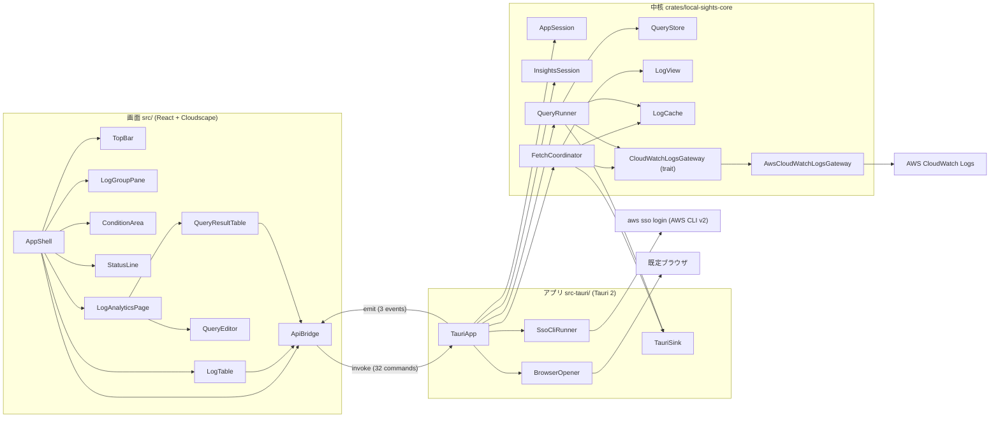
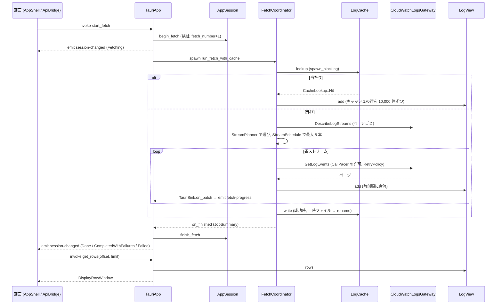
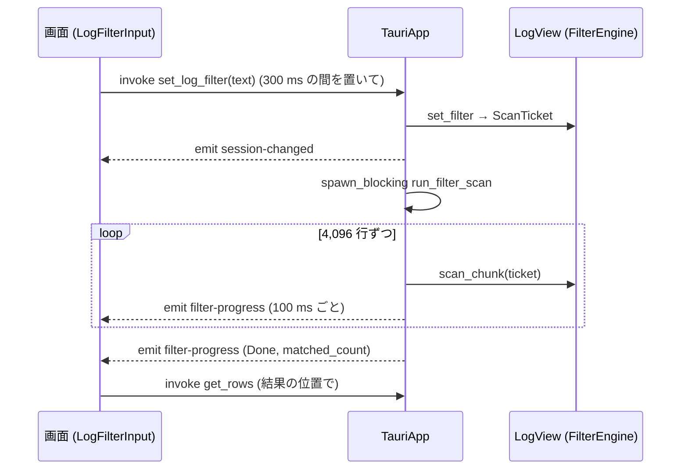
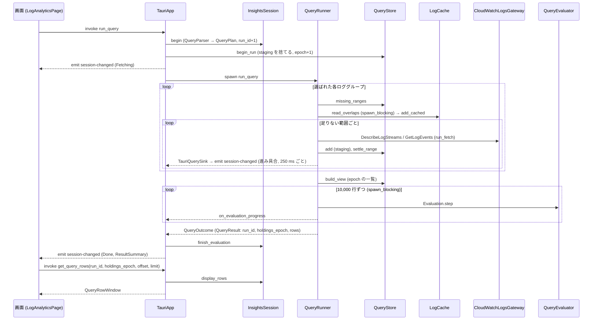
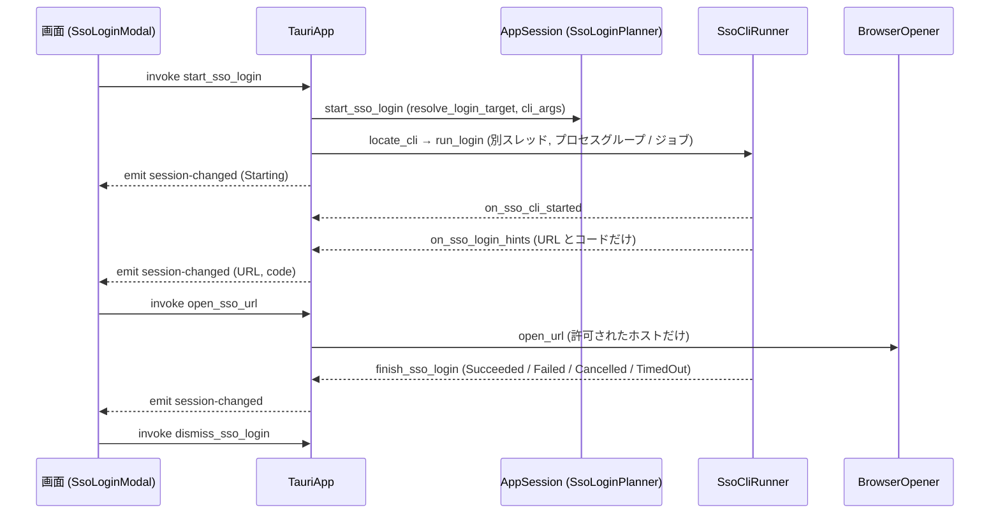

# 構成（Local Sights）

> 2026-10-20、コミット `3208713` の全面の読み直し。部品の名前は `component-inventory.md` の見出しと同じ。モジュールの配置は `code-structure.md`、公開 API は `api-documentation.md` にある。

## Architecture Analysis

### System Overview

1 つのデスクトップアプリで、3 つの層が 1 つのプロセスの中にある。

- **中核ライブラリ** `local-sights-core`（GUI に依存しない Rust）。取得・再試行・ペース調整・時刻順マージ・絞り込み・キャッシュ・クエリと、画面の状態機械（`AppSession`、`InsightsSession`）を持つ。AWS への呼び出しは `CloudWatchLogsGateway` trait の裏にあり、本物は `AwsCloudWatchLogsGateway` だけ、テストは `FakeGateway`。
- **アプリ** `local-sights`（Tauri 2、`src-tauri/`）。中核を `Mutex` で包んだ `AppState` を持ち、32 個の Tauri コマンドで画面の操作を受け、3 つのイベント（`session-changed`・`fetch-progress`・`filter-progress`）で状態を画面に押す。OS に触る処理（AWS CLI の起動と停止、既定ブラウザ、ファイルの場所と権限）はここか、中核の `cfg(unix)` / `cfg(windows)` の境界に閉じ込める。
- **画面** `src/`（React 19 ＋ TypeScript、Cloudscape の部品）。状態は中核が送る `SessionView` を映すだけで、自分の状態は開いた行や入力欄の文字など画面だけの事柄に限る（`src/App.tsx:94-102`）。

外部は AWS（CloudWatch Logs の読み取り 3 操作）、AWS CLI v2（SSO ログイン）、OS の既定ブラウザ、利用者のファイル（`~/.aws/config` と `credentials` の読み、設定ファイルとキャッシュの読み書き）である。サーバー側の部品はない。

### Architectural Style

モノリシックなデスクトップアプリ（単一プロセス）。層は Cargo のクレートと npm のパッケージで物理的に分かれている（`Cargo.toml` のワークスペース、`src-tauri/Cargo.toml` の `local-sights-core` への path 依存、`package.json`）。中核とアプリの間は Rust の型、アプリと画面の間は Tauri の IPC（JSON、`serde(rename_all = "camelCase")`）で、画面側は `src/api.ts` にその型を写している。

設計の決め手は、中核の先頭に書かれた ADR-001「GUI と中核を分ける」（`src/App.tsx:99` の参照）と、AWS SDK・ファイルシステム・GUI 枠組みを trait の裏に置く決まり（`gateway/mod.rs:125`、`coordinator.rs:230-273` の `FetchSink` / `TimelineStore` / `HeldEvents`）である。

### Component Relationships



文での説明：画面の部品は `ApiBridge`（`src/api.ts`）だけを通してアプリと話す。`TauriApp`（`src-tauri/src/lib.rs`）はコマンドを受けて `AppSession` / `InsightsSession` の状態を変え、取得やクエリの実行は `tokio` のタスクとして `FetchCoordinator` / `QueryRunner` に渡す。進み具合は `TauriSink`（`FetchSink` / `QuerySink` の実装）が受けてイベントで画面に押す。AWS を呼ぶのは `CloudWatchLogsGateway` を実装する `AwsCloudWatchLogsGateway` だけで、SSO ログインとブラウザ起動はアプリ側の OS 境界が担う。

### Data Flow

1. **設定と接続**：起動時に `ConnectionCatalog` が `~/.aws/config` と `credentials` を読んでプロファイルとリージョンの候補を作る（`catalog/`）。選ばれた接続は `ConnectionState` に入り、`ConnectionTarget`（profile と region）としてゲートウェイに渡る。
2. **取得**：`FetchRequest` の検証 → `FetchCoordinator::run_fetch_with_cache` → キャッシュ検索（`LogCache::lookup`、blocking スレッド）→ 当たれば `serve_from_cache`、外れれば `DescribeLogStreams` で `StreamPlanner` が期間に関わるストリームを選び、`StreamSchedule` が最大 8 本を `FuturesUnordered` で読み（`EventFetcher::next_page` → `GetLogEvents`、`CallPacer` の許可、`RetryPolicy` の再試行）→ ページは `TimelineStore::add` で `LogView`（`EventTimeline` ＋ `FilterEngine`）へ。終わりに成功していればキャッシュへ書く（`DeferredFinishSink` が書き終わりまで finished を遅らせる）。
3. **表示**：画面は `get_rows(offset, limit)` で見えている行だけを取り（最大 1,000 行／要求）、`row_positions` で開いた行の位置を追う。時刻の文字は中核が選ばれたゾーンで作る。
4. **絞り込み**：`set_log_filter` で `FilterEngine::set_text` → `ScanTicket` を持つ blocking タスクが 4,096 行ずつ走査（`SCAN_CHUNK_ROWS`）→ 100 ms ごとに `filter-progress`。取得中に届くページは `on_added` で判定される。
5. **クエリ（Log Analytics）**：`QueryParser` → `QueryPlan`（`DateTextResolver` で日付の文字を解く）→ `QueryRunner::run_query`：`QueryStore::missing_ranges` で足りない範囲を求め、`LogCache::read_overlaps` でキャッシュの重なりを取り込み、範囲ごとに `run_fetch` で取り足し（`settle_range` で committed と staging に分ける）→ `QueryStore::build_view` で世代（`holdings_epoch`）の一覧を作り、`QueryEvaluator` が `EVALUATION_CHUNK`（10,000）行ずつ評価（途中で止められる）→ `QueryResult` を `InsightsSession` が持ち、画面は `get_query_rows` / `get_query_row_detail` で読む。
6. **SSO ログイン**：`SsoLoginPlanner` がプロファイルから SSO の設定を解き（`source_profile` を最大 5 段）、`SsoCliRunner` が CLI を起動して出力から URL とコードだけを抜き、`BrowserOpener` が許可されたホスト（`.amazonaws.com`、`.awsapps.com`）の URL だけを開く。

### Key Design Decisions

- **読み取り 3 操作だけ**：`gateway/mod.rs` の trait がその 3 操作しか持たず、`@log` の値をコンソールの「アカウント ID:名前」にしない理由にもなっている（`query/fields.rs:5-8`）。
- **AWS・ファイル・GUI は境界の裏**：`CloudWatchLogsGateway`、`FetchSink` / `QuerySink` / `ListingSink`、`TimelineStore` / `HeldEvents`、`JitterSource`、`SessionClock`。テストはすべて偽物（`FakeGateway`、`RecordingSink`、`FixedJitter`、止まった時計）で、AWS にも実時間にも依存しない。
- **判断は OS に依存しない関数へ**：`sso_cli/mod.rs` が決め事と出力の処理を持ち、`unix.rs` / `windows.rs` は `spawn_cli` / `ProcessGroup` / `is_executable_file` の 3 つだけを提供する。`cache/mod.rs` のパーミッション（0700/0600）も `cfg(unix)` の中。
- **状態は中核が持ち、画面は映す**：`SessionView` を毎回丸ごと送り、画面は部分更新（`fetch-progress` など）を合成する（`src/api.ts` の `withProgress` / `withFilter`）。古い応答が新しい状態を上書きしないよう、結果を返さないコマンドが多い（`src/App.tsx:236-243`）。
- **止める理由は 2 つ**：`StopReason::Cancel` と `Close`、閉じるが常に強い（`retry.rs:204`）。
- **鍵の順序**：`session → LogView / QueryStore → handle` の順に取る（`src-tauri/src/lib.rs` の `lock` と各コマンド）。`PoisonError::into_inner` で毒された鍵も使う。
- **行は要求されたぶんだけ**：`MAX_ROWS_PER_REQUEST = 1_000`、開いた行は `MAX_EXPANDED_ROWS = 10_000`、位置の問い合わせは `MAX_POSITION_KEYS = 10_002`。
- **コマンドの登録は 3 か所で一致**：`generate_handler!`（lib.rs）、`build.rs` のマニフェスト、`capabilities/default.json`。Rust のテスト（`lib.rs:2238-2253`）と画面のテスト（`src/commandRegistration.test.ts`）の両方で守る。

### Improvement Opportunities

- `AppSession`（`session.rs`、6,147 行）と `TauriApp`（`lib.rs`、2,701 行）が大きい。SSO、設定、クエリの転送（`on_query_*` 群）は別モジュールに切れる。
- `QueryStore` の保持は接続を変えるまで増え続け、`read_overlaps` はファイルを丸ごと読む（本作業の対象。`code-quality-assessment.md`）。
- リージョンはコードの一覧だけで、名前の表がない（本作業の対象）。
- `holdings_epoch` は結果の行がもう依存しない値を 3 層で運んでいる（本作業の対象）。
- `cfg(windows)` のコードはカバレッジの外。Windows の手元の確認が今回も飛ぶため、CI の `Tauri app (windows-latest)` だけが守りになる。

## Interaction Diagrams

### 取得（Fetch）



文での説明：`start_fetch` は結果を返さず、状態の変化はすべて `session-changed` で届く。コーディネータはキャッシュ検索を blocking スレッドで行い、外れたときだけ AWS を呼ぶ。ページは届いた順に `LogView` に積まれ、時刻順の合流は `EventTimeline` が行う。取得が成功したときだけキャッシュに書き、書き終わるまで `on_finished` を遅らせる（`DeferredFinishSink`）。

### 絞り込み（Filter）



文での説明：画面は入力が 300 ms 止まってから送る。中核は新しい `ScanTicket` を切り、古い走査は次の塊で自分が古いと知って止まる。取得中に届くページは `on_added` でその場で判定され、走査と二重に数えない。

### クエリ（Log Analytics）



文での説明：クエリの読みはコマンドの中で先に行い、問題があれば取得を始めない。保持は実行のたびに staging だけを捨て、committed は残して足りない範囲だけを取り足す。評価は世代（`holdings_epoch`）を固定した一覧の上で塊ごとに進み、新しい実行・中断・接続の変更で止まる。結果の行は `run_id` で引き、`holdings_epoch` は画面がそのまま送り返すだけである。

### SSO ログイン



文での説明：CLI はシェルを介さず固定の候補パスから起動し、出力は 1 行ずつ `extract_login_hints` に渡して捨てる。5 分で時間切れ、［中断］と終了でプロセスグループ（Unix は SIGTERM → SIGKILL、Windows はジョブの終了）を止める。URL はホストの許可一覧に合うものだけ開く。

### 中断（Cancel）と閉じる（Close）

```mermaid
flowchart TD
  A[cancel_fetch / cancel_query] --> B{取得中か}
  B -- いいえ --> Z[何もしない]
  B -- はい --> C[StopHandle.stop(Cancel)]
  C --> D[CallPacer の許可待ち・再試行の待ち・応答待ちを打ち切る]
  D --> E{ストリームの列挙は終わっていたか}
  E -- いいえ --> F[Cancelled before listing: 保存しない]
  E -- はい --> G[読み終えていないストリームを N と数える]
  G --> H{N = 0 か}
  H -- はい --> I[Completed として扱い, 保存する]
  H -- いいえ --> J[Cancelled: CancelNotice に N を出す]
  K[窓を閉じる] --> L{取得中か}
  L -- はい --> M[CloseConfirmDialog]
  M -- 閉じる --> N[StopHandle.stop(Close): Cancel より強い]
  N --> O[Aborted: ログを捨てて終了]
```

文での説明：中断は `StopSignal` を通じて待ちと呼び出しを即座に打ち切り、新しい呼び出しを始めない。列挙前の中断と、全部読み終えた後の中断は別の終わり方になる（`coordinator.rs:82` の `decide_job_status`）。閉じるは常に中断より強く、確認ダイアログの承諾で `Close` を送り、ログを捨てて終了する。キャッシュ検索中の中断はこの境目にあり、当たれば Completed、外れれば列挙前の中断になる（`tests/u5_cancel.rs:518` のテストが確かめる）。
