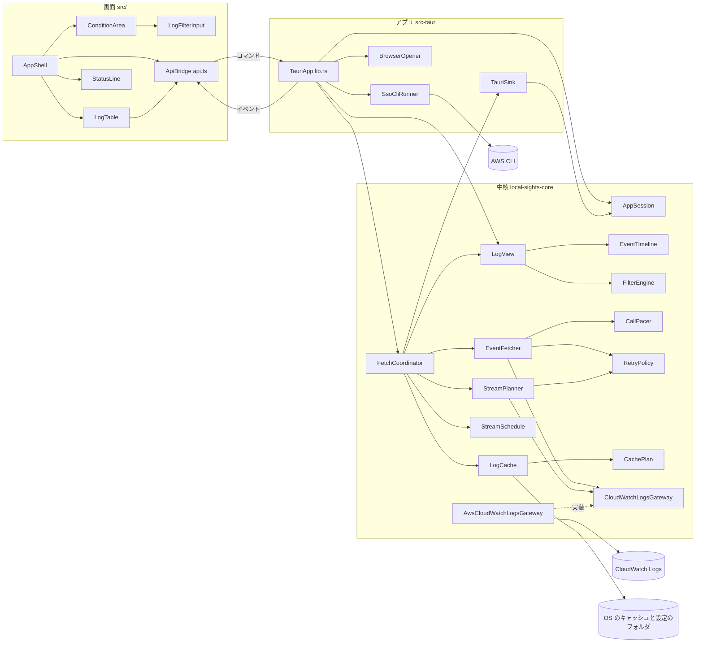
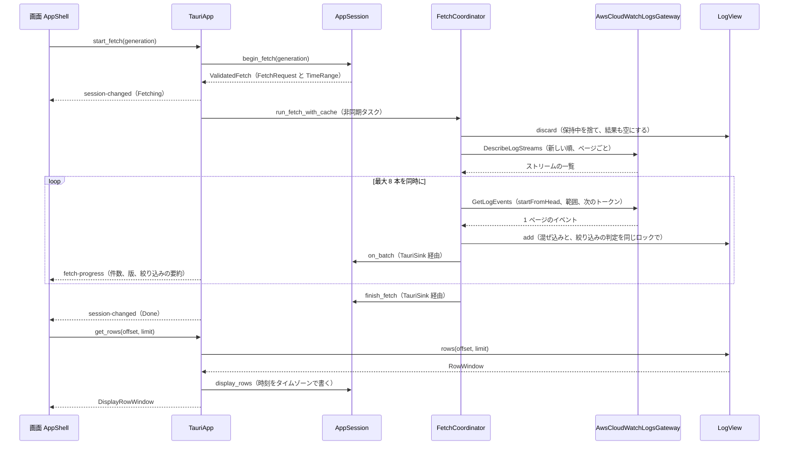
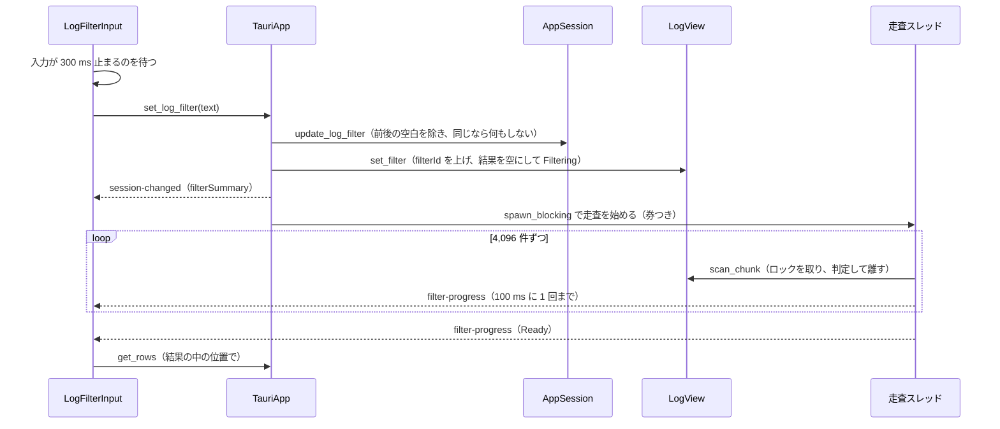
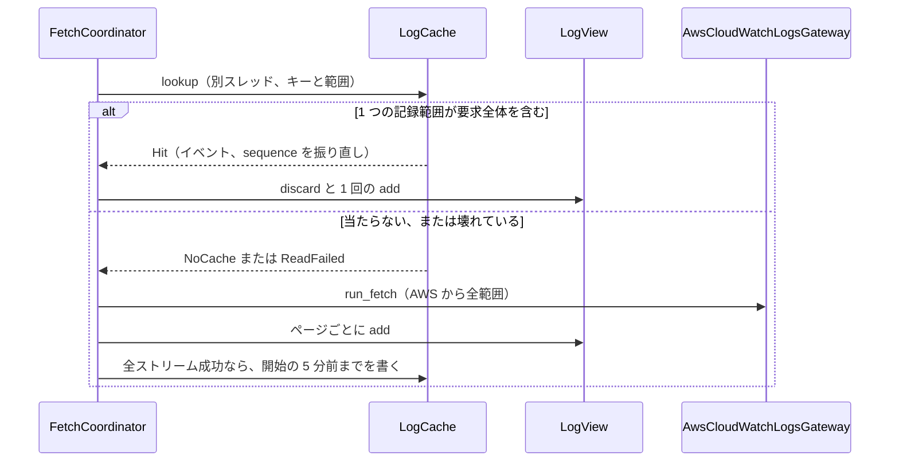

# 構成（Local Sights）

走査したコミット：`2760b13b8bc5b6daba36a6c283b3958c974a5a2d`（2026-10-17）。部品の名前は [component-inventory.md](component-inventory.md) の見出しと同じ綴りで使う。図は `flowchart` と `sequenceDiagram` だけを使い、目で構文を確かめた。どの図にも下に文章の説明を付けた。

## Architecture Analysis

### System Overview

1 台の PC で動くデスクトップアプリで、サーバーは無い。3 つの層に分かれる。

1. **中核ライブラリ** `crates/local-sights-core`（Rust）：取得の流れ、時刻順の保持、絞り込み、キャッシュ、画面の状態（`AppSession`）など、判断のすべて。GUI に依存しない（ADR-001）。AWS には `CloudWatchLogsGateway` trait を通してだけ触れる。
2. **アプリ** `src-tauri`（Rust、Tauri 2）：Tauri のコマンドとイベントの配線、共有状態（`AppState`）、非同期のタスクと別スレッドの起動、OS ごとの処理（AWS CLI の起動と停止、ブラウザ）。判断は持たない。
3. **画面** `src/`（React 19 + TypeScript + Cloudscape）：中核が押し出す `SessionView` を映し、操作をコマンドで送るだけ。ログのイベントは持たず、見えている行だけを `get_rows` で読む。

外の世界は AWS（CloudWatch Logs の読み取り 3 操作）、AWS の設定ファイル（読むだけ）、OS の設定・キャッシュフォルダ、AWS CLI（SSO ログインのときだけ）である。

### Architectural Style

単一プロセスのデスクトップアプリで、内部は「中核（純粋な判断と流れ）／境界（AWS・ファイル・プロセス）／薄い配線／表示だけの画面」に分けた層構造である。根拠：

- 中核の `lib.rs` の説明（GUI に依存しない、AWS は gateway の trait だけ）。
- `src-tauri/src/lib.rs` の説明（"This crate stays thin: every decision lives in `local-sights-core`"）。
- 画面の `App.tsx`（"It holds no state of its own beyond mirroring the session view the core pushes"）。
- 状態を変えるコマンドは何も返さず、結果は `session-changed` イベントで届く（遅れた応答が新しい状態を上書きしない）。

### Component Relationships

文章での説明：画面の `AppShell` は条件欄 `ConditionArea`（その中に絞り込みの欄 `LogFilterInput`）、一覧 `LogTable`、状態行 `StatusLine` を並べ、すべての呼び出しを `ApiBridge`（`api.ts`）経由で Tauri のコマンドとして `TauriApp` に送る。`TauriApp` は `AppSession`（画面の状態）と `LogView`（保持中のイベント `EventTimeline` と絞り込み `FilterEngine` を 1 つのロックに入れたもの）を持ち、取得は `FetchCoordinator` に任せる。`FetchCoordinator` は `StreamPlanner` でストリームを選び、`StreamSchedule` の順で最大 8 本を `EventFetcher` で読み、各ページを `LogView` に足し、進み具合を `TauriSink` 経由で `AppSession` に伝える。AWS には `CloudWatchLogsGateway` の実装 `AwsCloudWatchLogsGateway` だけが触れる。キャッシュ `LogCache` は判断を `CachePlan` に任せ、OS のキャッシュフォルダに書く。SSO ログインのときだけ `SsoCliRunner` が AWS CLI を起動し、`BrowserOpener` が既定のブラウザを開く。

### Data Flow

- **取得条件**：画面の開始・終了の入力（`update_input`）は `AppSession` の `DateTimeInput` に入り、選んだタイムゾーンで読んで `TimeRange`（開始は秒の 0 ms、終了は 999 ms まで、`time_range.rs`）になる。接続（プロファイル・リージョン）とロググループ（1 つ）は `AppSession` が持つ。`start_fetch` で `begin_fetch` が `ValidatedFetch { request: FetchRequest, range: TimeRange }` を返す（`request.rs`）。
- **取得**：`run_fetch_with_cache` → キャッシュが有効なら照会（当たれば AWS を呼ばない）→ 外れれば `run_fetch`：最初に `LogView` を捨てる（`discard`）→ `DescribeLogStreams` を最終イベントの新しい順に読み、範囲に関わるストリームを選ぶ → 最大 8 本を同時に `GetLogEvents`（`startFromHead`、`startTime`〜`endTime`）でページの終わりまで読む → 各ページに `sequence` を振って `LogEvent` にし、`TimelineStore::add` で `LogView` に足す。
- **保持**：`EventTimeline` はページを並べ替えて入る位置から混ぜ込み、`(timestamp, logStreamName, sequence)` 順の `Vec<LogEvent>` を保つ。ストリームごとの `sequence → timestamp` の索引で位置を二分探索する。足すたび・捨てるたびに版（`timelineVersion`）が上がる。
- **絞り込み**：`set_log_filter` で文字列を渡すと `FilterEngine` の条件が変わり、別スレッドの走査が 4,096 件ずつロックを取って判定する。取得中に届いたページは、同じロックの中で走査位置までだけ判定する。結果は一致したイベントの並びキーの整列済み配列。進み具合は `filter-progress`（100 ms に 1 回まで、終わりは必ず）。
- **表示**：画面は見えている範囲の `offset`／`limit` で `get_rows` を呼ぶ（1 回 1,000 行まで）。絞り込み中は結果の中の位置で数え、キーからタイムラインの行を二分探索して返す。時刻の表示文字列は `AppSession::display_rows` が選んだタイムゾーンで作る。
- **キャッシュ**：全ストリームが成功した取得だけ、取得開始の 5 分前までの範囲を JSON Lines（先頭が見出し）で書く。ファイル名はキー（プロファイル, リージョン, ロググループ）の SHA-256。

### Key Design Decisions

| 決定 | 中身 | 影響（IB-11 から見て） |
|------|------|------------------------|
| 判断は中核に置く（ADR-001） | 画面は状態を持たず、Tauri は配線だけ | クエリの解釈と評価も中核に置けば、今のテスト（中核の行カバレッジ 80%）の網に入る |
| 画面はイベントを持たない | 見えている行だけを `get_rows` で読む | 結果の件数が多くても画面の負担は変わらない。`fields` で列が変わると `RowWindow`／`DisplayRow` の形を広げる必要がある |
| 時刻順のタイムライン 1 本 | 並びキー `(timestamp, logStreamName, sequence)`、ページは混ぜ込み | `sort` で別の順を出すには、結果側に別の並びを持つ必要がある。ロググループを複数にするとキーにグループが要る |
| 絞り込みは LogView の 1 ロックの中 | 追加と判定、破棄と結果の空化が同時に起きる（U5 R-02） | クエリの評価も同じ継ぎ目（`on_added`／`scan_chunk`／`rows`）に入れられる |
| 走査は 4,096 件ずつ、券で古い作業を捨てる | 画面の行の読み出しは長く待たない | 重い評価（JSON の取り出し）でも同じ刻みで回せる |
| 取得は毎回まるごと取り直す | `run_fetch` の最初に破棄 | 「足りない分だけ取り足す」は新しい流れになる |
| 呼んでよい API は 3 つだけ | gateway の trait に 3 操作だけ | Logs Insights の API は使えない。クエリはすべて手元で評価する |
| OS ごとの処理は `cfg` の境界に閉じ込める | `sso_cli/unix.rs`・`windows.rs`、`browser.rs`、`cache/mod.rs` の権限 | クエリの層は OS に依存しない純粋な処理にできる |

### Improvement Opportunities

- `AppSession`（`session.rs` 5,428 行）は接続・取得・絞り込み・キャッシュ設定・閉じる確認・SSO・経過時間・取り消しを 1 つの型に持つ。クエリの状態を足すなら、別の型に分けて `AppSession` からは持つだけにすると見通しが保てる。
- `FilterCondition::matches` は判定のたびに `to_lowercase()` で文字列を作る。大きな件数では確保の費用が効く。
- 保持中のイベントは範囲を記録していないため、「どこまで取ったか」はキャッシュの `CoveredRange` にしか無い。取り足しにはタイムライン側にも取得済み範囲の記録が要る。
- `README.md` の「streams are read one after another」は今の同時取得と食い違う。

## Interaction Diagrams

### 取得 → タイムライン → 絞り込み → 表示

文章での説明：画面が `start_fetch` を送ると、`AppSession` が条件を確かめて `ValidatedFetch` を返し、状態が Fetching になる。`FetchCoordinator` はまず `LogView` を捨て、ストリームを選び、最大 8 本を同時に `GetLogEvents` で読む。ページが届くたびに `LogView` に足し（同じロックの中で絞り込みの判定もする）、`TauriSink` が `AppSession` を更新して軽い `fetch-progress` を送る。終わると `session-changed` で Done が届く。画面は版が変わるたびに、見えている範囲だけを `get_rows` で読み、時刻は中核が書いた文字列をそのまま出す。

### 絞り込みの文字列を変える

文章での説明：絞り込みの欄は入力が 300 ms 止まると（Enter なら直ちに）`set_log_filter` を送る。`AppSession` が空白を除いて前と同じか比べ、変わっていれば `LogView` の `FilterEngine` が新しい条件と空の結果で Filtering になる。別スレッドが券を持って 4,096 件ずつ判定し、途中経過を `filter-progress` で知らせる。文字列が変わるか取得し直しでタイムラインが捨てられると券が古くなり、走査は止まる。画面は結果の版が変わるたびに行を読み直す。

### キャッシュに当たる取得

文章での説明：キャッシュが有効なときは、まず別スレッドで照会する。1 つの記録範囲が要求範囲全体を含めば、AWS を呼ばずに保持中を捨てて全件を 1 回で足す。そうでなければ AWS から全範囲を取り直し、全ストリームが成功したときだけ、取得開始の 5 分前までの範囲を書き込む（既存の記録範囲とつなぐ）。部分的に当たった分だけを使い、残りを取り足すことはしない。
