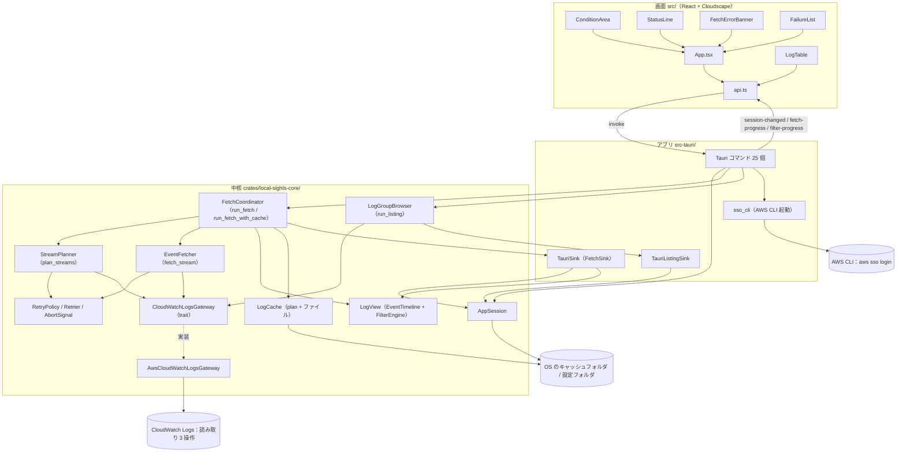
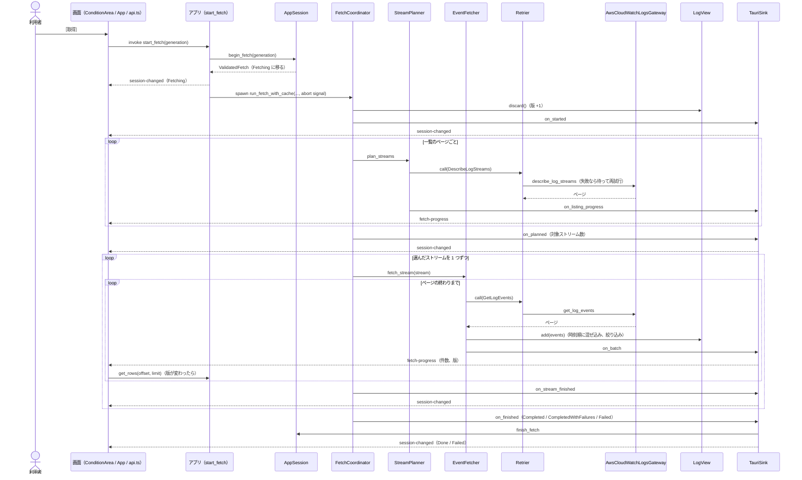
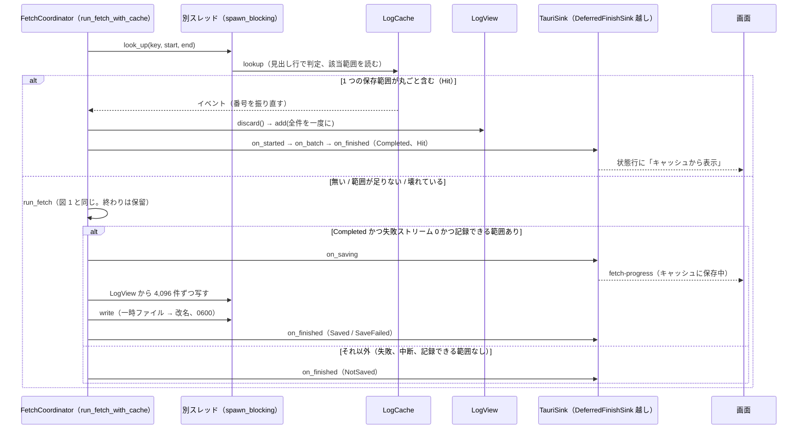
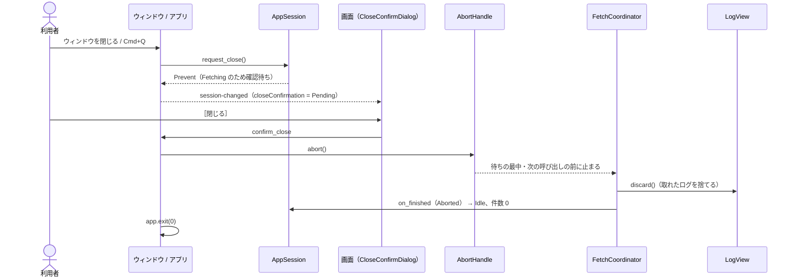
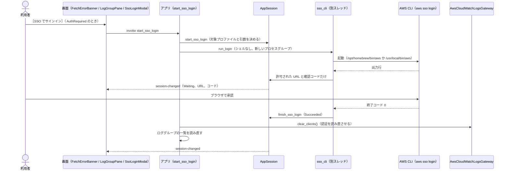

# アーキテクチャ（Local Sights）

走査したコミット：`9d08cbf5c6d97820f0ec7f276c3ce6020c903eb5`（2026-10-12）。部品の一覧は [component-inventory.md](component-inventory.md)、公開の口は [api-documentation.md](api-documentation.md) を参照。

## Architecture Analysis

### System Overview

Local Sights は 1 台の Mac の中だけで動くデスクトップアプリで、3 つの層からなる。

1. **画面（`src/`）**：React 19 と Cloudscape の部品で描く。自分では状態を持たず、中核が作った `SessionView` をそのまま表示し、利用者の操作を Tauri のコマンドとして送る（ADR-001）。ログの行も持たず、見えている範囲の行だけを `get_rows` で読む。
2. **アプリ（`src-tauri/`）**：Tauri 2 の薄いつなぎ。コマンドを受けて中核の `AppSession` を変え、結果はイベント（`session-changed`、`fetch-progress`、`filter-progress`）で画面に送る。取得・一覧・絞り込み・設定のファイル作業・AWS CLI の起動を非同期タスクや別スレッドで動かす。
3. **中核（`crates/local-sights-core/`）**：GUI に依存しないライブラリ。判断はすべてここにあり、AWS には `CloudWatchLogsGateway` trait を通してだけ届く。

AWS 側は CloudWatch Logs の読み取り 3 操作だけを使う。サーバーや自前のバックエンドは無い。

### Architectural Style

**単一プロセスのデスクトップアプリ（モノリス）で、中核は「ポートとアダプター」に近い形**である。根拠：

- 中核は GUI フレームワークに依存しない（`lib.rs` の説明、`Cargo.toml` に tauri が無い）。
- 外部への出口は trait で切られている：AWS は `CloudWatchLogsGateway`、取得の進み具合は `FetchSink`、保持先は `TimelineStore`／`HeldEvents`、一覧の受け口は `ListingSink`、ローカル時刻は `TimeZoneContext`、再試行の揺らぎは `JitterSource`。アプリ側がそれぞれの実装（`AwsCloudWatchLogsGateway`、`TauriSink`、`Mutex<LogView>` など）を差し込む。
- 判断は純粋関数に寄せ、流れを持つ部分（`run_fetch`、`plan_streams`、`fetch_stream`、`run_listing`）と分けている（`paging::decide`、`streams::is_selected`、`RetryPolicy::decide`、`decide_job_status`、`cache::plan::decide_write` など）。
- 状態は 1 つの `AppSession`（`Arc<Mutex<_>>`）に集め、画面は push されたスナップショットを映すだけ。

### Component Relationships

テキストでの説明（図の代わり）：

- 画面の `App.tsx` が各部品（条件欄 `ConditionArea`、状態行 `StatusLine`、エラー `FetchErrorBanner`、失敗一覧 `FailureList`、一覧 `LogTable`）をまとめ、`api.ts` を通して Tauri のコマンドを呼び、3 種類のイベントを受ける。
- アプリの各コマンドは中核の `AppSession` を変える。取得は `run_fetch_with_cache`（`FetchCoordinator`）を非同期タスクで動かし、進み具合は `TauriSink` が `AppSession` に写してイベントで送る。ロググループの一覧は `run_listing` を動かし `TauriListingSink` が受ける。SSO ログインは `sso_cli` が AWS CLI を起動する。
- `FetchCoordinator` は `StreamPlanner`（`DescribeLogStreams`）でストリームを選び、`EventFetcher`（`GetLogEvents`）で各ストリームを読む。どちらも `Retrier` を通して呼び、`CloudWatchLogsGateway` に届く。本番の実装は `AwsCloudWatchLogsGateway` で、AWS SDK を使う。
- 取れたイベントは `LogView`（`EventTimeline` と `FilterEngine` を 1 つのロックに入れたもの）に入る。ディスクキャッシュ `LogCache` は OS のキャッシュフォルダに、設定ファイルは OS の設定フォルダに置く。

### Data Flow

1. 利用者が条件を入れる → `update_input` → `AppSession` が検証し、理由を `validation_errors` として返す（日時は中核がタイムゾーンを考えて読む）。
2. ［取得］ → `start_fetch(generation)` → `AppSession::begin_fetch` が `Fetching` に移り、前回の結果を消し、検証済みの条件（プロファイルとリージョンを含む）を返す。
3. アプリが中断の組（`abort_pair`）を作り、取得タスクを起動する。
4. `run_fetch_with_cache`：キャッシュが有効なら別スレッドで見に行き、1 つの保存範囲が取得範囲を丸ごと含めば、AWS を呼ばずにその内容を一度に `LogView` に入れて終わる。含まなければ `run_fetch` へ。
5. `run_fetch`：`LogView` を空にする（版が上がる）→ `plan_streams` が `DescribeLogStreams` を最終イベントの新しい順にページで読み、範囲に関わるストリームを選ぶ（範囲開始の 1 時間前より古いストリームが出たら打ち切り）→ 選んだストリームを 1 つずつ `fetch_stream` で `GetLogEvents` のページの終わりまで読む。各ページは届くたびに `LogView` に混ぜ込まれ（時刻・ストリーム名・順番の順）、絞り込みにもかけられる。
6. 進み具合（一覧のページ、ページの追加）は軽い `fetch-progress` で、段階の変化（開始、一覧の終わり、ストリームの終わり、取得の終わり）は `session-changed` で画面に届く。画面は版が変わるたびに見えている行を `get_rows` で読み直す。
7. 終わり：すべて成功し記録できる範囲があれば、`LogView` から別スレッドで少しずつ写してキャッシュファイルに書き（一時ファイル→改名）、その後で取得を終える。`AppSession::finish_fetch` が `Done` か `Failed` に移り、失敗ストリームと通知を保つ。

### Key Design Decisions

- **画面は状態を持たない（ADR-001）**：表示はすべて `SessionView` から。コマンドは結果を返さず、結果はイベントで届くので、遅れた応答が新しい状態を上書きしない。
- **行は中核が持つ**：画面は見えている行だけを読む。100 万件でも画面のメモリと描画が増えない（U3:BR4.3、NFR3）。
- **進み具合は軽いメッセージで**：ページごとに `SessionView` 全体を送らず `FetchProgressUpdate` を送る（U3 review R-05）。
- **ロックの順はセッション → LogView**：取得は 1 ページごとに `LogView` を短く取るだけで、両方を同時に持たない。
- **接続の世代**：接続に依存する操作は画面が最後に見た世代を添え、古い世代の操作は答えずに捨てる（U3:BR6.7）。
- **再試行は中核の決まり**：スロットリングと通信失敗だけを、固定の待ち（1・2・4・8・16 秒 ±20%）で最大 5 回。中断はどの待ちの間にも効く。
- **失敗の詳細は許可リスト**：SDK の元のメッセージは出さず、種類と許可された項目（API 名、要求 ID、プロファイル、ロググループ、ストリームなど）だけで作る。
- **キャッシュは「全部成功した取得だけ」「直近 5 分は除く」「1 つの保存範囲で丸ごと賄えるときだけ使う」**：中途半端なデータで誤った結果を見せないため。ファイルは所有者だけが読めるようにする。
- **AWS CLI に SSO を任せる**：アプリは SSO の API もトークンも触らない（project.md の例外の決まり）。

### Improvement Opportunities

今回の intent（並行取得、上限内の呼び出し、取り消し、経過時間）の観点で、構造上の手当てが要る箇所を挙げる（詳しい根拠と行番号は [code-quality-assessment.md](code-quality-assessment.md)）。

- **直列を前提にした受け口**：`FetchSink` は `&mut self`、`fetch_stream` のページ受け取りは `FnMut` で、`run_fetch` は閉包の中で受け口と件数を可変で借りている。並行に読むには、受け口と件数の集計を共有できる形（ロック、または 1 本の通知の通り道に集める形）に変える必要がある。
- **一覧が終わるまでストリームを読み始めない**：`plan_streams` が最後まで終わってから取得が始まる。一覧のページが多いロググループでは、一覧と取得を重ねる余地がある。
- **アカウント全体の呼び出し回数を抑える仕組みが無い**：今は直列なので自然に抑えられている。並行にすると、全タスクで共有する速さの上限（とスロットリング時に下げる仕組み）が要る。AWS SDK の既定の再試行が明示されずに重なっている見込みもあり、呼び出し回数の見積もりを狂わせる。
- **中断＝ログを捨てる**：今の中断はウィンドウを閉じるときのためのもので、取れたログを捨てて Idle に戻す。利用者の取り消しで「残す」には、新しい終わり方（あるいは Aborted の意味の変更）と、セッション・状態行・キャッシュの判定・終了確認の文言の見直しが要る。
- **時刻順の混ぜ込みの費用**：ページを入れる位置から後ろを作り直すので、ストリームを同時に読み時刻の古いページが後から届くほど、1 ページあたりの作業と `LogView` のロック時間が増える。
- **経過時間の源が無い**：進み具合に開始時刻が無く、画面はイベントが来たときだけ描き直す。
- **`AppSession` が大きい**：接続・取得・絞り込み・キャッシュ設定・終了確認・SSO を 1 つの型が持つ（`session.rs` 本体 約 2000 行）。取り消しの状態を足すとさらに増える。

## Interaction Diagrams

### 1. AWS から取得する（キャッシュ無効、またはキャッシュに無い）

テキストでの説明：［取得］で `start_fetch` が呼ばれ、セッションが `Fetching` になった状態がすぐ画面に届く。取得タスクは `LogView` を空にし、ストリームの一覧をページごとに読み（各ページで軽い進み具合を送る）、一覧が終わると対象数を知らせる。その後、選んだストリームを 1 つずつ、`GetLogEvents` のページの終わりまで読み、各ページを `LogView` に混ぜ込んで進み具合を送る。画面は版が変わるたびに見えている行を読み直す。ストリームが 1 つ終わるごとにセッション全体を送り、最後に状態を決めて `Done` か `Failed` にする。呼び出しはすべて `Retrier` を通り、スロットリングと通信失敗は待ってから同じ要求を送り直す。3 ストリーム続けて再試行を使い切ると、残りは呼ばずに失敗とする。

### 2. キャッシュの経路（有効なとき）

テキストでの説明：キャッシュが有効なら、取得範囲を丸ごと含む保存範囲があるかを別スレッドで調べる。あれば AWS を呼ばず、全件を一度に `LogView` に入れて `Completed` で終える。無ければ図 1 の取得を行い、その終わりをいったん保留する。すべてのストリームが成功し（`Completed`、失敗 0）、取得開始の 5 分前までに記録できる部分があれば、`LogView` から 4,096 件ずつ写して一時ファイルに書き、改名で置き換えてから取得を終える。キャッシュが読めなかったときは AWS から取り直し、その旨を状態行に出す。中断された取得や失敗を含む取得は書き込まない。

### 3. 中断（今はウィンドウを閉じるときだけ）

テキストでの説明：取得中にウィンドウを閉じようとすると確認が出る。［取得を続ける］なら何も変わらない。［閉じる］なら中断信号を送り、取得は待ちの最中か次の呼び出しの前に止まり、取れたログを捨てて `Aborted` で終わり、アプリが終了する。利用者が取得だけを止める操作は今は無い。

### 4. SSO ログイン（認証エラーから）

テキストでの説明：取得や一覧で認証エラーが出て、選んだプロファイル（または `source_profile` の先）に SSO の設定があるとき、［SSO でサインイン］が出る。押すとアプリが AWS CLI の `aws sso login` を起動し、出力から許可された `https://` の URL と確認コードだけを取り出して画面に出す。利用者がブラウザで承認して CLI が成功すると、SDK のクライアントを捨てて認証を読み直させ、ロググループの一覧を読み直す。取り消し、5 分の時間切れ、アプリの終了では CLI のプロセスグループ全体を止める。
