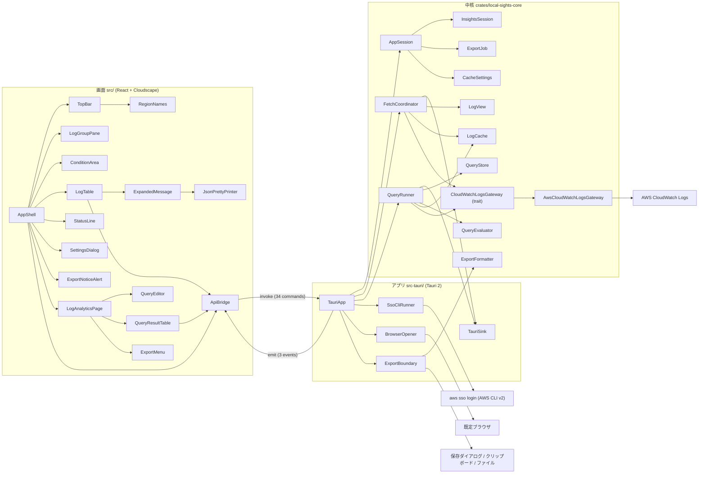
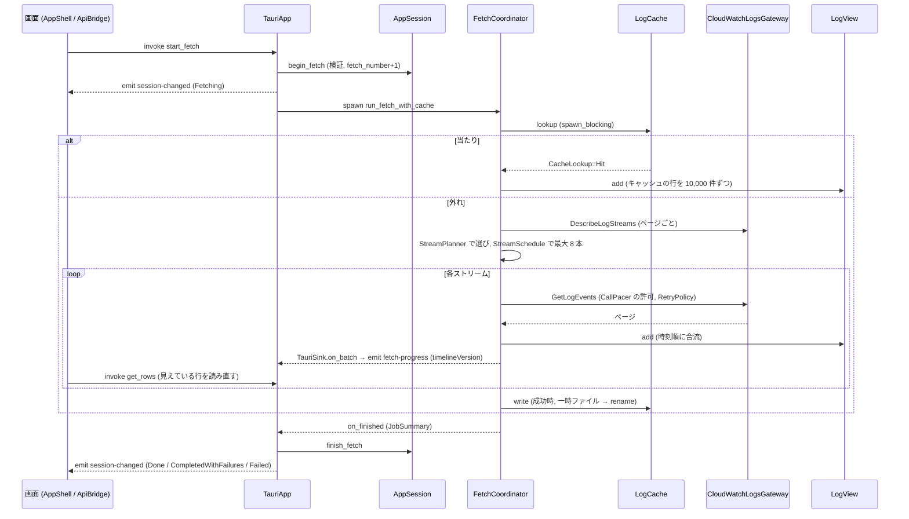
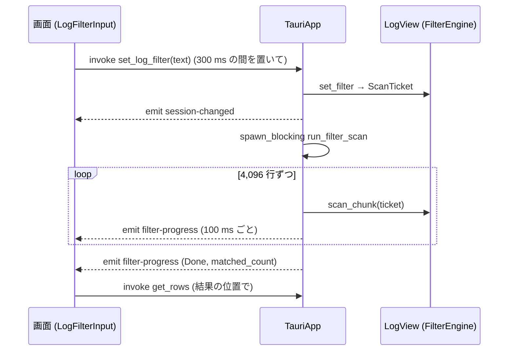
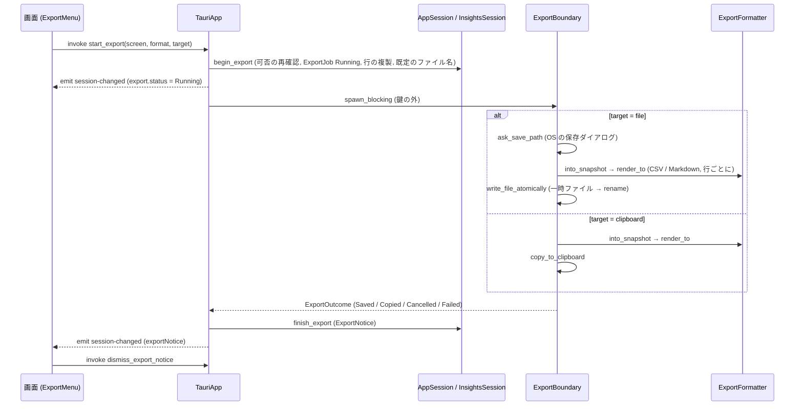
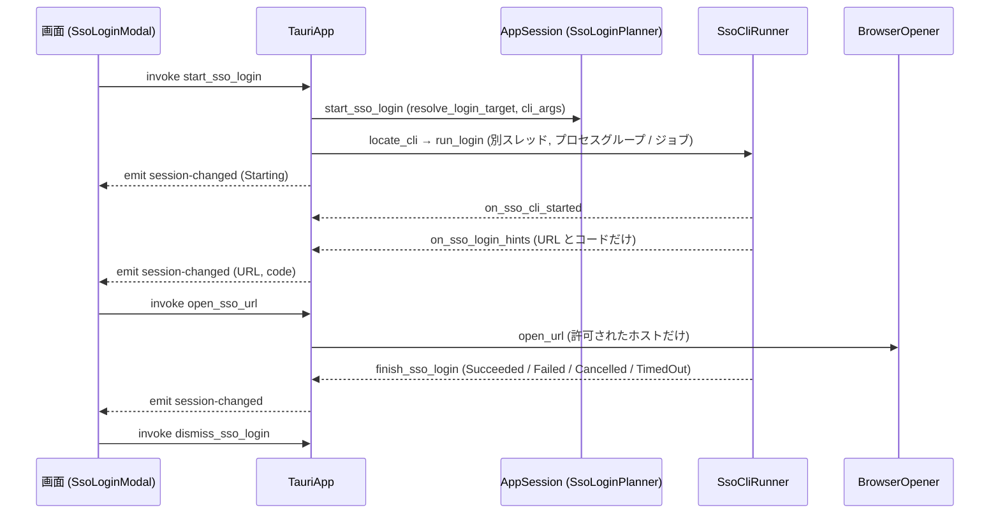
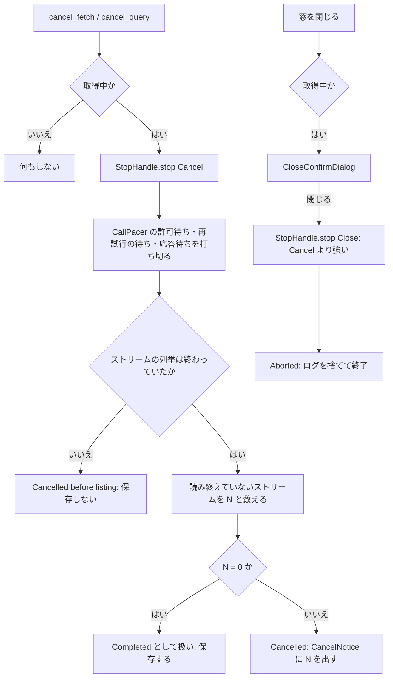

# 構成（Local Sights）

> 2026-10-20、コミット `3208713` の全面の読み直しを土台に、2026-10-25、コミット `793da17` の焦点を絞った読み直し（261025-insights-stats）で更新。部品の名前は `component-inventory.md` の見出しと同じ。モジュールの配置は `code-structure.md`、公開 API は `api-documentation.md` にある。

## Architecture Analysis

### System Overview

1 つのデスクトップアプリで、3 つの層が 1 つのプロセスの中にある。

- **中核ライブラリ** `local-sights-core`（GUI に依存しない Rust）。取得・再試行・ペース調整・時刻順マージ・絞り込み・キャッシュ・クエリ・書き出しの文字づくりと、画面の状態機械（`AppSession`、`InsightsSession`）を持つ。AWS への呼び出しは `CloudWatchLogsGateway` trait の裏にあり、本物は `AwsCloudWatchLogsGateway` だけ、テストは `FakeGateway`。
- **アプリ** `local-sights`（Tauri 2、`src-tauri/`）。中核を `Mutex` で包んだ `AppState` を持ち、34 個の Tauri コマンドで画面の操作を受け、3 つのイベント（`session-changed`・`fetch-progress`・`filter-progress`）で状態を画面に押す。OS に触る処理（AWS CLI の起動と停止、既定ブラウザ、ファイルの場所と権限、保存ダイアログとクリップボード）はここか、中核の `cfg(unix)` / `cfg(windows)` の境界に閉じ込める。
- **画面** `src/`（React 19 ＋ TypeScript、Cloudscape の部品）。状態は中核が送る `SessionView` を映すだけで、自分の状態は開いた行や入力欄の文字、整形／原文の切替など画面だけの事柄に限る。言語も `SessionView.language` と OS の言語から画面が決める。

外部は AWS（CloudWatch Logs の読み取り 3 操作）、AWS CLI v2（SSO ログイン）、OS の既定ブラウザ、OS の保存ダイアログとクリップボード（書き出し）、利用者のファイル（`~/.aws/config` と `credentials` の読み、設定ファイル・キャッシュ・書き出しのファイルの読み書き）である。サーバー側の部品はない。

### Architectural Style

モノリシックなデスクトップアプリ（単一プロセス）。層は Cargo のクレートと npm のパッケージで物理的に分かれている（`Cargo.toml` のワークスペース、`src-tauri/Cargo.toml` の `local-sights-core` への path 依存、`package.json`）。中核とアプリの間は Rust の型、アプリと画面の間は Tauri の IPC（JSON、`serde(rename_all = "camelCase")`）で、画面側は `src/api.ts` にその型を写している。

設計の決め手は、中核の先頭に書かれた ADR-001「GUI と中核を分ける」（`crates/local-sights-core/src/lib.rs:1-8`）と、AWS SDK・ファイルシステム・GUI 枠組みを trait の裏に置く決まり（`gateway/mod.rs`、`coordinator.rs` の `FetchSink` / `TimelineStore` / `HeldEvents`）である。書き出しでも、ダイアログとクリップボードはアプリ側のプラグイン呼び出し（`export_boundary.rs`）に置き、中核には純粋な書き手（`export::formatter`）と仕事の状態（`export::exporter`）だけを置いた（`export/mod.rs`）。

### Component Relationships



文での説明：画面の部品は `ApiBridge`（`src/api.ts`）だけを通してアプリと話す。`TauriApp`（`src-tauri/src/lib.rs`）はコマンドを受けて `AppSession` / `InsightsSession` の状態を変え、取得やクエリの実行は `tokio` のタスクとして `FetchCoordinator` / `QueryRunner` に渡す。進み具合は `TauriSink`（`FetchSink` / `QuerySink` の実装）が受けてイベントで画面に押す。書き出しは `AppSession` が仕事（`ExportJob`）の状態と行の複製を持ち、`ExportBoundary` が鍵の外でダイアログ・ファイル・クリップボードを扱う。AWS を呼ぶのは `CloudWatchLogsGateway` を実装する `AwsCloudWatchLogsGateway` だけで、SSO ログインとブラウザ起動はアプリ側の OS 境界が担う。

### Data Flow

1. **設定と接続**：起動時に `ConnectionCatalog` が `~/.aws/config` と `credentials` を読んでプロファイルとリージョンの候補を作る（`catalog/`）。同時に `CacheSettings` が `settings.json` からキャッシュの有無と言語の設定（`LanguagePreference`）を読み、`SessionView.language` として画面に渡る。選ばれた接続は `ConnectionState` に入り、`ConnectionTarget`（profile と region）としてゲートウェイに渡る。
2. **取得**：`FetchRequest` の検証 → `FetchCoordinator::run_fetch_with_cache` → キャッシュ検索（`LogCache::lookup`、blocking スレッド）→ 当たれば `serve_from_cache`、外れれば `DescribeLogStreams` で `StreamPlanner` が期間に関わるストリームを選び、`StreamSchedule` が最大 8 本を `FuturesUnordered` で読み（`EventFetcher::next_page` → `GetLogEvents`、`CallPacer` の許可、`RetryPolicy` の再試行）→ ページは `TimelineStore::add` で `LogView`（`EventTimeline` ＋ `FilterEngine`）へ。ページが届くたびに `FetchSink::on_batch(BatchProgress)` → `fetch-progress` イベントで画面が `timelineVersion` を見て行を読み直すので、**取得の途中でも表の行が増える**。終わりに成功していればキャッシュへ書く。
3. **表示**：画面は `get_rows(offset, limit)` で見えている行だけを取り（最大 1,000 行／要求）、`row_positions` で開いた行の位置を追う。時刻の文字は中核が選ばれたゾーンで作る。開いた行は画面側の `JsonPrettyPrinter` が最初の完全な JSON を整形し、「整形／原文」で切り替える。
4. **絞り込み**：`set_log_filter` で `FilterEngine::set_text` → `ScanTicket` を持つ blocking タスクが 4,096 行ずつ走査 → 100 ms ごとに `filter-progress`。取得中に届くページは `on_added` で判定される。
5. **クエリ（Log Analytics）**：`QueryParser::parse_query` → `QueryPlan`（`DateTextResolver::resolve_date_texts` で日付の文字を解く。`stats` などの非対応の命令と `toMillis` 以外の関数はここで `QueryProblem`（Unsupported）になり、何も取得しない）→ `QueryRunner::run_query`：`QueryStore::begin_run`（staging と選ばれなくなったロググループの保持を捨て、世代を進める）→ `missing_ranges` で足りない範囲を求め、`LogCache::read_overlaps` でキャッシュの重なりを取り込み、ロググループを順に、範囲を順に `run_fetch_with_cache` で取り足し（範囲ごとの holder に積み、終わったら `settle_range` で committed と staging に分ける）→ `on_fetch_ended` → `build_view` で世代を固定した一覧を作り → `QueryEvaluator` が `EVALUATION_CHUNK`（10,000）行ずつ blocking スレッドで評価（途中で止められる）→ `copy_rows` で結果の行（1 行 = 1 イベントの写し `ResultRow`）を複製 → `QueryResult` を `InsightsSession` が持ち、画面は `get_query_rows(runId, …)` / `get_query_row_detail` で読む。**評価は取得がすべて終わってから 1 回だけ走り、結果は終わりに 1 回で差し替わる**。実行中は前回の結果を「前回の結果」の印つきで残す。
6. **書き出し**：画面の［Export］→ `start_export(screen, format, target)`：鍵の中で `AppSession::begin_export`（可否の再確認、`ExportJob` を Running に、行の複製 `ExportSnapshotSource`、既定のファイル名）→ `session-changed` → 鍵の外の blocking スレッドで `ExportBoundary::ask_save_path`（ファイルのとき）→ `into_snapshot` と `render_to`（`ExportFormatter`）→ `write_file_atomically` かクリップボード → 鍵の中で `finish_export` → `session-changed`（通知 `ExportNotice`）。
7. **SSO ログイン**：`SsoLoginPlanner` がプロファイルから SSO の設定を解き、`SsoCliRunner` が CLI を起動して出力から URL とコードだけを抜き、`BrowserOpener` が許可されたホストの URL だけを開く。
8. **言語**：設定ダイアログの［Save］→ `save_settings(cacheEnabled, language)` → blocking スレッドで `settings.json` を書く → 成功したときだけ `AppSession.language` が変わり `session-changed` → 画面の `App` が `resolveLocale` で `locale` を決め直し、翻訳・Cloudscape の文言・`lang` 属性を一度に切り替える（再起動も再マウントもしない）。

### Key Design Decisions

- **読み取り 3 操作だけ**：`gateway/mod.rs` の trait がその 3 操作しか持たず、`@log` の値をコンソールの「アカウント ID:名前」にしない理由にもなっている（`query/fields.rs:5-8`）。
- **AWS・ファイル・GUI・OS は境界の裏**：`CloudWatchLogsGateway`、`FetchSink` / `QuerySink` / `ListingSink`、`TimelineStore` / `HeldEvents`、`JitterSource`、`SessionClock`、書き出しのプラグイン呼び出し（`export_boundary.rs`）。テストはすべて偽物で、AWS にも実時間にも依存しない。
- **判断は OS に依存しない関数へ**：`sso_cli/mod.rs` が決め事と出力の処理を持ち、`unix.rs` / `windows.rs` は 3 つの関数だけ。書き出しの OS の違いはプラグインに任せて `cfg` を増やさない。
- **鍵の中は短く**：書き出しは「可否・開始・複製」だけを鍵の中で行い、文字づくりと OS の呼び出しは鍵の外（`export/mod.rs:11-17`）。クエリの評価も鍵は 1 塊ずつ。
- **状態は中核が持ち、画面は映す**：`SessionView` を毎回丸ごと送り、画面は部分更新（`fetch-progress` など）を合成する。結果を返さないコマンドが多い。言語の決定だけは画面側（`system` のとき OS の言語が要るため）。
- **結果の行は複製**：クエリの結果は `run_id` だけで引き、保持がその後どう変わっても読める（`QueryResult` の `rows: Vec<ResultRow>`、`5ced3bf` で `holdings_epoch` を廃止）。
- **止める理由は 2 つ**：`StopReason::Cancel` と `Close`、閉じるが常に強い。
- **鍵の順序**：`session → LogView / QueryStore → handle` の順に取る。`PoisonError::into_inner` で毒された鍵も使う。
- **行は要求されたぶんだけ**：`MAX_ROWS_PER_REQUEST = 1_000`、開いた行は `MAX_EXPANDED_ROWS = 10_000`、位置の問い合わせは `MAX_POSITION_KEYS = 10_002`。
- **コマンドの登録は 3 か所で一致**：`generate_handler!`（lib.rs）、`build.rs`、`capabilities/default.json`。Rust のテスト（`same_commands`、数は固定しない）と画面のテスト（`src/commandRegistration.test.ts`）の両方で守る。
- **設定ファイルは前後の版と読み合える**：`language` は形式版を上げずに足し、ない値・読めない値は `system`（`cache/settings.rs:11-16`）。

### Improvement Opportunities

- `AppSession`（`session.rs`、本体 2,791 行）と `TauriApp`（`lib.rs`、2,898 行）がさらに大きくなった。SSO、設定、クエリの転送（`on_query_*` 群）、書き出しは別モジュールに切れる。
- **`stats` を入れるための形がない（本作業の対象）**：`CommandKind` は 4 種、`QueryPlan::columns()` は `Vec<FieldRef>`、`Evaluation` は保持の位置の列を絞る・並べる・切るだけで、結果の行は `ResultRow { event, log_group_name }`（1 イベントの写し）に固定されている。セルの文字は表示のたびに `row_cells` が項目から作り、書き出し（`ExportSnapshotSource::LogAnalytics`）も開いた行の詳細（`row_detail`）も同じ前提に立つ。集計の行（グループの鍵と集計値だけ）を表す型は中核にも画面（`QueryRow` は `LogEvent` を flatten）にもない。
- **途中結果を出す経路がない（本作業の対象）**：`run_query` は取得をすべて終えてから評価を 1 回だけ走らせ、`QuerySink` には件数の進み具合しか渡せない。取得中のイベントは範囲ごとの holder に積まれ、範囲が終わるまで `QueryStore` にも入らない。`InsightsSession` は `result` を `finish_evaluation` でだけ差し替え、画面は `result !== null` のときだけ表を描く。Log Management 側の `on_batch` → `fetch-progress` → `timelineVersion` → `get_rows` の流れが手本になる。
- `cfg(windows)` のコードはカバレッジの外。CI の `Tauri app (windows-latest)` だけが守り。
- `src/api.ts` の型は Rust の型の手写しで、自動生成がない。`ExportNotice` のようなタグ付き enum も手で合わせている。

## Interaction Diagrams

### 取得（Fetch）



文での説明：`start_fetch` は結果を返さず、状態の変化はすべて `session-changed` で届く。コーディネータはキャッシュ検索を blocking スレッドで行い、外れたときだけ AWS を呼ぶ。ページは届いた順に `LogView` に積まれ、`fetch-progress` の `timelineVersion` が変わるたびに画面が見えている行を読み直すので、取得の途中でも行が増えて見える。取得が成功したときだけキャッシュに書き、書き終わるまで `on_finished` を遅らせる（`DeferredFinishSink`）。

### 絞り込み（Filter）



文での説明：画面は入力が 300 ms 止まってから送る。中核は新しい `ScanTicket` を切り、古い走査は次の塊で自分が古いと知って止まる。取得中に届くページは `on_added` でその場で判定され、走査と二重に数えない。

### クエリ（Log Analytics）

```mermaid
sequenceDiagram
  participant S as 画面 (LogAnalyticsPage)
  participant T as TauriApp
  participant I as InsightsSession
  participant R as QueryRunner
  participant Q as QueryStore
  participant K as LogCache
  participant G as CloudWatchLogsGateway
  participant E as QueryEvaluator
  S->>T: invoke run_query
  T->>T: parse_query → resolve_date_texts (鍵の外)
  T->>I: begin (run_id+1; 問題なら QueryError で終わり)
  T-->>S: emit session-changed (Fetching, 前回の result は残る)
  T->>R: spawn run_query
  R->>Q: begin_run (staging と選ばれなくなったグループを捨てる, epoch+1)
  loop 選ばれた各ロググループ (順に)
    R->>Q: missing_ranges
    R->>K: read_overlaps (spawn_blocking) → add_cached
    loop 足りない範囲ごと (順に)
      R->>G: DescribeLogStreams / GetLogEvents (run_fetch_with_cache, 範囲ごとの holder へ)
      R-->>T: TauriQuerySink.on_batch → session-changed (進み具合の数だけ, 250 ms ごと)
      R->>Q: settle_range (範囲が終わってから committed / staging に)
    end
  end
  R-->>T: on_fetch_ended → I.finish_fetch (Evaluating)
  R->>Q: build_view (epoch の一覧を固定)
  loop 10,000 行ずつ (spawn_blocking, 鍵は 1 塊ずつ)
    R->>E: Evaluation.step
    R-->>T: on_evaluation_progress (件数だけ)
  end
  R->>Q: copy_rows → Vec<ResultRow> (1 行 = 1 イベントの写し)
  R-->>T: on_evaluated(QueryResult { run_id, rows, columns })
  T->>I: finish_evaluation (Done, result を差し替え)
  T-->>S: emit session-changed (ResultSummary)
  S->>T: invoke get_query_rows(run_id, offset, limit)
  T->>I: display_rows → row_cells (セルの文字をここで作る)
  T-->>S: QueryRowWindow
```

文での説明：クエリの読みはコマンドの中で先に行い、問題（書き誤り、`stats` などの非対応の命令）があれば取得を始めない。保持は実行のたびに staging と選ばれなくなったロググループを捨て、committed は残して足りない範囲だけを取り足す。取得はロググループと範囲を順に進め、評価はすべての取得が終わったあと、世代を固定した一覧の上で塊ごとに進む。結果は評価の終わりに 1 回で差し替わり、それまで画面は前回の結果（あれば）を「前回の結果」の印つきで見せる。結果の行は `run_id` で引き、セルの文字は読むたびに項目から作る。

### 書き出し（Export）



文での説明：`start_export` は `save_settings` と同じ async のコマンドで、終わりまで待つ。鍵の中では可否の判定と行の複製だけを行い、文字づくり・ダイアログ・ファイル・クリップボードは鍵の外の blocking スレッドで行う。ダイアログの取り消しは通知を出さず、失敗は OS の言葉ではなく種類（`ExportFailure`）と選んだパスだけを画面に渡す。書き出しは同時に 1 つで、番号（`export_number`）の合わない結果は捨てる。

### SSO ログイン



文での説明：CLI はシェルを介さず固定の候補パスから起動し、出力は 1 行ずつ `extract_login_hints` に渡して捨てる。5 分で時間切れ、［中断］と終了でプロセスグループ（Unix は SIGTERM → SIGKILL、Windows はジョブの終了）を止める。URL はホストの許可一覧に合うものだけ開く。

### 中断（Cancel）と閉じる（Close）



文での説明：中断は `StopSignal` を通じて待ちと呼び出しを即座に打ち切り、新しい呼び出しを始めない。列挙前の中断と、全部読み終えた後の中断は別の終わり方になる（`coordinator.rs` の `decide_job_status`）。閉じるは常に中断より強く、確認ダイアログの承諾で `Close` を送り、ログを捨てて終了する。キャッシュ検索中の中断はこの境目にあり、当たれば Completed、外れれば列挙前の中断になる（`tests/u5_cancel.rs` が、止める合図を取得の前に送る形で確かめる。`5ced3bf`）。
