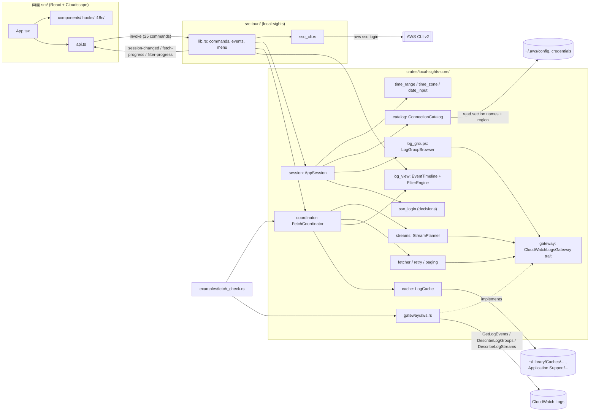
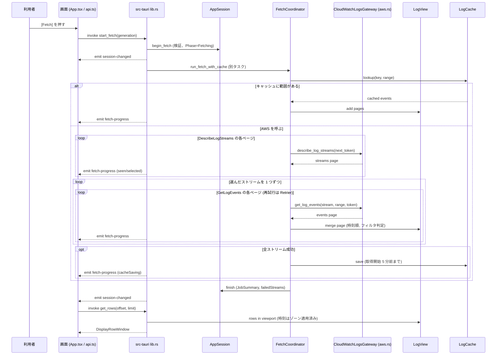
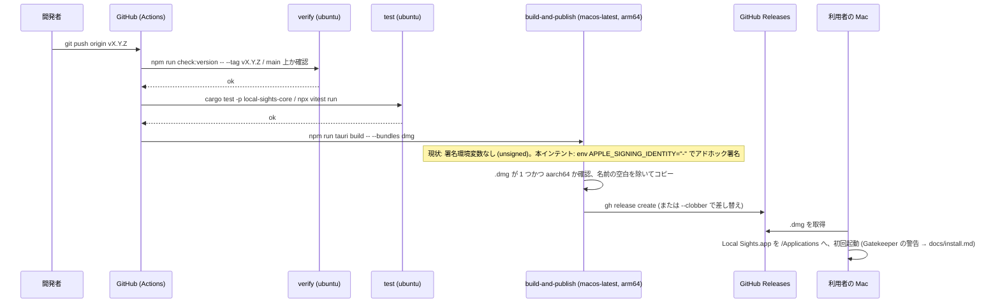

# Architecture

> リポジトリ `local-sights` のシステムアーキテクチャ。2026-10-12 の全体スキャン（コミット `9d08cbf`）に基づく。部品の一覧は `component-inventory.md`、API の詳細は `api-documentation.md` を参照。

## Architecture Analysis

### System Overview

Local Sights は **Tauri 2 のデスクトップアプリ**で、3 つの層からなる。

1. **`local-sights-core`**（Rust ライブラリ、`crates/local-sights-core/`）: GUI に依存しない中核。入力検証、時刻範囲、ストリーム計画、ページング、再試行、時刻順マージ、フィルタ、キャッシュ、画面状態（`AppSession`）、SSO ログインの判断、そして AWS に触れる唯一の境界 `CloudWatchLogsGateway` trait とその SDK 実装を持つ。
2. **`local-sights`**（Rust の Tauri アプリ、`src-tauri/`）: 薄い配線。25 個の Tauri コマンドを受けて core を呼び、状態変化を `session-changed` などのイベントで画面へ押し出す。メニュー、終了確認、AWS CLI（`aws sso login`）の起動も担う。
3. **画面**（TypeScript + React 19 + Cloudscape、`src/`）: 状態を持たない。`SessionView` を描き、操作を `src/api.ts` 経由でコマンドとして送る。表示する行は都度 `get_rows` で取りに行き、イベント本体を画面側に持たない。

外部に触れるものは、AWS CloudWatch Logs（読み取り 3 API）、`~/.aws` の設定ファイル（セクション名と `region` のみ）、OS のアプリ設定フォルダとキャッシュフォルダ、AWS CLI v2（外部プロセス）、`/usr/bin/open`（許可リスト済み URL）だけである。

配布面では、GitHub Actions が `vX.Y.Z` タグで macOS ランナー上に `.dmg` を作り GitHub Releases に公開する。サーバー環境は存在しない。

### Architectural Style

**レイヤード・モノリス（単一プロセスのデスクトップアプリ）+ ポート／アダプタ**。

根拠:
- `crates/local-sights-core/src/lib.rs` のクレート文書「the crate itself never depends on a GUI framework (ADR-001)」、`src-tauri/src/lib.rs` の「This crate stays thin: every decision lives in `local-sights-core`」。
- AWS 境界は trait `CloudWatchLogsGateway`（`gateway/mod.rs`）で、実装 `gateway/aws.rs` と テスト用 `tests/support/fake_gateway.rs` が差し替わる。タイムゾーンも `TimeZoneContext` 境界でテストが固定ゾーンに差し替える。
- core の各モジュールは「純粋ロジック（判断）」と「流れ（I/O を伴う進行）」を分けている（例: `streams/mod.rs` の判断と `streams/planner.rs` の流れ、`cache/plan.rs` と `cache/mod.rs`、`log_groups/mod.rs` と `log_groups/listing.rs`、`sso_login.rs` の判断と `src-tauri/src/sso_cli.rs` の実行）。team.md の「純粋なロジックはテスト先行、外部とつながる層は実装後にテスト」と対応する。
- 画面は「状態を持たない表示 + コマンド送信」で、Tauri の IPC がプロセス内の境界になる。

### Component Relationships

テキスト版（図が描けない環境向け）:
- 画面 `src/App.tsx` は部品（`components/`、`hooks/`、`i18n/`）を組み、`src/api.ts` を通じて 25 個の Tauri コマンドを `invoke` し、3 種のイベント（`session-changed`、`fetch-progress`、`filter-progress`）を `listen` する。
- `src-tauri/src/lib.rs` はコマンドを受け、core の `AppSession`（状態）、`FetchCoordinator`（取得）、`LogView`（保持イベント + フィルタ）を呼ぶ。`sso_cli.rs` が AWS CLI を起動する。
- core 内では `AppSession` が時刻・カタログ・ロググループ一覧・SSO の判断を束ね、`FetchCoordinator` が `StreamPlanner` → `EventFetcher`（`retry`、`paging`）→ `LogView` / `LogCache` の順に進める。AWS に触れるのは `CloudWatchLogsGateway` trait 経由だけで、本番は `gateway/aws.rs`、テストは偽物。
- `examples/fetch_check.rs` は同じ `FetchCoordinator` と SDK 実装で実 AWS を手元確認する開発者専用プログラム。

### Data Flow

1. **起動**: `main.rs` → `lib.rs::run()`。OS のタイムゾーン、`AWS_PROFILE`、設定ファイル（`settings.json`）、キャッシュフォルダの場所を読み、`AppSession` を作る。SDK に既定リージョンがあればロググループ一覧を始める。
2. **状態の流れ（単方向）**: 画面の操作 → `invoke` → コマンドが `AppSession` を変更 → `SessionView` を `session-changed` で画面へ。状態を変えるコマンドは戻り値を返さず、結果はイベントだけで届く（遅れた応答が新しい状態を上書きしない）。
3. **取得（U3）**: `start_fetch` → `FetchCoordinator::run_fetch_with_cache` が `DescribeLogStreams` を新しい順に読み、範囲に関係するストリームを選び、1 つずつ `GetLogEvents` のページを `LogView` にマージする。各ページで軽い `fetch-progress` を送る。終了時に全ストリーム成功ならキャッシュへ保存する。
4. **表示（U3/U7）**: 画面は保持イベントを持たず、`get_rows(offset, limit)` と `row_positions(keys)` で表示域の行と位置を都度取る。時刻は core がタイムゾーンを当てた文字列で返す。
5. **フィルタ（U5）**: `set_log_filter` → ブロッキングスレッドが `LogView` を 4,096 行ずつロックして走査し `filter-progress` を送る。取得中のページは追加時にフィルタ判定される。
6. **キャッシュ（U6）**: `LogCache` がキーの SHA-256 名の JSON Lines ファイルを読み書きする。ヒットすれば AWS を呼ばず表示する。
7. **SSO（261011）**: `start_sso_login` → core の `sso_login` が開始可否と引数を判断 → `sso_cli::run_login` が CLI を別プロセスグループで起動し、出力から許可リスト済み URL とコードだけを取り出す。成功で SDK クライアントを捨てて一覧を再読込する。
8. **リリース**: `git push origin vX.Y.Z` → `release.yml` の `verify`（タグ形式、4 ファイルの版一致、`main` 上のコミット）→ `test`（`cargo test -p local-sights-core`、`vitest`）→ `build-and-publish`（macos-latest で `npm run tauri build -- --bundles dmg`、`.dmg` が 1 つかつ `aarch64` を確認、`gh release create`）。

### Key Design Decisions

| 決定 | 根拠（コード上の証拠） | 含意 |
|---|---|---|
| GUI 非依存の core と薄い Tauri 層に分ける（ADR-001） | `lib.rs` 双方のクレート文書 | 判断は `cargo test` だけで検証でき、`fetch_check` が同じ流れを実 AWS で確かめられる |
| AWS は trait 境界の裏にだけ置き、読み取り 3 API 以外の操作を持たせない | `gateway/mod.rs` | project.md Forbidden をコードの型で保証。テストは偽物で AWS に接続しない |
| 画面は状態を持たず、行は都度取る | `src/api.ts` 文書、`lib.rs` U3 の説明 | 100 万件を画面に持たせない（NFR）。IPC の往復が増える代わりにメモリと一貫性を得る |
| 状態変更コマンドは戻り値を返さずイベントで届ける | `api.ts` の `startFetch` 等 | 遅延応答による上書き競合を排除 |
| ロックの順序を「session → LogView」に固定し、取得は両方を同時に持たない | `lib.rs` 文書 | デッドロック回避。取得中も表示域の読み出しが止まらない |
| 純粋ロジックと I/O を伴う流れをモジュールで分ける | `streams/`、`cache/`、`log_groups/`、`sso_login.rs` + `sso_cli.rs` | team.md の混在テスト方針（純粋ロジックは先、外部層は後）に沿う |
| エラー表示は許可リストのフィールドだけから組み立て、秘密らしき文字列はマスク | `failure.rs` | 秘密情報を画面・ログに出さない |
| AWS SDK の `rustls` 既定機能を外す | `Cargo.toml` のコメント（RUSTSEC-2026-0104 回避） | 依存監査（`cargo-deny`）を通す |
| 版は 4 ファイル（`Cargo.toml`、`Cargo.lock`、`package.json`、`tauri.conf.json`）で一致させ、タグと照合する | `scripts/release/versions.ts`、`release.yml` の `verify` | 版ずれのリリースを作らない |
| リリースは公開ジョブだけに `contents: write` を与え、Apple 証明書や AWS 認証情報は使わない | `release.yml` | 秘密情報ゼロの CI。署名は現状「しない」が前提 |
| macOS の署名設定を `tauri.conf.json` に持たない | `tauri.conf.json` に `bundle.macOS` 節が無い | Tauri CLI は署名 ID を環境変数 `APPLE_SIGNING_IDENTITY` からだけ読む。CI の `env` で `"-"` を渡せばアドホック署名になる（本インテントの変更点） |

### Improvement Opportunities

- `crates/local-sights-core/src/session.rs`（4,663 行、公開項目 114 件）に画面状態の責務が集中している。接続・設定・SSO・終了確認などへの分割候補。
- `src/components/LogTable.tsx` と計測用 `LogTableCloudscape.tsx` の並行実装、`src/dev/perfRows.ts` の分岐が `api.ts` に入っている。計測が終わったら片付ける余地がある。
- `release.yml` と `release-dry-run.yml` のビルドステップが重複している。署名などビルド条件を変えるときは両方を同じに保つ必要がある（composite action や reusable workflow に寄せる余地）。
- `tauri.conf.json` は `bundle.targets: "all"` だがリリースは `--bundles dmg` に絞っており、設定と実運用がずれている。
- 自動テストでは確かめられない macOS 側の挙動（Gatekeeper のダイアログ）は、`docs/releasing.md` の Release dry run に手元確認の手順として書く余地がある。

## Interaction Diagrams

### ログイベントの取得（`start_fetch`）

テキスト版: 利用者が Fetch を押す → 画面が `start_fetch` を送る → `lib.rs` が `AppSession` で検証して Fetching にし `session-changed` を送る → 別タスクで `FetchCoordinator` がキャッシュを調べ、無ければ `DescribeLogStreams` を新しい順に読んで関係するストリームを選び、1 つずつ `GetLogEvents` のページを `LogView` に時刻順でマージしながら `fetch-progress` を送る → 全ストリーム成功なら `LogCache` に保存 → 終了を `AppSession` に記録し `session-changed` → 画面は `get_rows` で表示域の行だけを取る。

### リリースビルドと配布（`release.yml`）

テキスト版: 開発者がタグを push → `verify` がタグ形式・版の一致・`main` 上のコミットを確認 → `test` がライブラリと画面のテストを実行 → `build-and-publish` が Apple Silicon ランナーで `.dmg` を作り、1 つだけで `aarch64` であることを確認して GitHub Releases に公開（再実行なら差し替え）→ 利用者が `.dmg` を取得してインストールし、初回起動時の Gatekeeper の警告を `docs/install.md` の手順で開く。ビルドステップは現在、署名の環境変数を渡さずに実行している。
