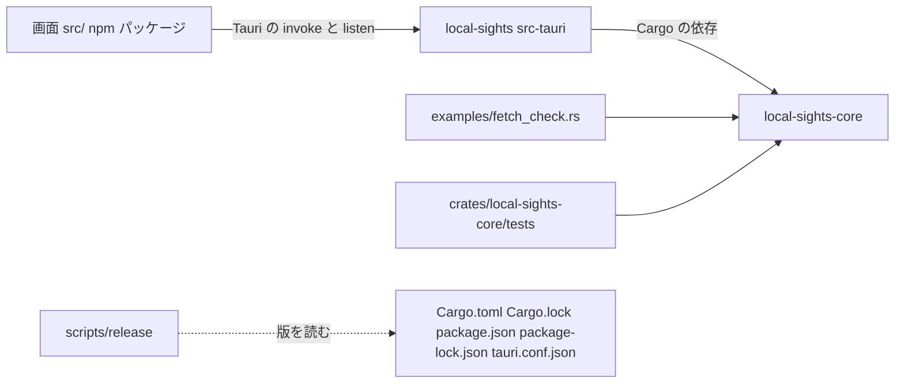
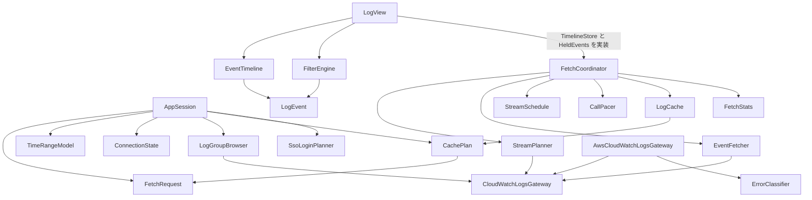

# 依存関係（Local Sights）

走査したコミット：`2760b13b8bc5b6daba36a6c283b3958c974a5a2d`（2026-10-17）。版の一覧は [technology-stack.md](technology-stack.md)、部品は [component-inventory.md](component-inventory.md)。

## 外部の依存（サービスとシステム）

| 相手 | 何に使うか | 境界の部品 | 決まり |
|------|------------|------------|--------|
| Amazon CloudWatch Logs | `DescribeLogGroups`・`DescribeLogStreams`・`GetLogEvents` だけ | CloudWatchLogsGateway、AwsCloudWatchLogsGateway | ほかの API は呼ばない（project.md Forbidden）。テストと CI からはつながない |
| AWS の認証（SDK の既定の連鎖） | SSO・アクセスキー・AssumeRole・環境変数 | AwsCloudWatchLogsGateway | 認証情報を読まない・持たない・書かない |
| AWS の設定ファイル（`~/.aws/config`、`~/.aws/credentials`、`AWS_CONFIG_FILE` など） | プロファイル名、`region`、SSO 設定の有無、`source_profile` | ConnectionCatalog | 認証情報の行は読んだそばから捨てる |
| AWS CLI v2 | `aws sso login`（利用者の操作でだけ） | SsoCliRunner | アプリは SSO の API を呼ばずトークンを扱わない |
| 既定のブラウザ | SSO の URL を開く | BrowserOpener | その試行の許可された URL だけ |
| OS のフォルダ | 設定ファイル（アプリの設定フォルダの `settings.json`）、キャッシュ（OS のキャッシュフォルダの `log-cache/`） | LogCache、CacheSettings、TauriApp | macOS は `~/Library` の下、Windows は利用者の `AppData` の下。Unix はフォルダ 0700・ファイル 0600 |
| OS のタイムゾーン | Local の意味 | TimeZoneContext | 起動時に 1 回読む |
| 画面の `localStorage` | 左の区画の幅 | PaneResizer | 使えなければ既定の幅 |

テレメトリやクラッシュレポートの送り先は無い（project.md Forbidden）。ログファイルも書かない。診断は標準エラーだけで、安全な詳細しか含まない。

## 内部の依存（パッケージの間）

文章での説明：画面はコードの上では Rust に依存せず、Tauri の `invoke` と `listen` でアプリとやりとりする（ビルド時には `dist/` がアプリに埋め込まれる）。アプリ `local-sights` は中核 `local-sights-core` だけに Cargo で依存する。中核は GUI にも Tauri にも依存しない。確認用プログラムと流れの試験は中核だけを使う。リリースの道具は 5 つの設定ファイルの版を読んでそろいを確かめる。

## 中核の中の依存（主なもの）

文章での説明：`AppSession` は取得条件・時刻・接続・一覧・キャッシュの判断・SSO の判断を使うが、取得の流れ（`FetchCoordinator`）は直接呼ばない（アプリが両方を持って結ぶ）。`FetchCoordinator` は保持先を trait（`TimelineStore`・`HeldEvents`）で受け取り、`LogView` がそれを実装する。`log_view.rs` は `coordinator.rs` の trait と補助関数を使い、`coordinator.rs` は `timeline.rs` の `EventTimeline` にも同じ trait を実装しているため、2 つのモジュールは互いを参照する（Rust では同じクレート内なので問題は無いが、層としては循環に見える）。AWS に触れるのは gateway の trait を通す 3 つの部品だけ。

## Cargo の依存（宣言）

- **ワークスペース共通**（`Cargo.toml`）：aws-config、aws-sdk-cloudwatchlogs（default-features 無し）、aws-credential-types、chrono（default-features 無し）、chrono-tz（default-features 無し）、iana-time-zone、regex、serde、serde_json、sha2、thiserror、tokio、futures-util（`std` だけ）、uuid、tauri、tauri-build、tempfile、home、fastrand、aws-smithy-*（テスト）。
- **local-sights-core**：上のうち tauri 以外。開発時に aws-smithy-runtime-api・aws-smithy-types・tempfile・tokio の `test-util`。
- **local-sights（src-tauri）**：local-sights-core、serde、serde_json、tauri、tokio、tauri-build（ビルド時）。`cfg(unix)` で libc、`cfg(windows)` で windows-sys（`Win32_Foundation`・`Win32_Security`・`Win32_System_JobObjects`・`Win32_System_Threading`・`Win32_UI_Shell`・`Win32_UI_WindowsAndMessaging`）。開発時に tempfile。機能 `custom-protocol`（`dist/` を埋め込む）。

## 依存の管理

- `Cargo.lock` と `package-lock.json` をコミットする（team.md Code Style）。
- `deny.toml`：脆弱性（`yanked = "deny"`、無視は Linux の GTK 経由で入る `proc-macro-error` の RUSTSEC-2024-0370 だけ）、ライセンスの許可リスト（MIT、Apache-2.0、Apache-2.0 WITH LLVM-exception、BSD-3-Clause、ISC、Unicode-3.0、Zlib、MPL-2.0）、出どころは crates.io だけ、ワイルドカードの版は禁止、同じクレートの複数の版は警告。
- 画面は `npm audit --audit-level=high` を CI で確かめる。
- Dependabot が cargo（aws-* と tauri* をまとめる）、npm（@tauri-apps/* とテスト系をまとめる）、GitHub Actions を毎週見る。
- 同じクレートの複数の版が入っている（`sha2` 0.10 と 0.11、`thiserror` 1 と 2、`windows-sys` の複数版など）。どれも他の依存が引くもので、`multiple-versions = "warn"` の扱い。

## IB-11 で増えうる依存

- クエリの構文解析に外部のパーサー（例：nom、pest、chumsky など）を使うか、手書きにするかは未定。足すなら許可リストのライセンスで、中核（`local-sights-core`）にだけ入れるのが今の構成に合う。
- JSON の取り出しは既存の `serde_json` で足りる。正規表現は既存の `regex` で足りる。
- 新しい AWS API の依存は足せない（呼べるのは 3 操作だけ）。
