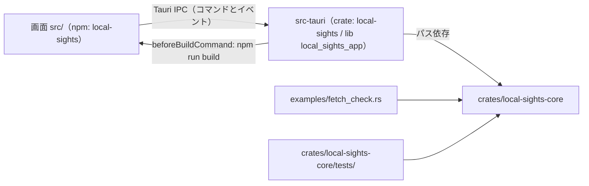

# 依存関係（Local Sights）

走査したコミット：`9d08cbf5c6d97820f0ec7f276c3ce6020c903eb5`（2026-10-12）。固定された実際の版は [technology-stack.md](technology-stack.md) にまとめ、ここでは宣言の範囲、どこが何に依存するか、依存の方針を記す。

## 内部の依存（パッケージ間）

テキストでの説明：画面は Rust に直接依存せず、Tauri の IPC でアプリとやり取りする。アプリ（`src-tauri`）は中核（`local-sights-core`）にパスで依存する。中核はアプリにも GUI にも依存しない。確認用の `fetch_check` 例と結合テストは中核だけに依存する。アプリのビルド時には画面のビルド（`npm run build`）が先に走り、その出力 `dist/` が埋め込まれる。

### 中核の中のモジュール依存（取得経路）

- `coordinator` → `streams::planner`、`fetcher`、`retry`、`timeline`、`cache`、`cache::plan`、`gateway`（trait のみ）、`request`、`failure`、`event`
- `fetcher` → `gateway`、`paging`、`retry`、`request`、`time_range`、`event`、`failure`
- `streams::planner` → `streams`、`gateway`、`paging`、`retry`、`request`、`time_range`
- `log_view` → `timeline`、`filter`、`coordinator`（`TimelineStore`／`HeldEvents` を実装）、`cache::plan`
- `session` → `connection`、`catalog`、`log_groups`、`request`、`date_input`、`time_zone`、`time_range`、`cache`、`cache::plan`、`cache::settings`、`coordinator`（型）、`streams`（型）、`sso_login`、`filter`（型）、`timeline`（型）
- `gateway::aws` → `gateway`、`gateway::classify`、`failure`、`log_groups`（型）、`streams`（型）
- `cache::plan` → `coordinator::JobStatus`、`request`、`catalog`、`event`

循環：`coordinator` ↔ `log_view`（`log_view` が `coordinator` の trait を実装し、`coordinator` は trait の総称で `LogView` を名指ししない）と `coordinator` ↔ `cache::plan`（`cache::plan` が `JobStatus` を使い、`coordinator` が `cache::plan` の判断を使う）はモジュール間の相互参照だが、同じクレート内で型と trait を参照し合うだけで、ビルドや初期化の問題は無い。

### アプリ（`src-tauri/src/lib.rs`）が使う中核の口

`session::AppSession` ほか、`coordinator::{run_fetch_with_cache, FetchSink, FetchJob, BatchProgress, JobStatus}`、`gateway::aws::AwsCloudWatchLogsGateway`、`log_groups::listing::{run_listing, ListingSink}`、`log_view::LogView`、`retry::{abort_pair, AbortHandle, RandomJitter, Retrier, RetryPolicy}`、`filter::{should_report_progress, ...}`、`catalog::files::load_catalog`、`time_zone::TimeZoneContext`、`sso_login::*`。

## 外部の依存（Rust）

ワークスペースの `[workspace.dependencies]` で範囲をまとめて宣言する（`Cargo.toml`）。

| クレート | 宣言 | 使う側 | 目的 |
|---|---|---|---|
| `aws-config` | `"1"` | 中核 | 認証と接続先 |
| `aws-sdk-cloudwatchlogs` | `"1"`、`default-features = false`、`["default-https-client", "rt-tokio"]` | 中核 | CloudWatch Logs |
| `aws-credential-types` | `"1"` | 中核 | 認証失敗の判定 |
| `aws-smithy-runtime-api`（`http-1x`）、`aws-smithy-types` | `"1"` | 中核（開発時のみ） | テストで SDK エラーを作る |
| `tokio` | `"1"`、`["rt-multi-thread", "macros", "sync"]`（中核は `time`、開発時は `test-util` を追加） | 中核、アプリ | 非同期 |
| `chrono` | `"0.4"`、`default-features = false`、`["std", "clock"]` | 中核 | 日時 |
| `chrono-tz` | `"0.10"`、`["std"]` | 中核 | タイムゾーン |
| `iana-time-zone` | `"0.1"` | 中核 | OS のゾーン名 |
| `regex` | `"1"` | 中核 | 伏せ字 |
| `serde`（`derive`）、`serde_json` | `"1"` | 中核、アプリ | 受け渡しとファイル |
| `sha2` | `"0.11"` | 中核 | キャッシュのファイル名 |
| `thiserror` | `"2"` | 中核 | エラー型 |
| `uuid`（`v4`） | `"1"` | 中核 | ID |
| `fastrand` | `"2"` | 中核 | 揺らぎ |
| `home` | `"0.5"` | 中核 | ホームフォルダ |
| `tauri` / `tauri-build` | `"2"` | アプリ | デスクトップ |
| `libc` | `"0.2"` | アプリ | プロセスグループへのシグナル |
| `tempfile` | `"3"` | 中核・アプリ（開発時のみ） | テスト用フォルダ |

`Cargo.lock` には 495 個のパッケージがある（AWS SDK と Tauri の推移的な依存が大半）。同じクレートの複数の版が入っている例：`sha2` 0.10.9 と 0.11.0、`thiserror` 1.0.69 と 2.0.21（`deny.toml` で `multiple-versions = "warn"`）。

## 外部の依存（npm）

| パッケージ | 宣言 | 区分 |
|---|---|---|
| `@cloudscape-design/components` | `^3.0.1396` | 実行時 |
| `@cloudscape-design/design-tokens` | `^3.0.114` | 実行時 |
| `@cloudscape-design/global-styles` | `^1.0.71` | 実行時 |
| `@tauri-apps/api` | `^2.12.2` | 実行時 |
| `react`、`react-dom` | `^19.3.0` | 実行時 |
| `@tauri-apps/cli` | `^2.12.1` | 開発時 |
| `typescript` | `^6.0.3` | 開発時 |
| `vite`、`@vitejs/plugin-react` | `^8.3.4`、`^6.1.2` | 開発時 |
| `vitest`、`jsdom` | `^5.0.3`、`^30.1.2` | 開発時 |
| `@testing-library/react`、`dom`、`jest-dom`、`user-event` | `^16.3.3`、`^10.4.2`、`^7.0.1`、`^14.6.7` | 開発時 |
| `eslint`、`@eslint/js`、`typescript-eslint`、`eslint-plugin-react-hooks`、`eslint-plugin-react-refresh`、`globals` | `^10.12.0`、`^10.0.1`、`^8.71.1`、`^7.1.1`、`^0.5.7`、`^17.13.0` | 開発時 |
| `prettier` | `^3.9.10` | 開発時 |
| `@resvg/resvg-js` | `^2.6.2` | 開発時 |

`package-lock.json` には 321 個のパッケージの項目がある。

## 依存の方針と検査

- `Cargo.lock` と `package-lock.json` はコミットする（team.md Code Style）。
- `cargo-deny`（`deny.toml`）：既知の脆弱性・メンテナンス終了・取り下げ版は失敗。例外は `RUSTSEC-2024-0370`（`proc-macro-error`、Tauri→gtk→glib-macros 経由、メンテナンス終了のみ）だけ。ライセンスは MIT、Apache-2.0、BSD-3-Clause、ISC、Unicode-3.0、Zlib、MPL-2.0 などの許可リスト。ワイルドカードの版は禁止（ワークスペースのパス依存は可）。取得元は crates.io だけ。
- npm：CI で `npm audit --audit-level=high`。
- Dependabot：毎週、まとめ単位は `aws-*`、`tauri*`、`@tauri-apps/*`、テスト系。
- 新しい依存を足すときの慣習：`Cargo.toml` のコメントにライセンスと「何も外に送らない」ことを書いている（例：`sha2`、`chrono-tz`、`libc`）。

## 今回の intent に関わる依存の注意

- 並行取得と速さの上限は、`tokio`（`sync` の `Semaphore`、`time`）と既存の依存の範囲で作れる見込みで、新しいクレートは必須ではない。
- `aws-config` の既定の再試行（`BehaviorVersion::latest()`）がアプリの再試行と重なっていると考えられる。呼び出し回数を数えるなら、SDK 側の再試行の設定を明示するかどうかを決める必要がある（[code-quality-assessment.md](code-quality-assessment.md)）。
