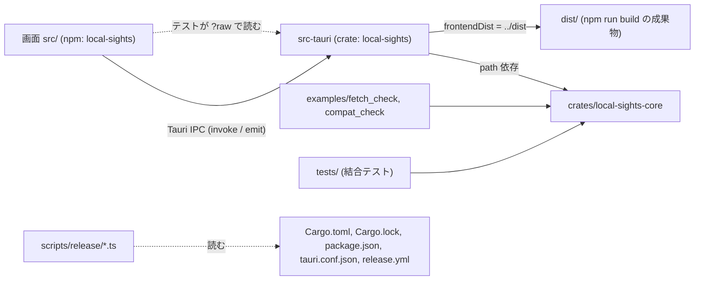

# 依存関係（Local Sights）

> 2026-10-20、コミット `3208713`。版の一覧は `technology-stack.md`、部品の中の依存は `component-inventory.md` の「頼る」にある。ここは外部との依存、パッケージの間の依存、管理の仕方。

## 外部の依存（サービスとシステム）

| 外部 | どう使うか | 境界のコード | 止められるか |
|---|---|---|---|
| AWS CloudWatch Logs（`DescribeLogGroups`、`DescribeLogStreams`、`GetLogEvents`） | ロググループの一覧、ストリームの列挙、ログの取得。他の操作は呼ばない | `crates/local-sights-core/src/gateway/aws.rs`（`CloudWatchLogsGateway` の実装） | テストは `FakeGateway` に差し替え。CI・テストは AWS につながない |
| AWS の認証情報とプロファイル | `aws-config` のプロファイル解決に任せる。アプリは秘密を読まず、保存せず、ログに出さない | `catalog/`（`config` の節と `credentials` の節名だけを読む）、`gateway/aws.rs` | `ConnectionCatalog::with_auth_infos` で差し替え |
| AWS CLI v2（`aws sso login`） | 利用者の操作で起動し、出力から URL とコードだけを抜く。トークンは CLI が書く | `src-tauri/src/sso_cli/` | テストは偽の CLI（シェルスクリプト／`aws.cmd`） |
| OS の既定ブラウザ | SSO の URL を開く（許可されたホストだけ） | `src-tauri/src/browser.rs` | 判断は `sso_login::is_allowed_login_url` が純粋に行う |
| ファイルシステム | `~/.aws/*` の読み、`settings.json`、`log-cache/`（JSON Lines、一時ファイル → rename） | `catalog/files.rs`、`cache/` | テストは `tempfile` のフォルダ |
| OS の時計とゾーン | 経過時間（`SessionClock`）、ローカルのゾーン名（`iana-time-zone`） | `session.rs:548`、`time_zone.rs` | `SessionClock::from_fn`、ゾーンを固定して渡す |
| WebView（macOS WebKit、Windows WebView2） | 画面の描画。CSP は `self` だけ、`connect-src ipc:` | `src-tauri/tauri.conf.json` | — |

ネットワークへの送信は AWS の 3 操作だけ。Ace のモジュールもアプリに同梱して読み込む（`src/aceLoader.ts`）。

## 内部の依存（パッケージの間）

- 中核は Tauri にも React にも依存しない（`crates/local-sights-core/Cargo.toml`）。アプリだけが `tauri` に依存する。
- 画面は `@tauri-apps/api` だけでアプリと話し、Rust の型は `src/api.ts` に手で写してある（自動生成はない）。`src/commandRegistration.test.ts` が `build.rs`・`lib.rs`・`capabilities/default.json` を文字として読み、`api.ts` の `invoke` の名前と一致を検査する。
- `src/test/fixtures.ts` が `SessionView` などの既定値を持つ。Rust 側の型を変えると、ここと `api.ts` の 2 か所を直す必要がある。

## 中核の中の依存（主な向き）

`coordinator` → `streams`、`schedule`、`fetcher`、`pacing`、`retry`、`cache`、`gateway`、`timeline`（trait 経由）。`query::runner` → `query::store`、`cache`、`coordinator`（`run_fetch`）、`query::evaluator`。`session` → `connection`、`catalog`、`log_groups`、`request`、`time_range`、`time_zone`、`sso_login`、`insights_session`、`cache::settings`。`insights_session` → `query::*`、`time_range`。`gateway::aws` → `gateway::classify`、`failure`。逆向き（`query` が `session` を使うなど）はない。

## Cargo の依存（宣言の要点）

- `[workspace.dependencies]` に一元化し、各クレートは `.workspace = true` で引く。`aws-sdk-cloudwatchlogs` は `default-features = false` で `rustls` 系だけ、`futures-util` も `default-features = false` で `std` だけ（cargo-deny で確かめる）。
- アプリの OS 依存は `[target.'cfg(unix)'.dependencies] libc = "0.2"` と `[target.'cfg(windows)'.dependencies] windows-sys = "0.61"`（features：Foundation、Security、System_JobObjects、System_Threading、UI_Shell、UI_WindowsAndMessaging）。
- dev：`tempfile`、`tokio/test-util`、`aws-smithy-runtime-api`、`aws-smithy-types`。
- `[[example]] compat_check` を明示（`examples/compat/` のサブモジュールを持つため）。

## npm の依存（宣言の要点）

実行時は 7 パッケージ（react、react-dom、Cloudscape の 3 つ、@tauri-apps/api、ace-builds）。残りは開発用。`package-lock.json` をコミットし、CI は `npm ci`。

## 依存の管理

- **固定**：`Cargo.lock` と `package-lock.json` をコミット。GitHub Actions は SHA で固定し、コメントに版を書く。
- **更新**：Dependabot が週次。cargo は `aws-*` と `tauri*` をグループ、npm は `@tauri-apps/*` と `@testing-library/* + vitest + jsdom` をグループ、PR は各 5 件まで。
- **検査**：cargo-deny（脆弱性・unmaintained・yanked を拒否、ライセンスは許可一覧、crates.io だけ、重複版は警告。RUSTSEC-2024-0370 だけ理由付きで無視）、`npm audit --audit-level=high`。
- **秘密**：リポジトリに AWS の認証情報はなく、CI にも置かない（`ci.yml:3-5`、`README.md` の「Secrets」）。

## この作業（carryover-fixes）で増えうる依存

なし。5 項目はいずれも既存の依存の中で直せる（`technology-stack.md` の末尾）。
