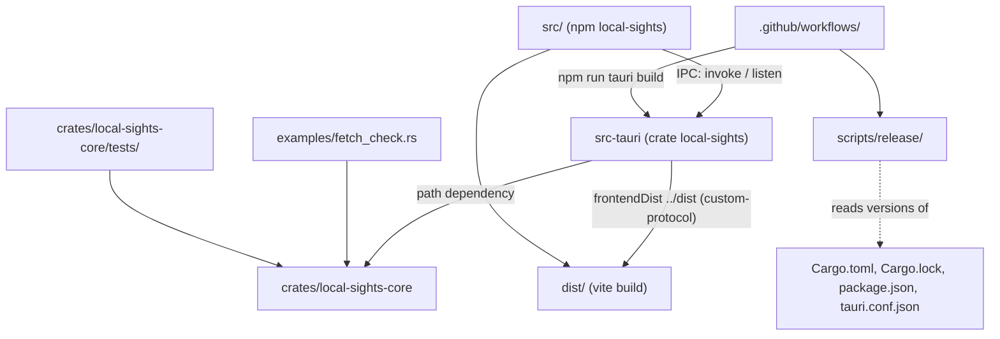

# Dependencies

> リポジトリ `local-sights` の外部依存と内部の相互依存。2026-10-12 の全体スキャン（コミット `9d08cbf`）に基づく。版の一覧は `technology-stack.md`、部品ごとの依存は `component-inventory.md` を参照。

## Dependency management

- **Rust**: `Cargo.toml` の `[workspace.dependencies]` に版を一元管理し、各クレートは `xxx.workspace = true` で参照。`Cargo.lock` はコミット（team.md）。`deny.toml` で crates.io 以外のソースを拒否、ライセンスは許可リスト（MIT、Apache-2.0、BSD-3-Clause、ISC、Unicode-3.0、Zlib、MPL-2.0 など）、脆弱性・yank は拒否、重複版は警告。
- **npm**: `package.json` + `package-lock.json`（コミット）。`npm ci` で再現。CI で `npm audit --audit-level=high`。
- **GitHub Actions**: すべてコミット SHA 固定（版はコメント）。
- **更新**: Dependabot が cargo（`aws-*`、`tauri*` をグループ化）、npm（`@tauri-apps/*`、testing をグループ化）、github-actions を週次で PR（上限 5 件）。履歴にも Dependabot のマージが並ぶ（#3〜#11）。

## External dependencies（Rust）

| クレート | 直接依存するクレート | 用途 | 備考 |
|---|---|---|---|
| aws-sdk-cloudwatchlogs | core | 読み取り 3 API | `default-features = false`、`default-https-client` + `rt-tokio`。rustls 0.21 系を避ける（RUSTSEC-2026-0104） |
| aws-config、aws-credential-types | core | 認証チェーン、プロファイル解決 | 認証情報を読むのは SDK だけ。アプリは触れない |
| aws-smithy-runtime-api、aws-smithy-types | core（dev） | テストで SDK エラーを組み立てる | |
| tokio | core、src-tauri | 非同期・待ち・中止 | core は `time`、テストは `test-util`（一時停止クロック） |
| chrono、chrono-tz、iana-time-zone | core | 時刻・タイムゾーン | MIT OR Apache-2.0、通信なし |
| serde、serde_json | core、src-tauri | 直列化、JSON Lines | |
| thiserror | core | エラー型 | |
| regex | core | マスク・解析 | |
| sha2 | core | キャッシュキー名 | |
| uuid | core | セッション ID | |
| home | core | `~/.aws` | |
| fastrand | core | 再試行のジッタ | |
| libc | src-tauri | `killpg` / `kill` | Unix 専用 |
| tauri、tauri-build | src-tauri | デスクトップ枠組み | `custom-protocol` feature で `dist/` を埋め込む |
| tempfile | core（dev）、src-tauri（dev） | 一時フォルダ | |

既知の重複版（`multiple-versions = "warn"` で許容）: `thiserror` 1.0.69 / 2.0.21、`sha2` 0.10.9 / 0.11.0。advisory の除外: `RUSTSEC-2024-0370`（`proc-macro-error` 未保守。tauri → gtk 経由、Linux のみ、除去不能）。

## External dependencies（npm）

| パッケージ | 種別 | 用途 |
|---|---|---|
| react、react-dom | dependencies | 画面 |
| @cloudscape-design/components、design-tokens、global-styles | dependencies | UI 部品、トークン、ベーススタイル |
| @tauri-apps/api | dependencies | `invoke` / `listen` |
| @tauri-apps/cli | devDependencies | `tauri dev` / `build` / `icon` |
| vite、@vitejs/plugin-react | devDependencies | バンドル |
| typescript | devDependencies | 型検査 |
| vitest、jsdom、@testing-library/react、dom、jest-dom、user-event | devDependencies | テスト |
| eslint、@eslint/js、typescript-eslint、eslint-plugin-react-hooks、eslint-plugin-react-refresh、globals | devDependencies | リント |
| prettier | devDependencies | フォーマット |
| @resvg/resvg-js | devDependencies | アイコン描画 |
| @types/react、@types/react-dom | devDependencies | 型 |

## External services and programs

| 相手 | 依存する部品 | 必須か |
|---|---|---|
| AWS CloudWatch Logs（読み取り 3 API） | `AwsCloudWatchLogsGateway` | 実利用時のみ。テスト・CI は接続しない |
| AWS CLI v2（`aws sso login`） | `SsoCli` | 任意（SSO サインイン機能のみ） |
| macOS `/usr/bin/open` | `TauriApp` | SSO の URL を開くときのみ |
| `~/.aws/config`、`~/.aws/credentials` | `ConnectionCatalog` | 無くても起動する（通知を出す） |
| GitHub Actions ランナー（ubuntu-latest、macos-latest arm64）、GitHub Releases、`gh` | `CiWorkflow`、`ReleaseWorkflow`、`ReleaseDryRunWorkflow` | CI/CD |
| Linux の WebKitGTK / GTK 開発パッケージ | `tauri-app` ジョブ（ubuntu） | CI の Linux ビルドのみ |
| Apple の署名・公証サービス | なし | 未使用（Developer Program 不参加）。アドホック署名は Apple のサービスを使わず `codesign` だけで行える |

## Internal dependencies（クレート・パッケージ間）



テキスト版: 画面（npm パッケージ）は IPC でだけ Tauri アプリに依存する。Tauri アプリは path 依存で core に依存し、`custom-protocol` feature で `vite build` の `dist/` を埋め込む。`fetch_check` の例と統合テストは core にだけ依存する。`scripts/release/` は 4 つの版ファイルを読み、ワークフローはそのスクリプトと `npm run tauri build` を呼ぶ。core は GUI・Tauri・画面のどれにも依存しない（ADR-001）。

## Internal dependencies（core のモジュール間、主要な向き）

```
session ─────┬─▶ request ─▶ time_range ─▶ time_zone
             ├─▶ catalog ─▶ catalog/files, catalog/regions
             ├─▶ connection
             ├─▶ log_groups ─▶ gateway (trait)
             ├─▶ cache/settings, cache/plan
             ├─▶ sso_login ─▶ catalog
             └─▶ failure
coordinator ─┬─▶ streams/planner ─▶ streams, gateway, retry
             ├─▶ fetcher ─▶ gateway, retry, paging
             ├─▶ log_view (TimelineStore) ─▶ timeline, filter ─▶ event
             ├─▶ cache ─▶ cache/plan
             └─▶ failure
gateway/aws ─▶ gateway (trait), gateway/classify, failure
```

循環依存は見当たらない（`session` は `coordinator` を知らず、`coordinator` は `session` を知らない。両者を束ねるのは `src-tauri/src/lib.rs`）。

## Internal dependencies（Tauri 層と画面）

- `src-tauri/src/lib.rs` → core の `session`、`coordinator`、`log_view`、`gateway::aws`、`catalog`、`log_groups::listing`、`retry`、`filter`、`sso_login`、`time_zone`、`failure` と、同クレートの `sso_cli`。
- `src-tauri/src/sso_cli.rs` → core の `sso_login`（`extract_login_hints`、`MAX_LINE_BYTES`、`SsoLoginOutcome`）、libc。
- `src/App.tsx` → `api.ts`、`components/*`（13）、`hooks/*`、`i18n/messages`、`dev/perfRows`。
- `src/api.ts` → `@tauri-apps/api`、`dev/perfRows`。部品やフックには依存しない。
- コマンドの整合: `build.rs`、`capabilities/default.json`、`lib.rs`、`api.ts` の 4 か所に同じ 25 コマンド。`src/commandRegistration.test.ts` が検査。

## Configuration coupling（リリース・配布）

- 版 `0.1.0` は `Cargo.toml`（`[workspace.package]`）、`Cargo.lock`（2 クレート）、`package.json`（+ `package-lock.json`）、`src-tauri/tauri.conf.json` の 4 か所で一致が必要。`scripts/release/versions.ts` が検査し、`release.yml` の `verify` がタグと照合する。
- `.app` の名前は `tauri.conf.json` の `productName`（`Local Sights`）から決まり、`release.yml` は `.dmg` を `Local-Sights_<ver>_aarch64.dmg` に改名して上げる。`docs/install.md` の例示ファイル名もこれに合わせている。
- 署名: `tauri.conf.json` に `bundle.macOS.signingIdentity` が無いため、Tauri CLI の署名動作は `release.yml` / `release-dry-run.yml` のビルドステップの環境変数に完全に依存する。両ワークフローのビルドステップは同じ内容で重複しており、片方だけ変えると挙動が食い違う。
- `docs/install.md`、`docs/releasing.md`、`README.md`、`release.yml` の `NOTES` は「not signed or notarized」を前提にした文言で結合している。
