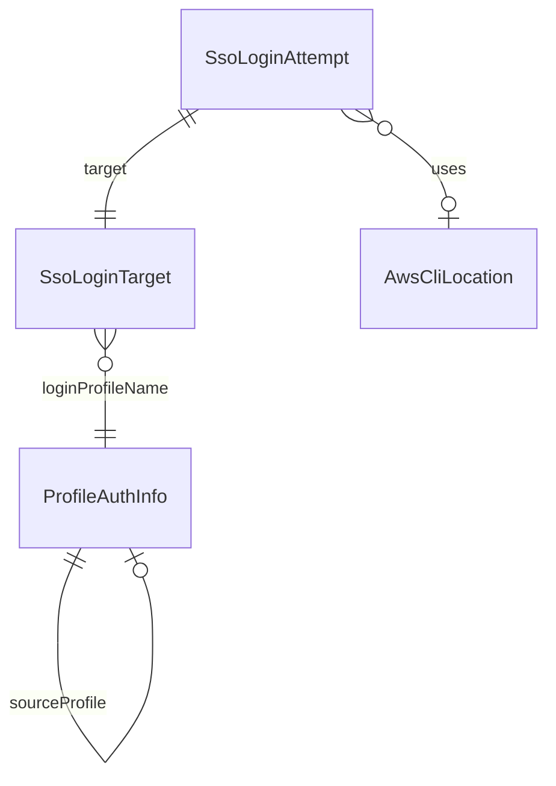

# Functional Spec — アプリから SSO ログインする

上流：`requirements.md`（FR1〜FR4、NFR1〜NFR7）、`functional-design-questions.md`（FD Q1〜Q3）。データの形は `entities.md`、判断の規則は `rules.md` が正。この文書は手順と状態の遷移の正。

## 1. 部品の置き場所（既存の境界に合わせる）

| 層 | 置くもの | 理由 |
|---|---|---|
| コア（`local-sights-core`、GUI に依存しない） | 設定ファイルからの ProfileAuthInfo の読み取り（catalog の拡張）、ログイン先の決定（BR1.3〜BR1.5、BR2.3）、CLI の出力の許可リスト（BR3.1）、ログインの状態（SsoLoginAttempt の状態遷移、BR2.5、BR3.4） | 純粋なロジックなのでテストを先に書ける（team.md Testing Posture） |
| Tauri 側（`src-tauri`） | CLI の探索（BR2.1）と起動（BR2.2、BR2.4）、時間切れ（BR3.2）、キャンセルとアプリ終了時の停止（BR3.3）、成功時の SDK クライアントの破棄（BR4.1） | 外部プロセスとファイルシステムに触れる境界。テストでは起動部分を差し替える |
| 画面（React） | 「SSO にログイン」ボタン、ログイン中のダイアログ、成功・失敗の知らせ | GUI の層 |

CLI の起動は、コアに「ログインを実行する」境界（trait）を置き、Tauri 側がそれを実装する。自動テストでは偽の実装に差し替え、本物の CLI も AWS も呼ばない（NFR6）。

## 2. 手順

### UC1. ログインする（成功）

1. 一覧の読み込みまたは取得が `AuthRequired` で失敗し、エラー表示が出る。
2. コアが選択中のプロファイルからログイン先を決める（BR1.3、BR1.4）。ログイン先があればボタンを出す（BR1.5）。
3. 利用者が「SSO にログイン」を押す。作業中でなければ（BR2.5）、コアがログインを Starting にし、画面がダイアログを開く。上部バーと条件エリアと左ペインの操作が止まる（BR3.4）。
4. Tauri 側が CLI を探す（BR2.1）。見つかれば、引数を組み立てて（BR2.2、BR2.3）シェルなしで起動する。状態を Waiting にし、5 分のタイマーを始める（BR3.2）。
5. CLI の出力を 1 行ずつ読み、許可リストに合う URL と確認コードをコアに渡す（BR3.1）。ダイアログに表示する。ほかの行は捨て、どこにも書かない。
6. CLI が終了コード 0 で終わる。Tauri 側がキャッシュしている SDK のクライアントを全部捨てる（BR4.1）。状態を Succeeded にする。
7. ダイアログを閉じ、「ログインしました」を知らせる。一覧の再読み込みを自動で始める。取得は始めない（BR4.1）。

### UC2. キャンセルする

1. Waiting の間に [キャンセル] を押す。
2. Tauri 側が CLI を終了させ、終了を待つ（BR3.3）。状態を Cancelled にする。
3. ダイアログを閉じ、ボタンを押す前の表示に戻る。操作の停止を解く。

### UC3. 時間切れ

1. Waiting のまま 5 分たつ（BR3.2）。
2. CLI を終了させ、状態を TimedOut にする。
3. ダイアログに「時間切れになりました。もう一度ログインしてください」と [閉じる] を出す。閉じると操作の停止を解き、ボタンをもう一度押せる。

### UC4. 失敗する

1. CLI が 0 以外の終了コードで終わる、または起動できない。
2. 状態を Failed にし、終了コードを持つ。
3. ダイアログに「ログインできませんでした（終了コード N）」と、ターミナルで `aws sso login` を実行する代わりの手順と [閉じる] を出す。CLI の出力の文章は出さない（BR4.2）。

### UC5. CLI が見つからない

1. 候補のどこにも実行できる `aws` がない（BR2.1）。
2. CLI を起動せず、状態を CliNotFound にする。
3. ダイアログに「AWS CLI が見つかりません」と、インストールの案内、ターミナルでの代わりの手順と [閉じる] を出す。

### UC6. ログイン中にアプリを閉じる

1. Waiting の間にウィンドウを閉じる。
2. 既存の閉じる確認の流れのあと、アプリが終わる前に CLI を終了させる（BR3.3）。

## 3. 状態の遷移（SsoLoginAttempt）

| 今の状態 | 出来事 | 条件 | 次の状態 | 動作 |
|---|---|---|---|---|
| （なし） | ボタンの押下 | 作業中でない、ログイン先あり | Starting | ダイアログを開き、操作を止める |
| Starting | CLI が見つかった | — | Waiting | CLI を起動、タイマー開始 |
| Starting | CLI が見つからない | — | CliNotFound | 案内を出す |
| Starting | 起動に失敗 | — | Failed | 失敗の旨を出す |
| Waiting | 出力 1 行 | 許可リストに合う | Waiting | URL・コードを更新（最初の 1 つだけ） |
| Waiting | 終了コード 0 | — | Succeeded | クライアントを捨て、知らせ、一覧を読み直す |
| Waiting | 終了コード 0 以外 | — | Failed | 終了コードを出す |
| Waiting | [キャンセル] | — | Cancelled | CLI を終了 |
| Waiting | 5 分経過 | — | TimedOut | CLI を終了 |
| Succeeded / Cancelled | — | — | （なし） | ダイアログを閉じ、操作の停止を解く |
| Failed / TimedOut / CliNotFound | [閉じる] | — | （なし） | ダイアログを閉じ、操作の停止を解く |

終わりの状態（Succeeded・Failed・TimedOut・Cancelled・CliNotFound）から先へは進まない。次のログインは新しい試みとして始める。

## 4. エンティティの関係（`entities.md` から導いた図）

文章での説明：ProfileAuthInfo は source_profile で別の ProfileAuthInfo を指せる。SsoLoginTarget はそのたどった先のプロファイルを指す。SsoLoginAttempt は 1 つの SsoLoginTarget と、見つかった AwsCliLocation を使う。

## 5. 規則の要約（`rules.md` から）

- 判定：BR1.1〜BR1.5（SSO の判定、残す情報、デフォルトの解釈、source_profile のたどり方、ボタンを出す条件）
- 起動：BR2.1〜BR2.5（探索順、固定の引数、--profile の要否、環境変数、同時に 1 つ）
- 待機：BR3.1〜BR3.4（許可リスト、5 分、必ず終了、操作の停止）
- 結果：BR4.1〜BR4.3（成功時の再読み込み、失敗時の表示、SSO の API に触れない）

## 6. 要件との差分

- FR3.3 の「CLI が出した失敗の理由（秘密情報を除いたもの）を出す」は、許可リスト方式（BR3.1）と両立しないため、終了コードと代わりの手順を出す形にした（BR4.2）。
- FR3.4 の「再起動しなくても新しい認証情報で使える」は、SDK が読み直すかに頼らず、成功時にクライアントを捨てる形で保証する（BR4.1、AS3 の解消）。

## 7. 手動で確かめること

- 会社の Mac で、SSO を直接持つプロファイルと、AssumeRole のプロファイルの両方でログインでき、一覧が読み直されること。
- ブラウザが開かない場合に、ダイアログの URL と確認コードでログインできること。
- [キャンセル]・5 分の時間切れ・ログイン中のアプリ終了で、`aws` のプロセスが残らないこと（アクティビティモニタで確かめる）。
