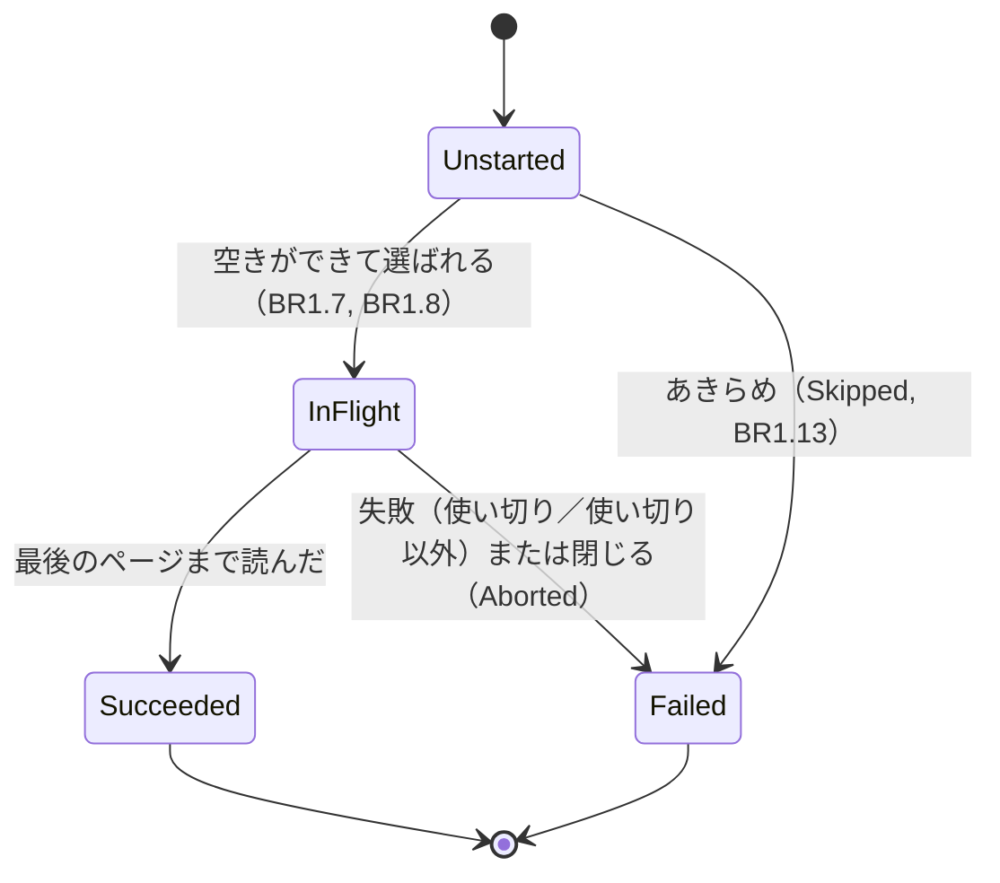
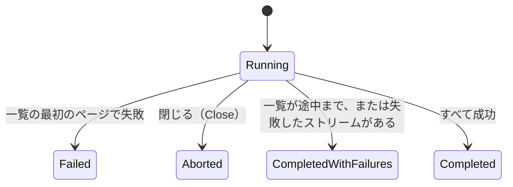
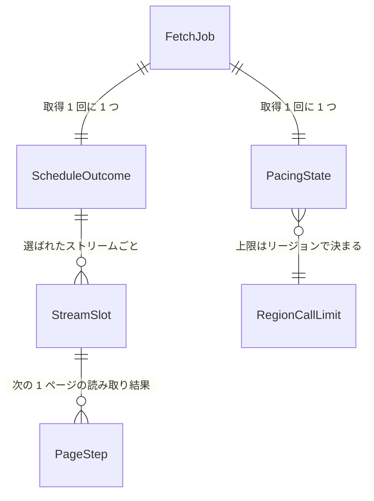

# Functional Spec — U1 薄い一本・同時取得（u1-concurrent-skeleton）

上流：`inception/units-generation/unit-of-work.md`（U1）・`unit-of-work-story-map.md`（US1.1〜US1.3）、`inception/requirements-analysis/requirements.md`、`inception/domain-design/components.md`・`decisions.md`、`inception/contract-design/contract-summary.md`、`entities.md`、`rules.md`。質問票の回答は `functional-design-questions.md` の Q1・Q2。アーキテクチャレビュー（1 回目）の指摘を反映済み。

この文書は、U1 の流れ（手順）と状態の移り変わりの正本である。データの形は `entities.md`、判断の決まりは `rules.md` が正本で、ここではそれを並べ直して見せる。

## 1. 取得 1 回の流れ

1. 画面（または確認用プログラム）が取得を始める。FetchCoordinator は取得 1 回の FetchJob を作り、`on_started` を呼ぶ（今と同じ）。
2. キャッシュを前段に置く流れ（照会して当たれば表示して終わる）は今と同じ。
3. 取得の条件のリージョンから CallPacer を 1 つ作る（BR1.1、BR1.2）。取得 1 回の全ストリームで共有する。
4. StreamPlanner がストリームの一覧を最後まで読む（BR1.9、今と同じ）。一覧の各ページで `on_listing_progress` を呼ぶ。
   - 一覧の最初のページで失敗して何も選べなかったら、読まずに Failed で終える（6 へ）。
5. 一覧が終わったら `on_planned` を呼び、StreamSchedule を選ばれたストリームで作る。同時に読む段（2 節）に入る。
6. すべてのストリームが終わったら、FetchCoordinator が一覧の段の結果と合わせて終わりの状態を決める（BR1.15）。Completed かつ失敗 0 ならキャッシュに書く（BR1.17、今と同じ流れ。`on_saving` を含む）。最後に `on_finished` を 1 回だけ呼ぶ。

## 2. 同時に読む段

読み取りは別のタスクに出さず（`tokio::spawn` は使わない）、取得 1 回のタスクの中で「1 本のストリームの次の 1 ページを読む」処理を最大 8 つ並べて進める。並べる入れ物には `futures-util` の FuturesUnordered を使う（今の依存にないため U1 で足す。MIT／Apache-2.0 で cargo-deny の許可に入る）。同じタスクの中なので、ゲートウェイや Retrier を借用のまま渡せる。

```
if 選ばれたストリームが 0 本: すぐ 1 節の 6 へ（今と同じく Completed）
loop:
  if 止める信号が来ていない:
    while 読み途中 < 8 and schedule.next() が未着手を返す:   # BR1.7, BR1.8
        そのストリームの「次の 1 ページ」を入れ物に入れる（3 節）
  if 入れ物が空: 抜ける                                          # すべて終わった
  入れ物から 1 つ終わるのを待つ（PageStep）
  if 止める信号が来ている: 返ったページは渡さず捨てる。次の 1 ページは入れない   # BR1.16
  elif Page: 保持先に混ぜ込み、on_batch、そのストリームの次の 1 ページを入れ物に入れる   # BR1.10, BR1.11
  elif Finished: schedule.finish(...)、on_stream_finished、
       あきらめで Skipped になったものがあれば それぞれ on_stream_finished          # BR1.13, BR1.19
```

- 終わりの判定は「入れ物が空で、未着手を始められない」こと。受け取りの待ちは入れ物に何か入っているときだけなので、永久に待つことはない。
- 受け口（FetchSink）と保持先には、この 1 か所からしか渡さない。受け口は同時には呼ばれない（ADR-003、約束 C4）。
- 1 本のストリームは前のページを渡し終えてから次の 1 ページを読むので、ページは必ずそのストリームの終わりの知らせより先になり、渡し待ちは最大 8 件になる（BR1.10、BR1.11）。別の通り道（チャネル）は持たない。
- 読み取りの中で panic が起きたときは、取得 1 回のタスクごと終わる（今と同じ）。アプリの「異常終了した取得の回復」（TauriApp）がそれを拾う。

## 3. 1 ストリームの読み取り

今の `fetch_stream`（1 本を最後まで読むループ、ページは同期の `on_page` で渡す）を、「次の 1 ページを読む」単位に分ける。ストリームごとの読み取りの状態（カーソル、ストリーム内の順番、再試行の数）を持つ値を作り、次の 1 ページの読み取りはその値を受け取って PageStep とその値を返す。ページの終わりの判定、ストリーム内の順番、再試行の待ちと回数（1・2・4・8・16 秒 ±20%、要求ごとに最大 5 回）は今と同じ。

試行の前の許可待ちは、`Retrier::call` に「試行の前に呼ぶ待ち処理」を渡す形にする。待ち処理は「進めてよい（Proceed）」か「止めた（Stopped）」を返す。

```
call(counter, before_attempt, attempt) -> CallResult:
  loop:
    if 止める信号 → Aborted                                # 今と同じ
    if before_attempt().await == Stopped → Aborted         # 許可待ち（BR1.4, BR1.5）
    match attempt().await: 成功 → Succeeded / 再試行しない失敗 → Failed / 再試行する失敗 → 待って続ける
call_unpaced(counter, attempt) = call(counter, || すぐ Proceed, attempt)   # 許可待ちなし
```

- GetLogEvents（EventFetcher）は `call` に CallPacer の許可待ちを渡す。許可待ちは止める信号も見ていて、来たら Stopped を返す（BR1.5）。
- DescribeLogStreams（StreamPlanner）は `call_unpaced` を使う。今の呼び出しはそのまま動き、速さの上限の対象にしない（FR2 は GetLogEvents が対象）。
- ロググループ一覧（DescribeLogGroups）は今のまま Retrier を通らず、SDK の既定の再試行も残す（BR1.6）。

## 4. 状態の移り変わり## 4. 状態の移り変わり

### ストリーム（StreamSlot）



文字による代替：未着手 → 読み途中（空きができて選ばれる）または失敗（あきらめで呼ばずに失敗）。読み途中 → 成功（最後まで読んだ）または失敗（失敗、または閉じるときに止めた）。

### 取得 1 回（JobStatus）



文字による代替：実行中から、一覧の最初の失敗なら Failed、閉じるなら Aborted、一覧が途中までか失敗があれば CompletedWithFailures、すべて成功なら Completed。値は今と同じ（BR1.15）。

## 5. 確かめ方（自動テストの条件）

偽物のゲートウェイ（FakeGateway）で、時間を止めて進める形で確かめる。実際の AWS には接続しない。U1 で FakeGateway に、1 回の呼び出しにかかる時間（台本で指定）、呼んだ時刻の記録、同時に出ている呼び出しの数の最大値の記録を足す。

| 確かめること | 条件 | 合格の基準 | 関わる AC |
|--------------|------|------------|-----------|
| 同時に呼んでいる | ストリーム 10 本、1 回の呼び出しに 200 ミリ秒 | 前の呼び出しが終わる前に、別のストリームの呼び出しが始まっている。同時の呼び出しは最大 8 | AC1.1.1 |
| 速くなる（NFR1） | 東京（上限 12 回／秒）、ストリーム 100 本・各 1 回の呼び出し、1 回 200 ミリ秒 | 全件がそろうまでの時間が、1 本ずつ読む今の方式（100 × 200 ミリ秒 ＝ 20 秒）の半分（10 秒）以下。見込みは約 8.5 秒（速さの上限で決まる） | AC1.1.2 |
| 呼び出しの量（NFR3） | 上と同じ条件と、制限の応答で再試行が起きる条件 | どの 1 秒をとっても、GetLogEvents の呼び出し（再試行を含む）が 12 回以下 | AC1.1.2（前提） |
| 選ぶストリームが同じ | 今のテストの一覧の条件 | 選ばれるストリームと順が今と同じ | AC1.1.3 |
| 最初の 1 件が早い | ストリーム 20 本、範囲にログがあるのは順で 5 本目から、1 回 200 ミリ秒 | 最初の on_batch が、1 本ずつの場合（約 1 秒）より早い | AC1.2.1、AC1.2.4 |
| 並びが時刻順 | 古い時刻のページが後から届く台本 | 一覧の並びが時刻・ストリーム名・順番の順 | AC1.2.2 |
| 100 万件の滑らかさ（NFR5） | 既存の速度測定テスト（`--release --ignored`） | 今と同じ基準で通る | AC1.2.3 |
| 一部の失敗 | 1 本が権限エラー | 他のストリームのログが残り、失敗が 1 件一覧される。失敗の詳細は安全な詳細だけ | AC1.3.1、AC1.3.2 |
| 許可待ちで止まる | 許可を待っている間に閉じる | AWS を呼ばずに止まり、Aborted で終わる | （BR1.5、U1 の安全網） |
| 閉じた後のページ | 応答待ちの間に閉じる | 閉じた後に返ったページは受け口に渡らない。最後のストリームの後でも on_finished の前に閉じたら Aborted | （BR1.16） |
| ページの順の保証 | 同時に読む 8 本 | 各ストリームの on_batch がそのストリームの on_stream_finished より先。渡し待ちは 8 件以下 | （BR1.10、BR1.11） |
| 許可の間隔 | 8 本が同時に許可を求める | 許可の時刻がすべて minInterval 以上あき、どの 1 秒の区間でも 12 回以下 | （BR1.3） |
| 0 本 | 一覧で何も選ばれない | 読まずに Completed で終わる（今と同じ） | （BR1.9） |
| SDK の再試行 | AwsCloudWatchLogsGateway の GetLogEvents の呼び出しの組み立て | GetLogEvents の呼び出しは SDK の再試行の回数が 1 に上書きされている。DescribeLogGroups・DescribeLogStreams は上書きしていない（組み立てた設定を確かめる単体テスト。AWS には接続しない） | （BR1.6） |
| 止める理由の強さ | Cancel→Close、Close→Cancel、同じ理由の繰り返し | Close が勝ち、繰り返しても変わらない | （BR1.20） |

AC1.1.4（実際の AWS で「かかった時間」で速さを確かめる）は、経過の表示を作る U4 で満たす。U1 では、手元の確認用プログラム（FetchCheck）で実際の AWS から同時に取得できることと、GUI で表示されることを確かめる（team-practices Walking Skeleton）。今の FetchCheck はリージョンを指定する引数がない（プロファイルの既定に任せる）ため、U1 でリージョンを必ず指定する引数を足す（指定がないと 1 秒 5 回になり、速さを正しく確かめられない）。

## 6. 規則のまとめ（rules.md から）

| 分類 | ルール |
|------|--------|
| 呼び出しの速さ | BR1.1〜BR1.6 |
| 同時に読む | BR1.7〜BR1.11 |
| 一覧の並びと結果 | BR1.12〜BR1.15、BR1.19 |
| 閉じる・キャッシュ・秘密 | BR1.16〜BR1.18 |

## 7. エンティティの関係（entities.md から）



文字による代替：取得 1 回に、速さの状態と読む段の終わり方が 1 つずつある。読む段には選ばれたストリームごとの状態があり、各ストリームは 1 ページずつ読み取り結果（ページか終わり）を返す。速さの上限はリージョンの上限の表で決まる。

## 8. 持ち越しの指摘の扱い

| 指摘 | U1 での扱い |
|------|-------------|
| ドメイン設計 R-12（許可待ちから止めた道） | 3 節の `Retrier::call` の形で片付けた |
| ドメイン設計 R-13（ADR-009 の見出しの言い回し） | ADR-009 は承認済みのため書き換えない。本文どおり、ストリームを読む段は StreamSchedule、取得 1 回の確定は FetchCoordinator（BR1.15） |
| ドメイン設計 R-14 の一部（一覧の段の状態の持ち方、決める表の置き場所） | 一覧の段の状態は今の FetchJob の listing_status・listing_failure のまま。終わりの状態を決める関数（今の decide_job_status）は FetchCoordinator に置き、FetchStatus は型だけを持つ |
| ドメイン設計 R-15（FetchCheck・RecordingSink の FetchStatus への依存） | 両方とも JobStatus を FetchStatus から取り込むように直す |
| 作業単位の切り分け R-05（U1 の担当部品に RetryPolicy） | U1 で Retrier（許可待ち）と StopSignal（理由つき）に手を入れる |
| 約束の設計 R-08（止める理由を読む時点） | U1 は Close だけなので、すべて止まった時点で理由を読み Aborted とする。Cancel との組み合わせは U5 |
| 約束の設計 R-11（StopSignal の持ち主） | 型は RetryPolicy の部品（retry.rs）に置き、`Retrier` がその受け口を持つ。部品としての持ち主は RetryPolicy のまま。今の `abort_pair`・`AbortHandle`・`AbortSignal`（`never` を含む）を、理由つきの StopHandle・StopSignal に置き換える（BR1.20） |
| ADR-007（ExhaustionStreak の移動） | U1 では移さない。今の RetryPolicy の ExhaustionStreak と max_consecutive_exhausted を、終わった順に当てはめて使う（BR1.13）。StreamSchedule への移動は U3 |
| JobStatus の取り込み先 | FetchStatus に移すと、今 coordinator の JobStatus を取り込んでいる箇所（coordinator.rs、cache/plan.rs、session.rs、src-tauri の lib.rs、examples/fetch_check.rs、tests の u1・u3・u5・u6 の流れのテストと recording_sink.rs）をすべて直す。値は変えないので、取り込み先を変えるだけ |
| 依存の追加 | 並べて進める入れ物に `futures-util`（既定の機能は切る）を足す。cargo-deny の許可するライセンス（MIT／Apache-2.0）に入る |

## Assumptions & Open Questions

- 仮の決め：NFR1 の偽物の条件（1 回 200 ミリ秒、100 本・各 1 回、東京）は、困りごとの場面（1 本あたりの呼び出しが少ない）に合わせて決めた。要件分析のレビューの指摘（偽物の時間が決まっていない）はこれで片付ける。
