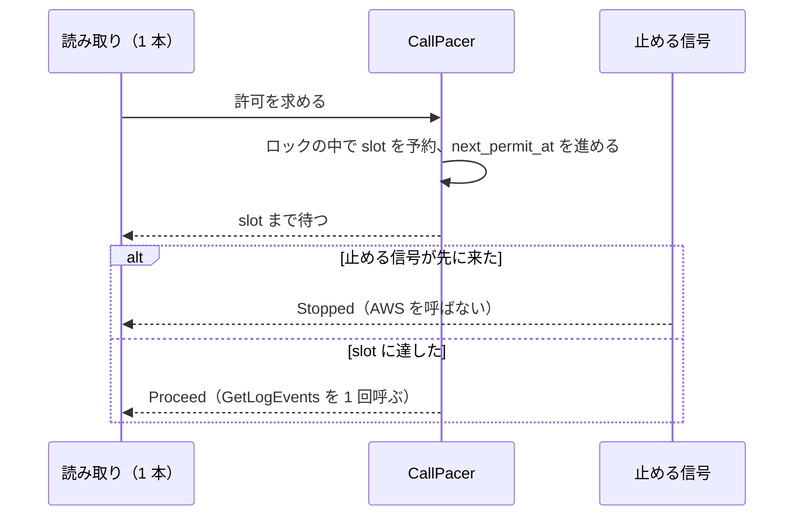

# Scalability Design — U1 薄い一本・同時取得（u1-concurrent-skeleton）

上流：`construction/u1-concurrent-skeleton/nfr-requirements/scalability-requirements.md`（NFR3.2〜NFR3.4、NFR1.4、NFR5.3）、`construction/u1-concurrent-skeleton/functional-design/rules.md`（BR1.1〜BR1.7）。質問票の回答は `nfr-design-questions.md` の Q1。

ローカルのアプリで、横に増やす・負荷を分ける仕組みはない。ここでの「伸び方」は、ストリームの本数が増えたときに、呼び出しの量を守りながら速く読むことである。

## 設計

| 要件 | 仕組み |
|------|--------|
| NFR3.2（どの 1 秒も上限の半分以下） | CallPacer はリージョンの上限の表から上限を決め（BR1.1、BR1.2）、許可の時刻を `next_permit_at` で管理する。許可は 1 つずつで、ためておく分はない |
| NFR3.3（8 本が同時に求めても間隔を守る） | 許可を求めたら、`std::sync::Mutex` の中で `slot = max(now, next_permit_at)`、`next_permit_at = slot + interval` を決めてからロックを放し、`slot` まで `tokio::time::sleep_until` で待つ。待つ前に予約するので、同じ時刻を 2 本が受け取らない |
| NFR3.4（SDK の再試行を数えない） | GetLogEvents の呼び出しにだけ、SDK の操作ごとの設定の上書きで再試行の回数を 1 にする。DescribeLogGroups・DescribeLogStreams はクライアントの既定のまま |
| NFR1.4（本数による伸び方） | 呼び出しの待ち時間より速さの上限が先に効くので、時間は「呼び出しの数 ÷ 上限」で伸びる。テストの合否には使わない |
| NFR5.3（同時 8 本で固定） | FetchCoordinator の定数。設定や画面からは変えられない |

## 許可待ちの手順（図）

文字による代替：読み取りが許可を求めると、CallPacer はロックの中で枠を予約して次の枠の時刻を進め、読み取りは枠の時刻まで待つ。待っている間に止める信号が来たら AWS を呼ばずに Stopped、枠の時刻になったら Proceed で GetLogEvents を 1 回呼ぶ。

## Assumptions & Open Questions

None.
