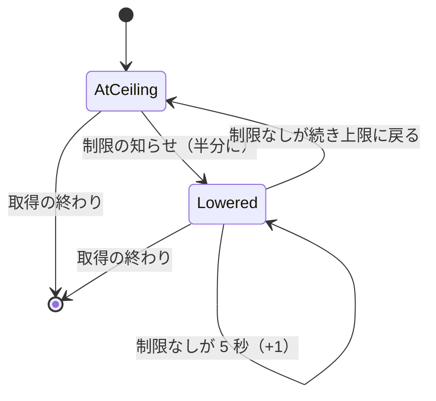

# Functional Spec — U2 呼び出しの速さ（u2-call-pacing）

上流：`inception/units-generation/unit-of-work.md`（U2）・`unit-of-work-story-map.md`（US2.2）、`inception/user-stories/stories.md`（AC2.2.1〜AC2.2.6）、`inception/requirements-analysis/requirements.md`（FR2.4〜FR2.6、NFR3）、`inception/domain-design/components.md`・`decisions.md`（ADR-001）、`inception/contract-design/contract-summary.md`（C1）、`entities.md`、`rules.md`、U1 の `functional-spec.md`。質問票の回答は `functional-design-questions.md` の Q1〜Q3。

この文書は、U2 の流れと状態の移り変わりの正本である。データの形は `entities.md`、判断の決まりは `rules.md` が正本。

## 1. 流れ

1. 取得を始めるとき、FetchCoordinator は今と同じく取得の条件のリージョンから CallPacer を 1 つ作る。今の速さはリージョンの上限（東京 12 回／秒）から始まる（BR2.6）。
2. 読み取りは、GetLogEvents のすべての試行の前に許可を待つ（U1 の BR1.4、変えない）。
3. 許可を求められたら、CallPacer はロックの中で次の順に決める（BR2.4、BR2.5）。
   1. 制限を受けない状態が 5 秒続いた分だけ、今の速さを 1 ずつ戻す（上限まで）
   2. 今の速さから間隔を求め、枠を予約する（slot = max(今, nextPermitAt)、nextPermitAt = slot + 間隔）
4. 試行が Throttled で終わったら、EventFetcher の `counted_call`（U1 で Throttled を数えている所）が CallPacer に知らせる（BR2.1）。CallPacer はロックの中で次の順に決める。
   1. たまっていた戻しを先に当てはめる（BR2.4。戻しを捨てない）
   2. quietSince を今にする（BR2.4）
   3. 次に下げてよい時刻（holdDecreaseUntil）より前なら、ここで終わる（BR2.3）
   4. そうでなければ、今の速さを半分にする（下限 1）。holdDecreaseUntil = max(今 + 1 秒, nextPermitAt)。最も低い速さを更新する（BR2.2）
5. その試行の再試行は、今と同じ待ち（1・2・4・8・16 秒 ±20%）の後、また許可を待つ。下げた速さが再試行にも効く（BR2.8）。
6. 取得が終わったら、FetchCoordinator が CallPacer の最も低い速さを読んで FetchStats に渡し、要約の 1 行に `min_rate=` を足して出す（BR2.7）。CallPacer を作る前に終わった取得（一覧の途中の中断・一覧の最初のページの失敗）では、リージョンの上限を出す。画面には何も足さない（FR2.6）。

```
apply_recovery():                         # ロックの中で呼ぶ
  if rate < ceiling:
    n = floor((now - quiet_since) / 5s)
    if n > 0:
      rate = min(ceiling, rate + n)
      quiet_since = quiet_since + n * 5s  # 端数は持ち越す

report_throttled():                       # ロックの中
  apply_recovery()
  quiet_since = now
  if hold_decrease_until is some and now < hold_decrease_until: return
  rate = max(1, rate / 2)                 # 切り捨て
  hold_decrease_until = max(now + 1s, next_permit_at)
  lowest = min(lowest, rate)

reserve_slot():                           # ロックの中
  apply_recovery()
  interval = ceil(1e9 / rate) ns
  slot = max(now, next_permit_at)
  next_permit_at = slot + interval
  return slot
```

## 2. 状態の移り変わり（今の速さ）



文字による代替：取得の始まりは上限の速さ。制限の知らせで半分になり（下げた状態）、下げた状態では、下げてよい時刻（下げてから 1 秒と、予約済みの枠が出終わる時刻の遅いほう）を過ぎた後の知らせでさらに半分（下限 1）、制限なしが 5 秒続くごとに 1 戻る。上限まで戻ると元の状態。どちらの状態からも取得の終わりで捨てる。

## 3. 例（東京、上限 12 回／秒）

| 時刻 | できごと | 今の速さ | 間隔 |
|------|----------|----------|------|
| 0 秒 | 取得を始める | 12 | 約 83 ミリ秒 |
| 2.0 秒 | 制限の知らせ（8 本のうち 5 本） | 6（最初の 1 件で下げ、残り 4 件は下げてよい時刻（3.0 秒。予約済みの枠は 2.6 秒ごろまでに出終わる）より前なので数えない） | 約 167 ミリ秒 |
| 3.5 秒 | 制限の知らせ | 3（下げてよい時刻を過ぎている） | 約 333 ミリ秒 |
| 8.5 秒 | 制限なしが 5 秒 | 4 | 250 ミリ秒 |
| 13.5 秒 | 制限なしが 10 秒 | 5 | 200 ミリ秒 |
| 48.5 秒 | 制限なしが 45 秒 | 12（上限） | 約 83 ミリ秒 |

## 4. 確かめ方（自動テストの条件）

偽物のゲートウェイ（FakeGateway）と止めた時計で確かめる。実際の AWS には接続しない。CallPacer の決まりは純粋な部品としてテストを先に書く（team.md）。

| 確かめること | 条件 | 合格の基準 | 関わる AC |
|--------------|------|------------|-----------|
| 半分に下げる | 東京、制限の知らせを 1 秒以上あけて 4 回 | 速さが 12 → 6 → 3 → 1 → 1 | AC2.2.3 |
| まとめて届いた知らせ | 下げてから 1 秒の間に 7 回の知らせ | 速さは 1 回分しか下がらない | AC2.2.3 |
| 予約済みの枠の後から届いた知らせ | 3 に下げたとき予約済みの枠が 2.7 秒先まである。下げてから 1.5 秒・2.5 秒に知らせ | どちらでも下げない（下げてよいのは予約済みの枠が出終わってから）。3.0 秒の後の知らせで 1 に | AC2.2.3 |
| 戻す | 3 に下げた後、知らせなしで 5 秒・10 秒・45 秒・60 秒 | 4・5・12・12 | AC2.2.3 |
| 端数の持ち越し | 3 に下げた知らせから 7 秒後に枠を予約、さらに 3 秒後に予約 | 7 秒後に 4、10 秒後に 5（端数の 2 秒を持ち越す） | AC2.2.3 |
| 戻しの数え直し | 3 に下げて、下げてよい時刻の後の 4 秒後に知らせ（1 に） | 知らせから 5 秒後に 2 | AC2.2.3 |
| 知らせの前にたまった戻し | 3 に下げてから知らせなし・枠の予約なしで 12 秒後に知らせ | 先に 2 段戻して 5 にしてから半分の 2 | AC2.2.3 |
| 間隔が広がる | 制限の応答が続く台本（GetLogEvents） | 許可の時刻の間隔が広がっていき、どの 1 秒も上限以下 | AC2.2.1、AC2.2.3 |
| 戻ると間隔が縮む | 制限が止んだ後 | 許可の間隔が上限の間隔まで戻る | AC2.2.3 |
| 予約済みの枠 | 枠を予約した後に下げる | 予約済みの枠の時刻は変わらず、次の枠から広い間隔 | （BR2.5） |
| 一覧の制限 | DescribeLogStreams が Throttled | 速さは変わらない | （BR2.1） |
| 再試行は今と同じ | 1 回の呼び出しが制限を 2 回受けて成功 | 待ちは 1・2 秒、許可は試行ごと | AC2.2.4 |
| 取得ごとに始め直す | 下げた取得の後に次の取得 | 次の取得は上限から | （BR2.6） |
| 要約の 1 行 | 下げた取得 | `min_rate=` に最も低い速さ、欄の順は streams・calls・throttled・elapsed_ms・max_in_flight・min_rate・status。U1 の要約の書式のテストを U2 の書式に直す | （BR2.7） |
| 要約の 1 行（CallPacer の前に終わる） | 一覧の途中で閉じる、一覧の最初のページで失敗 | `min_rate=` にリージョンの上限（東京 12、指定なし 5） | （BR2.7） |
| 画面に出さない | 下げている間の状態 | 状態行・通知に新しい表示が無い（JobStatus・FetchSink の知らせは今と同じ） | AC2.2.6 |

AC2.2.2（表にないリージョン）・AC2.2.5（SDK の再試行）は U1 で満たした。U2 ではそれらを変えない。

## 5. 規則のまとめ

| 分類 | ルール |
|------|--------|
| 知らせ | BR2.1 |
| 下げ方 | BR2.2、BR2.3 |
| 戻し方 | BR2.4、BR2.5 |
| 範囲 | BR2.6、BR2.7、BR2.8 |

## 6. 持ち越しの扱い

| 指摘 | U2 での扱い |
|------|-------------|
| U1 のコード生成のレビュー R-01（pacing.rs の冒頭の「切り上げで間は縮まない」は誤り） | U2 で pacing.rs の冒頭の文書を書き直すときに直す（project.md Corrections：レビューを記録した後の修正は次の作業単位）。同じ所で、ロックが守るものが時刻 1 つではなくなることに合わせ、壊れたロックの扱いの説明も書き直す（entities.md の PacingState の制約） |
| U1 のコード生成のレビュー R-02（計画のチェック） | U1 の記録の中のことで、U2 のコードは変えない |
| 約束 C1「制限を受けたときの下げ方と戻し方の数値」 | Q1・Q2 で決めた（BR2.2〜BR2.4） |

## Assumptions & Open Questions

None.
