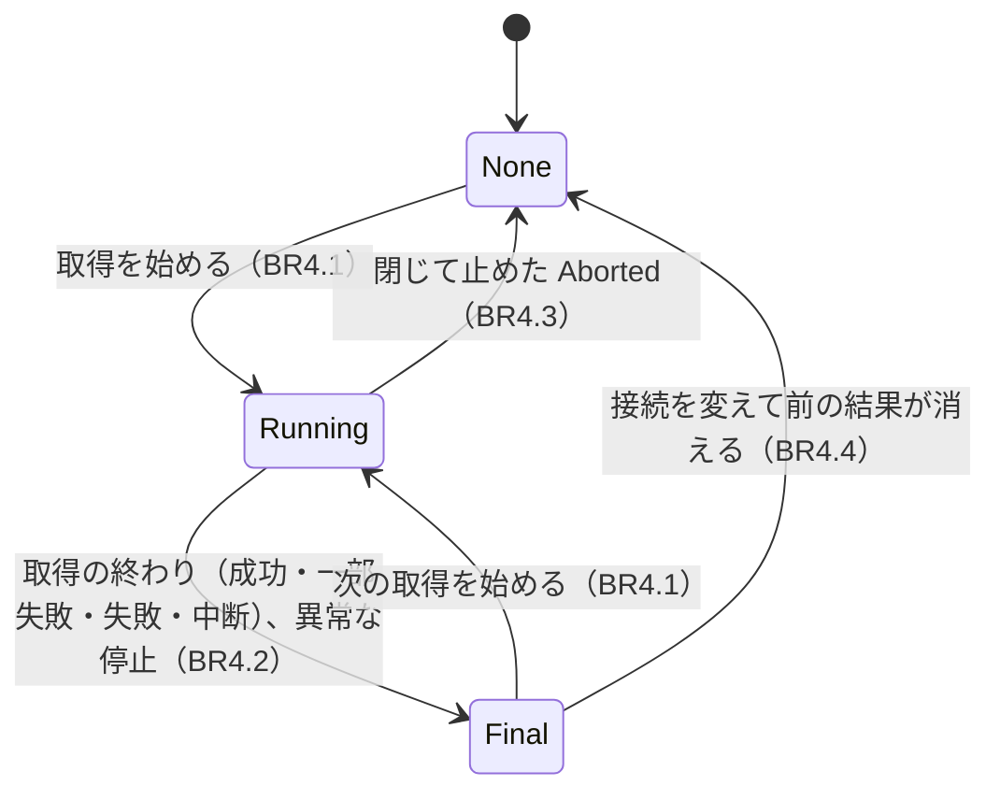
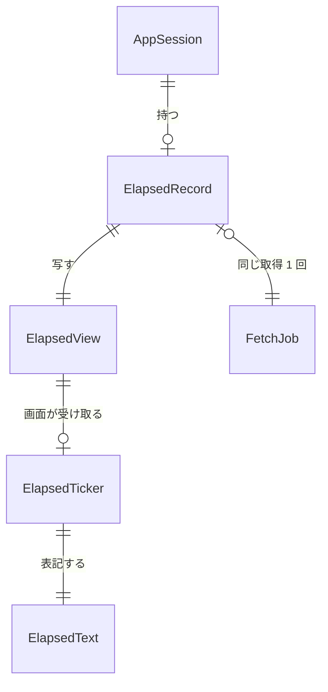

# Functional Spec — U4 かかった時間（u4-elapsed-time）

上流：`entities.md`（ElapsedRecord、ElapsedView、ElapsedTicker、ElapsedText）、`rules.md`（BR4.1〜BR4.10）、`inception/requirements-analysis/requirements.md`（FR4.1〜FR4.6、NFR6、NFR9）、`inception/user-stories/stories.md`（US2.1）、`inception/domain-design/decisions.md`（ADR-005）、`inception/contract-design/contract-summary.md`（C4、C5）、`inception/refined-mockups/`（mockups.md、interaction-spec.md、accessibility-checklist.md）。質問票の回答は `functional-design-questions.md`。

U4 は取得の流れそのもの（一覧・同時の読み取り・再試行・あきらめ）を変えない。AppSession に経過の記録を足し、SessionView に `elapsed` を足し、画面の状態行に経過を出す。

## 1. 流れ

### 1.1 取得（成功・一部失敗・失敗）

1. 利用者が［取得］を押す。AppSession が操作を受け入れて取得中に移り、startedAt を記録する（BR4.1）。このときの SessionView は `elapsed = { running: true, elapsedMs: 0 付近 }`。
2. 画面は SessionView を受け取り、ElapsedTicker の baseMs・receivedAt を置き換えて、1 秒ごとに状態行の「経過 00:01」「経過 00:02」…を描き直す（BR4.6）。
3. 一覧の進み・取得の進み・キャッシュへの保存など、状態が変わって SessionView が届くたびに、画面はその elapsedMs に合わせ直す。進み具合（fetch-progress）は経過を持たない（BR4.5）。
4. 再試行の待ち（最長 16 秒）の間はライブラリから何も届かないが、画面の時計が進め続ける（AC2.1.2）。
5. 取得が終わる。AppSession が finalElapsedMs を決め（BR4.2）、SessionView は `elapsed = { running: false, elapsedMs: 最終の値 }`。
6. 画面は時計を止め、最終の値を出す。状態行の変化は今と同じく控えめに読み上げられ、最終の経過も読み上げに含まれる（BR4.9）。
7. 最終の経過は、次に［取得］を押すまで残る。同じ接続でロググループを選び直すだけなら残る。

### 1.2 キャッシュから表示する取得

1. ［取得］の押下で 1.1 の 1 と同じく始まりを記録する。
2. キャッシュに当たって表示し終えると、取得の終わりとして最終の値を決める（BR4.2）。ほぼ一瞬なので 00:00 か 00:01 になる。
3. 状態行は今と同じキャッシュの通知の後ろに経過を出す（AC2.1.4）。

### 1.3 キャッシュへの保存を伴う取得

1. 全ストリームが読み終わり、キャッシュに保存している間も段階は取得中で、経過は進み続ける（「キャッシュに保存中 経過 00:30」）。
2. 保存が終わってから取得の終わりが届くので、最終の値は保存の時間を含む（BR4.2）。

### 1.4 接続を変える

1. 取得が終わった後に、プロファイルかリージョンを変える（表示中のログがあれば今の確認ダイアログを経る）。
2. 前の結果が消えるのと一緒に ElapsedRecord を消す（BR4.4）。SessionView は `elapsed = null`、状態行は取得前の表示に戻る。

### 1.5 閉じる

1. 取得中にアプリを閉じると、今と同じく取得は Aborted で終わり、段階は取得前に戻る。ElapsedRecord を消し（BR4.3）、経過は出さない。

### 1.6 取得の作業が異常に止まった

1. 取得の作業が結果を返さずに止まったとき（今の abort_fetch_with_failure）、失敗として終える時点で最終の値を決める（BR4.2）。状態行は今の失敗の文の後ろに最終の経過を出す。

## 2. 状態の移り変わり（ElapsedRecord）

テキストでの代替：

| 今の状態 | 出来事 | 次の状態 | SessionView.elapsed |
|----------|--------|----------|---------------------|
| None | 取得を始める | Running | `{ running: true, elapsedMs: 今 − startedAt }` |
| Running | 取得の終わり・異常な停止 | Final | `{ running: false, elapsedMs: 最終の値 }` |
| Running | Aborted | None | `null` |
| Final | 次の取得を始める | Running | `{ running: true, … }`（値は 0 付近から） |
| Final | 接続の変更で前の結果が消える | None | `null` |
| Final | 同じ接続でロググループを選び直す | Final（変わらない） | 同じ |

取得中に接続は変えられない（今の決まり）ので、Running から接続の変更で None に移る道はない。

## 3. 画面（StatusLine と時計のフック）

### 3.1 状態行の並び

状態行の今の部品の並びは変えず、経過を次の位置に足す（BR4.8）。

| 段階 | 状態行（日本語の例） |
|------|----------------------|
| 取得前（一度も取得していない、接続を変えた後） | 今と同じ。経過は出さない |
| 一覧を読んでいる | ◌ ストリームを列挙中… これまでに n ストリームを対象にしました　経過 00:03 |
| ストリームを読んでいる | ◌ 取得中… 42/180 ストリーム、これまでに 12,345 件　経過 00:07 |
| キャッシュに保存中 | ◌ 取得中… …　◌ キャッシュに保存中　経過 00:30 |
| 終わった | 12,345 件　経過 00:31 |
| 一部失敗 | 12,345 件　2 ストリームで失敗 [失敗の詳細を見る]　経過 00:31 |
| 0 件 | 0 件：この範囲にログはありません。　経過 00:02 |
| 失敗 | 今の失敗の文　経過 00:05 |
| キャッシュから表示 | 12,345 件　キャッシュから表示しました　経過 00:00 |

並び順は「取得の状態 → キャッシュの表示 → 経過 → ログの絞り込みの表示」とする。ログの絞り込みは取得とは別の操作の表示なので、経過は取得に関わる表示の最後に置く。

### 3.2 時計のフック（ScreenHooks）

- 入力は SessionView の `elapsed`。出力は表示する経過のミリ秒（または無し）。
- running の間だけ 1 秒ごとの描き直しを予約し、running でなくなるか `elapsed` が空になったら止める（BR4.6）。画面を閉じたときも止める。
- 描き直しのたびに表記の関数（BR4.7）で文字列にし、文言（「経過 {time}」／「Elapsed {time}」）に入れる。

### 3.3 読み上げ

- 状態行は今と同じく `role="status"`（控えめな読み上げ）。
- running の間、経過の部分は読み上げの対象から外す。秒が進んでも読み上げは起きない（AC2.1.7）。
- 取得が終わって running でなくなると、経過の部分を対象に戻す。終わったときの状態行の変化と一緒に、最終の経過も読み上げられる（Q1）。

## 4. 確かめ方（自動テストの条件）

| 確かめること | どこで | 例 |
|--------------|--------|----|
| 表記（BR4.7） | 画面のテスト（Vitest、テスト先行） | 0 → 00:00、999 ms → 00:00、7,999 ms → 00:07、3,599,999 ms → 59:59、3,600,000 ms → 1:00:00、75 分 → 1:15:00、10 時間 → 10:00:00、負 → 00:00 |
| 始まりと最終の値（BR4.1、BR4.2） | ライブラリのテスト（時計を差し替える） | 始めて 31.4 秒後に終わる → running false、elapsedMs 31,400。終わった後に時計が進んでも値は変わらない |
| 取得中の値（BR4.5） | ライブラリのテスト | 始めて 7 秒後に SessionView を作る → running true、elapsedMs 7,000 |
| キャッシュへの保存を含む（BR4.2） | ライブラリのテスト | 保存の知らせの後、さらに 3 秒たって終わり → 最終の値に 3 秒が入る |
| 断られた操作では変わらない（BR4.1） | ライブラリのテスト | 取得中に［取得］がもう一度来ても startedAt は変わらない |
| Aborted で消える（BR4.3） | ライブラリのテスト | 閉じて止めた → elapsed は null |
| 接続の変更で消え、ロググループの選び直しでは残る（BR4.4） | ライブラリのテスト | 終わった後に接続を変える → null。同じ接続でロググループを選び直す → 最終の値のまま |
| 異常な停止でも最終の値（BR4.2） | ライブラリのテスト | abort_fetch_with_failure → running false |
| 一度も取得していない（BR4.5） | ライブラリのテスト | 起動直後の SessionView → elapsed null |
| 1 秒ごとに進み、合わせ直す（BR4.6） | 画面のテスト（時計を差し替える） | running で elapsedMs 5,000 を受け取り 2 秒進める → 00:07。新しい elapsedMs 20,000 を受け取る → 00:20 |
| 終わったら止まる（BR4.6） | 画面のテスト | running false を受け取った後に時計を進めても表示は変わらない |
| 並びと文言（BR4.8） | 画面のテスト | 取得中・終わった・0 件・一部失敗・失敗で末尾に経過、英語は「Elapsed 00:07」、取得前は出ない |
| 読み上げ（BR4.9） | 画面のテスト | running の間は経過の部分が読み上げの対象外、終わった後は対象 |
| 秒ごとに送らない（BR4.5） | ライブラリのテスト | FetchProgressUpdate の項目が今と同じ |

GUI では、取得中に経過が 1 秒ごとに進み（再試行の待ちの間も）、終わると最終の値が残ることを目で確かめる（unit-of-work の確かめ方）。

## 5. エンティティの関係（entities.md から作った図）

テキストでの代替：AppSession は ElapsedRecord を 0 個か 1 個持つ。ElapsedRecord は SessionView の ElapsedView に写され、画面の ElapsedTicker がそれを受け取って 1 秒ごとに ElapsedText に表記する。ElapsedRecord は同じ取得 1 回の FetchJob に対応するが、FetchJob には項目を足さない。

## 6. 規則のまとめ（rules.md から）

| ID | 内容 |
|----|------|
| BR4.1 | 取得中に移った時点を始まりにする |
| BR4.2 | 終わった時点で最終の値を決め、次の取得まで残す（保存の時間を含む、異常な停止も同じ） |
| BR4.3 | 閉じて止めた（Aborted）ときは出さない |
| BR4.4 | 接続の変更で前の結果が消えるときは一緒に消す。ロググループの選び直しでは残す |
| BR4.5 | SessionView を作るたびに渡し、秒ごとには送らない |
| BR4.6 | 取得中は画面の時計で 1 秒ごとに進め、受け取るたびに合わせ直す |
| BR4.7 | mm:ss / h:mm:ss、秒未満は切り捨て |
| BR4.8 | 状態行の取得の表示の後ろ（絞り込みの表示の前）に「経過 {time}」 |
| BR4.9 | 取得中は読み上げず、終わったら最終の値も読み上げる |
| BR4.10 | 戻らない時計で数え、テストで差し替える |

## 7. U5 とのつながり

- U5 が足す中断（Cancelled）は、BR4.2 の「取得の終わり」に入る。U4 では Cancelled の値をまだ持たないが、Aborted 以外の終わりをすべて最終の値にする形にしておくので、U5 で経過の決まりを足す必要はない。
- 中断中（cancelling）も段階は取得中のままなので、経過は進み続ける（refined-mockups の状態と見た目の対応）。

## Assumptions & Open Questions

- [assumption] 始まりは、約束 C4 の文（on_started を受けた時点）ではなく、取得を始める操作を AppSession が受け入れた時点（今の begin_fetch）にする。押した時点（FR4.2）にいちばん近く、on_started との差は同じ操作の中の処理の分だけである。C4 の「FetchJob には足さない」は守る
- [assumption] 状態行で経過を置く位置は、ログの絞り込みの表示より前とする（mockups は絞り込みと経過が並ぶ場面を描いていない）
