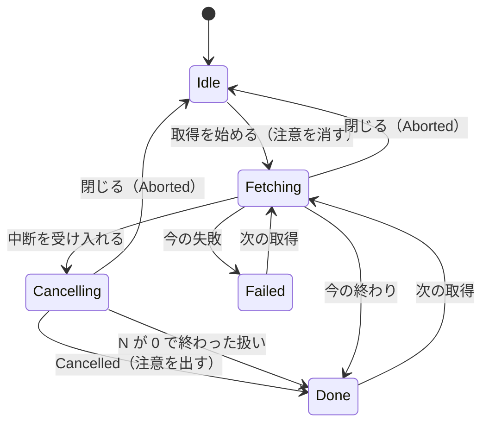
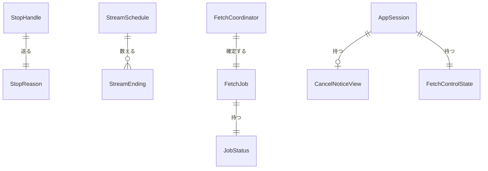

# Functional Spec — U5 中断（u5-cancel）

上流：`entities.md`、`rules.md`（BR5.1〜BR5.14）、`inception/units-generation/unit-of-work.md`（U5）、`inception/requirements-analysis/requirements.md`（FR5.1〜FR5.11、NFR4、NFR8〜NFR10）、`inception/user-stories/stories.md`（US3.1、US4.1、US4.2）、`inception/domain-design/components.md`・`decisions.md`（ADR-004、ADR-006、ADR-009）、`inception/contract-design/contract-summary.md`（C2〜C7）、`inception/refined-mockups/`（画面 A〜D、CancelNotice、文言の一覧）。質問票は `functional-design-questions.md`（まとめの確認）。

## 1. 流れ

### 1.1 読む段で中断する（一覧の後）

1. 取得中、ボタンは［中断］（BR5.10）。利用者が押す。確認は出さない。
2. 画面が `cancel_fetch` を送る。AppSession が押せるかを確かめ（BR5.2）、AppState が今の取得の持ち手に Cancel を送り、AppSession は cancelling を立てる（BR5.1）。ボタンは［中断中…］になり、フォーカスはそのまま。
3. 取得の流れは新しい呼び出しを始めない（BR5.3）。再試行の待ちや許可待ちのストリームはすぐ「止めた」になる。応答待ちのストリームは応答を待つ。まだ始めていないストリームは始めない。
4. 止めた後に届いた応答は BR5.4 の表のとおり記録する。
5. 読む段が止まる。StreamSchedule が「止めた」とまだ始めていない本数を出し、N を数える（BR5.4）。止めた後はあきらめを起こさない。
6. FetchCoordinator が終わりの状態を決める（BR5.5）。N > 0 なら Cancelled、N = 0 なら止めていないときと同じ決め方。
7. Cancelled ならキャッシュに書かない（BR5.7）。FetchSink の on_finished が届く。
8. AppSession は cancelling を戻し、段階を Done にし、cancelNotice に N を入れる（BR5.8）。ボタンは［取得］に戻る。
9. 画面はログの表の上に注意（「取得を中断しました。N 本の…」）を出し、一度読み上げる（BR5.11）。状態行は「中断・件数・失敗のリンク・経過」（BR5.12）。取れたログは表示したまま、絞り込みも使える。

### 1.2 止めた後に届く応答（BR5.4）

| 届いたもの | 理由 Cancel | 理由 Close |
|------------|-------------|------------|
| 最後でないページ | 一覧に足して on_batch で渡す。次のページは頼まない。ストリームは「止めた」（N に入る） | 捨てる（今と同じ） |
| 最後のページ | 一覧に足し、ストリームは読み終えた（N に入らない） | 捨てる |
| 失敗 | 失敗として記録する（失敗の件数とリンクに入り、N に入らない）。あきらめは起こさない | 捨てる |
| （再試行の待ち・許可待ちだった） | 「止めた」（N に入る） | 今と同じ |

### 1.3 一覧の途中で中断する

1. 一覧を読んでいる間に［中断］。1.1 の 2 と同じ。
2. 一覧の呼び出しは応答を待ってから止まり、読む段は始まらない。
3. 終わりは Cancelled、cancelled_before_listing = true（BR5.5）。ログは 0 件。キャッシュには書かない。
4. 注意は「ストリームの一覧を読み終える前に中断したため…」。状態行は「中断 0 件 経過」（範囲にログがない文は出さない）。

### 1.4 最後のストリームを読み終えた直後に中断が届く

1. 中断が届いたとき、出ている応答がそれぞれのストリームの最後のページで、まだ始めていないストリームもない。
2. 応答はすべて読み終えたとして記録され、N = 0 になる。終わりは止めていないときと同じ決め方（Completed か CompletedWithFailures）（BR5.5、FR5.9）。
3. on_finished の前に、今のとおりキャッシュに書くかを判定する（Completed かつ失敗 0 なら書く、BR5.7）。注意は出さない。

### 1.5 中断の後にウィンドウを閉じる

1. 中断中にウィンドウを閉じる。今と同じ確認が出る。閉じると理由が Close に強まる（BR5.6）。
2. 終わりは Aborted。取れたログを捨てて取得前に戻り、アプリは終わる。

### 1.6 キャッシュを引いている間・キャッシュに保存中

1. キャッシュを引いている間（look_up の待ち）は［中断］を押せる（BR5.2）。当たったら、キャッシュの結果は全部そろっているので最後まで表示し、Completed で終わる。当たらなければ一覧の前の中断（1.3）になる（BR5.5）。
2. キャッシュに保存している間は［中断］は押せない見た目（BR5.2、BR5.10）。押せないときに `cancel_fetch` が届いても何もしない（BR5.1）。
3. どの終わり方でも cancelling は戻る（BR5.8）。

## 2. 状態の移り変わり（画面の段階とボタン）

テキストでの代替：

| 今 | 出来事 | 次 | ボタン | 注意 |
|----|--------|----|--------|------|
| Idle・Done・Failed | 取得を始める | Fetching | ［中断］ | 消す |
| Fetching（押せる） | 中断を受け入れる | Fetching（cancelling） | ［中断中…］ | — |
| Fetching（キャッシュに保存中） | 中断が届く | 変わらない | 押せない［中断］ | — |
| Fetching（キャッシュを引いている間） | 中断を受け入れ、キャッシュに当たる | Done（Completed） | ［取得］ | 出さない |
| Fetching（cancelling） | Cancelled | Done | ［取得］ | 出す |
| Fetching（cancelling） | N = 0 で終わる | Done・Failed | ［取得］ | 出さない |
| Fetching（cancelling） | 閉じる | Idle | — | 出さない |
| Done（注意あり） | 接続の変更・別のロググループ | Idle・Done | ［取得］ | 消す |

Cancelling は画面の見た目のための区別で、SessionView の段階は Fetching のまま（cancelling が true）（C5）。

## 3. 例（FR5.4）

180 本、同時 8 本。40 本読み終え、2 本失敗、5 本読み途中、133 本まだ始めていない時点で中断。読み途中の 5 本のうち、応答で最後のページだったものはない。

- N = 5（止めた）＋ 133（まだ始めていない）＝ 138
- 注意：「取得を中断しました。138 本のストリームは読み終えていないため、一部のログが含まれていません。」
- 状態行：「中断 12,345 件 2 ストリームで失敗 [失敗の詳細を見る] 経過 00:09」

読み途中の 5 本のうち 1 本が応答で最後のページだったら、その 1 本は読み終えた扱いになり N = 137。

## 4. 確かめ方（自動テストの条件）

| 確かめること | どこで |
|--------------|--------|
| 中断の後は新しい GetLogEvents が 0 回、待ちの間ならすぐ止まる、応答待ちのページは渡される（BR5.3） | 偽物のゲートウェイと止めた時計の結合テスト |
| N の数え方と止めた後の応答の表（3 節の例を小さくしたもの、最後のページだったものは数えない、止めた後の失敗は失敗に入る、止めた後はあきらめない）（BR5.4） | StreamSchedule の単体テスト（テスト先行）と結合テスト |
| 終わりの状態の決め方の表、N = 0 でキャッシュに書く、キャッシュを引いている間の中断（BR5.5） | decide_job_status の単体テスト（テスト先行）と結合テスト |
| 一覧の途中の中断で Cancelled・一覧の前の印・0 件（BR5.5） | 結合テスト |
| 中断の後の閉じるで Aborted、閉じるの今の動き（BR5.6） | 結合テストと今の回帰テスト |
| Cancelled はキャッシュに書かない（BR5.7） | CachePlan の単体テスト |
| AppSession の cancelling（どの終わり方でも戻る）・fetchCancelAvailable・cancelNotice・段階・消えるとき（BR5.1、BR5.2、BR5.8、BR5.9） | session.rs の単体テスト |
| ボタンの 4 つの見た目、フォーカスが動かない（BR5.10） | 画面のテスト |
| 注意の文・role・閉じるボタンなし・エラーの表示と同時に出ない（BR5.11） | 画面のテスト |
| 状態行の「中断」と 0 件（BR5.12） | 画面のテスト |
| 文言の英日（BR5.13） | 文言の一覧のテスト |

## 5. エンティティの関係（entities.md から作った図）

テキストでの代替：StopHandle が理由（StopReason）を送る。StreamSchedule がストリームごとの終わり方を数えて N を出す。FetchCoordinator が FetchJob の終わりの状態（JobStatus）と N・一覧の前の印を確定する。AppSession はそれを受けて中断の注意とボタンの状態を持つ。

## 6. 規則のまとめ（rules.md から）

| ID | 内容 |
|----|------|
| BR5.1 | ［中断］の操作を受け入れたら、アプリ（AppState）が止める信号に理由「中断」を送り、AppSession を中断中にする |
| BR5.2 | ［中断］を押せるのは、取得中で、中断中でなく、キャッシュに保存中でないときだけ |
| BR5.3 | 止める信号が来たら、新しい呼び出しを始めない。出ている呼び出しの応答は待ち、待ちの間ならすぐに止まる |
| BR5.4 | 止めた後に届いた応答は、理由が「中断」なら次のとおり記録し、「閉じる」なら今のとおり捨てる。読み終えていない本数 N は、途中で止めたストリームとまだ始めていないストリームの合計 |
| BR5.5 | 止める信号で止まった取得の終わりの状態は、FetchCoordinator が止めた理由と N と一覧の進み具合から決める |
| BR5.6 | 閉じるは常に中断より強い |
| BR5.7 | 中断した取得はキャッシュに書かない |
| BR5.8 | どの終わり方でも中断中を戻し、Cancelled なら取れたログを表示したまま終わった段階に移り、注意を持つ |
| BR5.9 | 中断の注意は、次の取得を始めたとき、接続を変えたとき、別のロググループを選んだときに消す |
| BR5.10 | 取得のボタンは同じ場所で［取得］→［中断］→［中断中…］→［取得］と変わり、フォーカスは動かない |
| BR5.11 | 中断の注意はログの表の上に warning の注意として出し、アイコンと文で伝え、一度だけ読み上げる |
| BR5.12 | Cancelled で終わったときの状態行は「中断」・件数・（あれば）失敗の件数とリンク・最終の経過 |
| BR5.13 | 新しい文言は英語と日本語を用意する |
| BR5.14 | Cancelled と N を使う側をすべて追従させる |

## Assumptions & Open Questions

None.
