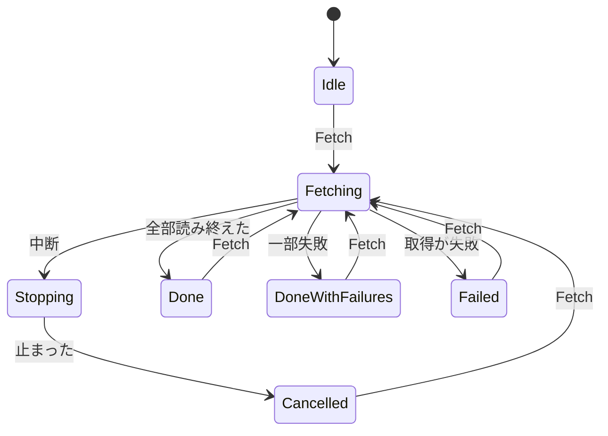

# User Flow — ロググループ全体の取得の高速化

上流：`ideation/intent-capture/intent-statement.md`、`ideation/scope-definition/scope-document.md`、`ideation/scope-definition/intent-backlog.md`

## 流れ 1：取得して全件を見る（主な流れ）

```
Flow: ストリームの多いロググループのログを取得する
Persona: 開発者本人（同僚・OSS の利用者も同じ）
Trigger: ロググループと時間範囲を選んで [Fetch] を押す
Steps:
  1. 条件エリア -> [Fetch] を押す -> ボタンが [中断] に変わり、状態表示に経過が出て進み始める
  2. 取得中 -> 待つ -> 届いたログが時刻順に一覧へ入り、状態表示の本数・イベント数・経過が進む
  3. 取得中 -> （任意）ログの絞り込みに文字を入れる -> 届いた分から絞り込まれる（今と同じ）
  4. 全部読み終える -> ボタンが [Fetch] に戻り、状態表示に最終の経過が残る
Success outcome: 全件が時刻順に並び、状態表示で「かかった時間」が分かる
Error paths:
  - 一部のストリームが失敗 -> 状態表示に失敗の件数のリンク（今と同じ） -> 一覧を開いて確かめる
  - 取得そのものが失敗 -> ログ一覧の上にエラーの表示（今と同じ） -> 表示のとおりに直してもう一度 [Fetch]
  - 制限を受けた -> 画面は変わらず、アプリが引き下がって読み続ける（遅くなるだけ）
```

## 流れ 2：途中で止める

```
Flow: 取得を途中で中断する
Persona: 開発者本人（同僚・OSS の利用者も同じ）
Trigger: 取得中に、もう十分なログが見えた、または条件を間違えたと気づく
Steps:
  1. 取得中 -> [中断] を押す（確認なし） -> ボタンが [中断中…] になり押せなくなる
  2. 止まるまで待つ（短い間） -> ボタンが [Fetch] に戻る
  3. ログ一覧の上に「取得を中断しました。N 本のストリームは読み終えていないため、一部のログが含まれていません」と出る
  4. 取れたログを見る、絞り込む -> 今と同じく使える
  5. （任意）条件を直して [Fetch] -> 注意の表示が消え、新しい取得が始まる
Success outcome: 取れた分を見られ、取れていない部分があることが分かる
Error paths:
  - 一覧を読み終える前に中断 -> 「ストリームの一覧を読み終える前に中断したため、一部のログが含まれていません」
  - 何も取れないうちに中断 -> 一覧は空のまま、注意の表示で中断したことが分かる
```

## 流れの図



テキスト版：取得前 →（Fetch）→ 取得中。取得中から、中断を押すと「中断中」を経て「中断した」へ、全部読み終えると「終わった」へ、一部失敗なら「一部失敗で終わった」へ、取得が失敗すれば「失敗した」へ移る。どの終わり方からも、Fetch でまた取得中に戻る。

## 今と変わらない流れ

- 取得中にウィンドウを閉じようとしたときの確認（今と同じ）。
- 取得中は日時・タイムゾーン・接続を変えられない（今と同じ）。
- キャッシュから表示する流れ（今と同じ。かかった時間は表示する）。

## Assumptions & Open Questions

- [assumption] 制限を受けて引き下がっている間も、画面には特別な表示を出さない（遅くなるだけ）。質問では決めていない
