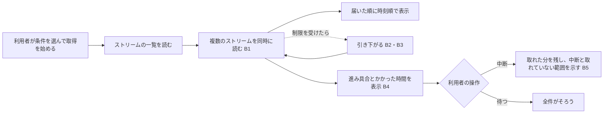

# Scope Document — ロググループ全体の取得の高速化

上流：`ideation/intent-capture/intent-statement.md`、`ideation/feasibility/feasibility-assessment.md`、`ideation/feasibility/constraint-register.md`

## 目的

ストリームが数十〜数百本あるロググループで短い時間範囲を取得するとき、待ち時間を短くする。あわせて、取得の進み具合を見られるようにし、取得を途中で止められるようにする。（intent-statement の Problem Statement）

## 範囲内（In Scope）

| ID | 項目 | 優先度 | 出典 |
|----|------|--------|------|
| B1 | 複数のストリームを同時に読んで、取得を速くする | Must | intent-statement、Q1 |
| B2 | 制限を受けたら、同時に読む量を減らすなどして引き下がる。使う量は呼び出しの上限の半分程度まで | Must | feasibility Q2、constraint-register C-O1、Q1 |
| B3 | 「再試行を使い切ったストリームが 3 本続いたらあきらめる」決まりを、ねらいを保ったまま同時に読む形に合わせて決め直す | Must | feasibility Q4、Q1 |
| B4 | 取得の進み具合を表示する。取得にかかった時間も表示する | Must | intent-statement、Q1、Q5 |
| B5 | 取得を中断できるようにする。取れた分は画面に残し、中断したことと取れていない範囲があることを示す | Must | intent-statement、feasibility Q3、Q1 |

## 範囲外（Out of Scope）

| 項目 | 出典 |
|------|------|
| Logs Insights 互換のクエリ | intent-statement |
| 利用者が速さの設定（同時に読む本数など）を変えられるようにすること | intent-statement、constraint-register C-O4 |
| 変更前の版との速さの比較（計測） | Q4 |
| 読み取りの 3 つ以外の呼び出しを使った高速化 | constraint-register C-T1 |
| 呼び出しの上限の引き上げ申請 | constraint-register Out of Scope |

## 変えないもの

| 項目 | 出典 |
|------|------|
| 利用者から見たディスクキャッシュの動き（すべて成功した取得だけを残す。中断した取得は残さない） | intent-statement、constraint-register C-T6 |
| 表示は時刻順 | constraint-register C-T5 |
| 取得に失敗したストリームを別に一覧する表示 | feasibility raid-log R-03 |

## 成功の判断

| 目安 | 判断のしかた | 出典 |
|------|--------------|------|
| 全件がそろうまでの時間が目に見えて短い | 進み具合の表示に出る「取得にかかった時間」を見て、開発者本人が判断する。変更前の版との厳密な比較はしない | intent-statement の Success Metrics、Q4、Q5 |
| 最初の 1 件が出るまでの時間が短い | 同上（画面に最初の行が出るまでを目で見て判断する） | intent-statement の Success Metrics、Q5 |

## 期限と削る順

- 期限は 1 週間以内。（feasibility Q6、constraint-register C-O2）
- 収まらないときは、まず中断（B5）を外し、次に進み具合の表示（B4）を外す。B1〜B3 は外さない。（Q2）

## 進める順

価値が先：速くする部分（B1〜B3）を先に作り、そのあと表示（B4・B5）に進む。（Q3）

## 価値の流れ

テキスト版：取得を始める → ストリームの一覧を読む → 複数のストリームを同時に読む（制限を受けたら引き下がる）→ 届いた順に時刻順で表示し、進み具合とかかった時間を出す → 利用者が中断すれば取れた分を残し、待てば全件がそろう。

## Assumptions & Open Questions

None.
