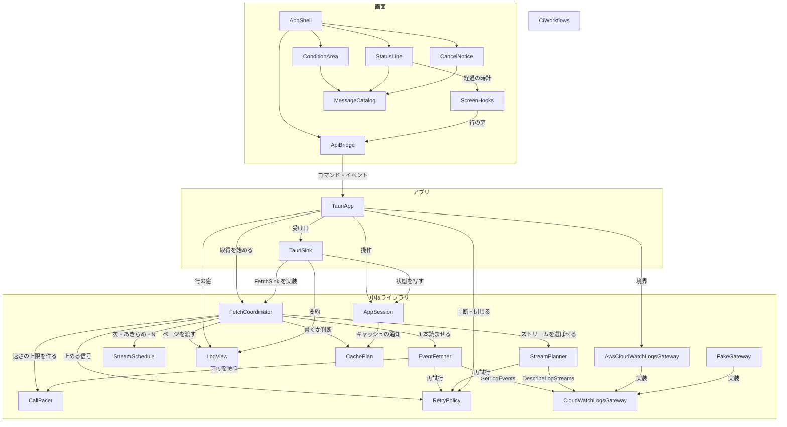

# Components — ロググループ全体の取得の高速化

上流の成果物：`inception/requirements-analysis/requirements.md`（FR1〜FR6、NFR1〜NFR10）、`inception/user-stories/stories.md`（US1.1〜US4.2）、`inception/refined-mockups/interaction-spec.md`、コードの知識ベース `codekb/local-sights/component-inventory.md`・`architecture.md`、`inception/practices-discovery/team-practices.md`。質問票の回答は `domain-design-questions.md` の Q1〜Q5。設計判断の記録は `decisions.md`（ADR-001〜ADR-007）。

ここで決めるのは「書くコードの部品」とその責任・依存・データの持ち主だけである。部品は書くコードに限り、AWS SDK・Tauri・React・Cloudscape・ファイルシステム・時計は外部依存として扱う（project.md Corrections）。同時に読む本数、速さの数値、下げ方と戻し方、リージョンの上限の表の中身、SDK の既定の再試行の扱いは機能設計で決める（requirements §7）。

**この一覧の範囲**：既存アプリの拡張のため、一覧に載せるのは今回新しく作る部品（CallPacer、StreamSchedule、CancelNotice）と、今回変える部品、およびそれらが直接つながる部品である。ここに載せていない部品（TimeRangeModel、LogCache、FilterEngine、LogTable など）は `codekb/local-sights/component-inventory.md` のまま変えない。依存（`depends_on`）も、この一覧に載せた部品どうしのものだけを書き、載せていない部品への今の依存はそのまま残る。

**全部品に共通の決まり**：呼べるのは DescribeLogGroups / DescribeLogStreams / GetLogEvents だけ。新しい表示（中断の注意、経過、失敗）にも、秘密の認証情報とアクセスキー ID を出さない（今の ApiFailure の許可リストを通す）。自動テストと CI は実際の AWS に接続しない（project.md Forbidden）。

## 部品カタログ（機械可読）

```yaml
components:
  - name: CallPacer
    summary: GetLogEvents の呼び出しの速さを、接続先リージョンの上限の半分程度に抑え、制限を受けたら下げて戻す（新規）
    behaviour: >
      取得 1 回につき 1 つ作られ、その取得で同時に読む全ストリームが共有する。
      GetLogEvents の試行の前（再試行の前も含む）に毎回呼ばれ、許可が出るまで待たせる。これで再試行も数に入る（FR2.3、NFR3）。
      速さの上限は、接続先リージョンの GetLogEvents の上限の表から半分程度として決める（FR2.1）。表にないリージョンは 1 秒 5 回程度とする（FR2.2）。
      制限（スロットリング）を受けたと知らされたら速さを下げ、しばらく制限を受けなければ上限まで戻す（FR2.4）。下げていることは画面に知らせない（FR2.6）。
      待っている間に中断・中止の信号が来たら、許可を出さずにすぐ戻る（NFR4）。
      時計は差し替えられる形にし、時間を進めるテストで速さを確かめる。テストを先に書く純粋なロジックとする（NFR6）。
      表の値・下げ方・戻し方の数値は機能設計で決める。
    responsibilities:
      - リージョンごとの GetLogEvents の上限の表
      - 取得 1 回で共有する速さの上限と、試行ごとの許可
      - 制限を受けたときの引き下げと、制限が止んだときの戻し
    depends_on: []
    dependents:
      - component: FetchCoordinator
        interaction: 取得 1 回ごとに接続先リージョンで作り、全ストリームの読み取りに共有させる
      - component: EventFetcher
        interaction: 各試行の前に許可を待ち、制限を受けたことを知らせる
    external_dependencies:
      - name: 戻らない時計（tokio の時間）
        kind: other
        purpose: 速さの計算と待ち。テストでは時間を止めて進める
    entities:
      - name: RegionCallLimit
        identifier: regionCode
        attributes: [regionCode, getLogEventsPerSecond]
      - name: PacingState
        identifier: fetchJobId
        attributes: [fetchJobId, ceilingRate, currentRate, lastThrottledAt]
        references:
          - entity: FetchJob
            owned_by: FetchCoordinator
            relationship: 取得 1 回に 1 つの速さの状態がある
          - entity: ConnectionTarget
            owned_by: CloudWatchLogsGateway
            relationship: 速さの上限は接続先のリージョンで決まる

  - name: StreamSchedule
    summary: 同時に読むストリームごとの状態を持ち、次に読むもの・あきらめ・中断時の本数・終わりの状態を決める純粋な部品（新規）
    behaviour: >
      選ばれたストリームを、今と同じ順（最終イベントの新しい順）で未着手として受け取り、空きが出るたびに次に読むものを渡す（FR1.1、FR1.4）。
      各ストリームの状態は、未着手・読み途中・成功・失敗のどれか。
      ストリームが終わった順に、再試行を使い切って失敗したものを数え、成功が 1 本終われば 0 に戻す。使い切り以外の失敗でも 0 に戻す（FR3.1、FR3.4）。
      使い切りが 3 本たまったら、未着手のストリームは呼ばずに失敗とし、失敗の内容は最後に使い切ったストリームのものを写す。読み途中のものは最後まで読ませる（FR3.2、FR3.3）。
      中断のときは、読み終えていない本数 N＝読み途中＋未着手（失敗は含めない）を出す（FR5.4）。一覧を読み終える前の中断は、本数の代わりに「一覧の前」と出す（FR5.6）。
      すべてのストリームが終わった後に中断が届いたら、中断ではなく終わった扱いにする（FR5.9）。
      非同期の処理も入出力も持たず、テストを先に書く純粋なロジックとする（NFR6）。今の RetryPolicy の ExhaustionStreak の役割はここに移る。
    responsibilities:
      - ストリームごとの状態（未着手・読み途中・成功・失敗）
      - 次に読むストリームの選び出し
      - 使い切りが続いたときのあきらめの決まり
      - 中断時の読み終えていない本数と、終わりの状態の判断
    depends_on: []
    dependents:
      - component: FetchCoordinator
        interaction: 次に読むストリームを聞き、各ストリームの終わりを知らせ、終わりの状態と本数 N を受け取る
    external_dependencies: []
    entities:
      - name: StreamSlot
        identifier: logStreamName
        attributes: [logStreamName, state, endReason, failure]
        references:
          - entity: PlannedStream
            owned_by: StreamPlanner
            relationship: 選ばれたストリーム 1 本に 1 つの状態がある
      - name: ScheduleOutcome
        identifier: fetchJobId
        attributes: [fetchJobId, succeededStreams, failedStreams, unfinishedStreams, exhaustionStreak, endState]
        references:
          - entity: FetchJob
            owned_by: FetchCoordinator
            relationship: 取得 1 回の終わり方を決める

  - name: FetchCoordinator
    summary: ロググループ全体の取得 1 回を、複数のストリームを同時に読む形で進める（変更）
    behaviour: >
      ストリームの一覧（StreamPlanner）を読み終えたら、StreamSchedule から次に読むストリームを受け取り、複数のストリームの読み取り（EventFetcher）を同時に走らせる（FR1.1）。同時に走らせる本数は機能設計で決める。
      取得 1 回ごとに CallPacer を接続先リージョンで作り、全ストリームの読み取りに共有させる（FR2.1）。
      各ストリームの読み取りはページを FetchCoordinator に送るだけにし、FetchCoordinator が届いた順に 1 つずつ FetchSink とログの保持先に渡す（FR1.2、FR1.3）。FetchSink の形（1 つずつ呼ばれる）は変えない。
      ストリームが終わるたびに StreamSchedule に知らせ、未着手の扱い（あきらめ）と終わりの状態を受け取る（FR3）。
      止める信号の理由が「中断」なら、新しいストリームも新しい呼び出しも始めず、出ている呼び出しの応答を待って止まり、取れたログを残して「中断」で終える（FR5.2、FR5.3、NFR4）。理由が「閉じる」なら今と同じく取れたログを捨てる（FR5.10）。
      中断で終えた取得は、キャッシュに書かない（FR5.8）。キャッシュを前段に置く流れ（照会、保存）は今と同じ。
    responsibilities:
      - 取得 1 回の流れ（一覧 → 同時の読み取り → 終わり）
      - 同時の読み取りの起動と、届いたページの 1 列への集約
      - 取得 1 回の数え上げと終わりの状態の確定
      - 止める信号の理由に応じた終わり方
    depends_on:
      - component: StreamPlanner
        interaction: 範囲に関わるストリームを今と同じ決まりで選ぶ
        style: sync
      - component: EventFetcher
        interaction: 1 ストリームを読ませ、ページと終わりを受け取る
        style: async
      - component: StreamSchedule
        interaction: 次に読むストリーム、あきらめ、中断時の本数、終わりの状態を決めさせる
        style: sync
      - component: CallPacer
        interaction: 取得 1 回分の速さの上限を作り、読み取りに共有させる
        style: sync
      - component: RetryPolicy
        interaction: 止める信号とその理由を受け取る
        style: sync
      - component: LogView
        interaction: 届いたページを時刻順の保持先に渡す、閉じるときは捨てる
        style: sync
      - component: CachePlan
        interaction: キャッシュに書くかどうかを判断させる（中断は書かない）
        style: sync
    dependents:
      - component: TauriApp
        interaction: 取得を始め、止める信号を渡す
      - component: TauriSink
        interaction: FetchSink を実装し、ページと進み具合と終わりを受け取る
    external_dependencies:
      - name: tokio（非同期の実行と、部品間の受け渡しの通り道）
        kind: other
        purpose: 同時の読み取りと、ページの集約
    entities:
      - name: FetchJob
        identifier: fetchJobId
        attributes: [fetchJobId, plannedStreams, finishedStreams, eventCount, status]

  - name: EventFetcher
    summary: 1 ストリームを GetLogEvents でページの終わりまで読む（変更）
    behaviour: >
      各試行（再試行を含む）の前に CallPacer の許可を待つ（FR2.3）。制限を受けたら CallPacer に知らせる（FR2.4）。
      再試行の待ちと回数は今と同じ（1・2・4・8・16 秒 ±20%、要求ごとに最大 5 回、FR2.5）。
      読んだページはストリーム内の順番を振って FetchCoordinator に送る。止める信号が来たら、新しい呼び出しを始めずに終わる（NFR4）。
      終わり方（成功・使い切り・使い切り以外の失敗・止めた）を返す。
    responsibilities:
      - 1 ストリームのページの読み取りと順番の振り分け
      - 試行ごとの速さの許可待ちと、制限の報告
    depends_on:
      - component: CloudWatchLogsGateway
        interaction: GetLogEvents を呼ぶ
        style: async
      - component: CallPacer
        interaction: 試行の前に許可を待ち、制限を受けたことを知らせる
        style: async
      - component: RetryPolicy
        interaction: 再試行の待ちと回数、止める信号
        style: async
    dependents:
      - component: FetchCoordinator
        interaction: 1 ストリームを読ませる
    external_dependencies: []
    entities:
      - name: StreamFetchOutcome
        identifier: logStreamName
        attributes: [logStreamName, pageCount, eventCount, endReason, failure]
        references:
          - entity: PlannedStream
            owned_by: StreamPlanner
            relationship: 選ばれたストリーム 1 本を読んだ結果

  - name: StreamPlanner
    summary: DescribeLogStreams で範囲に関わるストリームを選ぶ（今と同じ）
    behaviour: >
      最終イベントの新しい順にページで読み、範囲に関わるものを選ぶ。選び方は変えない（FR1.4）。
      一覧の途中で止める信号が来たら、一覧の前の中断として FetchCoordinator に返す（FR5.6）。一覧と読み取りを重ねるかどうかは機能設計で決める。
    responsibilities:
      - 取得の対象のストリームの選び出し
    depends_on:
      - component: CloudWatchLogsGateway
        interaction: DescribeLogStreams を呼ぶ
        style: async
      - component: RetryPolicy
        interaction: 再試行と止める信号
        style: async
    dependents:
      - component: FetchCoordinator
        interaction: 対象のストリームを選ばせる
    external_dependencies: []
    entities:
      - name: PlannedStream
        identifier: logStreamName
        attributes: [logStreamName, lastEventTimestamp]

  - name: RetryPolicy
    summary: 再試行の決まりと、止める信号（理由つき）を持つ（変更）
    behaviour: >
      再試行の決まり（スロットリングと通信失敗だけ、1・2・4・8・16 秒 ±20%、最大 5 回）は今と同じ（FR2.5）。
      止める信号に理由を持たせる。理由は「中断（取れたログを残す）」と「閉じる（捨てる）」の 2 つ。どちらでも、再試行の待ちの間ならすぐ戻り、新しい呼び出しを始めさせない（NFR4）。
      一度送った理由は変えない（先に届いた理由が勝つ。中断の後に閉じるが来たら「閉じる」に強める扱いは機能設計で決める）。
      連続使い切りの数え（ExhaustionStreak）は StreamSchedule に移す。
    responsibilities:
      - 1 回の要求の再試行の決まり
      - 理由つきの止める信号
    depends_on: []
    dependents:
      - component: FetchCoordinator
        interaction: 止める信号とその理由を受け取る
      - component: EventFetcher
        interaction: 再試行の待ちと回数、止める信号
      - component: StreamPlanner
        interaction: 再試行と止める信号
      - component: TauriApp
        interaction: 止める信号を作り、中断・閉じるで送る
    external_dependencies: []
    entities:
      - name: RetryRule
        identifier: failureKind
        attributes: [failureKind, delays, jitter, maxAttempts]
      - name: StopSignal
        identifier: fetchJobId
        attributes: [fetchJobId, reason]
        references:
          - entity: FetchJob
            owned_by: FetchCoordinator
            relationship: 取得 1 回に 1 つの止める信号がある

  - name: CloudWatchLogsGateway
    summary: AWS への唯一の境界の trait（読み取り 3 操作だけ）（今と同じ）
    behaviour: >
      形は変えない。同時に呼ばれても使える形である（component-inventory）。
    responsibilities:
      - 読み取り 3 操作の境界と要求・応答の型
    depends_on: []
    dependents:
      - component: EventFetcher
        interaction: GetLogEvents を呼ぶ
      - component: StreamPlanner
        interaction: DescribeLogStreams を呼ぶ
      - component: AwsCloudWatchLogsGateway
        interaction: trait を実装する
      - component: FakeGateway
        interaction: trait を実装する（テスト用）
    external_dependencies: []
    entities:
      - name: ConnectionTarget
        identifier: profileAndRegion
        attributes: [profileName, regionCode]

  - name: AwsCloudWatchLogsGateway
    summary: AWS SDK による境界の実装（変更）
    behaviour: >
      SDK の中で行われる既定の再試行が、アプリの再試行と重なって呼び出しの数を増やさないようにする（NFR3）。止めるか数に入れるかは機能設計で決める。
      同時の最初の呼び出しで、同じ接続先のクライアントを二重に作らないようにする（codekb の指摘）。
      エラーは今と同じく安全な詳細に変える。
    responsibilities:
      - SDK のクライアントの用意と再利用
      - SDK の再試行の扱い
      - SDK のエラーの安全な変換
    depends_on:
      - component: CloudWatchLogsGateway
        interaction: trait を実装し、要求・応答の型を使う
        style: sync
    dependents:
      - component: TauriApp
        interaction: 取得と一覧に使う境界として渡す
    external_dependencies:
      - name: AWS SDK for Rust（CloudWatch Logs）
        kind: third-party-api
        purpose: 読み取り 3 操作の呼び出し
    entities: []

  - name: FakeGateway
    summary: AWS に接続しないテスト用の境界（変更）
    behaviour: >
      ストリームごとの台本で答え、要求と呼んだ時刻を記録する。1 回の呼び出しにかかる時間を台本で決められるようにし、時間を止めて進めるテストで、同時に読めていること・速さの上限・中断の速さを確かめる（NFR1、NFR3、NFR4）。
    responsibilities:
      - 台本どおりの応答と、呼び出しの記録（時刻つき）
    depends_on:
      - component: CloudWatchLogsGateway
        interaction: trait を実装する
        style: sync
    dependents: []
    external_dependencies: []
    entities: []

  - name: LogView
    summary: 時刻順の保持先と絞り込みを 1 つのロックで持つ（今と同じ）
    behaviour: >
      FetchCoordinator から 1 つずつ渡されるページを、今と同じ並びのキー（時刻・ストリーム名・順番）で混ぜ込む（FR1.2）。中断のときは残し、閉じるときは捨てる。古い時刻のページが後から届いても 100 万件で滑らかに動く今の性能を保つ（NFR5）。
    responsibilities:
      - 取得したログの時刻順の保持と絞り込み
    depends_on: []
    dependents:
      - component: FetchCoordinator
        interaction: ページを渡す、捨てる
      - component: TauriSink
        interaction: 絞り込みの要約を写す
      - component: TauriApp
        interaction: 行の窓を返す
    external_dependencies: []
    entities: []

  - name: CachePlan
    summary: キャッシュに書くかどうかなどの純粋な判断（変更）
    behaviour: >
      書くのは「すべてのストリームが成功して終わった」取得だけ、という今の判断に、「中断」で終えた取得は書かないことを加える（FR5.8）。利用者から見たキャッシュの動きは変えない。
    responsibilities:
      - キャッシュの書き込みの判断
    depends_on: []
    dependents:
      - component: FetchCoordinator
        interaction: 書くかどうかを判断させる
      - component: AppSession
        interaction: 状態行のキャッシュの通知
    external_dependencies: []
    entities: []

  - name: AppSession
    summary: 画面が表示する状態のすべて（変更）
    behaviour: >
      取得の段階に「中断中」を加え、ボタンの文言と押せるか（取得／中断／中断中…／押せない中断）を決める（FR5.1、FR5.2）。キャッシュに保存中・キャッシュから表示中は中断を押せない。
      取得の始まりと終わりを戻らない時計で記録し、最終のかかった時間を持つ。キャッシュから表示した場合も同じ（FR4.1〜FR4.4）。取得中の秒ごとの進みは画面に任せ、秒ごとには送らない。
      中断で終えたら、中断の注意（読み終えていない本数、または一覧の前）を持ち、失敗の一覧と件数は今と同じく持つ（FR5.4〜FR5.6）。注意は、次の取得を始めたとき、接続・ロググループを変えたときに消す（FR5.7）。
      中断で 0 件のときは「この範囲にログはありません」を出さない（refined Q3）。
    responsibilities:
      - 取得の段階とボタンの状態
      - かかった時間の始まり・終わり・最終の値
      - 中断の注意の状態
    depends_on:
      - component: CachePlan
        interaction: 状態行のキャッシュの通知を決めさせる
        style: sync
    dependents:
      - component: TauriApp
        interaction: 操作（取得・中断）を伝え、状態を読む
      - component: TauriSink
        interaction: 進み具合と終わりを写す
    external_dependencies:
      - name: 戻らない時計（std の Instant）
        kind: other
        purpose: かかった時間の記録
    entities:
      - name: FetchSessionView
        identifier: fetchJobId
        attributes: [fetchJobId, phase, startedAt, finishedAt, elapsedMs, buttonState]
        references:
          - entity: FetchJob
            owned_by: FetchCoordinator
            relationship: 表示中の取得 1 回の状態
      - name: CancelNoticeView
        identifier: fetchJobId
        attributes: [fetchJobId, unfinishedStreams, beforeListing]
        references:
          - entity: ScheduleOutcome
            owned_by: StreamSchedule
            relationship: 読み終えていない本数は取得の終わり方から写す

  - name: TauriApp
    summary: Tauri のコマンドと非同期の起動（変更）
    behaviour: >
      取得の中断のコマンドを足す。取得中だけ受け付け、止める信号に理由「中断」を送る。ウィンドウを閉じるときは今と同じく理由「閉じる」を送る（FR5.10）。
      中断のコマンドを画面から呼べるよう、コマンドの権限（capabilities）に足す。
    responsibilities:
      - 取得の開始・中断・閉じるの受け付け
      - 走っている取得の止める信号の保持
    depends_on:
      - component: AppSession
        interaction: 操作を伝え、状態を読む
        style: sync
      - component: FetchCoordinator
        interaction: 取得を始める
        style: async
      - component: RetryPolicy
        interaction: 止める信号を作り、理由つきで送る
        style: sync
      - component: AwsCloudWatchLogsGateway
        interaction: 取得の境界として渡す
        style: sync
      - component: TauriSink
        interaction: 取得の受け口として渡す
        style: sync
      - component: LogView
        interaction: 行の窓を返す
        style: sync
    dependents:
      - component: ApiBridge
        interaction: コマンドを呼び、イベントを受け取る
    external_dependencies:
      - name: Tauri
        kind: other
        purpose: コマンド、イベント、ウィンドウ
    entities:
      - name: RunningFetch
        identifier: fetchJobId
        attributes: [fetchJobId, stopHandle]
        references:
          - entity: StopSignal
            owned_by: RetryPolicy
            relationship: 走っている取得 1 回に 1 つの止める信号の送り口

  - name: TauriSink
    summary: FetchSink の実装（今の形のまま）
    behaviour: >
      FetchCoordinator から 1 つずつ呼ばれる今の形のまま、セッションの状態を写して画面に送る（Q3）。同時に読んでも、呼ばれ方は 1 列のまま。
    responsibilities:
      - 取得の進み具合と終わりを画面に送る
    depends_on:
      - component: FetchCoordinator
        interaction: FetchSink を実装する
        style: sync
      - component: AppSession
        interaction: 進み具合と終わりを写す
        style: sync
      - component: LogView
        interaction: 絞り込みの要約を写す
        style: sync
    dependents:
      - component: TauriApp
        interaction: 取得の受け口として渡される
    external_dependencies:
      - name: Tauri
        kind: other
        purpose: イベントの送出
    entities: []

  - name: ApiBridge
    summary: Tauri コマンドの型付きの包み（変更）
    behaviour: >
      中断のコマンドの包みと、新しい状態（中断中、かかった時間、中断の注意）の型を足す。
    responsibilities:
      - コマンドとイベントの型付きの包み
    depends_on:
      - component: TauriApp
        interaction: コマンドを呼び、イベントを受け取る
        style: async
    dependents:
      - component: AppShell
        interaction: 操作を送り、状態を受け取る
      - component: ScreenHooks
        interaction: 行の窓を読む（今と同じ）
    external_dependencies:
      - name: '@tauri-apps/api'
        kind: other
        purpose: コマンドとイベント
    entities: []

  - name: AppShell
    summary: 画面の組み立てと操作の送信（変更）
    behaviour: >
      ［中断］の押下を中断のコマンドに送る。中断の注意を、ログの表の上（今のエラーの表示と同じ場所）に置く。
    responsibilities:
      - 画面の部品の配置と操作の送信
    depends_on:
      - component: ApiBridge
        interaction: 操作を送り、状態を受け取る
        style: async
      - component: ConditionArea
        interaction: 条件と［取得］／［中断］を出す
        style: sync
      - component: StatusLine
        interaction: 状態行を出す
        style: sync
      - component: CancelNotice
        interaction: 中断の注意を出す
        style: sync
    dependents: []
    external_dependencies:
      - name: React
        kind: other
        purpose: 画面の描画
    entities: []

  - name: ConditionArea
    summary: 条件エリアと［取得］／［中断］ボタン（変更）
    behaviour: >
      取得中は同じ場所のボタンを［中断］に替え、中断中は読み込み中の状態（中断中…）にして押せなくし、キャッシュに保存中・表示中は押せなくする。フォーカスは同じボタンに残す（FR5.1、FR5.2、NFR10）。interaction-spec の FetchCancelButton にあたる。
    responsibilities:
      - 条件の入力と、取得・中断のボタン
    depends_on:
      - component: MessageCatalog
        interaction: 取得・中断・中断中…の文言
        style: sync
    dependents:
      - component: AppShell
        interaction: 条件と［取得］／［中断］を出す
    external_dependencies:
      - name: Cloudscape Design System
        kind: other
        purpose: Button（primary、loading、disabled）
    entities: []

  - name: StatusLine
    summary: 状態行（変更）
    behaviour: >
      今の内容の後ろに「経過 mm:ss」（1 時間以上は h:mm:ss）を足す。取得中は画面の時計で 1 秒ごとに進め、終わったら最終の値を出す。経過の部分は秒ごとの読み上げの対象にしない（FR4.1〜FR4.6）。
      中断で終えたときは「中断」・件数・（あれば）失敗の件数とリンク・最終の経過を出す（FR5.5）。
    responsibilities:
      - 状態行の表示（経過と中断を含む）
    depends_on:
      - component: ScreenHooks
        interaction: 取得中の経過を 1 秒ごとに進める時計のフック
        style: sync
      - component: MessageCatalog
        interaction: 経過・中断の文言
        style: sync
    dependents:
      - component: AppShell
        interaction: 状態行を出す
    external_dependencies:
      - name: Cloudscape Design System
        kind: other
        purpose: StatusIndicator
    entities: []

  - name: CancelNotice
    summary: 中断した後の注意（新規の画面部品）
    behaviour: >
      読み終えていない本数 N を知らせる文、または一覧の前の中断の文を、warning のアイコンと文で出す。閉じるボタンは付けない。出たときに一度だけ読み上げる（role="status"）。フォーカスは動かさない（FR5.4、FR5.6、FR5.11）。
    responsibilities:
      - 中断の注意の表示
    depends_on:
      - component: MessageCatalog
        interaction: 中断の注意の文言
        style: sync
    dependents:
      - component: AppShell
        interaction: 中断の注意を出す
    external_dependencies:
      - name: Cloudscape Design System
        kind: other
        purpose: Alert（type="warning"）
    entities: []

  - name: ScreenHooks
    summary: 画面のフック群（変更）
    behaviour: >
      取得中の経過を、取得の始まりを受け取った時点からの画面の戻らない時計で 1 秒ごとに進めるフックを足す。終わりを受け取ったら、AppSession の最終の値に置き換える。表記（mm:ss、h:mm:ss）は画面の書式の関数で行い、テストを先に書く。
    responsibilities:
      - 経過の時計のフックと表記
      - 行の窓の読み込みなど（今と同じ）
    depends_on:
      - component: ApiBridge
        interaction: 行の窓を読む（今と同じ）
        style: async
    dependents:
      - component: StatusLine
        interaction: 経過を 1 秒ごとに進める
    external_dependencies:
      - name: ブラウザの戻らない時計（performance.now）
        kind: other
        purpose: 取得中の経過
    entities: []

  - name: MessageCatalog
    summary: 英語と日本語の文言（変更）
    behaviour: >
      中断（Cancel／中断）、中断中…（Cancelling…）、経過（Elapsed {time}／経過 {time}）、中断の状態、中断の注意 2 種の文言を足す（NFR9、interaction-spec の文言の一覧）。
    responsibilities:
      - 画面の文言
    depends_on: []
    dependents:
      - component: ConditionArea
        interaction: 取得・中断・中断中…の文言
      - component: StatusLine
        interaction: 経過・中断の文言
      - component: CancelNotice
        interaction: 中断の注意の文言
    external_dependencies: []
    entities: []

  - name: CiWorkflows
    summary: CI の検査（変更：下準備）
    behaviour: >
      ライブラリと画面の行カバレッジを測り、80% を下回る PR を失敗にする（FR6.1）。cargo-deny についてのコメントを設定（実際にビルドする機能だけを調べる）に合わせて直す（FR6.3）。CI に AWS の認証情報は置かない。測る道具と範囲は下準備の作業で決める。
    responsibilities:
      - マージ前の検査（カバレッジの下限を含む）
    depends_on: []
    dependents: []
    external_dependencies:
      - name: GitHub Actions
        kind: other
        purpose: CI の実行
    entities: []
```

## Component Diagram



文字による代替：FetchCoordinator が StreamPlanner・EventFetcher・StreamSchedule・CallPacer・RetryPolicy・LogView・CachePlan を使う。EventFetcher は CloudWatchLogsGateway・CallPacer・RetryPolicy を使う。TauriApp が取得を始め、止める信号を理由つきで送る。TauriSink は FetchSink を実装して 1 つずつ受け取る。画面は ApiBridge を通して TauriApp を呼び、AppShell が ConditionArea・StatusLine・CancelNotice を並べる。CiWorkflows はどの部品ともつながらない。

## Component Summary

| Component | Purpose | Depends On | Dependents | Entities Owned |
|-----------|---------|------------|------------|----------------|
| CallPacer（新規） | 呼び出しの速さを上限の半分程度に抑え、制限で下げて戻す | — | FetchCoordinator, EventFetcher | RegionCallLimit, PacingState |
| StreamSchedule（新規） | ストリームごとの状態、次に読むもの、あきらめ、N、終わりの状態 | — | FetchCoordinator | StreamSlot, ScheduleOutcome |
| FetchCoordinator | 取得 1 回を同時の読み取りで進め、ページを 1 列に集める | StreamPlanner, EventFetcher, StreamSchedule, CallPacer, RetryPolicy, LogView, CachePlan | TauriApp, TauriSink | FetchJob |
| EventFetcher | 1 ストリームを読む、試行ごとに許可を待つ | CloudWatchLogsGateway, CallPacer, RetryPolicy | FetchCoordinator | StreamFetchOutcome |
| StreamPlanner | 対象のストリームを選ぶ（今と同じ） | CloudWatchLogsGateway, RetryPolicy | FetchCoordinator | PlannedStream |
| RetryPolicy | 再試行の決まり、理由つきの止める信号 | — | FetchCoordinator, EventFetcher, StreamPlanner, TauriApp | RetryRule, StopSignal |
| CloudWatchLogsGateway | AWS への境界の trait（今と同じ） | — | EventFetcher, StreamPlanner, AwsCloudWatchLogsGateway, FakeGateway | ConnectionTarget |
| AwsCloudWatchLogsGateway | SDK による実装、SDK の再試行の扱い | CloudWatchLogsGateway | TauriApp | — |
| FakeGateway | テスト用の境界（呼んだ時刻の記録、呼び出しの時間） | CloudWatchLogsGateway | — | — |
| LogView | 時刻順の保持と絞り込み（今と同じ） | — | FetchCoordinator, TauriSink, TauriApp | — |
| CachePlan | 書き込みの判断（中断は書かない） | — | FetchCoordinator, AppSession | — |
| AppSession | 段階・ボタン・経過・中断の注意の状態 | CachePlan | TauriApp, TauriSink | FetchSessionView, CancelNoticeView |
| TauriApp | 中断のコマンドと止める信号の保持 | AppSession, FetchCoordinator, RetryPolicy, AwsCloudWatchLogsGateway, TauriSink, LogView | ApiBridge | RunningFetch |
| TauriSink | FetchSink の実装（形は今のまま） | FetchCoordinator, AppSession, LogView | TauriApp | — |
| ApiBridge | 中断のコマンドと新しい型 | TauriApp | AppShell, ScreenHooks | — |
| AppShell | 中断の送信、注意の配置 | ApiBridge, ConditionArea, StatusLine, CancelNotice | — | — |
| ConditionArea | ［取得］／［中断］ボタン | MessageCatalog | AppShell | — |
| StatusLine | 経過と中断の表示 | ScreenHooks, MessageCatalog | AppShell | — |
| CancelNotice（新規） | 中断の注意 | MessageCatalog | AppShell | — |
| ScreenHooks | 経過の時計のフックと表記 | ApiBridge | StatusLine | — |
| MessageCatalog | 新しい文言（英語・日本語） | — | ConditionArea, StatusLine, CancelNotice | — |
| CiWorkflows | カバレッジの下限、コメントの修正 | — | — | — |

## Entity Ownership

| Entity | Owning Component | Identifier | Attributes | References |
|--------|------------------|------------|------------|------------|
| RegionCallLimit | CallPacer | regionCode | regionCode, getLogEventsPerSecond | — |
| PacingState | CallPacer | fetchJobId | fetchJobId, ceilingRate, currentRate, lastThrottledAt | FetchJob（FetchCoordinator）、ConnectionTarget（CloudWatchLogsGateway） |
| StreamSlot | StreamSchedule | logStreamName | logStreamName, state, endReason, failure | PlannedStream（StreamPlanner） |
| ScheduleOutcome | StreamSchedule | fetchJobId | fetchJobId, succeededStreams, failedStreams, unfinishedStreams, exhaustionStreak, endState | FetchJob（FetchCoordinator） |
| FetchJob | FetchCoordinator | fetchJobId | fetchJobId, plannedStreams, finishedStreams, eventCount, status | — |
| StreamFetchOutcome | EventFetcher | logStreamName | logStreamName, pageCount, eventCount, endReason, failure | PlannedStream（StreamPlanner） |
| PlannedStream | StreamPlanner | logStreamName | logStreamName, lastEventTimestamp | — |
| RetryRule | RetryPolicy | failureKind | failureKind, delays, jitter, maxAttempts | — |
| StopSignal | RetryPolicy | fetchJobId | fetchJobId, reason | FetchJob（FetchCoordinator） |
| ConnectionTarget | CloudWatchLogsGateway | profileAndRegion | profileName, regionCode | — |
| FetchSessionView | AppSession | fetchJobId | fetchJobId, phase, startedAt, finishedAt, elapsedMs, buttonState | FetchJob（FetchCoordinator） |
| CancelNoticeView | AppSession | fetchJobId | fetchJobId, unfinishedStreams, beforeListing | ScheduleOutcome（StreamSchedule） |
| RunningFetch | TauriApp | fetchJobId | fetchJobId, stopHandle | StopSignal（RetryPolicy） |

`fetchJobId` は「取得 1 回」を指す言葉として使う。今のコードに同じ名前の値があるとは限らず、実際の持ち方は機能設計で決める。

## External Dependencies

| Component | Dependency | Kind | Purpose |
|-----------|------------|------|---------|
| CallPacer | 戻らない時計（tokio の時間） | other | 速さの計算と待ち（テストでは時間を進める） |
| FetchCoordinator | tokio | other | 同時の読み取りと、ページの集約 |
| AwsCloudWatchLogsGateway | AWS SDK for Rust（CloudWatch Logs） | third-party-api | 読み取り 3 操作 |
| AppSession | 戻らない時計（std の Instant） | other | かかった時間の記録 |
| TauriApp, TauriSink | Tauri | other | コマンド、イベント、ウィンドウ |
| ApiBridge | @tauri-apps/api | other | コマンドとイベント |
| AppShell | React | other | 画面の描画 |
| ConditionArea, StatusLine, CancelNotice | Cloudscape Design System | other | Button、StatusIndicator、Alert |
| ScreenHooks | ブラウザの戻らない時計（performance.now） | other | 取得中の経過 |
| CiWorkflows | GitHub Actions | other | CI の実行 |

## Rationale

| Component | なぜ別の部品か |
|-----------|----------------|
| CallPacer | 関心が違う：「1 回の要求の再試行」（RetryPolicy）ではなく「取得 1 回の全呼び出しの速さ」を扱う。共有される状態（速さ）を持ち、時計を差し替えて単独でテストできる（Q1、ADR-001） |
| StreamSchedule | 変わる理由が違う：あきらめ・N・終わりの判断は利用者に見える決まりで、非同期の処理とは別に変わる。純粋なのでテスト先行で作れる（Q2、ADR-002） |
| FetchCoordinator | 非同期のつなぎ（同時に走らせ、ページを 1 列に集める）に専念させる（Q3、ADR-003） |
| RetryPolicy | 止める信号の持ち主のまま、理由を足す（Q4、ADR-004）。連続使い切りの数えは StreamSchedule に渡す（ADR-007） |
| AppSession／ScreenHooks | 経過の値の持ち主（始まり・終わり・最終の値）はライブラリ、秒ごとの進みは画面、と分ける（Q5、ADR-005） |
| CancelNotice | 今の FetchErrorBanner は「取得全体の失敗」のための部品で、中断は失敗ではない。出す場所は同じだが、文・色・読み上げが違うため別の部品にする（refined-mockups、ADR-006） |
| ConditionArea／StatusLine／MessageCatalog／TauriApp／ApiBridge／AppShell | 今の部品の役割の中で足す。新しい部品にする理由がない |
| CiWorkflows | 下準備（FR6）。アプリの部品とはつながらない |

### Alternatives Rejected

- 速さの上限：ゲートウェイを包む部品（B）は「制限を受けた」の判断と再試行の数え方が 2 か所に分かれるため、RetryPolicy を広げる案（C）は 1 つの部品に「1 回の要求」と「取得全体」の 2 つの関心が混ざるため、採らない（ADR-001）。
- ストリームの状態：FetchCoordinator の中に置く案（B）は、非同期の処理と数え方が混ざり、テストが偽のゲートウェイ経由になるため採らない（ADR-002）。
- 受け口：受け口を同時に呼べる形に変える案（B）は、TauriSink・RecordingSink・確認用プログラムをすべて直す必要があるため採らない（ADR-003）。
- 止める信号：中断用の別の信号（B）は、止め方を 2 か所で守る必要があるため採らない（ADR-004）。
- 経過：画面だけで数える案（B）は最終の値をライブラリのテストで確かめられず、ライブラリが秒ごとに送る案（C）は取得中ずっと送信が増えるため採らない（ADR-005）。

## Assumptions & Open Questions

- 仮の決め：FetchCoordinator が同時に走らせる読み取りは、1 つのプロセスの中の非同期の仕事として作る（今の tokio の使い方の延長）。スレッドの数などは機能設計で決める。
- 仮の決め：一覧（StreamPlanner）を読み終えてから読み取りを始める今の順を前提にする。一覧と読み取りを重ねるかは機能設計で決める（requirements §5）。重ねても部品の分け方は変わらない。
- 同時に読む本数、リージョンの上限の表の値、下げ方と戻し方、SDK の既定の再試行の扱い、止める理由が重なったときの扱いは、機能設計で決める。

