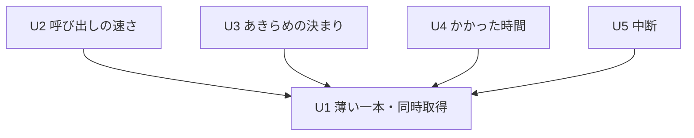

# Unit of Work Dependency — ロググループ全体の取得の高速化

上流：`unit-of-work.md`、`inception/domain-design/components.md`、`units-generation-questions.md`（Q3）。

ここに書くのは「どの作業単位がどれに依存するか」という形だけで、どれから作るかの順番は Delivery Planning で決める。

## 依存の形

```yaml
units:
  - name: u1-concurrent-skeleton
    kind: service
    depends_on: []
  - name: u2-call-pacing
    kind: library
    depends_on: [u1-concurrent-skeleton]
  - name: u3-give-up-rule
    kind: library
    depends_on: [u1-concurrent-skeleton]
  - name: u4-elapsed-time
    kind: service
    depends_on: [u1-concurrent-skeleton]
  - name: u5-cancel
    kind: service
    depends_on: [u1-concurrent-skeleton]
```



文字による代替：U2・U3・U4・U5 は、どれも U1 だけに依存する（矢印は「依存する」の向き）。U2〜U5 の間に依存はない。

## 依存の理由

| 作業単位 | 依存先 | 理由 |
|----------|--------|------|
| U2 | U1 | CallPacer の固定の上限と、すべての試行（再試行を含む）の前の許可待ちの上に、引き下げと戻しを足す |
| U3 | U1 | StreamSchedule（ストリームごとの状態）と同時の読み取りの上に、あきらめの決まりを足し、U1 の暫定の動きを置き換える |
| U4 | U1 | 経過は同時取得の取得 1 回の始まりと終わりを測る（stories の依存関係：US2.1 は US1.1 を前提） |
| U5 | U1 | 中断は同時の読み取り・StreamSchedule の状態（N の数え方）・FetchStatus の上に足す |

## つなぎ目

| つなぎ目 | 作るところ | 使うところ | 種類 |
|----------|------------|------------|------|
| CallPacer の許可待ち | U1 | U2（引き下げと戻し）、U5（許可待ちの最中の中断） | ライブラリの中の関数呼び出し |
| StreamSchedule の状態 | U1 | U3（あきらめ）、U5（N の数え方、最後が終わった後の中断） | ライブラリの中の関数呼び出し |
| FetchStatus（JobStatus） | U1 | U5（Cancelled の追加） | ライブラリの中の共有の型 |
| FetchJob と進み具合の受け口（FetchSink） | U1 | U4（始まりと終わり）、U5（中断の結果） | ライブラリとアプリの間の trait |
| SessionView と Tauri のコマンド・イベント | 既存 | U4（経過の値）、U5（中断のコマンド、注意） | アプリと画面の間のコマンドとイベント |

## 同時に進められる組み合わせ

- U1 が終わった後、U2・U3・U4・U5 は互いに依存しないので、どの順でも、同時にでも進められる。
- ただし同じファイルに手を入れる組み合わせがある（U2 と U5 は CallPacer と EventFetcher、U3 と U5 は StreamSchedule、U4 と U5 は AppSession と StatusLine）。同時に進めるときは、マージの順と衝突の扱いを Delivery Planning で決める。

## 薄い一本

最初の作業単位は U1（`u1-concurrent-skeleton`、依存なし）。U1 だけで「画面から取得 → 同時に読む → 届いた分から時刻順に表示」が端から端まで動き、手元の実際の AWS で確かめられる。後の作業単位がなくても動く。あきらめは暫定として今の ExhaustionStreak（3 本）をストリームが終わった順に当てはめ、制限を受けても速さは固定の上限のまま下げない。経過と中断は無い状態。

## Assumptions & Open Questions

None.
