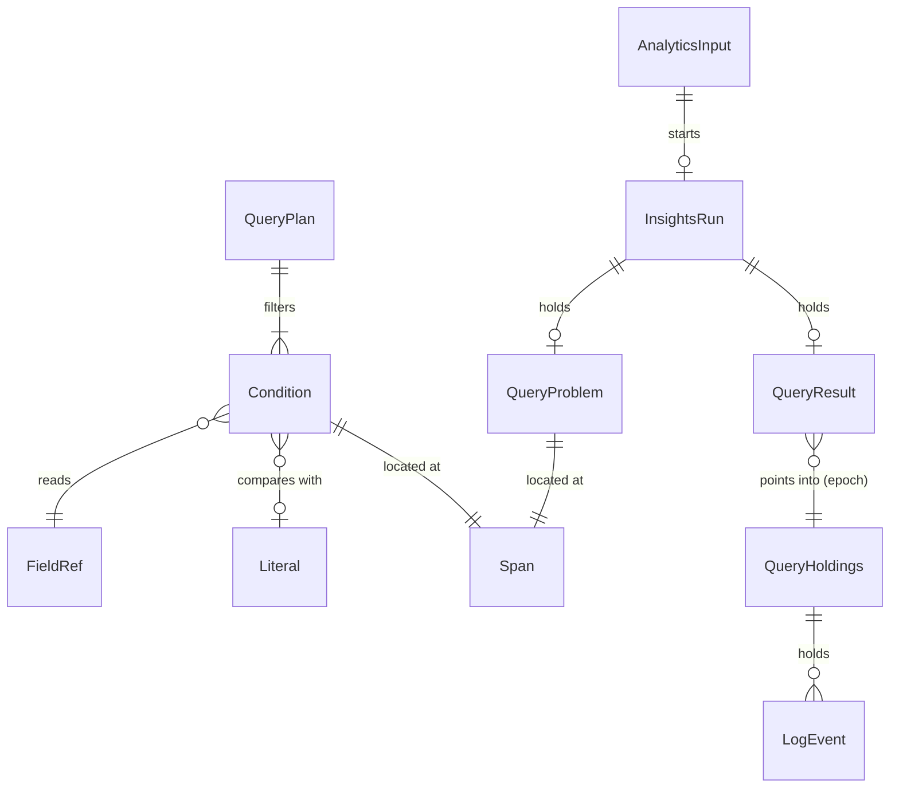

# Entities — U1 薄い一本（u1-filter-skeleton）

上流：`inception/units-generation/unit-of-work.md`（U1）・`unit-of-work-story-map.md`、`inception/requirements-analysis/requirements.md`（FR1、FR2.1・FR2.4〜FR2.6 の表示と止め方、FR3.1・FR3.2、FR4.1、FR5、FR6.3、FR7.2、FR7.6）、`inception/domain-design/components.md`（QueryStore・QueryParser・QueryEvaluator・EventFieldReader・QueryRunner・InsightsSession・AppSession）・`decisions.md`（ADR-001・ADR-002・ADR-005・ADR-007・ADR-008）、`inception/refined-mockups/interaction-spec.md`（クエリの画面の状態の移り変わり）、質問票 `functional-design-questions.md`（Q2〜Q6、Q8）、今のコード（`event.rs` の LogEvent、`timeline.rs` の EventTimeline、`coordinator.rs` の FetchJob・TimelineStore・HeldEvents、`session.rs` の AppSession・Phase）。

型の名前は設計の上の名前で、作る段階で言語の慣用に合わせてよい。LogEvent・EventTimeline・FetchJob・FailedStream は今のものをそのまま使い、ここでは形を変えない（ADR-001）。

## エンティティ（機械可読）

```yaml
entities:
  - name: AnalyticsInput
    description: クエリの画面の入力。ログ管理の画面の入力とは別に持つ（RA Q3b、refined-mockups の 2 つの画面の約束）
    attributes:
      - name: selectedLogGroup
        type: string
        required: false
        constraints: 今の接続のロググループの一覧（DescribeLogGroups）にある名前。U1 では 0 個か 1 個（FR1.3 の複数は U3）
      - name: startText
        type: string
        required: true
        default: 空
        constraints: 今のログ管理の画面と同じ日時の入力（DateTimeInput）。秒まで
      - name: endText
        type: string
        required: true
        default: 空
        constraints: 同上。終了はその秒の 999 ms まで含む（FR1.4）
      - name: range
        type: TimeRange
        required: false
        constraints: startText・endText を選んでいるタイムゾーンで読んだ結果。開始が終了より前のときだけある（今の TimeRangeModel）
      - name: queryText
        type: string
        required: true
        default: 例のクエリ（refined-mockups の QueryEditor の初回）
        max: 10000 文字（Unicode のスカラー値の数、Q4）
        constraints: 接続を変えても、エラーになっても消さない（FR6.3、A2）
    relationships:
      - target: InsightsRun
        cardinality: 1 対 0..1
        direction: AnalyticsInput から実行を始める

  - name: QueryPlan
    description: 読み取ったクエリ。U1 では filter の条件の並びだけ（QueryParser が持つ）
    attributes:
      - name: filters
        type: list<Condition>
        required: true
        min: 1
        constraints: 文に現れた順。filter を 2 つ以上つないだときは、すべてを満たすものだけを残す（BR3.2）
    relationships:
      - target: Condition
        cardinality: 1..n
        direction: QueryPlan が持つ

  - name: Condition
    description: filter の条件の木。葉は 1 つの項目と値の比べ方
    attributes:
      - name: kind
        type: enum
        required: true
        allowed: [And, Or, Not, Compare, Like, Match, In]
      - name: children
        type: list<Condition>
        required: false
        constraints: And・Or は 2 つ、Not は 1 つ、葉（Compare・Like・Match・In）は持たない
      - name: field
        type: FieldRef
        required: false
        constraints: 葉だけが持つ
      - name: operator
        type: enum
        required: false
        allowed: [Eq, NotEq, Lt, LtEq, Gt, GtEq]
        constraints: Compare だけが持つ
      - name: negated
        type: boolean
        required: false
        default: false
        constraints: Like（not like）と In（not in）だけが持つ
      - name: value
        type: Literal
        required: false
        constraints: Compare は 1 つ、Like は文字列か正規表現、Match は正規表現、In は値の並び（1 つ以上）
      - name: span
        type: Span
        required: true
        constraints: クエリの文の中の場所（エラーの場所を示すため）
    relationships:
      - target: FieldRef
        cardinality: 1..1（葉）
        direction: Condition が指す

  - name: FieldRef
    description: 条件に書ける項目。U1 では決まった項目だけ（FR4.1）。JSON の項目は U2
    attributes:
      - name: name
        type: enum
        required: true
        allowed: [Timestamp, TimestampMillis, Message, LogStream, Log]
        constraints: TimestampMillis は toMillis(@timestamp) と書いたとき。Timestamp と同じ値（ミリ秒）を読む（BR4.1）

  - name: Literal
    description: 条件の値
    attributes:
      - name: kind
        type: enum
        required: true
        allowed: [String, Number, Regex, Instant]
        constraints: Instant は @timestamp と比べる日時の文字列を、実行の時点でミリ秒に直したもの（BR5.9、FR5.6）
      - name: text
        type: string
        required: false
        constraints: String は引用符の中身（\\ \" \' を解いたあと）、Regex は / と / の間（\/ を解いたあと）
      - name: number
        type: decimal
        required: false
        constraints: Number のとき。整数・小数・負の数。Instant のときはミリ秒の整数
      - name: compiledRegex
        type: Regex
        required: false
        constraints: Regex と、like の文字列（BR5.4）のとき。読み取りのときに 1 回だけ作る。大きさは正規表現の仕組みの既定の上限まで（ADR-002、Q4）

  - name: Span
    description: クエリの文の中の場所
    attributes:
      - name: line
        type: integer
        required: true
        min: 1
      - name: column
        type: integer
        required: true
        min: 1
        constraints: 行の中の何文字目か（Unicode のスカラー値で数える）
      - name: length
        type: integer
        required: true
        min: 1

  - name: QueryProblem
    description: 読み取りのエラー。取得の前に返す（FR6）
    attributes:
      - name: kind
        type: enum
        required: true
        allowed: [Syntax, Unsupported]
        constraints: Syntax は書き間違い（閉じていない括弧や引用符、受け付けない日時の文字列、読めない正規表現など）。Unsupported は対応外の命令・関数・項目・演算子
      - name: messageKey
        type: string
        required: true
        constraints: 画面の文言の鍵。英語と日本語を用意する（FR6.4、NFR9）
      - name: word
        type: string
        required: false
        constraints: 対応外の言葉（例：stats）。クエリの文から取った言葉だけで、認証情報は含まない（FR6.4）
      - name: span
        type: Span
        required: true
    relationships: []

  - name: QueryHoldings
    description: QueryStore の最小版の中身。クエリの画面が取得したログ 1 つのロググループ分。ログ管理の画面の EventTimeline とは別のもの（FR2.1、ADR-001）
    attributes:
      - name: key
        type: HoldingKey
        required: false
        constraints: （プロファイル, リージョン, ロググループ）。まだ取得していないときはない
      - name: timeline
        type: EventTimeline
        required: true
        constraints: 今の EventTimeline をそのまま使う。実行のたびに捨てて取り直す（U1、units Q2a）
      - name: epoch
        type: integer
        required: true
        default: 0
        constraints: 捨てるたびに 1 増える。結果の行がどの中身を指しているかを確かめる（BR2.3）
    relationships:
      - target: LogEvent
        cardinality: 1 対 0..n
        direction: QueryHoldings が持つ

  - name: EvalItem
    description: 評価の入口に渡す 1 件。（イベント, ロググループ名）の組（unit-of-work-dependency の評価の入口の形）
    attributes:
      - name: event
        type: LogEvent（参照）
        required: true
      - name: logGroupName
        type: string
        required: true
        constraints: QueryHoldings の key から添える。LogEvent の型は変えない（ADR-001）

  - name: QueryResult
    description: 評価の結果（QueryEvaluator が持つ）
    attributes:
      - name: runId
        type: integer
        required: true
      - name: holdingsEpoch
        type: integer
        required: true
        constraints: 評価した QueryHoldings の epoch
      - name: rows
        type: list<ResultRowKey>
        required: true
        constraints: 結果の行のキー（ストリーム名, ストリーム内の順番）。並びは QueryHoldings の時刻順（BR7.3）。件数の上限は設けない（Q3）
      - name: evaluatedCount
        type: integer
        required: true
        constraints: 評価を終えたイベントの数（進み具合）
    relationships:
      - target: InsightsRun
        cardinality: 0..1 対 1
        direction: InsightsRun が持つ

  - name: InsightsRun
    description: クエリの画面の 1 回の実行の状態（InsightsSession が持つ）
    attributes:
      - name: runId
        type: integer
        required: true
        unique: true
        constraints: 実行のたびに増える。古い実行の知らせは捨てる（FR7.6）
      - name: phase
        type: enum
        required: true
        allowed: [Idle, Fetching, Evaluating, Done, QueryError, FetchFailed, Cancelled]
        default: Idle
        constraints: 読み取り（Parsing）は 1 回の呼び出しで終わるため、状態としては残さない（functional-spec の状態の移り変わり）
      - name: problem
        type: QueryProblem
        required: false
        constraints: QueryError のときだけ
      - name: fetchJob
        type: FetchJob の要約
        required: false
        constraints: 取得の段に入ったときから。計画した本数・終えた本数・件数・失敗したストリーム・終わりの状態
      - name: partial
        type: boolean
        required: true
        default: false
        constraints: 取得が CompletedWithFailures のとき true（FR2.5）
      - name: result
        type: QueryResult
        required: false
        constraints: Done のときだけ。Evaluating の間は途中の件数だけを出す
      - name: startedAt
        type: instant
        required: false
        constraints: 経過時間の表示（今の ElapsedView と同じ）
    relationships: []

  - name: FetchOwner
    description: いま走っている取得がどちらの画面のものか（AppSession が持つ、ADR-005）
    attributes:
      - name: value
        type: enum
        required: true
        allowed: [None, LogManagement, LogAnalytics]
        default: None
```

## まとめ

- **入力と実行**：AnalyticsInput がクエリの画面の入力（ロググループ 1 つ、期間、クエリの文）を持ち、[Run query] で InsightsRun を 1 つ始める。InsightsRun は段階（Idle・Fetching・Evaluating・Done・QueryError・FetchFailed・Cancelled）と、取得の要約・一部失敗の印・結果を持つ。
- **読み取り**：QueryPlan は filter の条件（Condition の木）の並びで、葉は決まった項目（FieldRef）と値（Literal）の比べ方を持つ。読めないときは QueryProblem（Syntax か Unsupported と場所）を返す。
- **保持**：QueryHoldings はクエリの画面専用の 1 つのロググループ分のログで、今の EventTimeline をそのまま使う。実行のたびに捨てて取り直し、そのたびに epoch が増える。ログ管理の画面の保持とは何も受け渡さない。
- **評価**：QueryHoldings から（イベント, ロググループ名）の EvalItem の並びを作って評価し、QueryResult に結果の行のキーを持つ。
- **取得の 1 本化**：AppSession の FetchOwner が、いま走っている取得の持ち主の画面を持つ。



<!-- Text fallback: AnalyticsInput は 0 か 1 つの InsightsRun を始め、InsightsRun は QueryResult か QueryProblem を持つ。QueryPlan は 1 つ以上の Condition を持ち、Condition は FieldRef を読み、Literal と比べ、Span の場所を持つ。QueryHoldings は LogEvent を持ち、QueryResult は epoch で QueryHoldings の中を指す。 -->
