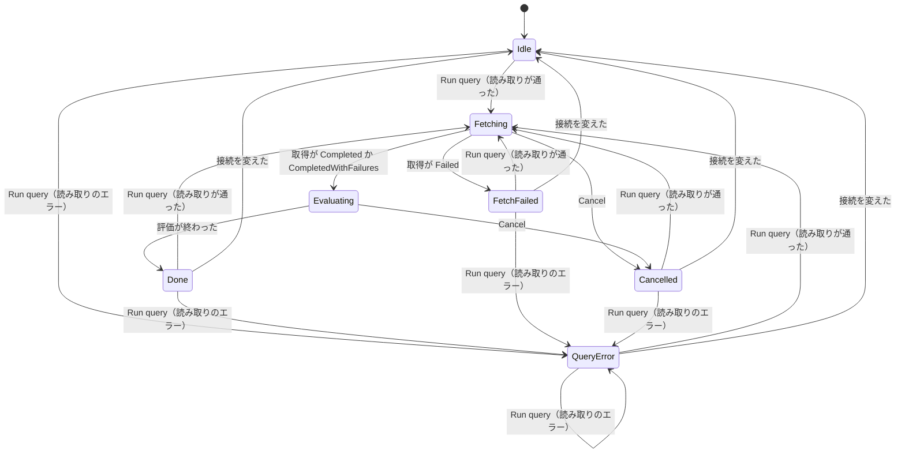
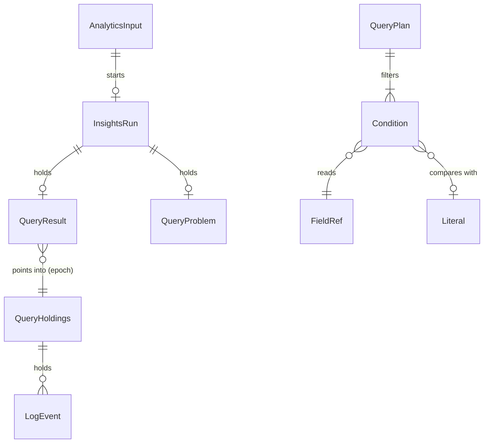

# Functional Spec — U1 薄い一本（u1-filter-skeleton）

上流：`inception/units-generation/unit-of-work.md`（U1）・`unit-of-work-story-map.md`・`unit-of-work-dependency.md`（評価の入口の形）、`inception/requirements-analysis/requirements.md`、`inception/domain-design/components.md`・`decisions.md`、`inception/refined-mockups/interaction-spec.md`・`mockups.md`（画面 2〜7）、質問票 `functional-design-questions.md`（Q2〜Q6、Q8。Q1・Q7・Q7a は RA Q3b で不要になった）。データの形は `entities.md`、決まりは `rules.md` が正本で、この文書は流れ（手順）と状態の移り変わりの正本である。

## 1. U1 で作るもの

Log Analytics の画面で、ロググループを 1 つと期間を選び、`filter` だけでできたクエリを実行すると、クエリの画面専用の保持（QueryStore）に期間全体を取得してから手元で評価し、結果を決まった列の表に出す。ログ管理の画面の保持・表示・部分一致の絞り込みには触れない（BR1.7）。

| 部品 | U1 での中身 |
|---|---|
| AppNavigation・AppShell | 2 つの画面の切り替え（BR1.1） |
| LogAnalyticsPage・LogGroupMultiselect・QueryEditor・QueryResultTable | 入力・実行の行・結果の囲み（BR1.2〜BR1.6、BR2.4〜BR2.9、BR6.1〜BR6.4）。色分け・補完・エラーの下線は U2 |
| QueryParser | filter の読み取りとエラー（BR3.1〜BR3.9、BR5.6、BR5.7、BR5.9） |
| EventFieldReader（決まった項目） | BR4.1 |
| QueryEvaluator | filter の評価、区切りごとに止められる（BR5.1〜BR5.5、BR5.8、BR5.10） |
| QueryStore（最小版） | 1 つのロググループ、実行のたびに捨てて取り直す（BR2.1） |
| FetchCoordinator | 今の run_fetch_with_cache を、行き先に QueryStore を渡して使う（BR2.2）。今の関数は行き先を TimelineStore・HeldEvents の形で受け取るため、QueryStore にその 2 つを持たせれば、取得の流れそのものは変えずに済む見込み |
| QueryRunner | 読み取り → 取得 → 評価（2 章） |
| InsightsSession・AppSession | クエリの画面の状態、取得の 1 本化、接続の変更（BR1.5、BR2.3、BR2.8、BR7.1〜BR7.3） |
| TauriApp・ApiBridge | 3 章のコマンドとイベント |

## 2. 流れ（手順）

### UC1 クエリを実行する（成功）

1. 利用者が [Run query] か Cmd/Ctrl+Enter を押す（BR1.6）。
2. AppSession が BR1.5 の順で調べる。当たれば何もしない（画面は押せない状態のまま）。
3. InsightsSession が新しい runId を作る。
4. QueryParser がクエリの文を読む（BR3.1〜BR3.8、BR5.6、BR5.7）。エラーなら UC2 へ。
5. QueryRunner が、`@timestamp` と比べる日時の文字列を、今選んでいるタイムゾーンでミリ秒に直す（BR5.9）。直せなければ UC2 へ。
6. AppSession が FetchOwner を LogAnalytics にする（BR2.3）。すでに取得が走っていれば断り、段階は前のまま（2 で防いでいるため、通常は起きない）。
7. 前の結果を消し（BR2.9）、段階を Fetching にする。
8. QueryStore が中身を捨てて epoch を増やし、key を今の（プロファイル, リージョン, ロググループ）にする（BR2.1）。
9. FetchCoordinator が、期間全体を今の流れで取得し、ページを QueryStore に足す（BR2.2）。進み具合を知らせる（BR2.4）。
10. 取得が終わったら FetchOwner を None に戻す。終わりの状態で分ける：Completed → 11、CompletedWithFailures → partial を立てて 11（BR2.5）、Failed → UC3、Cancelled → UC4、Aborted（閉じた） → 何もしない（アプリが閉じる）。
11. 段階を Evaluating にする。QueryRunner が QueryStore から（イベント, ロググループ名）の並びを時刻順に作り、QueryEvaluator が 10,000 件ずつ評価する（BR5.8）。区切りごとに進み具合を知らせ、止める信号・runId・epoch を確かめる。
12. 評価が終わったら QueryResult を持ち、段階を Done にする。結果の囲みに件数と行を出す（0 件なら BR6.1）。
13. 画面は見えている行だけを（runId, epoch, 先頭, 件数）で読み出す（BR6.4）。

```text
// 評価の入口の形（U1 で固定し、U2・U3 は中身だけを広げる）
evaluate(plan: QueryPlan, items: 時刻順の (event, logGroupName) の並び,
         stop: 止める信号) -> 区切りごとの進み具合, 最後に QueryResult
```

### UC2 読み取りのエラー

1. QueryParser か日時の文字列の変換（BR5.9）が QueryProblem を返す。
2. 段階を QueryError にし、QueryProblem を持つ。AWS は呼ばず、FetchOwner も変えない。
3. 前の結果は残す。クエリの文は消さない（BR3.9）。
4. クエリ欄の直下に、対応外（Unsupported）か書き間違い（Syntax）かで分けた文言と、行・列を出す。焦点をクエリ欄に置き、カーソルをエラーの場所に動かす。
5. 利用者がクエリを直して再び実行すると UC1 の 1 から。

### UC3 取得全体の失敗

1. 取得が Failed で終わる（一覧の最初のページから失敗したときなど、今の decide_job_status のとおり）。
2. 段階を FetchFailed にし、結果の囲みの上にエラーのアラートを出す（BR2.6）。前の結果は 7 ですでに消えている。
3. 利用者は権限を直す・SSO でログインし直すなどしてから再び実行する（UC1 の 1 から）。

### UC4 中止

1. Fetching か Evaluating の間に、利用者が [Cancel] を押す。
2. Fetching の間：今のログ管理の画面と同じ止め方で取得を止める。取得は Cancelled で終わり、FetchOwner を None に戻す。評価には進まない。
3. Evaluating の間：次の区切りで評価を止め、途中までの結果を捨てる。
4. 段階を Cancelled にし、結果の囲みに「Query cancelled」を出す（BR2.7）。
5. 再び実行すると UC1 の 1 から（QueryStore は 8 で捨てて取り直す）。

### UC5 一部のストリームの失敗

UC1 の 10 で CompletedWithFailures のとき、評価して Done にし、結果の囲みの上に警告と失敗したストリームの一覧を出す（BR2.5）。一覧の中身はストリーム名と安全な理由だけ。

### UC6 接続を変える

1. 利用者がプロファイルかリージョンを選ぶ。どちらかの画面の取得中・クエリの画面の評価中は選べない（BR7.3）。
2. ログ管理の画面にログがあるか、クエリの画面に結果の行があれば確認ダイアログを出す（BR7.1）。やめれば何も変えない。
3. 変えたら、ログ管理の画面は今と同じく捨て、QueryStore を捨てて epoch を増やし、クエリの画面のロググループの選択と結果を消して Idle に戻す。クエリの文と期間は残す（BR7.2）。

### UC7 ログ管理の画面とのかかわり

- クエリの画面の取得中は、ログ管理の画面の [Fetch] を押せず「Log Analytics でクエリを実行中」と出る。逆も同じ（BR2.3）。評価中はログ管理の画面の [Fetch] を押せる（評価は AWS を呼ばない）。
- クエリの画面の実行は、ログ管理の画面の表示中のログ・件数・部分一致の絞り込み・失敗の一覧・中止の知らせを変えない（BR1.7）。
- 取得中にアプリを閉じようとすると、どちらの画面の取得でも今の閉じる確認が出る（BR2.8）。

## 3. コマンドとイベント（TauriApp・ApiBridge）

形は今のログ管理の画面のコマンドにならう。新しいコマンドは capabilities と permissions にも足す（codekb）。ログ管理の画面のコマンドは変えない。

| 名前 | 種類 | 中身 |
|---|---|---|
| update_analytics_input | コマンド | ロググループ・開始・終了・クエリの文のどれかを変える（BR1.3、BR1.4）。実行中は断る |
| run_query | コマンド | UC1 を始める。BR1.5 に当たれば断る。読み取りのエラーは断りではなく状態（QueryError）で返す |
| cancel_query | コマンド | UC4。実行中でなければ何もせず成功を返す |
| get_query_rows | コマンド | （runId, epoch, 先頭, 件数）で結果の行を返す（BR6.4） |
| session-changed | イベント（今のもの） | SessionView にクエリの画面の状態（入力、段階、押せない理由、進み具合、エラー、一部失敗、件数）を足す |

## 4. 状態の移り変わり（InsightsRun.phase）

interaction-spec の状態のうち、Parsing は 1 回の呼び出しで終わるため状態として残さない（UC1 の 4〜5）。



<!-- Text fallback: Idle から Run query で、読み取りが通れば Fetching、エラーなら QueryError。Fetching は取得の終わり方で Evaluating・FetchFailed・Cancelled へ。Evaluating は Done か Cancelled へ。Done・QueryError・FetchFailed・Cancelled からは Run query で Fetching か QueryError へ、接続を変えると Idle へ。Fetching・Evaluating の間は接続を変えられない。 -->

- interaction-spec の「入力を変えると Idle に戻る」は、[Run query] がまた押せるようになることを表している。U1 では段階の値は変えずに、BR1.5 の条件だけで押せるかを決める（段階の名前は画面に出ないため、見え方は interaction-spec と同じ）。入力を変えても前の結果とエラーの表示は残し、次の実行で置き換える。
- 段階ごとの [Run query]・[Cancel]・欄の使える・使えないは、BR1.5 と BR2.4 のとおり。

## 5. エンティティの関係（entities.md から作った見取り図）



<!-- Text fallback: 入力が実行を始め、実行は結果かエラーを持つ。読み取ったクエリは条件の木を持ち、条件は項目と値を比べる。クエリの画面の保持はイベントを持ち、結果は epoch でその中を指す。正本は entities.md。 -->

## 6. 決まりの見取り図（rules.md から作った要約）

| まとまり | 決まり | 要点 |
|---|---|---|
| 画面と入力 | BR1.1〜BR1.7 | 2 つの画面を切り替え、入力は別に持つ。[Run query] の条件は 8 つで、10,000 文字を超える文は実行できない。ログ管理の画面は変えない |
| 保持と取得 | BR2.1〜BR2.9 | QueryStore を実行のたびに捨てて取り直す。取得は今と同じ流れで 2 つの画面で同時に 1 つ。一部失敗は評価して示し、全体の失敗と中止は評価しない。U1 は取得に入るときに前の結果を消す |
| 読み取り | BR3.1〜BR3.9 | `|` の並び、filter だけ、言葉は大文字・小文字を区別しない（仮）、優先順位は not > and > or（仮）、項目は決まった 4 つと toMillis(@timestamp)。エラーは取得の前に、文と前の結果を残して示す |
| 項目 | BR4.1 | @log はロググループ名だけ（アカウント ID は付けない） |
| 評価 | BR5.1〜BR5.10 | 比べる・like・=~・in の判定、10,000 件ずつの区切り、@timestamp と数値・日時の文字列の比べ方 |
| 結果 | BR6.1〜BR6.4 | 0 件の表示、最後の実行だけ、決まった列と時刻順、上限なし、見えている行だけを読む |
| 接続の変更 | BR7.1〜BR7.3 | どちらかの画面にログか結果があれば確認、クエリの文と期間は残す、実行中は変えられない |

## 7. 確かめ方（U1）

team.md の Walking Skeleton の 3 つに合わせる。

1. **自動テスト**：`cargo test` と Vitest がすべて通る（CI の Linux・macOS・Windows）。純粋なロジック（QueryParser、EventFieldReader の決まった項目、QueryEvaluator、日時の文字列の変換）はテストを先に書く。QueryStore・QueryRunner・AppSession の取得の 1 本化と接続の変更は、偽の取得（今のテストの道具）で、実装の後にテストを書く。ログ管理の画面の既存のテストは変えずに通す。BR1.7 は「クエリの画面で実行しても、ログ管理の画面の件数・行・絞り込みの状態が変わらない」テストで確かめる。
2. **手元の確認用プログラム**：今の FetchCheck を広げ、実際の AWS から 1 つのロググループの期間を取得して、filter の結果の件数と先頭の行を出す。timestamp-check.sh と同じロググループ・期間で `filter @timestamp > 1756053806000` を流し、2190 件になることを確かめる（Q2 の確かめの結果）。
3. **GUI**：macOS と Windows で、Log Analytics の画面でクエリを実行して結果が出ること、ログ管理の画面で表示中のログと絞り込みがそのまま残ること、読み取りのエラー・中止・接続を変えるときの確認を目で確かめる。

## 8. 残した問い

- コンソールの細部（言葉の大文字・小文字、優先順位、型の違う値の比べ方、`sort` がないときの並び順）は U1 では仮の決まりで作り、U2 の機能設計（OQ2）と U4 で合わせる。
- 評価の区切りの件数（10,000 件）は、作る段階で NFR1・NFR2 を測って変えてよい。
