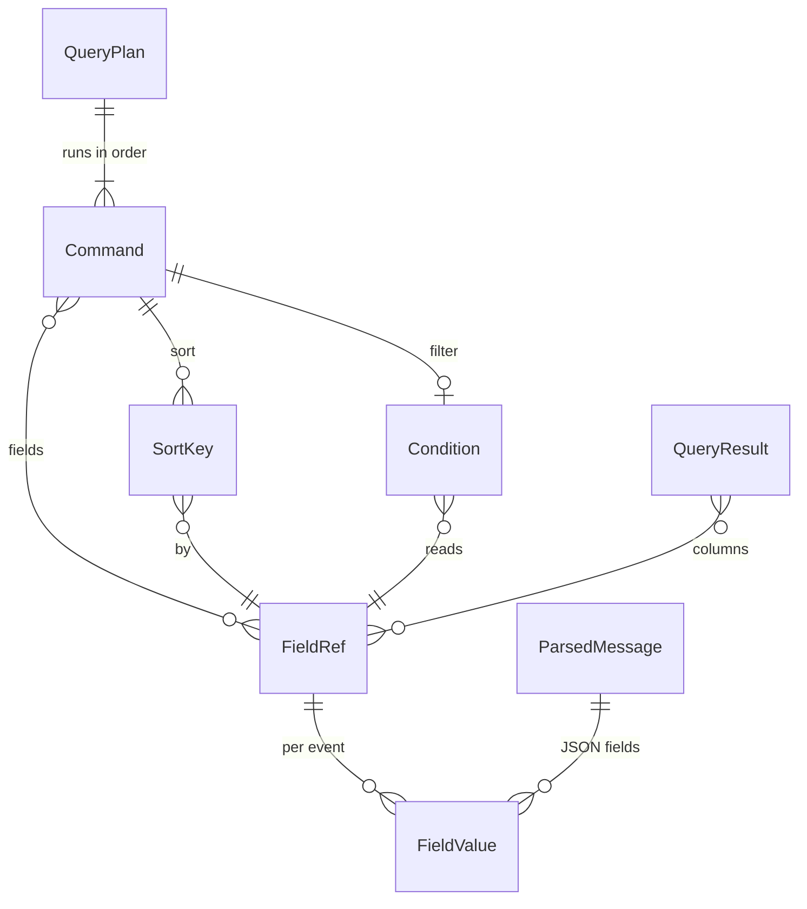

# Entities — U2 クエリの言語をそろえる（u2-query-language）

上流：`inception/units-generation/unit-of-work.md`（U2）・`unit-of-work-story-map.md`、`inception/requirements-analysis/requirements.md`（FR3.3〜FR3.8、FR4.2〜FR4.5、FR6.1・FR6.2・FR6.4、FR7.1・FR7.3〜FR7.5、FR8、FR9、OQ1・OQ2）、`inception/domain-design/components.md`（EventFieldReader・QueryParser・QueryEvaluator・QueryResultTable・QueryEditor・QueryRunner）、質問票 `functional-design-questions.md`（Q1・Q1a・Q1b：コンソールでの確かめ）、AWS の資料（fields・sort・limit）、U1 の機能設計とコード（`crates/local-sights-core/src/query/` の plan・parser・fields・evaluator）。

U1 の形（QueryPlan・Condition・FieldRef・Literal・Span・QueryProblem・EvalItem・QueryResult・InsightsRun）を広げる。LogEvent・EventTimeline・QueryStore の形は変えない（ADR-001）。型の名前は設計の上の名前で、作る段階で言語の慣用に合わせてよい。

## エンティティ（機械可読）

```yaml
entities:
  - name: QueryPlan
    description: 読み取ったクエリ。U1 の filter の並びに、fields・sort・limit を足す（命令は文に現れた順に持つ）
    attributes:
      - name: commands
        type: list<Command>
        required: true
        min: 1
        constraints: 文に現れた順。評価もこの順に進める（BR3.1）
      - name: hasFields
        type: boolean
        required: true
        constraints: fields を 1 つでも書いたか。書かないときの列は @timestamp と @message（BR3.3）
      - name: hasSort
        type: boolean
        required: true
        constraints: sort を 1 つでも書いたか。書かないときの並びは @timestamp の降順（BR4.4）
    relationships:
      - target: Command
        cardinality: 1..n
        direction: QueryPlan が持つ

  - name: Command
    description: 1 つの命令
    attributes:
      - name: kind
        type: enum
        required: true
        allowed: [Filter, Fields, Sort, Limit]
      - name: condition
        type: Condition
        required: false
        constraints: Filter だけ
      - name: fields
        type: list<FieldRef>
        required: false
        min: 1
        constraints: Fields だけ。同じ項目を 2 回書いても列は 1 つ
      - name: sortKeys
        type: list<SortKey>
        required: false
        min: 1
        constraints: Sort だけ
      - name: limit
        type: integer
        required: false
        min: 0
        max: 100000
        constraints: Limit だけ。0 は件数を絞らない（Q1a の 7c）。100,001 以上は書き間違い（7b）
      - name: span
        type: Span
        required: true
        constraints: 命令の言葉の場所
    relationships:
      - target: Condition
        cardinality: 0..1
        direction: Filter が持つ

  - name: SortKey
    description: sort の 1 つの項目と向き
    attributes:
      - name: field
        type: FieldRef
        required: true
      - name: direction
        type: enum
        required: true
        allowed: [Asc, Desc]
        default: Asc
        constraints: 向きを書かないときは昇順（Q1b の 1a）

  - name: Condition
    description: U1 の条件の木。U2 で各部分に Span を持たせる（U1 のコードの見直し R-04）
    attributes:
      - name: kind
        type: enum
        required: true
        allowed: [And, Or, Not, Compare, Like, Match, In]
        constraints: Not の子は括弧で囲んだ条件だけ（BR2.4）
      - name: span
        type: Span
        required: true
        constraints: 条件の木のどの部分にも付ける。エラーの印に使う

  - name: FieldRef
    description: 項目。U1 の決まった項目に、JSON の項目を足す
    attributes:
      - name: kind
        type: enum
        required: true
        allowed: [Timestamp, TimestampMillis, Message, LogStream, Log, Json]
      - name: path
        type: list<string>
        required: false
        min: 1
        constraints: Json だけ。`a.b` を [a, b] に分けたもの。名前に . や空白などを含むときはバッククォートで囲む（BR1.3）
      - name: text
        type: string
        required: true
        constraints: 書いたままの名前（列の見出しに使う）

  - name: FieldValue
    description: 1 つのイベントの 1 つの項目の値
    attributes:
      - name: kind
        type: enum
        required: true
        allowed: [Missing, Text, Number, Boolean]
        constraints: JSON の null と、オブジェクト・配列を指す名前は Missing（BR1.4、BR1.5）
      - name: text
        type: string
        required: false
      - name: number
        type: decimal
        required: false

  - name: ParsedMessage
    description: メッセージを JSON として読んだ結果。評価の間だけ持つ（BR1.2）
    attributes:
      - name: object
        type: map
        required: false
        constraints: メッセージが JSON のオブジェクトとして読めたときだけ。読めないとき・配列・文字列だけのときはない（FR4.3）

  - name: QueryProblem
    description: U1 の読み取りのエラー。場所を必ず持つ
    attributes:
      - name: kind
        type: enum
        required: true
        allowed: [Syntax, Unsupported]
      - name: messageKey
        type: string
        required: true
        constraints: 英語と日本語の文言の鍵（FR6.4）
      - name: word
        type: string
        required: false
      - name: span
        type: Span
        required: true
        constraints: 行と列（1 から）と長さ。画面はこれで下線と行番号の横の印を出す（FR6.1、FR6.2）

  - name: QueryResult
    description: U1 の評価の結果に、列と打ち切りを足す
    attributes:
      - name: columns
        type: list<string>
        required: true
        constraints: 出す列の見出し（FieldRef の text）。fields を書かないときは @timestamp・@message。どのイベントにも値がない列は出さない（Q1a の 5j、BR3.4）
      - name: rows
        type: list<integer>
        required: true
        constraints: 結果の行のキー（QueryHoldings の中の位置。U1 の R-05）。並びは sort と BR4.4 のとおり
      - name: matchedCount
        type: integer
        required: true
        constraints: 条件に合った件数（打ち切る前）
      - name: truncatedAt
        type: integer
        required: false
        constraints: limit か既定の上限（10,000）で打ち切ったときの件数（FR3.7、FR7.3）

  - name: CompletionCandidate
    description: 補完の候補（FR9.1、Should）
    attributes:
      - name: text
        type: string
        required: true
      - name: kind
        type: enum
        required: true
        allowed: [Command, Keyword, FixedField, JsonField]
```

## まとめ

- **読み取ったクエリ**：QueryPlan は命令（filter・fields・sort・limit）の並びを、文に現れた順に持つ。sort は項目と向き（既定は昇順）の並び、limit は 0〜100,000 の数を持つ。
- **項目**：FieldRef に JSON の項目（`a.b` を分けた道筋）を足す。値は Missing・Text・Number・Boolean のどれかで、JSON の null・オブジェクト・配列は Missing とする。
- **場所**：条件の木のどの部分にも Span を持たせ、エラーの下線と印に使う。
- **結果**：QueryResult に列の見出し、条件に合った件数、打ち切った件数を足す。
- **書く手助け**：補完の候補は、命令・言葉・決まった項目・取得済みのログに出てくる JSON の項目の名前。



<!-- Text fallback: QueryPlan は順に並んだ Command を持つ。Command は filter の Condition、sort の SortKey、fields の FieldRef を持つ。SortKey と Condition は FieldRef を読み、FieldRef はイベントごとに FieldValue を持つ。JSON の項目の値は ParsedMessage から来る。QueryResult は列として FieldRef を持つ。 -->
