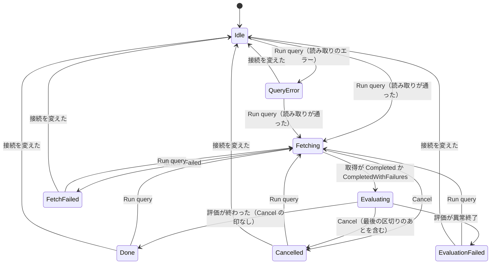
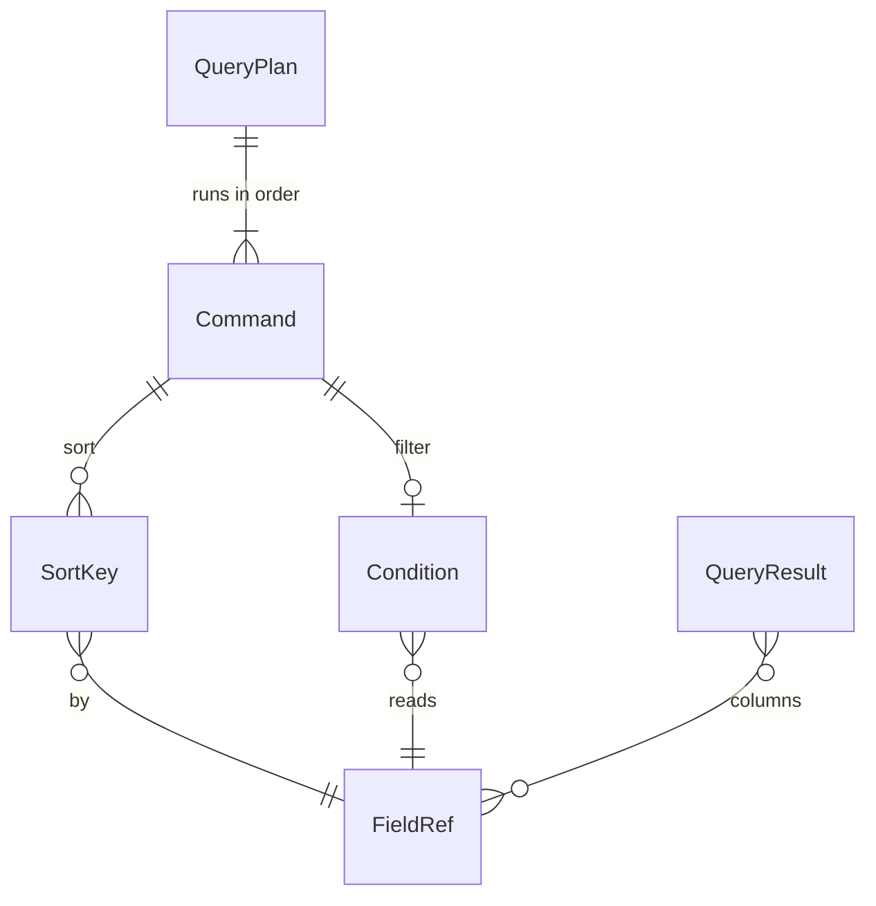

# Functional Spec — U2 クエリの言語をそろえる（u2-query-language）

上流：`inception/units-generation/unit-of-work.md`（U2）・`unit-of-work-story-map.md`・`unit-of-work-dependency.md`（評価の入口の形は U1 で固定）、`inception/requirements-analysis/requirements.md`、`inception/domain-design/components.md`、`inception/refined-mockups/interaction-spec.md`・`mockups.md`、質問票 `functional-design-questions.md`（Q1・Q1a・Q1b）、U1 の機能設計 `construction/u1-filter-skeleton/functional-design/`。データの形は `entities.md`、決まりは `rules.md` が正本で、この文書は流れと状態の移り変わりの正本である。

## 1. U2 で作るもの

U1 の薄い一本の上に、クエリの言語の残りをそろえる。

| 部品 | U2 での中身 |
|---|---|
| EventFieldReader | JSON の項目の取り出し（入れ子、バッククォート、値の型、ない項目）と、項目の名前の収集（BR1.1〜BR1.7） |
| QueryParser | fields・sort・limit、`not (…)` だけの否定、条件の木の場所、エラーの場所と種類（BR2.1〜BR2.5、BR10.3） |
| QueryEvaluator | 命令を順に当てはめる評価、fields の列、sort の自然順と既定の並び、limit と既定の上限（BR3.1〜BR5.2） |
| QueryResultTable | 可変の列、件数と打ち切り、行を開いた項目と値の一覧（BR5.3、BR7.1〜BR7.4） |
| QueryEditor | エラーの下線と印（BR6.1）。補完・色分け（BR9.1・BR9.2、Should） |
| LogAnalyticsPage | 例のクエリ（BR9.3、Should） |
| QueryRunner・InsightsSession・TauriApp・ApiBridge | 項目の名前の収集と補完の候補のコマンド（Should）、評価の失敗の段階（BR10.2）、最後の区切りのあとの [Cancel]（BR10.1） |
| README | 対応範囲の一覧（BR8.1） |

評価の入口の形（時刻順の（イベント, ロググループ名）の並びを受け取り、結果の行を返す）は U1 のまま変えない。U3 とは重ならない（U3 は QueryStore と取得の段の内側だけを広げる）。

## 2. 流れ（手順）

### UC1 クエリを実行する（U1 の UC1 の評価の段を広げる）

1. U1 の UC1 の 1〜10 と同じ（押せる条件、読み取り、日時の文字列の変換、取得）。読み取りは BR2.1〜BR2.5 の言語で行う。
2. 段階を Evaluating にする。QueryRunner が QueryStore から（イベント, ロググループ名）の並びを作る。
3. QueryEvaluator が、最初の並びを決まった並び（@timestamp の降順、BR4.4）にする。
4. 命令を文に現れた順に当てはめる（BR3.1）：
   - filter：10,000 件ずつの区切りで条件を評価し（U1 の BR5.8）、区切りごとに止める信号を確かめる。JSON の項目を使うときは、そのイベントのメッセージを 1 回だけ JSON として読む（BR1.2）。
   - fields：出す列を足す（BR3.2）。
   - sort：安定な並べ替え（BR4.1〜BR4.4）。並べ替えの前と後に止める信号を確かめる。
   - limit：先頭から切る（BR5.1）。
5. 1〜100,000 の limit がなかったら、先頭から 10,000 件で切る（BR5.2）。
6. 列を決める：fields がなければ @timestamp・@message（BR3.3）。結果のどの行にも値がない列は外す（BR3.4）。
7. [Cancel] の印が立っていれば、結果を捨てて Cancelled にする（BR10.1）。そうでなければ Done にし、列・件数・条件に合った件数・打ち切りを持つ。
8. 画面は見えている行だけを、列の値と一緒に読み出す（BR7.4）。

```text
// 評価の段の形（U1 の入口は変えない）
evaluate(plan, items: 時刻順の (event, logGroupName) の並び, stop)
  -> 区切りごとの進み具合, 最後に QueryResult { columns, rows, matchedCount, truncatedAt }
```

### UC2 読み取りのエラー（U1 の UC2 に印を足す）

1. QueryParser が QueryProblem（Syntax か Unsupported、行・列・長さ）を返す。
2. U1 と同じく、取得も評価もせず、文と前の結果を残して QueryError にする。
3. クエリ欄の中の該当の範囲に下線、行番号の横に印、欄の直下に文言を出し、カーソルを場所に動かす（BR6.1）。
4. 利用者が文を書き換えると、下線と印を消す。

### UC3 評価の異常終了

1. 評価の区切りが異常終了する。
2. QueryRunner が評価の失敗を知らせ、段階を EvaluationFailed にする（BR10.2）。結果の囲みの上に「クエリを評価できなかった」を出す。取得の失敗（FetchFailed）とは別の文言にする。
3. 再び実行すると UC1 から。

### UC4 補完と例のクエリ（Should）

1. クエリの画面の取得が終わると、QueryRunner が取得済みのログから JSON の項目の名前を集める（BR1.7）。
2. 利用者が Ctrl+Space を押すか、命令や項目を書き始めると、QueryEditor が候補を出す（BR9.1）。
3. 例のクエリの一覧から選ぶと、クエリ欄に入る。書きかけの文があれば置き換える前に確かめる（BR9.3）。

## 3. コマンドとイベントの追加

| 名前 | 種類 | 中身 |
|---|---|---|
| get_query_rows | コマンド（U1 のものを広げる） | 返す行に、QueryResult の列ごとの値を足す（BR7.1、BR7.4） |
| get_query_row_detail | コマンド | 1 行の項目と値の一覧とメッセージ全体（BR7.3） |
| get_completion_candidates | コマンド（Should） | 補完の候補（BR9.1） |
| session-changed | イベント（今のもの） | 結果の列、条件に合った件数、打ち切り、EvaluationFailed を足す |

新しいコマンドは build.rs・capabilities・generate_handler にも足す（U1 と同じ）。

## 4. 状態の移り変わり（InsightsRun.phase）

U1 の状態に EvaluationFailed を足す。



<!-- Text fallback: U1 の状態の移り変わりに EvaluationFailed を足した。Evaluating は Done・Cancelled・EvaluationFailed のどれかへ進み、Cancel は最後の区切りのあとでも Cancelled にする。EvaluationFailed からは Run query で Fetching へ、接続を変えると Idle へ。どの終わりの状態からも、読み取りのエラーなら QueryError へ進む（図では Idle と QueryError からだけ描いた）。 -->

## 5. エンティティの関係（entities.md から作った見取り図）



<!-- Text fallback: 読み取ったクエリは命令を順に持ち、filter は条件、sort は項目と向き、fields は列を持つ。結果は列として項目を持つ。正本は entities.md。 -->

## 6. 決まりの見取り図（rules.md から作った要約）

| まとまり | 決まり | 要点 |
|---|---|---|
| 項目 | BR1.1〜BR1.7 | JSON のオブジェクトだけから項目を取り出す。null・オブジェクト・配列は値なし。ない項目は != と not like と not in だけを満たす。数字だけの文字列は数として比べる |
| 読み取り | BR2.1〜BR2.5 | fields・filter・sort・limit。not は括弧の前だけ。and は or より強い。エラーは種類と場所つき |
| 命令の順と fields | BR3.1〜BR3.4 | 文の順に当てはめる。既定の列は @timestamp と @message。値のない列は出さない |
| sort | BR4.1〜BR4.4 | 既定は昇順、自然順、ない値は最小、sort なしは @timestamp の降順 |
| limit | BR5.1〜BR5.3 | 100,000 まで、0 は絞らない、既定は 10,000、打ち切りを示す |
| 画面 | BR6.1、BR7.1〜BR7.4 | エラーの下線と印、可変の列、件数、行を開いた一覧 |
| README | BR8.1 | 対応範囲の一覧 |
| 書く手助け（Should） | BR9.1〜BR9.3 | 補完、色分け、例のクエリ |
| U1 から回した直し | BR10.1〜BR10.3 | 最後の区切りのあとの Cancel、評価の失敗、条件の木の場所 |

## 7. 確かめ方（U2）

1. **自動テスト**：`cargo test` と Vitest がすべて通る。純粋なロジック（JSON の項目、型の比べ方、自然順、命令の順、limit、読み取りとエラーの場所）はテストを先に書く。コンソールで確かめた結果（Q1a・Q1b）は、それぞれテストの例にする（ない項目の 5c〜5i、型の 6b〜6h、limit の 7a〜7c、並びの 1a〜1d）。
2. **手元**：macOS と Windows で、JSON のログに `fields`・`sort`・`limit` を使ったクエリを実行して、列・並べ替え・打ち切りの表示・エラーの下線を目で確かめる。
3. **速さ（NFR1）**：取得済み 10 万件と 100 万件で、filter・sort・JSON の項目を使うクエリの評価の時間を測り、合否の数値を決めて記録する（OQ3）。

## 8. 残した問い

- JSON の配列の要素を指す書き方（`a.0` など）はコンソールの振る舞いを確かめておらず、U2 では対応外とした。U4 の比較で必要になれば足す。
- NFR1 の数値は、この作業単位の作る段階で測ってから決める。
