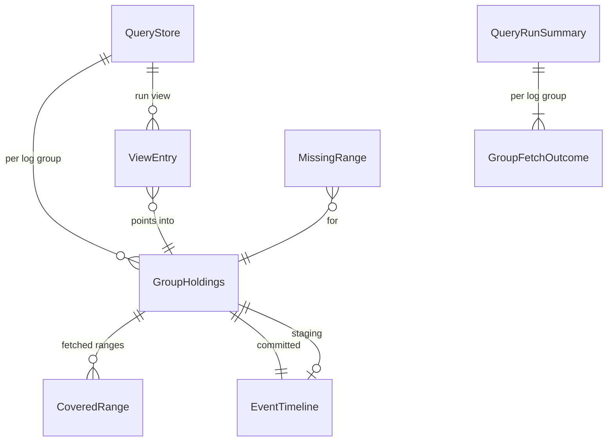

# Entities — U3 クエリの画面の取り足しと複数のロググループ（u3-shared-store）

上流：`inception/units-generation/unit-of-work.md`（U3）・`unit-of-work-story-map.md`、`inception/requirements-analysis/requirements.md`（FR1.3、FR2.1〜FR2.8、NFR2）、`inception/domain-design/components.md`（QueryStore・CachePlan・LogCache・FetchCoordinator・QueryRunner・LogGroupMultiselect）・`decisions.md`（ADR-001・ADR-004〜ADR-008）、質問票 `functional-design-questions.md`（質問にしなかったことの表）、U1・U2 のコード（`query/store.rs` の QueryStore・HoldingKey、`cache/plan.rs` の CoveredRange・record_range、`timeline.rs` の EventTimeline）。

U1 の QueryStore の最小版（1 つのロググループ、実行のたびに捨てて取り直す）を、ロググループごとの保持と取得済みの範囲に広げる。LogEvent・EventTimeline・ログ管理の画面の保持は変えない（ADR-001）。評価の入口の形（時刻順の（イベント, ロググループ名）の並び）は U1 のまま。

## エンティティ（機械可読）

```yaml
entities:
  - name: QueryStore
    description: クエリの画面の取得済みのログ。ロググループごとの保持を持つ（ADR-001）
    attributes:
      - name: groups
        type: map<HoldingKey, GroupHoldings>
        required: true
        constraints: キーは（プロファイル, リージョン, ロググループ）。違う接続のキーは持たない（接続を変えたら全部捨てる、ADR-008）
      - name: epoch
        type: integer
        required: true
        default: 0
        constraints: 実行を始めるたびと、接続を変えたときに 1 増える。結果の行がどの中身を指すかを確かめる（U1:BR6.4）
      - name: runView
        type: list<ViewEntry>
        required: false
        constraints: 今の実行で評価する並び（選んだロググループの、期間に入るイベント）。実行を始めるときに作り直す
    relationships:
      - target: GroupHoldings
        cardinality: 1 対 0..n
        direction: QueryStore が持つ

  - name: GroupHoldings
    description: 1 つのロググループの取得済みのイベントと範囲
    attributes:
      - name: committed
        type: EventTimeline
        required: true
        constraints: 取得済みとみなすイベント。範囲 coveredRanges の中のイベントだけを持つ
      - name: coveredRanges
        type: list<CoveredRange>
        required: true
        default: 空
        constraints: 重ならず、時刻順に並ぶ閉区間（ミリ秒）。隣り合う・重なる範囲はつなぐ（今の merge_ranges）
      - name: staging
        type: EventTimeline
        required: false
        constraints: 今の実行で取得したが、取得済みとみなさないイベント（一部失敗・中止のロググループ、BR2.5）。次の実行を始めるときに捨てる
      - name: nextSequence
        type: map<string, integer>
        required: true
        default: 空
        constraints: ストリームごとの次の順番。足すたびに続きから振る（BR1.4）

  - name: MissingRange
    description: あるロググループについて、期間のうちまだ取得していない部分
    attributes:
      - name: key
        type: HoldingKey
        required: true
      - name: startMs
        type: integer
        required: true
      - name: endMs
        type: integer
        required: true
        constraints: startMs 以上。取得済みの範囲と重ならない（ADR-004）

  - name: ViewEntry
    description: 評価の並びの 1 件。どのロググループの、どの保持の、何番目のイベントか
    attributes:
      - name: group
        type: integer
        required: true
        constraints: 今の実行で選んだロググループの番号
      - name: source
        type: enum
        required: true
        allowed: [Committed, Staging]
      - name: position
        type: integer
        required: true
        constraints: その保持の中の位置。epoch が変わるまで変わらない

  - name: GroupFetchOutcome
    description: 1 つのロググループの、1 回の実行での取得の結果
    attributes:
      - name: key
        type: HoldingKey
        required: true
      - name: status
        type: enum
        required: true
        allowed: [NotNeeded, FromCache, Completed, CompletedWithFailures, Failed, Cancelled]
        constraints: NotNeeded はすべて取得済みで AWS もキャッシュも使わなかった。FromCache は足りない分をすべてキャッシュで埋めた
      - name: failedStreams
        type: list<FailedStream>
        required: true
        default: 空
        constraints: 今の FailedStream にロググループ名を添える（BR2.6）
      - name: failure
        type: ApiFailure
        required: false
        constraints: Failed のとき。種類と安全な詳細だけ

  - name: QueryRunSummary
    description: 1 回の実行の取得の要約（InsightsRun が持つ）
    attributes:
      - name: groups
        type: list<GroupFetchOutcome>
        required: true
        constraints: 選んだ順
      - name: partial
        type: boolean
        required: true
        constraints: CompletedWithFailures か Cancelled のロググループがあれば true（Cancelled の実行では評価しないため、実際には CompletedWithFailures だけ）
      - name: fromAws
        type: boolean
        required: true
        constraints: AWS を呼んだか（FR2.3 の確かめに使う）

  - name: QueryResult
    description: U2 の評価の結果。行を、位置ではなくイベントの写しで持つように変える（BR3.2）
    attributes:
      - name: runId
        type: integer
        required: true
      - name: rows
        type: list<ResultRow>
        required: true
        max: 100000
        constraints: limit か既定の上限で切ったあとの行。QueryStore が後で変わっても読める
    relationships:
      - target: ResultRow
        cardinality: 1 対 0..100000
        direction: QueryResult が持つ

  - name: ResultRow
    description: 結果の 1 行。イベントの写しとロググループ名
    attributes:
      - name: event
        type: LogEvent
        required: true
      - name: logGroupName
        type: string
        required: true

  - name: AnalyticsInput
    description: U1 の入力を、ロググループ 50 個までに広げる
    attributes:
      - name: selectedLogGroups
        type: list<string>
        required: true
        default: 空
        min: 0
        max: 50
        constraints: 今の接続の一覧にある名前。重ならない。選んだ順を保つ（ADR-006）
```

## まとめ

- **保持**：QueryStore は（プロファイル, リージョン, ロググループ）ごとに GroupHoldings を持つ。GroupHoldings は取得済みとみなすイベント（committed）とその範囲、今の実行で取れたが取得済みとみなさないイベント（staging）、ストリームごとの次の順番を持つ。
- **足りない範囲**：期間から取得済みの範囲を引いたもの（MissingRange）。取得済みの範囲とミリ秒で重ならない。
- **評価の並び**：選んだロググループの、期間に入るイベント（committed と staging）を ViewEntry の並びにまとめ、評価の入口に（イベント, ロググループ名）として渡す。
- **取得の結果**：ロググループごとの GroupFetchOutcome（失敗したストリームにはロググループ名を添える）と、実行の要約。



<!-- Text fallback: QueryStore はロググループごとに GroupHoldings を持ち、GroupHoldings は取得済みの範囲と、committed と staging の 2 つの EventTimeline を持つ。今の実行の評価の並び ViewEntry は GroupHoldings の中を指す。実行の要約はロググループごとの取得の結果を持つ。足りない範囲はロググループごとに計算する。 -->
