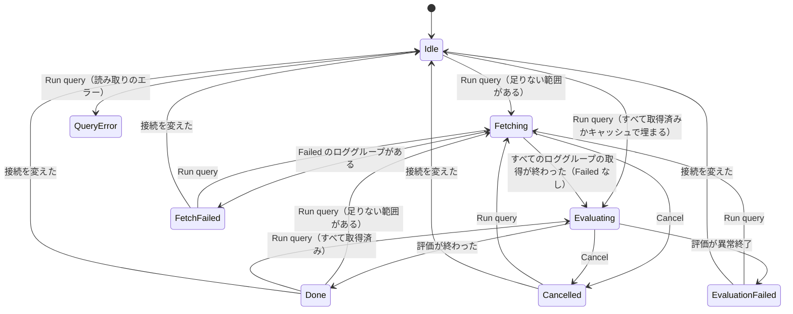
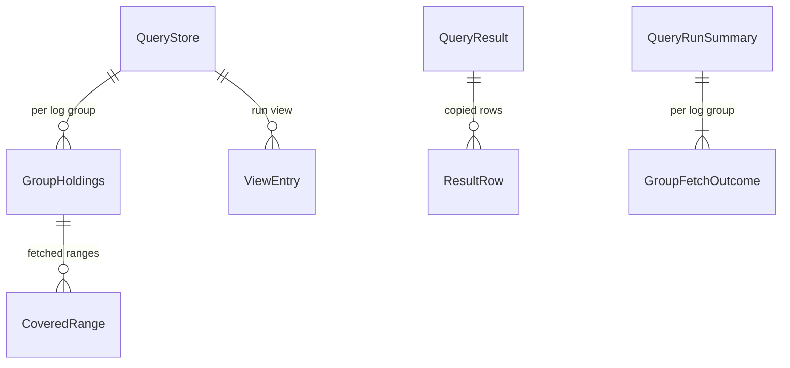

# Functional Spec — U3 クエリの画面の取り足しと複数のロググループ（u3-shared-store）

上流：`inception/units-generation/unit-of-work.md`（U3）・`unit-of-work-story-map.md`・`unit-of-work-dependency.md`、`inception/requirements-analysis/requirements.md`（FR1.3、FR2.1〜FR2.8）、`inception/domain-design/components.md`・`decisions.md`、`inception/refined-mockups/interaction-spec.md`・`mockups.md`（画面 4・6c）、質問票 `functional-design-questions.md`、U1・U2 の機能設計とコード。データの形は `entities.md`、決まりは `rules.md` が正本で、この文書は流れと状態の移り変わりの正本である。

## 1. U3 で作るもの

| 部品 | U3 での中身 |
|---|---|
| CachePlan | 足りない範囲の計算（期間 − 取得済みの範囲）と、範囲の重なりの計算（BR1.1、BR2.1） |
| QueryStore | ロググループごとの committed・staging・取得済みの範囲・ストリームごとの順番、評価の並び、接続の変更での全破棄（BR1.1〜BR1.6） |
| LogCache | 記録範囲のうち、足りない範囲と重なる部分のイベントだけを読む照会（BR2.1）。ログ管理の画面の照会は変えない |
| FetchCoordinator | 今の取得の流れを、（ロググループ, 足りない範囲）ごとに、行き先を QueryStore の staging にして使う（BR2.2）。ログ管理の画面の取得は変えない |
| QueryRunner | キャッシュ → AWS の取り足し、取得の終わりの決め方、評価の並び、補完の名前（BR2.1〜BR2.5、BR3.3、BR5.2） |
| InsightsSession・LogAnalyticsPage | 50 個までの選択、ロググループ名つきの失敗の一覧、進み具合、前の結果を残す（BR2.6、BR2.7、BR3.4、BR4.1、BR4.2） |
| LogGroupMultiselect | 50 個までの複数選択とトークン（BR4.1） |
| QueryParser | 入れ子の上限（BR5.1、U2 から回した直し） |

ログ管理の画面の保持・表示・取得・部分一致の絞り込みは変えない（FR2.1、C5）。評価の入口の形は U1 のまま。

## 2. 流れ（手順）

### UC1 クエリを実行する（取り足しと複数のロググループ）

1. U1 の UC1 の 1〜5 と同じ（押せる条件、読み取り、日時の文字列の変換）。押せる条件のロググループは 1〜50 個（BR4.2）。
2. AppSession が 1 回の呼び出しで、実行を始める（U1 の R-04 と同じ排他）。補完の名前を消す（BR5.2）。前の結果は残す（BR3.4）。
3. QueryStore が、すべてのロググループの staging を捨て、epoch を増やす（BR1.3）。
4. 選んだロググループごとに、足りない範囲を計算する（BR1.1）。
5. ディスクキャッシュが有効なら、ロググループごとに、足りない範囲と記録範囲の重なる部分のイベントをキャッシュから読み、committed に足して取得済みの範囲に加える（BR2.1、BR1.4 の順番の振り直し）。足りない範囲を計算し直す。
6. 足りない範囲が残っていれば、FetchOwner を LogAnalytics にし（BR2.4）、段階を Fetching にする。残っていなければ 9 へ（AWS を呼ばない、BR2.3）。
7. 選んだ順のロググループ、時刻の順の範囲ごとに、今の取得の流れで取得する（BR2.2）。ページは staging に足す（BR1.4）。範囲の取得が Completed なら、BR1.2 のとおり committed に移して取得済みの範囲に加える。進み具合を知らせる（BR2.7）。
   - [Cancel] が押されたら、今の取得を止め、残りを始めない。
   - ロググループの取得が Failed になっても、残りのロググループは取得を続ける（失敗したロググループをすべて示すため）。
8. すべて終わったら FetchOwner を None に戻し、BR2.5 で終わりを決める：Cancelled（評価しない）、FetchFailed（評価しない、前の結果を消す）、一部失敗（評価して印を立てる）、そのほか（評価する）。
9. 選んだロググループの期間に入るイベント（committed と staging）で評価の並びを作り（BR1.5）、U2 の評価に渡す。
10. 評価が終わったら、結果の行（limit か既定の上限で切ったあと）を写して結果に持ち（BR3.2）、Done にする。補完の名前を集める（BR3.3）。
11. 画面は、結果の中の写しから見えている行だけを読む（BR3.2）。

### UC2 すべて取得済みの期間で実行する

UC1 の 4 で足りない範囲が空（またはキャッシュで埋まる）なら、AWS を呼ばずに 9 へ進む。結果の囲みには、取得の進み具合を出さずに評価の進み具合だけを出す（FR2.3）。

### UC3 取り足しで重なりそうな期間

取得済みが 10:00〜11:00 のとき、10:00〜12:00 で実行すると、足りない範囲は 11:00:00.000〜12:00:59.999 のうち 11:00 の範囲の終わりの次のミリ秒からになる（BR1.1）。11:00 ちょうどのイベントは取得済みの範囲に入っているため、2 回は取得しない（FR2.7）。

### UC4 接続を変える

U1 の UC6 と同じ。QueryStore のすべてのロググループの保持と範囲を捨てる（BR1.6）。ロググループの選択は空に戻す（BR4.1）。

## 3. コマンドとイベントの変更

| 名前 | 種類 | 変更 |
|---|---|---|
| update_analytics_input | コマンド | ロググループを 50 個までの並びで受け取る |
| get_query_rows・get_query_row_detail | コマンド | 結果の中の写しから読み、runId で確かめる（BR3.2） |
| session-changed | イベント | ロググループごとの取得の結果、ロググループ名つきの失敗の一覧、ロググループ i / n の進み具合を足す |

## 4. 状態の移り変わり（InsightsRun.phase）

U2 の状態の移り変わりのまま。取得の段（Fetching）が、複数のロググループと範囲の取得をまとめて 1 つの段になる。キャッシュだけで埋まるときと、すべて取得済みのときは、Fetching を通らずに Evaluating に進む。

<!-- Text fallback: Idle から Run query で、足りない範囲があれば Fetching、すべて取得済みかキャッシュで埋まれば Evaluating、読み取りのエラーなら QueryError へ。Fetching は Failed のロググループがあれば FetchFailed、Cancel なら Cancelled、ほかは Evaluating へ。Evaluating は Done・Cancelled・EvaluationFailed へ。終わりの状態から Run query で Fetching か Evaluating へ、接続を変えると Idle へ。どの終わりの状態からも、読み取りのエラーなら QueryError へ進む（図では Idle からだけ描いた）。 -->

## 5. エンティティの関係（entities.md から作った見取り図）

<!-- Text fallback: QueryStore はロググループごとに保持と取得済みの範囲を持ち、評価の並びを持つ。結果は行の写しを持つ。実行の要約はロググループごとの取得の結果を持つ。正本は entities.md。 -->

## 6. 決まりの見取り図（rules.md から作った要約）

| まとまり | 決まり | 要点 |
|---|---|---|
| 保持 | BR1.1〜BR1.6 | 足りない範囲は取得済みとミリ秒で重ならない。終わった範囲だけを、取得の 5 分前までを取得済みに加える。取得済みとみなさない分は次の実行で捨てる。順番はストリームごとに続きから。接続を変えたときだけ全部捨てる |
| 取得 | BR2.1〜BR2.7 | キャッシュの重なる部分を先に使う。ロググループ 1 つずつ、範囲 1 つずつ今の流れで取得。取得済みなら呼ばない。1 回の実行で取得は 1 つ。Failed があれば評価しない。失敗にロググループ名 |
| 結果 | BR3.1〜BR3.4 | 自動ではやり直さない。結果の行は写しで持つ（多くて 100,000 件）。前の結果を残す |
| 選択 | BR4.1・BR4.2 | 50 個まで |
| U2 から回した直し | BR5.1〜BR5.3 | 入れ子は 100 段まで、補完の名前を消す、メモリを測る |

## 7. 確かめ方（U3）

1. **自動テスト**：`cargo test` と Vitest がすべて通る。足りない範囲の計算と範囲の重なり（同じミリ秒、終了の 999 ms、隣り合う範囲、5 分の新しさ）と、順番の振り直しは、テストを先に書く。要件の FR2 の受け入れ基準 6 つ（取り足し、すべて取得済み、重なり、同じ名前のストリーム、一部失敗、キャッシュが切でログ管理の画面と別に取得）を、それぞれテストにする。ログ管理の画面の既存のテストと速さのテスト（10 万件 10 秒・100 万件 100 秒）は今と同じに通す。
2. **手元**：macOS と Windows で、実際の AWS に対して、取得済みの範囲の一部を含む期間でクエリを実行し、足りない分だけが取得されること（進み具合と取得した件数で分かる）と、複数のロググループの結果に `@log` が出ることを確かめる。
3. **U2 から回した目視（R-04）**：本物の Ace で、構文の色分け・補完・エラーの下線と行番号の横の印が出ることを、macOS と Windows で目で確かめる。
4. **記録の誤り（U2 の R-05）**：U2 の `code-summary.md` の「権限ファイルはコミットしていない」は誤りで、実際はコミットに含まれていることを、U3 の `code-summary.md` に書く。
5. **メモリ（BR5.3）**：100 万件を 2 つのロググループに持った状態で、JSON の項目の sort を含むクエリを評価したときのピークのメモリを測って記録する。

## 8. 残した問い

- ロググループを並べて同時に取得すると速くなるかは、今の呼び出しの速さの上限（リージョンごとに 1 つ）の下では見込みが薄いため試していない。50 個のロググループの取得が遅すぎると分かったら見直す。
