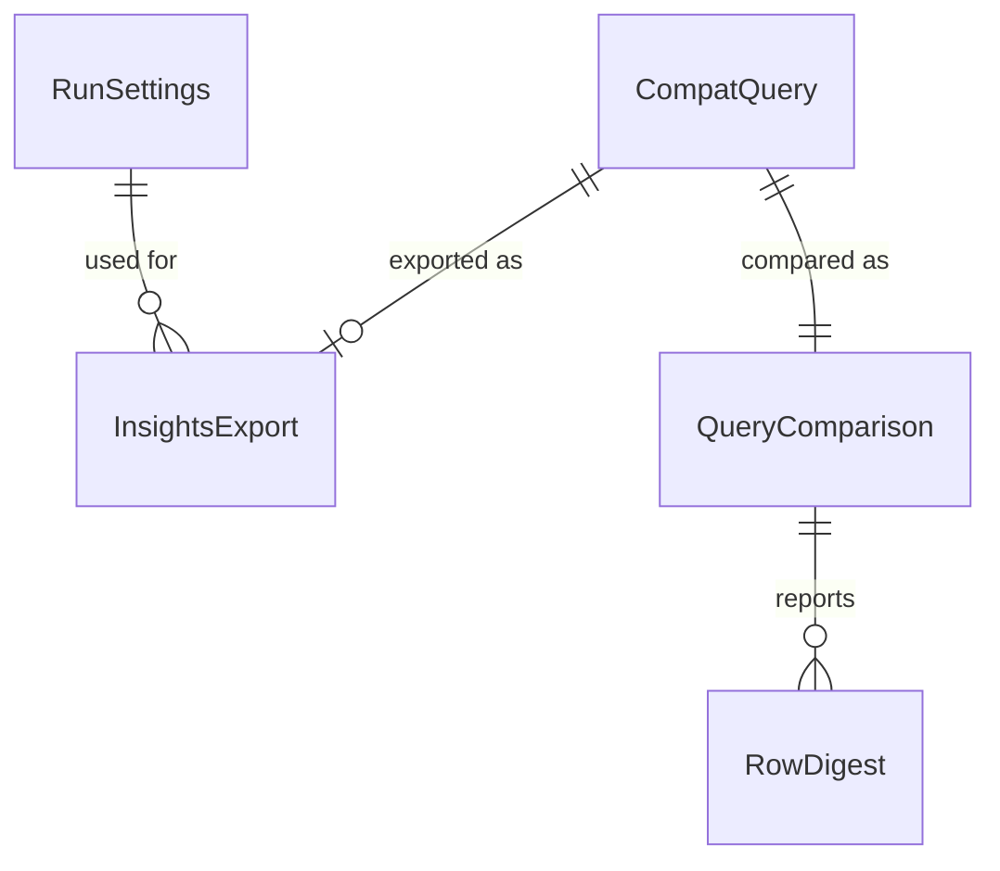

# Entities — U4 互換の確認用プログラム（u4-compat-check）

上流：`inception/units-generation/unit-of-work.md`（U4）、`inception/requirements-analysis/requirements.md`（SM1、NFR3、NFR4、OQ5、D17〜D19）、質問票 `functional-design-questions.md`（Q1：CLI のスクリプトで Logs Insights の結果を用意する）、U2 の `code-summary.md`（U4 に引き継ぐ仮の決まり）、U1〜U3 のコード（`crates/local-sights-core/src/query/`、`examples/fetch_check.rs`）。

確認用プログラムは開発者の手元だけで動かし、配らない（NFR4）。アプリの中核（QueryParser・QueryEvaluator・EventFieldReader・QueryStore・取得の流れ）をそのまま使い、新しい判断は比べ方だけに置く。

## エンティティ（機械可読）

```yaml
entities:
  - name: CompatQuery
    description: 比べるクエリの 1 本（クエリの組のファイルの 1 行）
    attributes:
      - name: id
        type: string
        required: true
        unique: true
        constraints: 英数字と - だけ（例 q01-doc-latest）。結果のファイルの名前にも使う
      - name: text
        type: string
        required: true
        max: 10000 文字
        constraints: アプリが対応する範囲（fields・filter・sort・limit）だけ。@log の値を比べない（U1 の決まり）。日時の文字列との比べ（アプリだけの拡張）を使わない
      - name: compareOrder
        type: boolean
        required: true
        constraints: sort を書いたクエリだけ true（D18）
      - name: purpose
        type: enum
        required: true
        allowed: [DocExample, Provisional, Basic]
        constraints: DocExample は AWS の資料の例を手元のログに合わせたもの、Provisional は U2 の仮の決まりの確かめ
      - name: note
        type: string
        required: false
        constraints: 何を確かめるか（例「数字だけの文字列と数の >」）

  - name: InsightsExport
    description: スクリプトが CLI で Logs Insights に流して保存した、1 本のクエリの結果
    attributes:
      - name: queryId
        type: string
        required: true
        constraints: CompatQuery の id
      - name: status
        type: enum
        required: true
        allowed: [Complete, Failed, Cancelled, Timeout, Unknown, Error]
        constraints: Error は start-query が断ったとき（そのときは message を持つ）
      - name: rows
        type: list<list<{field, value}>>
        required: false
        constraints: get-query-results の results をそのまま。@ptr は比べない
      - name: message
        type: string
        required: false
        constraints: start-query のエラーの文（リクエスト ID は除く）

  - name: RunSettings
    description: 1 回の比べの条件。スクリプトと確認用プログラムで同じものを使う
    attributes:
      - name: profile
        type: string
        required: false
      - name: region
        type: string
        required: true
      - name: logGroup
        type: string
        required: true
      - name: startSeconds
        type: integer
        required: true
      - name: endSeconds
        type: integer
        required: true
        constraints: 実行する時刻の 30 分以上前（遅れて届くログで両方の見るイベントがずれないように、BR1.3）。startSeconds より後
      - name: exportDir
        type: path
        required: true
        constraints: リポジトリの外（BR1.2）

  - name: QueryComparison
    description: 1 本のクエリの比べの結果
    attributes:
      - name: queryId
        type: string
        required: true
      - name: verdict
        type: enum
        required: true
        allowed: [Same, Different, BothRejected, OnlyAppRejected, OnlyInsightsRejected, Skipped]
        constraints: Skipped は書き出しのファイルがないか、件数がどちらかの上限に当たったとき（BR2.5）
      - name: insightsCount
        type: integer
        required: false
      - name: appCount
        type: integer
        required: false
      - name: missingInApp
        type: list<RowDigest>
        required: false
        max: 5
        constraints: Logs Insights にだけある行（最初の 5 つまで）
      - name: missingInInsights
        type: list<RowDigest>
        required: false
        max: 5
      - name: firstOrderMismatch
        type: integer
        required: false
        constraints: compareOrder のとき、並びが最初に食い違った行の番号

  - name: RowDigest
    description: 報告に出す行の要約。ログの中身を出しすぎない
    attributes:
      - name: timestamp
        type: string
        required: true
      - name: columns
        type: string
        required: true
        constraints: 列の名前と、値の先頭 40 文字
```

## まとめ

- **クエリの組**：CompatQuery の並び。AWS の資料の例を手元のログ（CloudTrail）に合わせたものと、U2 の仮の決まりを確かめるものからなる。リポジトリに置く（クエリの文だけで、ログの中身は含まない）。
- **書き出し**：スクリプトが CLI で Logs Insights に流した結果（InsightsExport）。リポジトリの外のフォルダに、クエリごとに 1 つの JSON のファイルで置く。
- **比べの条件**：RunSettings（接続、ロググループ、期間、書き出しのフォルダ）。スクリプトと確認用プログラムで同じ値を使う。
- **比べの結果**：クエリごとの QueryComparison。違いがあるときは、片方にだけある行の要約を最初の 5 つまで出す。



<!-- Text fallback: 比べるクエリ 1 本ごとに、Logs Insights の書き出しが 0 か 1 つあり、比べの結果が 1 つある。比べの結果は違いの行の要約を持つ。比べの条件は書き出しとアプリの両方に使う。 -->
