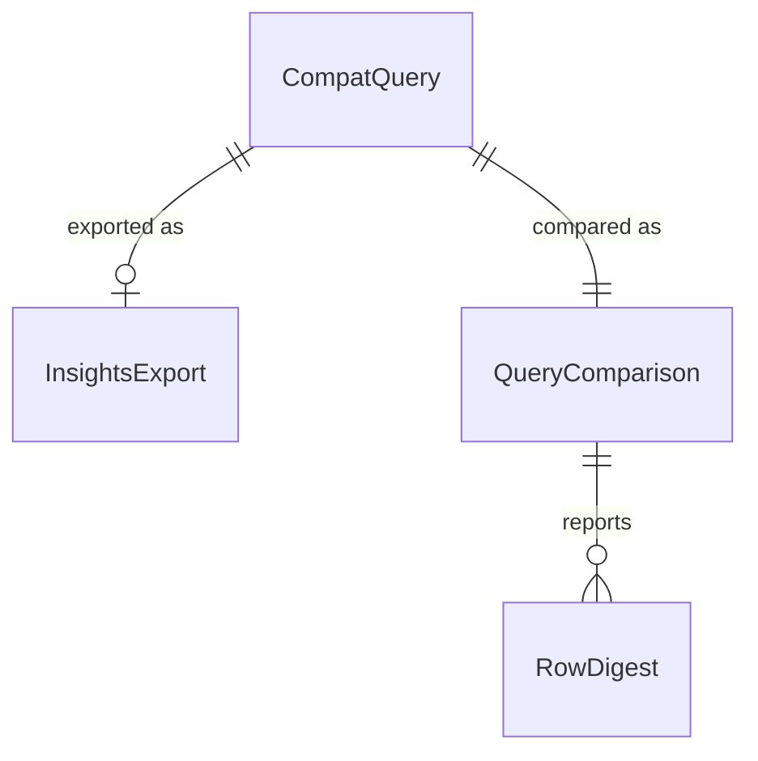

# Functional Spec — U4 互換の確認用プログラム（u4-compat-check）

上流：`inception/units-generation/unit-of-work.md`（U4）・`unit-of-work-dependency.md`（U4 は U2 に依存）、`inception/requirements-analysis/requirements.md`（SM1、SM2、NFR3、NFR4、OQ5）、質問票 `functional-design-questions.md`（Q1）、U1〜U3 の機能設計とコード。データの形は `entities.md`、決まりは `rules.md` が正本で、この文書は流れの正本である。

## 1. U4 で作るもの

| もの | 置き場所 | 中身 |
|---|---|---|
| クエリの組 | `crates/local-sights-core/examples/compat_queries.txt` | 1 行に 1 本：id、比べ方（order か set）、目的、クエリの文（BR3.1）。クエリの文だけで、ログの中身は含まない |
| 書き出しのスクリプト | `scripts/compat/insights-export.sh` | CLI で Logs Insights にクエリの組を流し、結果を JSON で保存する（BR1.1〜BR1.4）。開発者の手元だけで動かす |
| 確認用プログラム | `crates/local-sights-core/examples/compat_check.rs` | 書き出しを読み、同じ条件でアプリの取得と評価をして比べる（BR2.1〜BR2.6、BR3.2） |
| 比べ方の部品 | `crates/local-sights-core/examples/compat/`（例の中のモジュール） | 書き出しの読み込み、値の書き方の合わせ、多重集合と並びの比べ。見本のデータでテストする |

確認用プログラムは `cargo test` で例としてコンパイルされるが、実行はされない（今の fetch_check と同じ）。比べ方の部品のテストは、見本のデータで `cargo test --example compat_check` で流す（AWS には接続しない）。

## 2. 流れ（手順）

### UC1 Logs Insights の結果を書き出す（開発者の手元）

1. 開発者が、PROFILE・REGION・GROUP・START・END・OUT（リポジトリの外のフォルダ）を指定してスクリプトを流す。
2. スクリプトが、OUT がリポジトリの外にあることと、END が 30 分以上前であることを確かめる（BR1.2、BR1.3）。
3. 条件を `OUT/settings.json` に書く（BR1.4）。
4. クエリの組を 1 行ずつ読み、start-query と get-query-results で流し、`OUT/<id>.json` に保存する。start-query が断ったら、断った文を `status: Error` として保存する。
5. 最後に、流した数と、Complete 以外の数を出す。

### UC2 アプリの結果と比べる（開発者の手元）

1. 開発者が `cargo run -p local-sights-core --example compat_check -- --export-dir OUT` を流す。
2. 確認用プログラムが `OUT/settings.json` を読み、OUT がリポジトリの外にあることを確かめる（BR1.2）。
3. 今のアプリの取得の流れ（QueryStore と取得の流れ）で、そのロググループの期間を 1 回取得する。取得が Completed でなければ、終了コード 2 で止まる（違いではなく、比べられなかった）。
4. クエリの組の 1 本ずつについて、アプリの中核で読み取りと評価をし、`OUT/<id>.json` と比べる（BR2.1〜BR2.5）。
5. クエリごとの結果を 1 行ずつ、違いがあれば行の要約を出す（BR3.2）。
6. 最後に数の要約を出し、BR2.6 の終了コードで終わる。

### UC3 違いがあったとき

1. 開発者が報告を見て、違いの原因を見立てる（アプリの読み取り・評価の誤りか、仮の決まりの違いか、取得の違いか）。
2. アプリの誤りなら、Build and Test から直しに戻る。仮の決まりの違いなら、コンソールに合わせて直すか、違いを README に書いて受け入れる。
3. 結果の要約を記録に残す（BR3.3）。

## 3. クエリの組（最初の版）

| id | 比べ方 | 目的 | クエリ |
|---|---|---|---|
| q01-doc-latest | order | 資料の例（fields・sort・limit） | `fields @timestamp, @message \| sort @timestamp desc \| limit 20` |
| q02-doc-like | order | 資料の例（like） | `fields @timestamp, @message \| filter @message like /Exception/ \| sort @timestamp desc \| limit 20` |
| q03-doc-regex-ci | set | 資料の例（(?i)） | `fields eventName \| filter eventName like /(?i)assumerole/` |
| q04-doc-in | set | 資料の例（in） | `fields @timestamp, eventName \| filter eventName in ["AssumeRole", "Decrypt"]` |
| q05-doc-and | set | 資料の例（and と比べる） | `fields eventName, awsRegion \| filter (eventSource = "kms.amazonaws.com" and awsRegion = "us-east-1")` |
| q06-nested | set | JSON の入れ子 | `fields userIdentity.type, eventName \| filter userIdentity.type = "AWSService"` |
| q07-match | set | =~ | `fields eventName \| filter eventName =~ /^Get/` |
| q08-not-paren | set | not (…) | `fields eventName \| filter not (eventName like /Get/ or eventName like /List/)` |
| q09-sort-natural | order | 自然順 | `fields eventName \| sort eventName asc \| limit 200` |
| q10-sort-missing | order | ない値の並び | `fields errorCode, eventName \| sort errorCode desc \| limit 50` |
| q11-nosort-set | set | sort がないとき（集まりだけ） | `fields @timestamp, eventName \| filter eventSource = "sts.amazonaws.com"` |
| p01-numstr-gt | set | 仮：数字だけの文字列と数の > | `fields eventVersion \| filter eventVersion > 1.05` |
| p02-numstr-lt | set | 仮：数字だけの文字列と数の < | `fields eventVersion \| filter eventVersion < 1.09` |
| p03-text-order | set | 仮：数字でない文字列どうしの順 | `fields eventName \| filter eventName > "M"` |
| p04-bool | set | 仮：真偽値と文字列 | `fields eventName, readOnly \| filter readOnly = "true"` |
| p05-bool-literal | set | 仮：真偽値と true | `fields eventName, readOnly \| filter readOnly = true` |
| p06-upper-and-or-not | set | 仮：AND・OR・NOT の大文字 | `fields eventName \| filter eventSource = "kms.amazonaws.com" AND NOT (eventName = "Decrypt" OR eventName = "Encrypt")` |
| p07-upper-not-like-in | set | 仮：NOT LIKE・NOT IN の大文字 | `fields eventName \| filter eventName NOT LIKE /Get/ \| filter eventName NOT IN ["AssumeRole"]` |
| p08-limit0 | set | 仮：limit 0（10,000 件を超える期間で意味がある） | `fields @timestamp \| limit 0` |
| p09-json-number | set | 仮：JSON の数と文字列の数 | `fields eventName \| filter eventVersion = "1.08"` |

- クエリの組の項目の名前は CloudTrail のログに合わせた。ほかのロググループで比べるときは、組のファイルを分けて足す。
- p08 は、期間の中のイベントが 10,000 件を超えるときだけ意味がある。超えないときも比べる（BR2.5 で上限に当たらなければ集まりで比べる）。

## 4. 状態の移り変わり

確認用プログラムとスクリプトは、1 回流して終わるだけで、状態を持たない。終わり方は BR2.6 の終了コードで表す。

## 5. エンティティの関係（entities.md から作った見取り図）

<!-- Text fallback: 比べるクエリ 1 本ごとに、Logs Insights の書き出しが 0 か 1 つ、比べの結果が 1 つある。比べの結果は違いの行の要約を持つ。正本は entities.md。 -->

## 6. 決まりの見取り図（rules.md から作った要約）

| まとまり | 決まり | 要点 |
|---|---|---|
| 用意 | BR1.1〜BR1.4 | CLI のスクリプトで結果を用意し、リポジトリの外に置く。期間は 30 分以上前に終わる。同じ条件を使う |
| 比べ方 | BR2.1〜BR2.6 | 列と値の多重集合、値の書き方の合わせ、並びは sort のときだけ、断り方、上限に当たったら比べない、終了コード |
| クエリの組と報告 | BR3.1〜BR3.3 | 資料の例と仮の決まり、要約だけを出す、記録に残す |

## 7. 確かめ方（U4）

1. **自動テスト**：比べ方の部品（書き出しの読み込み、値の書き方の合わせ、多重集合と並びの比べ、断り方、上限、フォルダと期間の確かめ）を、見本のデータでテストする。見本のデータはテストの中で作り、実際のログは使わない。AWS には接続しない。
2. **手元**：開発者が CloudTrail のロググループで UC1 と UC2 を流し、報告の要約を記録に残す（BR3.3）。

## 8. 残した問い

- 違いが出たときに、アプリをコンソールに合わせて直すか、違いを受け入れるかは、結果を見て Build and Test で開発者と決める。
