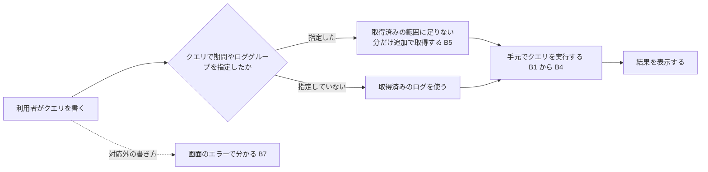

# Scope Document — Logs Insights 互換のクエリ（IB-11）

上流：`ideation/intent-capture/intent-statement.md`（intent-statement）。質問票の回答は `scope-definition-questions.md` の Q1〜Q9 を指す。意図の把握の回答は「意図 Q◯」と書く。

## 目的

取得したログを、CloudWatch Logs Insights に似たクエリで絞り込めるようにする。いちばん困っているのは、今の絞り込みでは条件を組み合わせられないこと（例：「ERROR を含み、かつ timeout を含まない」）である。今の部分一致の絞り込みを発展させる位置づけとし、クエリは手元で実行する。（intent-statement の Problem Statement）

## 範囲内（In Scope）

| ID | 項目 | 優先度 | 出典 |
|----|------|--------|------|
| B1 | 条件を組み合わせて絞り込む（`filter`。かつ・または・否定を組み合わせられる） | Must | intent-statement、意図 Q1・Q6、Q3 |
| B2 | 表示する項目を選ぶ（`fields`） | Must | 意図 Q6、Q3 |
| B3 | クエリで使える項目は、決まった項目（`@timestamp`・`@message`・`@logStream`・`@log`）と、JSON 形式のログから自動で取り出した項目（入れ子は `a.b` の形で指定）とする | Must | Q1、Q3 |
| B4 | 並べ替え（`sort`）と件数の上限（`limit`） | Must | 意図 Q6、Q3 |
| B5 | クエリの中で期間とロググループ（複数可）を指定でき、取得済みの範囲に足りない分だけを追加で取得してから、手元でクエリを実行する | Must | 意図 Q10・Q11、Q2、Q3 |
| B6 | 対応する範囲（使える命令・関数・演算子）の一覧を README に短く書く | Must | Q8、Q9 |
| B7 | 対応していない命令や関数を書いたとき、画面のエラーでそれと分かる | Must | Q8、Q9 |
| B8 | 入力の補完（命令や項目の名前の候補を出す） | Should | Q7、Q9 |
| B9 | 構文の色分け | Should | Q7、Q9 |
| B10 | 例のクエリを選んで入れられる仕組み | Should | Q7、Q9 |

使える関数や演算子の細かい範囲は要件分析で決める。（intent-statement の Initial Scope Signal）

## 範囲外（Out of Scope）

| 項目 | 扱い | 出典 |
|------|------|------|
| 集計（`stats`） | 次の版以降 | intent-statement、意図 Q6・Q9 |
| クエリの保存や履歴 | 今回は作らない | intent-statement、意図 Q8 |
| クエリの結果をファイルに書き出すこと | 今回は作らない | intent-statement、意図 Q8 |
| クエリの書き方の説明（手順書や README への記載）。書き方は AWS の資料に任せる | 今回は作らない（対応する範囲の一覧 B6 は別に書く） | Q6、Q8 |
| Logs Insights のクエリの呼び出し（StartQuery など）や、読み取りの 3 つ以外の呼び出し | 使わない | intent-statement、project.md の Forbidden |

## 変えないもの

| 項目 | 出典 |
|------|------|
| 今の部分一致の絞り込みは残し、クエリは別に書けるようにする（手軽な絞り込みとクエリの両方を使える） | intent-statement、意図 Q7 |
| 呼べるのは読み取りの 3 つ（DescribeLogGroups / DescribeLogStreams / GetLogEvents）だけ。追加の取得も同じ | intent-statement、project.md の Forbidden |
| 速さの基準（10 万件で 10 秒以内、100 万件で 100 秒以内） | intent-statement の Success Metrics |
| macOS と Windows の両方で動く | intent-statement の Success Metrics |

## 成功の判断

| 目安 | 判断のしかた | 出典 |
|------|--------------|------|
| コンソールとの互換 | マネジメントコンソールの Logs Insights で書いていたクエリが、このアプリが対応する範囲（B6 の一覧）ではそのまま書けて、同じ結果になる。どのクエリで確かめ、何を同じとみなすかは後のステージで決める | intent-statement の Success Metrics、意図 Q3 |
| 対応外の書き方が分かる | 対応していない命令や関数を書くと、画面のエラーでそれと分かる（B7） | Q8 |

## 期限と配る版

- 期限はない。この作業も `v0.2.0` に含め、終わるまで `v0.2.0` のタグを待つ。`v0.2.0` は、取得の高速化（PR #22）・Windows 版・この作業を合わせて配る版になる。（Q5、team.md の Deployment）
- B1〜B7 はどれも欠かせない（Must）。時間が足りないときは、B8〜B10（書く手助け）を次の版に回してよい。（Q3、Q9）

## 進める順

価値が先：最初の一本は、条件を組み合わせた `filter`（B1）を取得済みのログに対して手元で実行し、結果を表示するところまでとする。そのあと項目（B2・B3）、並べ替えと件数（B4）、クエリの中での期間とロググループの指定と追加の取得（B5）、対応範囲の伝え方（B6・B7）、書く手助け（B8〜B10）の順に足す。細かい分け方は作業単位の分割で決める。（Q4、team.md の Walking Skeleton）

## 価値の流れ

テキスト版：利用者がクエリを書く → クエリの中で期間やロググループを指定していれば、取得済みの範囲に足りない分だけを追加で取得する（指定していなければ取得済みのログを使う）→ 手元でクエリ（絞り込み・項目・並べ替え・件数）を実行する → 結果を表示する。対応していない書き方は画面のエラーで分かる。

## Assumptions & Open Questions

None.
