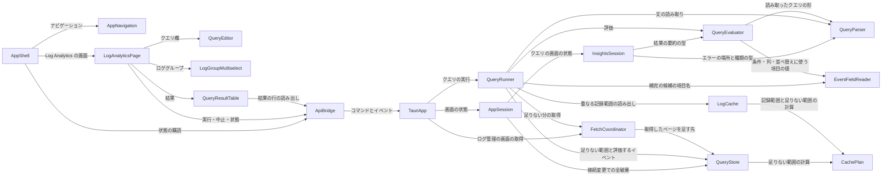

# Components — Logs Insights 互換のクエリ（IB-11）

上流の成果物：`inception/requirements-analysis/requirements.md`（FR1〜FR9、NFR1〜NFR12、A1〜A5、OQ1〜OQ5）、`inception/refined-mockups/`（mockups.md・interaction-spec.md、画面の名前は Log Management（ログ管理）と Log Analytics）、コード知識ベース `codekb/local-sights/architecture.md`・`component-inventory.md`。質問票の回答は `domain-design-questions.md` の Q1〜Q9。設計判断の記録は `decisions.md`（ADR-001〜ADR-008）。

2026-10-17 の要件の見直し（RA Q3b：2 つの画面は取得済みのログを共有しない）に合わせて、この一覧を作り直した。共有の保持（LogStore）はやめ、クエリの画面専用の保持（QueryStore）を置く（Q6）。ログ管理の画面の保持・表示・取得（LogView、EventTimeline の使い方、取得のたびに捨てる流れ）は変えない。

ここで決めるのは「書くコードの部品」とその責任・依存・データの持ち主だけである。AWS SDK・Tauri・React・Cloudscape・Ace・ファイルシステムは外部依存として扱う（project.md Corrections）。型の細部、既定の上限の数、コンソールの細部の振る舞い（OQ1・OQ2）、速さの数値（OQ3）は機能設計と作る段階で決める。

**この一覧の範囲**：既存アプリの拡張のため、載せるのは今回新しく作る部品と、今回変える部品だけである。ここに載せていない部品（LogEvent、EventTimeline、LogView、FilterEngine、EventFetcher、StreamPlanner、TimeRangeModel、DateTimeInput、RetryPolicy、CallPacer、StreamSchedule、LogTable など）は `codekb/local-sights/component-inventory.md` のまま変えない。`depends_on` も載せた部品どうしのものだけを書き、載せていない部品への今の依存はそのまま残る（例：QueryStore はロググループごとに今の EventTimeline を使い、FetchCoordinator は今と同じく EventFetcher・StreamPlanner を使う）。

**全部品に共通の決まり**：呼べるのは DescribeLogGroups / DescribeLogStreams / GetLogEvents だけ。クエリはすべて手元で評価する。エラーや表示に秘密の認証情報とアクセスキー ID を出さない。自動テストと CI は実際の AWS に接続しない（project.md Forbidden）。判断は中核ライブラリに置き、Tauri は配線、画面は表示だけにする（codekb architecture、ADR-001 の今の分け方）。

## 部品カタログ（機械可読）

```yaml
components:
- name: CachePlan
  summary: キャッシュの純粋な判断（変更：範囲の差の計算を足す）
  behaviour: 今の記録範囲の結合（merge_ranges）に加え、「要求の範囲から取得済みの範囲を引いた、足りない範囲」を求める純粋な関数を持つ。QueryStore とキャッシュの照会の両方がこの計算を使う。境界はミリ秒で閉区間として扱い、足りない範囲どうしが取得済みの範囲と重ならないようにする（ADR-004）。テストを先に書く。
  responsibilities:
  - 記録範囲の結合
  - 足りない範囲の計算
  depends_on: []
  dependents:
  - component: LogCache
    interaction: 記録範囲と足りない範囲の計算
  - component: QueryStore
    interaction: 足りない範囲の計算
  external_dependencies: []
  entities: []
- name: LogCache
  summary: ディスクキャッシュ（変更：記録範囲の一部だけでも使う照会を足す）
  behaviour: 今の照会（1 つの記録範囲が要求全体を含むときだけ当たる）はログ管理の画面のために変えない。クエリの画面のために、要求に重なる記録範囲のイベントを返し、重なった範囲を「取得済み」として知らせる照会を足す（FR2.2）。ログ管理の画面がキャッシュに書いた範囲もこの照会で使える（FR2.1 の例外はディスクキャッシュだけ）。書き込みの決まり（全ストリームが成功した取得だけ、取得開始の 5 分前まで）は変えない。キーは今と同じ（プロファイル, リージョン, ロググループ）。
  responsibilities:
  - キャッシュの照会と書き込み
  - 重なる記録範囲の読み出し
  depends_on:
  - component: CachePlan
    interaction: 記録範囲と足りない範囲の計算
    style: sync
  dependents:
  - component: QueryRunner
    interaction: 重なる記録範囲の読み出し
  external_dependencies:
  - name: OS のキャッシュフォルダ
    kind: other
    purpose: JSON Lines のファイル
  entities: []
- name: QueryStore
  summary: クエリの画面の取得済みのログ（新規）
  behaviour: （プロファイル, リージョン, ロググループ）ごとに、今の EventTimeline と取得済みの範囲の一覧を持つ（Q6、FR2.1）。ログ管理の画面の保持とは別のもので、ログ管理の画面の取得・表示・絞り込みに何も渡さず、何も受け取らない。足りない範囲を問われたら CachePlan で計算して返す（FR2.2、FR2.3）。取得したページは対応するロググループの EventTimeline に足し、そのストリームの取得が終わった範囲だけを取得済みに加える（失敗した部分と中止で途中までの部分は加えない、FR2.5・FR2.6）。足りない範囲は取得済みと重ならないため、同じイベントを 2 回持たない（FR2.7、ADR-004）。同じストリームを別の範囲から取り足しても、ストリーム内の順番がぶつからないように振る（形は機能設計、ADR-004）。読み手（QueryRunner）には、指定したロググループと期間に入るイベントを、ロググループ名を添えて渡す（@log、FR4.1）。違うロググループの同じ名前のストリームは別に持つ（FR2.8）。捨てるのは接続を変えたときとアプリを閉じたときだけで、手で捨てる手段は作らない（Q9、ADR-008）。メモリの上限は設けず、NFR2 で確かめる。
  responsibilities:
  - ロググループごとのイベントと取得済みの範囲
  - 足りない範囲の問い合わせ
  - 取得したページの追加と範囲の記録
  - 条件に合うイベントの読み出し
  - 接続変更での全破棄
  depends_on:
  - component: CachePlan
    interaction: 足りない範囲の計算
    style: sync
  dependents:
  - component: FetchCoordinator
    interaction: 取得したページを足す先（捨てない保持の口）
  - component: QueryRunner
    interaction: 足りない範囲と評価するイベント
  - component: AppSession
    interaction: 接続変更での全破棄
  external_dependencies: []
  entities:
  - name: GroupHoldings
    identifier: holdingKey（プロファイル, リージョン, ロググループ名）
    attributes:
    - profile
    - region
    - logGroupName
    - coveredRanges
    - version
- name: FetchCoordinator
  summary: 取得 1 回の流れ（変更：保持中を捨てずに、指定の範囲だけを指定の先に足す取得を足す）
  behaviour: ログ管理の画面の取得（最初に保持中を捨て、ロググループ 1 つの期間全体を取り直す）は今のまま変えない（FR1.8、C5）。これと別に、クエリの画面のための取得の入口を足す：（ロググループ, 足りない範囲）の並びを受け取り、保持中を捨てずに、それぞれの範囲を今の決まり（同時に読む本数、呼び出しの速さ、再試行、あきらめ）で読み、ページを QueryStore に足す（Q6、FR2.2、FR2.4）。ストリームの選び方（StreamPlanner）とページ読み（EventFetcher）は今のものを範囲ごとに使う。一部のストリームの失敗と中止の扱いは今と同じで、取得できた分は QueryStore に残る（FR2.5、FR2.6）。取得は 2 つの画面を合わせて同時に 1 つだけ走る（ADR-005、Q7）。
  responsibilities:
  - ログ管理の画面の取得（変えない）
  - （ロググループ, 範囲）の並びを捨てずに足す取得
  - 中止と失敗の扱い
  depends_on:
  - component: QueryStore
    interaction: 取得したページを足す先（捨てない保持の口）
    style: sync
  dependents:
  - component: QueryRunner
    interaction: 足りない分の取得
  - component: TauriApp
    interaction: ログ管理の画面の取得
  external_dependencies: []
  entities: []
- name: EventFieldReader
  summary: イベントから項目を取り出す（新規、純粋）
  behaviour: 決まった項目（@timestamp・@message・@logStream・@log、@ingestionTime の扱いは機能設計）と、メッセージが JSON のオブジェクトのときの項目（入れ子は a.b）を取り出す（FR4.1〜FR4.3）。@log は QueryStore がイベントに添えて渡すロググループ名を読む（LogEvent の型は変えない）。JSON として読めないメッセージ・壊れた JSON・配列や文字列だけのものは、JSON の項目を持たないとして扱い、エラーにしない（FR4.3）。クエリの画面で取得済みのログに出てくる JSON の項目の名前を集める（補完の候補、FR9.1）。値の型の扱いは機能設計（OQ2）。テストを先に書く。
  responsibilities:
  - 決まった項目と JSON の項目の取り出し
  - 項目の名前の収集
  depends_on: []
  dependents:
  - component: QueryEvaluator
    interaction: 条件・列・並べ替えに使う項目の値
  - component: QueryRunner
    interaction: 補完の候補の項目名
  external_dependencies: []
  entities: []
- name: QueryParser
  summary: クエリの文の読み取り（新規、純粋）
  behaviour: クエリの文を読み取り、命令（fields・filter・sort・limit）と条件（比較・and/or/not・括弧・like・=~・正規表現・in）の形にする（FR3、FR5）。書き間違いと対応外（stats などの命令、関数、対応外の演算子）を区別し、行と列の場所を付けて返す（FR6.1、FR6.2）。対応外の言葉の一覧は、画面の色分けと補完の候補にも渡す（FR9）。言葉の大文字・小文字、優先順位などコンソールの細部は機能設計で AWS の資料に合わせる（OQ2）。テストを先に書く。
  responsibilities:
  - クエリの文の読み取り
  - 書き間違いと対応外の検出と場所
  - 使える言葉の一覧
  depends_on: []
  dependents:
  - component: QueryEvaluator
    interaction: 読み取ったクエリの形
  - component: QueryRunner
    interaction: 文の読み取り
  - component: InsightsSession
    interaction: エラーの場所と種類の型
  external_dependencies: []
  entities:
  - name: QueryPlan
    identifier: queryText（読み取った文そのもの）
    attributes:
    - queryText
    - commands
    - fields
    - condition
    - sortKeys
    - limit
  - name: QueryProblem
    identifier: position（行, 列）
    attributes:
    - line
    - column
    - kind
    - word
- name: QueryEvaluator
  summary: クエリの評価（新規、純粋）
  behaviour: 読み取ったクエリを、渡された（イベント, ロググループ名）の並びに当てはめて結果を作る：filter で残し、fields で列を決め、sort で並べ、limit と既定の上限（コンソールと同じ、OQ1）で打ち切る（FR3、FR7.3）。同じ値の並びは決まった順（時刻, ロググループ, ストリーム, 順番）で決める（FR3.4）。今の FilterEngine と同じく、決まった件数ずつ評価して途中で止められる形にし、古い実行の評価は捨てる（FR7.6、NFR2）。結果は行のキーと列で持ち、画面は見えている行だけを読む（FR7.5）。
  responsibilities:
  - 条件での絞り込み
  - 列の選択
  - 並べ替えと打ち切り
  - 途中で止められる評価
  depends_on:
  - component: QueryParser
    interaction: 読み取ったクエリの形
    style: sync
  - component: EventFieldReader
    interaction: 条件・列・並べ替えに使う項目の値
    style: sync
  dependents:
  - component: QueryRunner
    interaction: 評価
  - component: InsightsSession
    interaction: 結果の要約の型
  external_dependencies: []
  entities:
  - name: QueryResult
    identifier: runId
    attributes:
    - runId
    - columns
    - rowKeys
    - matchedCount
    - scannedCount
    - truncated
    references:
    - entity: QueryPlan
      owned_by: QueryParser
      relationship: 1 つの結果は 1 つの読み取ったクエリから作られる
    - entity: GroupHoldings
      owned_by: QueryStore
      relationship: 結果の行は QueryStore が持つイベントを（ロググループ, 並びキー）で指す
- name: QueryRunner
  summary: クエリの実行の流れ（新規）
  behaviour: '[クエリを実行] の流れを持つ：読み取り → 足りない範囲の問い合わせ（QueryStore） → キャッシュが有効なら重なる記録範囲を QueryStore に足す（LogCache） → 残りの取得（FetchCoordinator） → 評価 → 結果（FR1.7、FR2.2〜FR2.6）。読み取りでエラーなら取得も評価もしない（FR6.1）。取得全体が失敗したロググループがあれば評価しない。一部のストリームの失敗は、取得できた分で評価し、一部だけの結果だと知らせる。中止は取得と評価の両方に効く。進み具合（段階、件数）を画面に知らせる。'
  responsibilities:
  - 実行の段階の流れ
  - 取得と評価の順番と止め方
  - 進み具合の通知
  depends_on:
  - component: QueryParser
    interaction: 文の読み取り
    style: sync
  - component: QueryEvaluator
    interaction: 評価
    style: sync
  - component: QueryStore
    interaction: 足りない範囲と評価するイベント
    style: sync
  - component: LogCache
    interaction: 重なる記録範囲の読み出し
    style: sync
  - component: FetchCoordinator
    interaction: 足りない分の取得
    style: sync
  - component: EventFieldReader
    interaction: 補完の候補の項目名
    style: sync
  dependents:
  - component: TauriApp
    interaction: クエリの実行
  external_dependencies: []
  entities: []
- name: InsightsSession
  summary: クエリの画面の状態（新規）
  behaviour: クエリの画面の入力（選んだロググループ 50 個まで、期間、クエリの文）、実行の段階、結果の要約、エラー、失敗したストリームを持つ（Q3、Q5）。期間とロググループの選択はログ管理の画面と別に持つ。[クエリを実行] を押せるかと、押せない理由を決める（FR1.6）。接続が選ばれていないときも理由を出す。期間の入力と検証は今の DateTimeInput と TimeRangeModel を使う。画面を行き来しても入力と結果を残す。
  responsibilities:
  - クエリの画面の入力と検証
  - 実行の段階と結果の要約
  - 押せない理由
  depends_on:
  - component: QueryParser
    interaction: エラーの場所と種類の型
    style: sync
  - component: QueryEvaluator
    interaction: 結果の要約の型
    style: sync
  dependents:
  - component: AppSession
    interaction: クエリの画面の状態
  external_dependencies: []
  entities:
  - name: InsightsRun
    identifier: runId
    attributes:
    - runId
    - phase
    - selectedLogGroups
    - timeRangeInput
    - queryText
    - problem
    - resultSummary
    - failedStreams
    references:
    - entity: QueryResult
      owned_by: QueryEvaluator
      relationship: 1 回の実行に 1 つの結果
    - entity: QueryProblem
      owned_by: QueryParser
      relationship: エラーのときに 1 つの問題を指す
- name: AppSession
  summary: 画面の状態（変更：クエリの画面の状態を持ち、取得を 1 つに保つ）
  behaviour: InsightsSession を持ち、接続などの共通の状態を渡す（Q3）。取得は 2 つの画面を合わせて同時に 1 つだけにし、どちらかが取得中なら、もう一方の [取得]・[クエリを実行] を押せなくして理由を出す（ADR-005、Q7）。接続を変えるときは、ログ管理の画面に表示中のログがあるか、クエリの画面に結果が出ているときに確認ダイアログを出し、両方の画面のログと結果が消えることを文で示す（ADR-007、Q8）。変えたら、ログ管理の画面は今と同じく保持中を捨て、QueryStore も全部捨て、クエリの画面の選択と結果を空にする（クエリの文は残す、A2）。
  responsibilities:
  - クエリの画面の状態を持つ
  - 2 つの画面を合わせた取得の 1 本化
  - 接続変更の確認と破棄
  depends_on:
  - component: InsightsSession
    interaction: クエリの画面の状態
    style: sync
  - component: QueryStore
    interaction: 接続変更での全破棄
    style: sync
  dependents:
  - component: TauriApp
    interaction: 画面の状態
  external_dependencies: []
  entities: []
- name: TauriApp
  summary: Tauri のコマンドとイベント（変更：クエリのコマンドを足す）
  behaviour: クエリの実行・中止・結果の行の読み出し・補完の候補のコマンドと、進み具合のイベントを足す。新しいコマンドは capabilities と permissions にも足す（codekb）。ログ管理の画面のコマンドは変えない。判断は持たない。
  responsibilities:
  - クエリのコマンドとイベントの配線
  depends_on:
  - component: AppSession
    interaction: 画面の状態
    style: sync
  - component: QueryRunner
    interaction: クエリの実行
    style: sync
  - component: FetchCoordinator
    interaction: ログ管理の画面の取得
    style: sync
  dependents:
  - component: ApiBridge
    interaction: コマンドとイベント
  external_dependencies:
  - name: Tauri
    kind: other
    purpose: コマンドとイベント
  entities: []
- name: ApiBridge
  summary: 画面とアプリの橋渡し（変更：クエリの型と関数を足す）
  behaviour: クエリのコマンドとイベントの型と関数を足す。
  responsibilities:
  - クエリのコマンドとイベントの型
  depends_on:
  - component: TauriApp
    interaction: コマンドとイベント
    style: sync
  dependents:
  - component: QueryResultTable
    interaction: 結果の行の読み出し
  - component: LogAnalyticsPage
    interaction: 実行・中止・状態
  - component: AppShell
    interaction: 状態の購読
  external_dependencies: []
  entities: []
- name: AppNavigation
  summary: 左端のナビゲーション（新規）
  behaviour: Log Management（ログ管理）と Log Analytics を切り替える。閉じると左端に [≡] だけを残し、開閉の状態はアプリを閉じるまで覚える（画面設計）。
  responsibilities:
  - 画面の切り替え
  - 開閉
  depends_on: []
  dependents:
  - component: AppShell
    interaction: ナビゲーション
  external_dependencies:
  - name: Cloudscape SideNavigation
    kind: other
    purpose: ナビゲーションの部品
  entities: []
- name: QueryEditor
  summary: クエリ欄（新規）
  behaviour: CodeEditor（Ace）でクエリの文を書く。色分け・補完・エラーの印を出す（FR6、FR9）。Cmd/Ctrl+Enter で実行を頼む。
  responsibilities:
  - クエリの文の入力
  - 色分け・補完・エラーの印
  depends_on: []
  dependents:
  - component: LogAnalyticsPage
    interaction: クエリ欄
  external_dependencies:
  - name: Cloudscape CodeEditor と Ace
    kind: other
    purpose: コードの欄
  entities: []
- name: LogGroupMultiselect
  summary: ロググループの複数選択（新規）
  behaviour: 今の接続のロググループの一覧から 50 個まで選ぶ（Q5）。
  responsibilities:
  - ロググループの複数選択
  depends_on: []
  dependents:
  - component: LogAnalyticsPage
    interaction: ロググループ
  external_dependencies:
  - name: Cloudscape Multiselect
    kind: other
    purpose: 複数選択の部品
  entities: []
- name: QueryResultTable
  summary: 結果の表（新規）
  behaviour: 列を可変にした表で、見えている行だけを読む。行を開くと項目と値の一覧を出す（FR7）。
  responsibilities:
  - 結果の表示
  - 行の項目と値の一覧
  depends_on:
  - component: ApiBridge
    interaction: 結果の行の読み出し
    style: sync
  dependents:
  - component: LogAnalyticsPage
    interaction: 結果
  external_dependencies: []
  entities: []
- name: LogAnalyticsPage
  summary: Log Analytics の画面（新規）
  behaviour: ロググループ・期間・クエリ欄・実行・結果をまとめ、ApiBridge で実行と中止を頼む。
  responsibilities:
  - 画面の組み立て
  depends_on:
  - component: ApiBridge
    interaction: 実行・中止・状態
    style: sync
  - component: QueryEditor
    interaction: クエリ欄
    style: sync
  - component: LogGroupMultiselect
    interaction: ロググループ
    style: sync
  - component: QueryResultTable
    interaction: 結果
    style: sync
  dependents:
  - component: AppShell
    interaction: Log Analytics の画面
  external_dependencies: []
  entities: []
- name: AppShell
  summary: 画面全体の枠（変更：ナビゲーションと 2 つの画面）
  behaviour: AppNavigation を左端に置き、ログ管理の画面と Log Analytics の画面を切り替えて出す。
  responsibilities:
  - ナビゲーションと画面の切り替え
  depends_on:
  - component: AppNavigation
    interaction: ナビゲーション
    style: sync
  - component: LogAnalyticsPage
    interaction: Log Analytics の画面
    style: sync
  - component: ApiBridge
    interaction: 状態の購読
    style: sync
  dependents: []
  external_dependencies: []
  entities: []
```

## Component Diagram



<!-- Text fallback: 画面の AppShell が AppNavigation と LogAnalyticsPage を置き、LogAnalyticsPage は QueryEditor・LogGroupMultiselect・QueryResultTable と ApiBridge を使う。ApiBridge は TauriApp を呼び、TauriApp は AppSession・QueryRunner・FetchCoordinator を使う。QueryRunner は QueryParser・QueryEvaluator・QueryStore・LogCache・FetchCoordinator・EventFieldReader を使う。FetchCoordinator は取得したページを QueryStore に足す。QueryStore と LogCache は CachePlan を使う。AppSession は InsightsSession と QueryStore を使う。ログ管理の画面の LogView と EventTimeline は今のまま（この図には載せない）。 -->

文章での説明：Log Analytics の画面（LogAnalyticsPage）は ApiBridge 経由で TauriApp にクエリの実行を頼む。TauriApp は QueryRunner に任せ、QueryRunner は文を QueryParser で読み取り、QueryStore に足りない範囲を問い合わせ、キャッシュが有効なら LogCache の重なる記録範囲を QueryStore に足し、残りを FetchCoordinator で取得して QueryStore に足してから、QueryEvaluator で評価する。ログ管理の画面は今のまま、自分の保持（LogView と EventTimeline）を使い、QueryStore とは何も受け渡さない。画面の状態は AppSession が持ち、クエリの画面の分は InsightsSession に分けてある。

## Component Summary

| Component | Purpose | Depends On | Dependents | Entities Owned |
|---|---|---|---|---|
| CachePlan | キャッシュの純粋な判断（変更：範囲の差の計算を足す） | — | LogCache, QueryStore | — |
| LogCache | ディスクキャッシュ（変更：記録範囲の一部だけでも使う照会を足す） | CachePlan | QueryRunner | — |
| QueryStore | クエリの画面の取得済みのログ（新規） | CachePlan | FetchCoordinator, QueryRunner, AppSession | GroupHoldings |
| FetchCoordinator | 取得 1 回の流れ（変更：捨てずに指定の範囲だけを足す取得を足す） | QueryStore | QueryRunner, TauriApp | — |
| EventFieldReader | イベントから項目を取り出す（新規、純粋） | — | QueryEvaluator, QueryRunner | — |
| QueryParser | クエリの文の読み取り（新規、純粋） | — | QueryEvaluator, QueryRunner, InsightsSession | QueryPlan, QueryProblem |
| QueryEvaluator | クエリの評価（新規、純粋） | QueryParser, EventFieldReader | QueryRunner, InsightsSession | QueryResult |
| QueryRunner | クエリの実行の流れ（新規） | QueryParser, QueryEvaluator, QueryStore, LogCache, FetchCoordinator, EventFieldReader | TauriApp | — |
| InsightsSession | クエリの画面の状態（新規） | QueryParser, QueryEvaluator | AppSession | InsightsRun |
| AppSession | 画面の状態（変更：クエリの画面の状態を持ち、取得を 1 つに保つ） | InsightsSession, QueryStore | TauriApp | — |
| TauriApp | Tauri のコマンドとイベント（変更：クエリのコマンドを足す） | AppSession, QueryRunner, FetchCoordinator | ApiBridge | — |
| ApiBridge | 画面とアプリの橋渡し（変更：クエリの型と関数を足す） | TauriApp | QueryResultTable, LogAnalyticsPage, AppShell | — |
| AppNavigation | 左端のナビゲーション（新規） | — | AppShell | — |
| QueryEditor | クエリ欄（新規） | — | LogAnalyticsPage | — |
| LogGroupMultiselect | ロググループの複数選択（新規） | — | LogAnalyticsPage | — |
| QueryResultTable | 結果の表（新規） | ApiBridge | LogAnalyticsPage | — |
| LogAnalyticsPage | Log Analytics の画面（新規） | ApiBridge, QueryEditor, LogGroupMultiselect, QueryResultTable | AppShell | — |
| AppShell | 画面全体の枠（変更：ナビゲーションと 2 つの画面） | AppNavigation, LogAnalyticsPage, ApiBridge | — | — |

## Entity Ownership

| Entity | Owning Component | Identifier | Attributes | References |
|---|---|---|---|---|
| GroupHoldings | QueryStore | holdingKey（プロファイル, リージョン, ロググループ名） | profile, region, logGroupName, coveredRanges, version | — |
| QueryPlan | QueryParser | queryText（読み取った文そのもの） | queryText, commands, fields, condition, sortKeys, limit | — |
| QueryProblem | QueryParser | position（行, 列） | line, column, kind, word | — |
| QueryResult | QueryEvaluator | runId | runId, columns, rowKeys, matchedCount, scannedCount, truncated | QueryPlan（QueryParser）：1 つの結果は 1 つの読み取ったクエリから作られる; GroupHoldings（QueryStore）：結果の行は QueryStore が持つイベントを（ロググループ, 並びキー）で指す |
| InsightsRun | InsightsSession | runId | runId, phase, selectedLogGroups, timeRangeInput, queryText, problem, resultSummary, failedStreams | QueryResult（QueryEvaluator）：1 回の実行に 1 つの結果; QueryProblem（QueryParser）：エラーのときに 1 つの問題を指す |

GroupHoldings が持つイベントの型は、今の LogEvent（変えない部品）のままである。ロググループ名はイベントに足さず、GroupHoldings のキーから添える。

## External Dependencies

| Component | Dependency | Kind | Purpose |
|---|---|---|---|
| LogCache | OS のキャッシュフォルダ | other | JSON Lines のファイル |
| TauriApp | Tauri | other | コマンドとイベント |
| AppNavigation | Cloudscape SideNavigation | other | ナビゲーションの部品 |
| QueryEditor | Cloudscape CodeEditor と Ace | other | コードの欄 |
| LogGroupMultiselect | Cloudscape Multiselect | other | 複数選択の部品 |

## Rationale

| Component | なぜ別の部品か |
|---|---|
| QueryStore | クエリの画面だけが持つデータ（取得済みの範囲とロググループごとのイベント）の持ち主（Q6、FR2.1）。ログ管理の画面の保持とは変わる理由（取り足しの決まり、捨てる契機）が違い、分けることでログ管理の画面を変えずに済む |
| EventFieldReader | JSON の取り出しは評価にも補完の候補にも使う。純粋で、JSON の形の変化だけが変わる理由になる |
| QueryParser | 文の読み取りとエラーの場所は、評価と別にテストでき、画面の色分け・補完とも言葉の一覧を共有する（Q2） |
| QueryEvaluator | 評価は件数と速さ（NFR1・NFR2）が効く部分で、読み取りと別に速さを測って直せる（Q2） |
| QueryRunner | 読み取り・取得・評価の順番と止め方という流れは、純粋な部品（読み取り・評価）から分けて置く（今の FetchCoordinator と純粋な判断の分け方にならう） |
| InsightsSession | クエリの画面の状態は AppSession と変わる理由が違い、AppSession をこれ以上大きくしない（Q3） |
| AppNavigation・LogAnalyticsPage・QueryEditor・LogGroupMultiselect・QueryResultTable | 画面設計の部品。表示だけを持ち、判断は中核に置く |
| 変える部品（CachePlan・LogCache・FetchCoordinator・AppSession・TauriApp・ApiBridge・AppShell） | クエリの画面の取り足し、複数のロググループ、2 つの画面に合わせて責任を広げる。ログ管理の画面の振る舞いに関わる部分は変えない |

### 選んだ分け方と、選ばなかった分け方

- **クエリの画面の取得済みのログの持ち方**（ADR-001）：クエリの画面専用の保持（QueryStore）を作り、取得は今の FetchCoordinator を使う。選ばなかったもの：取得の流れも別に作る（同じ決まりのコードが 2 つになり、速さ・再試行の直しが片方に漏れる）。前の版で選んだ共有の保持（LogStore）は、要件の見直し（RA Q3b）でやめた。
- **クエリの部品**（ADR-002）：読み取りと評価を別の新しい部品にし、FilterEngine は変えない。選ばなかったもの：FilterEngine を広げる（ログ管理の画面の振る舞いを変える危険、FR1.8）、1 つの部品にまとめる（速さを直すときに読み取りまで触れる）。
- **画面の状態**（ADR-003）：InsightsSession に分ける。選ばなかったもの：AppSession に足す。
- **同じイベントを 2 回持たない方法**（ADR-004）：足りない範囲を取得済みと重ならないように計算し、QueryStore の中で順番を範囲をまたいで一意にする。選ばなかったもの：イベントの中身で重複を除く。
- **同時の取得**（ADR-005）：2 つの画面を合わせて同時に 1 つ。選ばなかったもの：速さの上限を分け合って同時に走らせる、それぞれの上限で同時に走らせる。
- **ロググループの数**（ADR-006）：50 個まで。
- **接続を変えるときの確認**（ADR-007）：どちらかの画面にログか結果があれば確認する。
- **クエリの画面の取得済みのログを捨てる契機**（ADR-008）：接続を変えたときとアプリを閉じたときだけ。

## Open Questions

| 問い | 決める段 |
|---|---|
| QueryStore の中で、同じストリームを別の範囲から取り足したときの順番の振り方（範囲をまたいで一意で、時刻順の索引と矛盾しない形） | 機能設計 |
| QueryStore のメモリの上限を設けるか（今は設けない。NFR2 で、ログ管理の画面とクエリの画面の両方に持った状態も含めて確かめる） | 機能設計・作る段階 |
| キャッシュの重なる記録範囲を使うときの読み出しの単位 | 機能設計 |
| FetchCoordinator の「捨てずに足す」入口を、今の入口とどう共通にするか（ログ管理の画面の取得の振る舞いと速さのテストを今と同じに保つ） | 機能設計・作る段階 |
