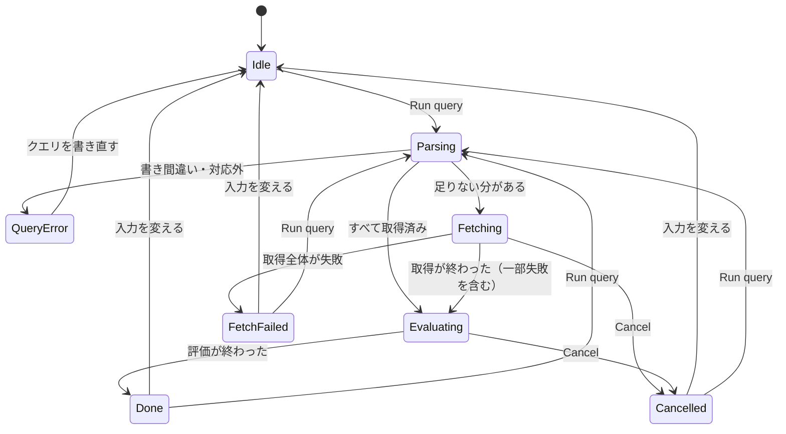

# Interaction Spec — Logs Insights 互換のクエリ（IB-11）

上流：`inception/requirements-analysis/requirements.md`（FR1〜FR9、NFR9〜NFR11）、`mockups.md`（画面 1〜8）、質問票 Q1〜Q5。部品の書式は component-spec-template に従う。レスポンシブの欄は、デスクトップアプリのため「最小ウィンドウ 1024×640」と「それより広い」の 2 段で書く。

## 主な流れ

```
Flow: クエリを書いて実行する
Persona: 開発者本人（同僚・OSS の利用者も同じ）
Trigger: 左端のナビゲーションで Log Analytics を選ぶ
Steps:
  1. Log Analytics（画面 2） -> ロググループを 1 つ以上選ぶ -> 欄の下にトークンが並ぶ
  2. 同 -> 開始・終了を入れる -> 時刻は焦点が外れたときに補う
  3. 同 -> クエリを書く（補完・色分けは Should）
  4. 同 -> [Run query] か Cmd/Ctrl+Enter -> クエリを読み取る
  5. 読み取れた -> 足りない分を取得（画面 4） -> 評価 -> 結果（画面 5）
Success outcome: 結果の一覧と件数が出る
Error paths:
  - 欄の不備 -> 欄の直下に理由、[Run query] は押せない（画面 3） -> 直す
  - 書き間違い・対応外 -> 欄の直下と欄の中に印（画面 7） -> 直して再実行
  - 取得全体の失敗 -> エラーのアラート（画面 6b） -> 権限を直す、SSO でログインし直す
  - 一部のストリームの失敗 -> 警告と結果（画面 6c） -> 失敗の一覧を見る、再実行
  - [Cancel] -> 止めた知らせ（画面 6d） -> 再実行
```

<!-- Text fallback: 上の流れは、ナビゲーションで Log Analytics を選び、ロググループと期間とクエリを入れて実行し、足りない分を取得してから評価して結果を出すまでを表す。エラーの道は 5 つ。 -->

## 状態の移り変わり（クエリの画面）



<!-- Text fallback: 待機中から実行ボタンで読み取りに入る。読み取りで誤りがあればエラー、足りない分があれば取得、なければ評価へ。取得は評価・全体の失敗・取り消しのどれかへ進む。評価は完了か取り消しへ。完了・失敗・取り消しのあとは、再実行するか入力を変えて待機に戻る。 -->

- 状態の名前は画面の文言には出さない（画面の文言は文言表のとおり）。
- QueryError・FetchFailed・Cancelled・Done では、ロググループ・期間・クエリ欄は使え、[Run query] も押せる（欄の不備がなければ）。
- 前の結果は、次の実行の Fetching・Evaluating の間は「前の結果」として薄くせずに残し、新しい結果が出たら置き換える。QueryError のときは前の結果を残す。FetchFailed のときは前の結果を消す（違う条件の結果を残すと取り違えるため）。

## 部品

### SideNavigation（画面の切り替え）

| Field | Value |
|---|---|
| Component | AppNavigation（`<SideNavigation>`） |
| Description | Log Management と Log Analytics を切り替える |
| Category | navigation |

| State | Description | Trigger |
|---|---|---|
| default | 2 項目、今の画面を強調 | 起動時は Log Management |
| collapsed | 閉じて、左端に [≡]（開く）だけを残す。開閉の状態はアプリを閉じるまで覚える | 見出しの右の [×]（閉じる）、[≡] で開く |
| disabled | なし（どの状態でも切り替えられる） | — |

| Requirement | Implementation |
|---|---|
| ARIA role | `navigation`（部品の既定）、今の項目に `aria-current="page"` |
| Keyboard interaction | Tab で入り、Enter で切り替え。Ctrl+1 / Ctrl+2（macOS は Cmd+1 / Cmd+2）でも切り替える |
| Focus management | 切り替えたら、行き先の画面の最初の欄（Log Management はロググループの検索、Log Analytics はロググループの選択）に焦点を移す |
| Screen reader | 切り替えたら画面名を読み上げる（`aria-live="polite"` の領域に画面名） |

### LogGroupMultiselect（ロググループ）

| Prop | Type | Required | Default | Description |
|---|---|---|---|---|
| options | ロググループ名の一覧 | yes | — | Log Management の左ペインと同じ一覧 |
| selected | 名前の一覧 | yes | 空 | 選んだもの |
| disabled | boolean | no | false | 実行中は true |

| State | Description | Trigger |
|---|---|---|
| default | 未選択、プレースホルダ「Select log groups」 | 初回 |
| loading | 一覧の読み込み中（`statusType="loading"`） | 接続の変更 |
| error | 「Couldn't load log groups」と [Retry] | 一覧の失敗 |
| empty | 「No log groups」 | 一覧が 0 件 |
| disabled | 実行中 | Fetching・Evaluating |

- 名前の部分一致で候補を絞る（`filteringType="auto"`）。選んだものは欄の下にトークンで出し、× で外せる。
- 選べる数の上限は Domain Design で決める（要件のレビュー R-05）。上限があるときは、プレースホルダと上限に達したときの文で示す。
- 接続を変えたら、選んだものは空に戻す（今の Log Management がロググループの選択を外すのと同じ）。

### QueryEditor（クエリ欄）

| Field | Value |
|---|---|
| Component | QueryEditor（`<CodeEditor>`） |
| Description | クエリの文を書く。色分け・補完・エラーの印 |
| Category | input |

| State | Description | Trigger |
|---|---|---|
| default | 初回は例のクエリ入り | 初回 |
| focus | 入力中 | クリック・Tab |
| error | 該当の言葉に下線、行番号の横に印、直下に文 | 読み取りのエラー |
| read-only | 内容は見えるが書けない | Fetching・Evaluating |
| loading | エディタ本体の読み込み中（`loading`） | 画面を初めて開いたとき |

| Requirement | Implementation |
|---|---|
| Label | 見える見出し「Query」と `ariaLabel` |
| Keyboard interaction | Cmd/Ctrl+Enter で実行。Ctrl+Space で補完。Tab はエディタの中では字下げに使わず、次の部品へ移る（キーボードの罠を作らない）。字下げは使わない |
| Screen reader | エラーが出たら直下の文を `aria-live="assertive"` で読み上げる |
| Focus management | エラーのとき、焦点はクエリ欄に置き、カーソルをエラーの場所へ動かす |

- エディタの設定（テーマ、行の折り返し、文字の大きさ）は CodeEditor の設定画面を出さず、今の画面の明暗に合わせた 1 つに固定する（NFR11 の標準部品だけ）。
- 書いた文はアプリを閉じるまで残す（保存・履歴は作らない。範囲外）。

### RunBar（実行の行）

| State | Description | Trigger |
|---|---|---|
| default | [Run query] 押せる | 欄に不備なし |
| disabled | [Run query] 押せない | 欄の不備・実行中 |
| running | [Run query] 押せない、[Cancel] が出る | Fetching・Evaluating |

- キーの組み合わせの表示は OS で変える（macOS は「⌘↩」ではなく「Cmd+Enter」と文字で、Windows は「Ctrl+Enter」）。

### QueryResultTable（結果）

| State | Description | Trigger |
|---|---|---|
| empty-initial | 「No results yet」と次の行動 | まだ実行していない |
| loading | 結果の囲みの中に StatusIndicator（段階と進み） | Fetching・Evaluating |
| populated | 列＝fields、件数を見出しに | Done |
| truncated | 見出しの右に「Showing N」 | limit・上限で打ち切り |
| empty-result | 「No matching events」 | 0 件 |
| error | 結果の囲みの上にアラート | FetchFailed |
| partial | 結果の囲みの上に警告 | 一部のストリームの失敗 |

- 行を開く：▶ を押すか、行を選んで Enter / Space。開いた中身は項目と値の一覧（決まった項目 → JSON の項目、名前の順）。
- 行の選び方とスクロールの決まりは Log Management の表と同じ（↑↓ で行、見えている行だけを読む）。

## 文言表

| キー | English | 日本語 |
|---|---|---|
| nav.logManagement | Log Management | ログ管理 |
| nav.logAnalytics | Log Analytics | Log Analytics |
| insights.logGroups.label | Log groups | ロググループ |
| insights.logGroups.placeholder | Select log groups | ロググループを選ぶ |
| insights.logGroups.required | Choose at least one log group. | ロググループを 1 つ以上選んでください。 |
| insights.query.label | Query | クエリ |
| insights.query.required | Write a query. | クエリを書いてください。 |
| insights.run | Run query | クエリを実行 |
| insights.cancel | Cancel | 中止 |
| insights.examples | Examples | 例 |
| insights.results.title | Results | 結果 |
| insights.results.count | {shown} of {matched} matched | {matched} 件中 {shown} 件 |
| insights.results.truncated | Showing {shown} | {shown} 件まで表示 |
| insights.results.initial | No results yet. Choose log groups and a time range, write a query, then choose Run query. | まだ結果はありません。ロググループと期間を選び、クエリを書いて「クエリを実行」を押してください。 |
| insights.results.none | No matching events. No events in the selected log groups and time range matched the query. | 一致するイベントはありません。選んだロググループと期間に、クエリに一致するイベントはありませんでした。 |
| insights.status.fetching | Fetching missing logs: {groups} log groups, {done} / {total} streams, {events} events | 足りないログを取得中：ロググループ {groups} 個、ストリーム {done} / {total}、{events} 件 |
| insights.status.running | Running query: {scanned} / {total} events | クエリを実行中：{scanned} / {total} 件 |
| insights.partial | Results are based on part of the logs. {count} streams could not be fetched. | 結果は一部のログだけから作られています。{count} 本のストリームを取得できませんでした。 |
| insights.cancelled | The query was cancelled. Logs fetched before cancelling are kept. | クエリを中止しました。中止する前に取得したログは残しています。 |
| insights.error.unsupported | Line {line}, column {col}: "{word}" is not supported in this version. | {line} 行 {col} 列：「{word}」にはこの版では対応していません。 |
| insights.error.supportedList | Supported commands: fields, filter, sort, limit. | 使える命令：fields、filter、sort、limit |
| insights.error.syntax | Line {line}, column {col}: {problem} | {line} 行 {col} 列：{problem} |
| insights.examples.replace | Replace the current query with the example? | 今のクエリを例で置き換えますか？ |

- 書き間違いの `{problem}` の文言（括弧が閉じていない、など）は Functional Design で一覧にする。
- FR6.4 のとおり、取得の前のエラー（FR6.1・FR6.2）には、クエリの言葉と場所だけを入れる。

## 2 つの画面の間の約束

- 接続（プロファイル・リージョン）とタイムゾーンは共通。期間・ロググループの選択・入力は画面ごとに別。
- 取得済みのログは共有する（要件 FR2.1）。Log Management で取得したログは、クエリの画面の「足りない分」の計算に使われる。
- Log Management の取得中・クエリの画面の実行中でも、画面は切り替えられる。同じロググループに両方から取得が走るときの扱いは Domain Design で決める（要件 OQ4、レビュー R-03）。
