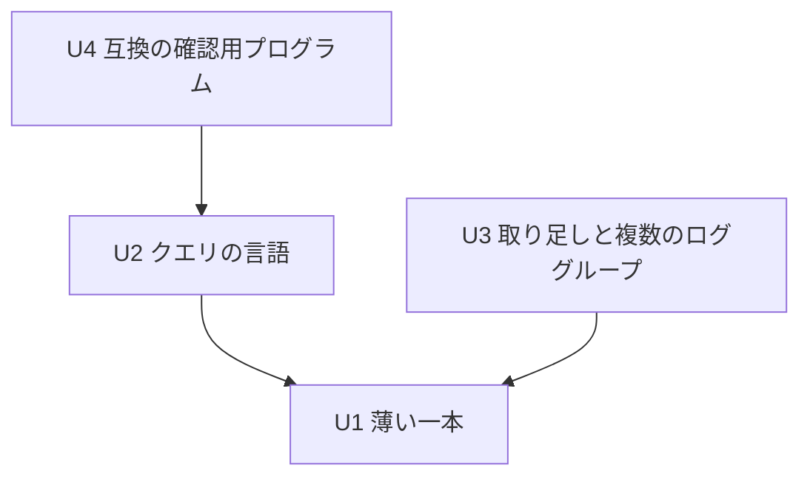

# Unit of Work Dependency — Logs Insights 互換のクエリ（IB-11）

上流：`unit-of-work.md`、`inception/domain-design/components.md`（部品の依存）・`decisions.md`、`inception/requirements-analysis/requirements.md`。

この文書は依存の形だけを書く。どれから作るかは作る段階の計画で決める。

## 依存の一覧（機械可読）

```yaml
units:
  - name: u1-filter-skeleton
    kind: service
    depends_on: []
  - name: u2-query-language
    kind: library
    depends_on: [u1-filter-skeleton]
  - name: u3-shared-store
    kind: service
    depends_on: [u1-filter-skeleton]
  - name: u4-compat-check
    kind: library
    depends_on: [u2-query-language]
```



文字による代替：U2 と U3 は U1 に依存する。U4 は U2 に依存する（矢印は「依存する」の向き）。U2 と U3 の間、U3 と U4 の間に依存はない。

## 依存の理由

| 依存 | 理由 |
|---|---|
| U2 → U1 | U2 は U1 が作る QueryParser・QueryEvaluator・QueryResultTable・QueryEditor・LogAnalyticsPage を広げる |
| U3 → U1 | U3 は U1 が作る QueryStore の最小版・FetchCoordinator のクエリの画面の入口・QueryRunner・LogGroupMultiselect・AppSession の取得の 1 本化を、範囲の記録と取り足し、複数のロググループに広げる |
| U4 → U2 | U4 が比べるクエリには `fields`・`sort`・`limit` と JSON の項目が要る（言語がそろってから作る、Q3） |

## 作業単位の間のつなぎ目

| つなぎ目 | 作る作業単位 | 使う作業単位 | 中身 |
|---|---|---|---|
| クエリの読み取り結果の形（QueryPlan・QueryProblem） | U1（U2 で広げる） | U2、U4 | 命令と条件の形、エラーの種類と場所 |
| 評価の入口（イベントとロググループ名の組の並びを受け取り、結果の行を返す） | U1（形は U1 で固定。U2 は命令を足すだけ） | U2、U3（QueryStore の中を複数のロググループに広げても、入口の形は変えない）、U4 | 途中で止められる評価、結果の行のキー。ロググループ名は QueryStore のキーから添える |
| クエリの画面の保持（QueryStore） | U1（最小版：1 つのロググループ、実行のたびに捨てて取り直す） | U3（範囲の記録、足りない分だけの取り足し、複数のロググループ、順番の払い出し） | 読み手は QueryRunner だけ。ログ管理の画面とは何も受け渡さない |
| FetchCoordinator のクエリの画面の入口 | U1（渡す先を QueryStore にする） | U3（足りない範囲の並びを捨てずに取得する） | ログ管理の画面の取得の入口は変えない |
| クエリの実行の流れ（QueryRunner） | U1 | U3（取得の段を足りない分の取得とキャッシュの一部の利用に変える） | 読み取り → 取得 → 評価の段階と進み具合 |
| 取得の 1 本化（AppSession） | U1 | U3 | 2 つの画面を合わせて同時に 1 つ |
| Tauri のコマンドとイベント | U1 | U2、U3 | 実行・中止・結果の行・進み具合 |

## 並べて進められる組み合わせ

- U1 のあと、U2 と U3 は並べて進められる。`@log` とロググループによる並びの決まり（FR3.4・FR4.1）は、U1 で固定した評価の入口が渡すロググループ名を使うため、U2 は U3 を待たない。U3 は QueryStore と取得の段の内側だけを広げる。重なる部品は QueryRunner と、TauriApp・ApiBridge のコマンド（U2 は補完の候補、Should）で、どれも U1 で決めた形の内側の変更にとどまる（units レビュー R-04）。
- U4 は U2 のあとで、U3 とは並べて進められる。
