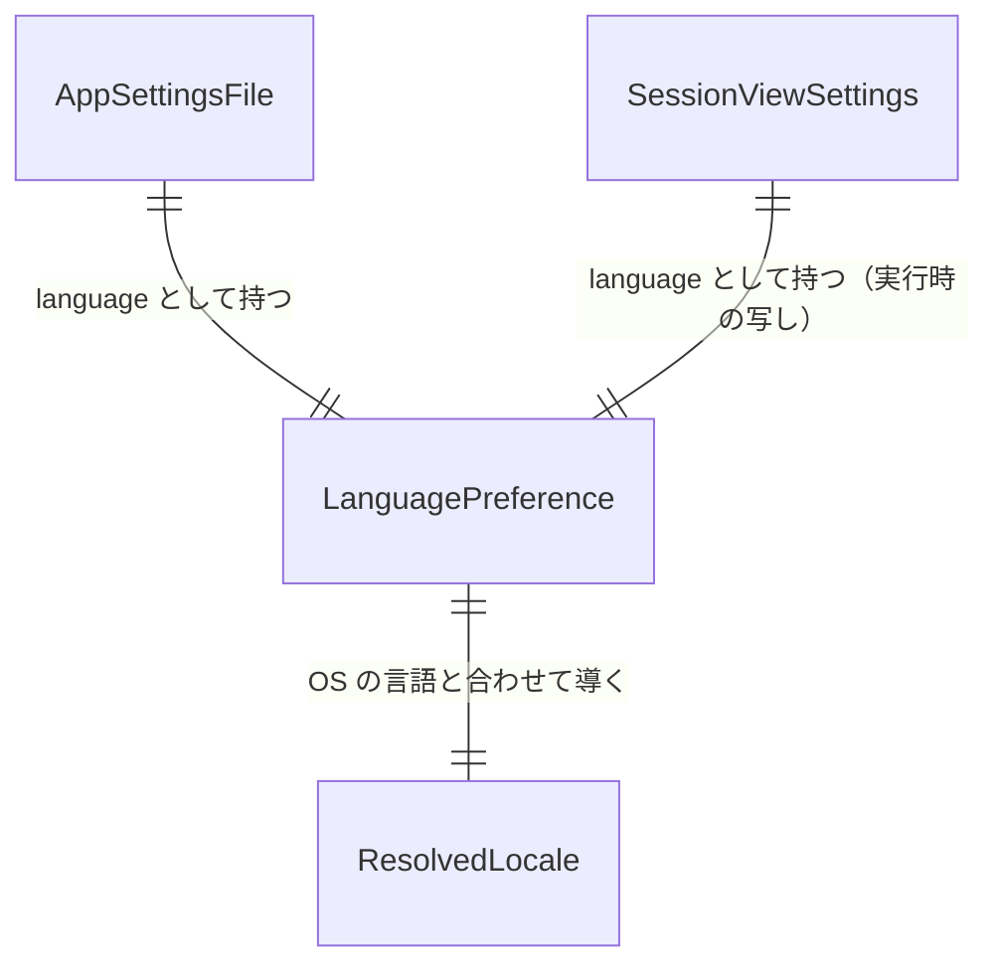

# Entities — U1 言語切替（u1-language-switch）

上流：`inception/units-generation/unit-of-work.md`（U1）・`unit-of-work-story-map.md`（FR1.1〜FR1.6）、`inception/requirements-analysis/requirements.md`（FR1、NFR5）、`inception/domain-design/components.md`（AppSettings の AppSettingsFile、AppSession の LanguageSetting）・`decisions.md`（ADR-005）、今のコード（`cache/settings.rs` の `SettingsFile`、`session.rs` の `SessionView`）。

型の名前は設計の上の名前で、作る段階で言語の慣用に合わせてよい。この作業単位で新しく作る実体は 1 つ（LanguagePreference：言語の設定値）で、あとは今の実体（設定ファイル、画面の状態）に項目を足す。

## エンティティ（機械可読）

```yaml
entities:
  - name: LanguagePreference
    description: 利用者が選んだ言語の設定値。設定ファイルに保存し、SessionView に載せる。表示の言語（Locale）そのものではなく、「どう決めるか」の選択（ADR-005）
    attributes:
      - name: value
        type: enum
        required: true
        allowed_values: [system, ja, en]
        default: system
        constraints: system は「OS の設定に合わせる」。知らない値は system として扱う（BR1.4）
    constraints:
      - 設定ファイルと SessionView の両方に同じ値が載る。設定ファイルが保存の源で、SessionView は実行時の写し（units レビュー R-01、domain-design レビュー R-04）
    relationships:
      - target: AppSettingsFile
        cardinality: 1 対 1
        direction: AppSettingsFile が language として持つ
      - target: SessionView
        cardinality: 1 対 1
        direction: SessionView.settings が language として持つ
  - name: AppSettingsFile
    description: 設定ファイル settings.json の中身（今の SettingsFile を広げる）。キャッシュの有無と言語の設定を持つ。プロファイル・リージョン・認証情報は持たない（NFR5、project.md Forbidden）
    attributes:
      - name: formatVersion
        type: integer
        required: true
        allowed_values: [1]
        default: 1
        constraints: 上げない。language は省略できる項目として足すため、前の版のアプリも今の版のファイルを読める（BR1.5）
      - name: cacheEnabled
        type: boolean
        required: true
        constraints: 今のまま。意味も読み方も変えない
      - name: language
        type: LanguagePreference.value
        required: false
        default: system
        constraints: ない・知らない値のときは system（BR1.4）。cacheEnabled の読みには影響しない
    constraints:
      - 書き込みは今と同じ（一時ファイル → rename、フォルダとファイルは所有者だけ）
      - 読めない・形式が違う・formatVersion が 1 でないときは、キャッシュは無効、言語は system として扱う（今の SettingsLoad の Missing / Unreadable / Invalid と同じ分け方）
    relationships: []
  - name: ResolvedLocale
    description: 実際に画面に出す言語。LanguagePreference と OS（ブラウザ）の言語の並びから純粋な関数で決める（MessageCatalog）。保存しない
    attributes:
      - name: locale
        type: enum
        required: true
        allowed_values: [en, ja]
        constraints: 今の Locale 型と同じ。system のときは今の detectLocale の結果（先頭の言語が ja か ja- で始まれば ja、それ以外は en）
    constraints:
      - 画面全体で 1 つ。翻訳（createTranslator）、Cloudscape の文言（I18nProvider）、リージョン名（regionLabel）、document.documentElement.lang がすべて同じ値を見る（BR1.2）
    relationships:
      - target: LanguagePreference
        cardinality: 1 対 1
        direction: LanguagePreference と OS の言語から導く
  - name: SessionViewSettings
    description: SessionView のうち設定ダイアログに関わる項目（今の cacheEnabled・cacheDirectory・settingsDialog・settingsNotice・canOpenSettings）に language を足したもの
    attributes:
      - name: cacheEnabled
        type: boolean
        required: true
      - name: language
        type: LanguagePreference.value
        required: true
        default: system
        constraints: 起動時に設定ファイルから読んだ値。保存が成功したときだけ変わる（BR1.3、BR1.6）
      - name: settingsNotice
        type: enum
        required: false
        allowed_values: [Cleared, ClearFailed, SaveFailed]
        constraints: 今のまま。言語の保存の失敗も SaveFailed で知らせる
    constraints:
      - language 以外の項目は変えない
    relationships:
      - target: LanguagePreference
        cardinality: 1 対 1
        direction: language として持つ
```

## 概要

- **LanguagePreference** は「OS に合わせる／日本語／English」の 3 値で、設定ファイルと SessionView の両方に同じ値が載る。設定ファイルが保存の源、SessionView は実行時の写し。
- **AppSettingsFile** は今の `settings.json` に `language` を省略可能な項目として足す。`formatVersion` は 1 のまま（前の版のファイルも、今の版のファイルを前の版のアプリで開くことも、どちらも読める）。
- **ResolvedLocale** は LanguagePreference と OS の言語から決める表示の言語で、保存しない。画面のすべての文言がこの 1 つの値を見る。



<!-- Text fallback: AppSettingsFile と SessionViewSettings はそれぞれ LanguagePreference を language として 1 つ持つ（ファイルが源、SessionView は写し）。ResolvedLocale は LanguagePreference と OS の言語から 1 つ導かれる。 -->
