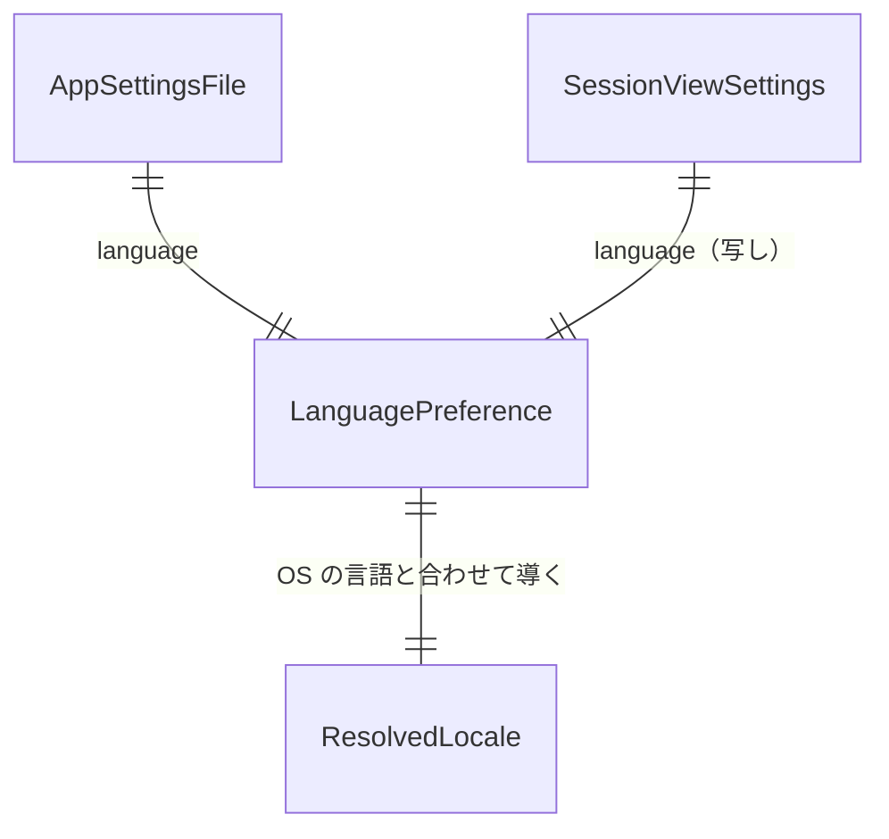

# Functional Spec — U1 言語切替（u1-language-switch）

上流：`inception/units-generation/unit-of-work.md`（U1：薄い一本）・`unit-of-work-story-map.md`（FR1.1〜FR1.6）、`inception/requirements-analysis/requirements.md`（FR1、NFR1・NFR3・NFR4・NFR5・NFR6）、`inception/domain-design/components.md`（AppSettings・AppSession・MessageCatalog・AppShell・SettingsDialog・TauriApp・ApiBridge）・`decisions.md`（ADR-005）。実体は `entities.md`、ルールは `rules.md` が源で、ここでは流れと状態の移り変わりを決める。

## 概要

設定ダイアログで言語を選んで保存すると、アプリは設定ファイルに書き、SessionView の言語を更新し、画面は起動し直さずに文言を入れ替える。次の起動では設定ファイルの言語で始まる。この作業単位は、設定ダイアログ（画面）→ `save_settings`（Tauri）→ AppSession → AppSettings（設定ファイル）→ SessionView → AppShell（切り替え）の経路を一通り通す薄い一本である。AWS は呼ばない。

## 流れ

### W1 起動時の言語の決定

1. 画面（`main.tsx`）は OS の言語（`navigator.languages`）から今の `detectLocale` で言語を決め、その言語で最初の描画をする（BR1.2 の system の分岐と同じ）。
2. アプリ（TauriApp）は起動時に AppSession に設定ファイルの場所を渡し、AppSession は AppSettings で読む（今の `load_settings` を広げたもの）。読みの結果は「キャッシュの有無」と「言語の設定（system / ja / en）」の 2 つで、どちらも BR1.4 の既定に落ちる。
3. AppSession は SessionView.settings.language にその値を載せ、画面に送る（今の `session-changed`）。
4. 画面（AppShell）は SessionView の言語の設定と OS の言語から BR1.2 で表示の言語を決める。最初の描画と同じなら何もしない。違えば、翻訳・Cloudscape の文言・リージョン名・`lang` 属性を切り替える（取得済みのログや入力はまだないので、何も失わない）。

### W2 設定ダイアログで言語を変える

1. 利用者が［設定］を開く。ダイアログは SessionView の cacheEnabled と language を初期値にして描く（BR1.1）。
2. 利用者が「言語」の Select で値を選ぶ。選んだだけでは何も起きない。
3. ［保存］を押す。画面は `save_settings` にキャッシュの有無と言語の 2 つを渡す（ApiBridge の関数の引数を広げる）。
4. TauriApp は AppSession の `begin_save_settings` に 2 つを渡し、返った SettingsWork::Save（location、enabled、clear_after、language）を blocking スレッドで走らせる（今の `run_settings_work` と同じ流儀）。
5. SettingsWork::Save は AppSettings の `save_settings` で `formatVersion`・`cacheEnabled`・`language` を 1 つのファイルに書く（一時ファイル → rename）。キャッシュを無効にしたときの消去は今と同じ順（書いてから消す）。
6. 書けたら AppSession の `finish_settings_work` が cache_enabled と language の両方を新しい値にし、ダイアログを閉じ、SessionView を送る（BR1.3）。
7. 画面（AppShell）は SessionView の言語が変わったのを見て、BR1.2 で表示の言語を決め直し、翻訳・Cloudscape の文言・リージョン名・`lang` 属性を切り替える。画面の部品は作り直さず、取得済みのログ・開いた行・入力欄・接続・絞り込みの文字は保つ（FR1.5）。
8. 書けなかったら `finish_settings_work` は SaveFailed の知らせを載せ、言語もキャッシュも前の値のまま。ダイアログは開いたまま知らせを出す（BR1.6）。

### W3 ［キャンセル］で閉じる

1. 利用者が言語を選んだあと［キャンセル］・Escape・閉じるボタンを押す。
2. 画面は選択を捨てて `cancel_settings` を呼ぶ（今と同じ）。言語は変わらない（BR1.1）。

### W4 次の起動

1. W1 の 2 で設定ファイルから `language` を読む。前の起動で保存した値（ja / en / system）が返る。
2. W1 の 3〜4 のとおり表示する。前の版のファイル（`language` がない）なら system（BR1.4、BR1.5）。

## 状態の移り変わり

言語の設定（SessionView.settings.language）の状態機械。

| 今の状態 | 出来事 | 条件 | 次の状態 | 動作 |
|---|---|---|---|---|
| （起動前） | 起動 | 設定ファイルが読め、language が system/ja/en | その値 | SessionView を送る。画面は BR1.2 で言語を決める |
| （起動前） | 起動 | ファイルがない・読めない・形式違い・language がない・知らない値 | system | 同上（キャッシュは今の読み方のまま） |
| X（system/ja/en） | ［保存］ | 書けた | 選んだ値 | SessionView を送る。画面は文言だけ入れ替える |
| X | ［保存］ | 書けなかった | X（変わらない） | SaveFailed の知らせ。ダイアログは開いたまま |
| X | ［キャンセル］・閉じる | — | X | 何もしない |

表示の言語（ResolvedLocale）は状態を持たず、常に `resolve(language, osLanguages)` の結果である（BR1.2）。

## 画面の部品の変更（frontend-components.md の代わり：この作業単位の種類は service）

- **SettingsDialog**：キャッシュのチェックボックスの下に `Select`「言語」（FormField のラベルつき）を足す。選択肢は「OS の設定に合わせる」（表示の言語で訳す）、「日本語」（固定）、「English」（固定）。`onSave` の引数を `(cacheEnabled, language)` に広げる。初回フォーカスはチェックボックスのまま（BR1.7）。
- **AppShell / main.tsx**：`App` が `locale` を props で受けるのをやめ、SessionView の `settings.language` と OS の言語から `resolveLocale` で決める。`I18nProvider` は `App` の中（SessionView が読める場所）に移し、`locale` と `messages` を状態に合わせて切り替える。`document.documentElement.lang` も同じ場所で更新する。SessionView が届くまでは OS の言語で描く（W1）。
- **MessageCatalog**：`resolveLocale(preference, languages): Locale` を足す（純粋、テスト先行）。文言 `settings.language`（ラベル）、`settings.language.system`、`settings.language.ja`（固定「日本語」）、`settings.language.en`（固定「English」）を足す。
- **ApiBridge**：`SessionView` に `language: "system" | "ja" | "en"` を足し、`saveSettings(enabled, language)` に広げる。
- **TopBar・LogTable・LogAnalyticsPage など**：変更なし。`locale` と `t` が新しい値で渡れば文言は入れ替わる。

## 中核とアプリの変更

- **AppSettings（`cache/settings.rs`）**：`SettingsFile` に `language: Option<String>`（serde の既定で省略可）を足す。`SettingsLoad::Loaded` に `language: LanguagePreference` を足し、知らない値・ない値は `System`（BR1.4）。`save_settings(path, cache_enabled, language)`。`formatVersion` は 1 のまま（BR1.5）。モジュールの名前は変えない（部品の名前 AppSettings は設計上の名前）。
- **AppSession（`session.rs`）**：`language: LanguagePreference` を持ち、起動時の読み、`begin_save_settings(enabled, language)`、`SettingsWork::Save` の `language`、`SettingsWorkResult::Saved` の `language`、`finish_settings_work` での反映、`SessionView.language` を足す。
- **TauriApp（`lib.rs`）**：`save_settings(enabled, language)` に広げる。コマンドの集合は変わらないため、3 か所の登録は変えない。

## エンティティ関係（entities.md から導いた図）

<!-- Text fallback: AppSettingsFile と SessionViewSettings が LanguagePreference を持ち、LanguagePreference と OS の言語から ResolvedLocale が導かれる。 -->

## ルールの一覧（rules.md から導いた表）

| ID | 要点 |
|---|---|
| BR1.1 | 設定ダイアログの 3 択。［保存］で確定、［キャンセル］で捨てる |
| BR1.2 | 設定 × OS → 1 つの言語を全部の文言が見る |
| BR1.3 | 保存成功で切り替え、起動し直さない、状態は保つ、次の起動でも使う |
| BR1.4 | 言語の読みはキャッシュと独立。ない・知らない値は system |
| BR1.5 | formatVersion 1 のまま、前後の版と互換 |
| BR1.6 | 保存失敗は SaveFailed、言語は変えない |
| BR1.7 | キーボード操作と読み上げの名前 |

## 確かめ方（unit-of-work.md の U1 の確かめ方を具体にしたもの）

- 自動テスト（テスト先行）：`resolveLocale` の 3 値 × OS の言語の組み合わせ、`load_settings` の「language なし」「知らない値」「ja / en / system」「前の版のファイル」「書けない」、`save_settings` の書いた中身（3 項目だけ、秘密なし）。
- 自動テスト（実装後）：SettingsDialog の Select と `onSave` の引数、AppShell が SessionView の言語で `lang` 属性と文言を切り替えること、`save_settings` コマンドの引数。
- 目視（macOS と Windows）：日本語の OS で「English」を保存して画面が英語になる、ログを取得したまま切り替えても表示が残る、起動し直して英語で始まる、前の版の `settings.json` で起動できる。

## Assumptions & Open Questions

- [assumption] Cloudscape の `I18nProvider` の `locale` と `messages` を描画中に差し替えても、開いている部品（ダイアログ、ドロップダウン）は崩れない。崩れる部品があれば、その部品だけ `key` で作り直す（U1 の実装で確かめる）。
- [assumption] `serde` の既定の読み方では知らない項目を無視するため、今の版が書く `language` を前の版のアプリが読んでも落ちない（BR1.5）。実装でテストして確かめる。
