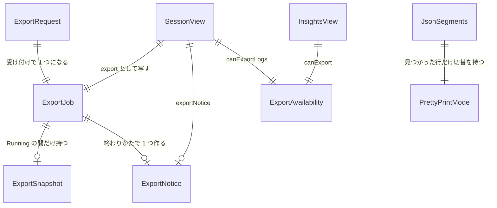

# Entities — U2 書き出しと JSON の整形（u2-export-and-json）

上流：`inception/units-generation/unit-of-work.md`（U2）・`unit-of-work-story-map.md`（FR2〜FR5）、`inception/requirements-analysis/requirements.md`（FR2、FR3、FR4、FR5、NFR2、NFR5）、`inception/domain-design/components.md`（LogExporter の ExportJob・ExportSnapshot、AppSession、InsightsSession、ExportBoundary、JsonPrettyPrinter）・`decisions.md`（ADR-001〜ADR-004、ADR-006）、質問票 `functional-design-questions.md`（Q1〜Q4）、今のコード（`session.rs` の `DisplayRow`・`SessionView`、`insights_session.rs` の `ResultSummary`・`QueryRow`、`log_view.rs` の `rows`、`ExpandedMessage.tsx`）。

型の名前は設計の上の名前で、作る段階で言語の慣用に合わせてよい。新しく作る実体は 4 つ（ExportRequest、ExportSnapshot、ExportJob、ExportNotice）と、画面側の表示だけの実体 2 つ（JsonSegments、PrettyPrintMode）。あとは今の実体（SessionView、InsightsView）に項目を足す。

## エンティティ（機械可読）

```yaml
entities:
  - name: ExportRequest
    description: 利用者が［エクスポート］のメニューで選んだ 1 回の書き出しの依頼。画面がコマンドで渡し、保存しない
    attributes:
      - name: screen
        type: enum
        required: true
        allowed_values: [logManagement, logAnalytics]
        constraints: どの画面の一覧を写すか（FR2、FR3）
      - name: format
        type: enum
        required: true
        allowed_values: [csv, markdown]
        constraints: FR4.1.1
      - name: target
        type: enum
        required: true
        allowed_values: [file, clipboard]
        constraints: FR4.1.2
    constraints:
      - 4 通り（format × target）のどれも、どちらの画面からも選べる（FR4.1.2、ADR-006）
    relationships:
      - target: ExportJob
        cardinality: 1 対 1
        direction: 受け付けられた依頼が 1 つの ExportJob になる
  - name: ExportSnapshot
    description: 依頼を受けた時点の、表示中の行の写し。以後は一覧が変わっても写しだけから出力を作る（ADR-004）。文字の写し（参照ではない）で、ExportJob が終わったら捨てる
    attributes:
      - name: columns
        type: list<string>
        required: true
        constraints: 見出しの文字。ログの画面は `@timestamp`・`@logStream`・`@message` の 3 つ（Q1 A）。クエリの画面は結果の列名（`ResultSummary.columns` そのまま。`@timestamp` にゾーンの添え字は付けない）
      - name: rows
        type: list<list<string>>
        required: true
        constraints: 各行は columns と同じ数のセル。欠けた値は空の文字（domain-design レビュー R-04）。ログの画面は絞り込み後の表示中の行を一覧の順に（FR2.1、FR2.3）、クエリの画面は結果の行を表の順に（FR3.4）。行数の上限なし（FR2.4、FR3.4）
      - name: logGroupName
        type: string
        required: false
        constraints: 既定のファイル名に使う。ログの画面は選んでいるロググループ、クエリの画面は最初に選んだロググループ。ないときは空
      - name: takenAt
        type: datetime
        required: true
        constraints: 写しを取った時刻。既定のファイル名の日時に使う（選んでいるタイムゾーンで書く、Q3 A）
    constraints:
      - 写しは session と LogView の 2 つの錠（lock）の中で 1 回で取り、取ったあとは錠を離す（NFR2）
      - 写しの中身は一覧が持つ文字そのまま。加工は括りと逃がしだけ（FR4.1.4、NFR5）
    relationships:
      - target: ExportJob
        cardinality: 1 対 1
        direction: ExportJob が持つ
  - name: ExportJob
    description: 進行中または最後に終わった書き出しの仕事。アプリ全体で 1 つだけ持ち（AppSession が持つ）、同時に 1 つしか走らない（FR4.6.2、domain-design レビュー R-01）
    attributes:
      - name: exportNumber
        type: integer
        required: true
        constraints: 依頼を受け付けるたびに 1 増える。終わった結果がどの依頼のものかを確かめるのに使う
      - name: status
        type: enum
        required: true
        allowed_values: [Idle, Running, Done, Failed]
        default: Idle
        constraints: Running の間は両画面の書き出しの操作が無効（FR4.6.1）。ダイアログの取り消しは Idle に戻る（FR4.4.2）
      - name: request
        type: ExportRequest
        required: false
        constraints: Idle 以外のとき必ずある
      - name: rowCount
        type: integer
        required: false
        constraints: 写しの行数（見出しを含まない）。Done のとき知らせに使う（FR4.4.4、FR4.5.1）
      - name: outputPath
        type: string
        required: false
        constraints: ファイルに保存したときの保存先。Done かつ target が file のときだけ
      - name: failureReason
        type: enum
        required: false
        allowed_values: [DialogFailed, WriteFailed, ClipboardFailed, Interrupted]
        constraints: Failed のときだけ。OS のエラーの文は safeDetail として別に添える（パスは含めてよい、秘密は含めない）
    constraints:
      - Running のときに新しい依頼が来たら受け付けず、何も変えない（FR4.6.2）
      - 写し（ExportSnapshot）は Running の間だけ持ち、Done / Failed / 取り消しで捨てる
    relationships:
      - target: ExportSnapshot
        cardinality: 1 対 0..1
        direction: Running の間だけ持つ
      - target: ExportNotice
        cardinality: 1 対 0..1
        direction: 終わりかたに応じて 1 つ作る
  - name: ExportNotice
    description: 直前の書き出しの結果の知らせ。SessionView に載せ、画面が出す。次の書き出しが受け付けられると消え、利用者が閉じても消える
    attributes:
      - name: kind
        type: enum
        required: true
        allowed_values: [Saved, Copied, SaveFailed, CopyFailed]
      - name: rowCount
        type: integer
        required: false
        constraints: Saved / Copied のとき
      - name: outputPath
        type: string
        required: false
        constraints: Saved のとき（FR4.4.4）
      - name: safeDetail
        type: string
        required: false
        constraints: 失敗のとき、原因が分かる文（OS のエラーの種類とパス）。秘密の認証情報は含まれない（NFR5）
    constraints:
      - 取り消し（ダイアログを閉じた）では作らない（FR4.4.2）
    relationships: []
  - name: ExportAvailability
    description: 書き出しの操作を今押せるかの判断（画面ごとに 1 つ）。保存せず、SessionView / InsightsView を作るたびに計算する
    attributes:
      - name: canExport
        type: boolean
        required: true
      - name: blocker
        type: enum
        required: false
        allowed_values: [NoRows, Fetching, Filtering, Running, Evaluating, NoResult, Exporting]
        constraints: 無効の最初の理由。ツールチップなどには出さず、テストと読み上げの説明に使う
    constraints:
      - ログの画面：表示中の行が 0・取得中・絞り込みの走査中・書き出し中のどれかなら無効（FR2.5、FR2.6、FR4.6.1）
      - クエリの画面：結果がない・結果が 0 行・実行中（取得中か評価中）・書き出し中のどれかなら無効（FR3.5、FR4.6.1）
    relationships: []
  - name: JsonSegments
    description: 開いた行のメッセージを「前の文字」「整形した JSON」「後ろの文字」に分けた結果（画面側の純粋な関数の戻り値、ADR-003）。保存しない
    attributes:
      - name: prefix
        type: string
        required: true
        constraints: JSON の前の文字そのまま（末尾の空白も含めて変えない）
      - name: pretty
        type: string
        required: true
        constraints: 字句を保って整形した JSON（BR5.2）
      - name: suffix
        type: string
        required: true
        constraints: JSON の後ろの文字そのまま
    constraints:
      - 見つからなければ JsonSegments は作らない（null）。prefix + 元の JSON + suffix は元のメッセージと等しい
    relationships: []
  - name: PrettyPrintMode
    description: 開いた行ごとの「整形／元のまま」の表示の状態（画面側）。行を閉じて開き直すと初期値に戻る（FR5.5）
    attributes:
      - name: mode
        type: enum
        required: true
        allowed_values: [pretty, raw]
        default: pretty
    constraints:
      - JSON が見つからない行には存在しない（切替を出さない、FR5.6）
    relationships: []
```

## 今の実体への追加

- **SessionView**（`session.rs`）：`export: ExportJobView`（`exportNumber`・`status`・`screen`・`format`・`target`・`rowCount`）、`exportNotice: ExportNotice | null`、`canExportLogs: boolean`（ログの画面の ExportAvailability）。
- **InsightsView**（`insights_session.rs`）：`canExport: boolean`（クエリの画面の ExportAvailability。書き出し中かは AppSession の ExportJob から渡して判断する）。

## 概要

- **ExportRequest** は画面が選んだ 4 通りのうちの 1 つで、受け付けられると **ExportJob** になる。ExportJob はアプリ全体で 1 つで、Running の間は両画面の操作が無効になる。
- **ExportSnapshot** は依頼の時点の表示中の行の文字の写し。出力はこれだけから作るので、処理中に一覧が変わっても結果は押した時点の内容（ADR-004）。終わったら捨てる。
- **ExportNotice** は結果の知らせで、取り消しでは作らない。**ExportAvailability** は操作の可否で、保存せず毎回計算する。
- **JsonSegments** と **PrettyPrintMode** は画面側だけの表示の実体で、中核には送らない（ADR-003）。



<!-- Text fallback: ExportRequest は受け付けで 1 つの ExportJob になる。ExportJob は Running の間だけ ExportSnapshot を持ち、終わりかたに応じて ExportNotice を 1 つ作る。SessionView は ExportJob の写し、ExportNotice、ログの画面の ExportAvailability を持ち、InsightsView はクエリの画面の ExportAvailability を持つ。画面側では JSON が見つかった行だけが JsonSegments と PrettyPrintMode を持つ。 -->
