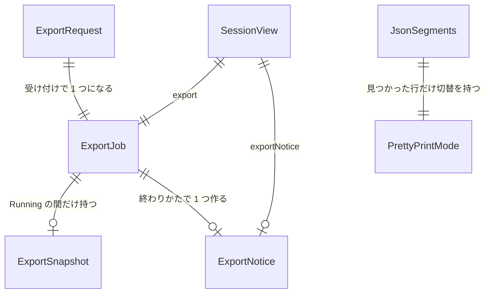

# Functional Spec — U2 書き出しと JSON の整形（u2-export-and-json）

上流：`inception/units-generation/unit-of-work.md`（U2）・`unit-of-work-story-map.md`（FR2〜FR5）、`inception/requirements-analysis/requirements.md`（FR2、FR3、FR4、FR5、NFR2、NFR3、NFR5、NFR6）、`inception/domain-design/components.md`（ExportFormatter・LogExporter・ExportBoundary・AppSession・InsightsSession・TauriApp・ApiBridge・ExportMenu・AppShell・JsonPrettyPrinter・ExpandedMessage・MessageCatalog）・`decisions.md`（ADR-001〜ADR-004、ADR-006）、質問票 `functional-design-questions.md`（Q1〜Q4）、U1 の機能設計（`construction/u1-language-switch/functional-design/`：`SessionView` と `save_settings` の形はそのまま使う）。実体は `entities.md`、ルールは `rules.md` が源で、ここでは流れと状態の移り変わりを決める。

## 概要

2 つの画面の一覧の上に［エクスポート］メニュー（4 項目）を置く。選ぶと、中核が依頼の時点の表示中の行の写しを取り、ファイルなら OS の保存ダイアログで保存先を決めて一時ファイルに書いてから rename し、クリップボードなら文字を 1 つにして渡す。処理は錠を持たない blocking スレッドで走り、両画面のメニューだけを無効にして、ほかの操作は止めない。終わると知らせ（保存先と行数／行数／失敗の原因）を画面に出す。あわせて、ログの画面で行を開いたときの全文の表示で、メッセージの中の最初の JSON を字句を保って整形し、「整形／元のまま」を切り替えられるようにする。AWS は呼ばない。

## 流れ

### W1 ログの画面から CSV をファイルに保存する（代表の流れ）

1. 利用者が一覧の上の［エクスポート］を開き、「CSV で保存」を選ぶ。メニューは `canExportLogs`（BR2.3）が有効のときだけ押せる。
2. 画面は `start_export(screen: logManagement, format: csv, target: file)` を呼ぶ（ApiBridge）。
3. TauriApp は session の錠を取り、AppSession の `begin_export(request)` を呼ぶ。AppSession は BR2.3 をもう一度確かめ（無効ならエラーで返し、何も変えない）、ExportJob を Running にして exportNumber を 1 増やし、前の知らせを消す。TauriApp は LogView の錠を取って `rows(0, total_count)` の読み方で表示中の行を写し（BR2.1）、AppSession が 3 列の文字に写す（BR2.2）。ロググループ名・写した時刻・選んでいるゾーンから既定のファイル名（BR4.5）を作る。SessionView を送り、2 つの錠を離す（ここまで短時間。NFR2）。
4. 画面は SessionView の `export.status: Running` を見て、両画面のメニューを無効にし処理中を示す（BR4.1）。
5. ExportBoundary が保存ダイアログを出す（既定名と `.csv` のフィルタ）。
6. 利用者が保存先を決める。ExportBoundary は blocking スレッドで、保存先と同じフォルダの一時ファイルに BOM（BR4.3）と CSV（BR4.2）を 1 行ずつ書き、閉じて rename する（BR4.6）。
7. 終わると session の錠を取り直し、`finish_export(exportNumber, result)` で ExportJob を Done にし、知らせ Saved（保存先のパス、行数）を載せ、写しを捨て、SessionView を送る（BR4.8、BR4.9）。
8. 画面はメニューを有効に戻し、警告の領域に成功の知らせを出す。利用者が閉じると `dismiss_export_notice` で中核の知らせを消す。

### W2 保存ダイアログを取り消す

1. W1 の 5 で利用者がダイアログを取り消す。
2. ExportBoundary は何も書かず、`finish_export(exportNumber, Cancelled)` を呼ぶ。AppSession は ExportJob を Idle に戻し、写しを捨て、知らせは作らない（BR4.6、FR4.4.2）。SessionView を送る。
3. 画面はメニューを有効に戻す。何も表示しない。

### W3 書けなかった

1. W1 の 6 で一時ファイルが作れない・書けない・rename できない。
2. ExportBoundary は一時ファイルを消し（消せなくても続ける）、原因の種類（権限がない・空きがない・見つからない・その他）と保存先のパスを結果に入れる。
3. `finish_export` で ExportJob を Failed にし、知らせ SaveFailed（原因、パス）を載せる（BR4.6）。
4. 画面は失敗の知らせを `role="alert"` で出す。メニューは有効に戻る。

### W4 クリップボードへコピーする

1. 利用者が「Markdown をコピー」（または「CSV をコピー」）を選ぶ。W1 の 2〜4 と同じ（既定のファイル名は作らない）。
2. ExportBoundary は blocking スレッドで出力を 1 つの文字にする（BOM なし、BR4.3。Markdown は BR4.4、CSV は BR4.2）。
3. クリップボードのプラグインに文字を渡す。渡せたら `finish_export` で Done と知らせ Copied（行数）、失敗なら Failed と知らせ CopyFailed（BR4.7）。
4. 画面は知らせを出し、メニューを有効に戻す。

### W5 クエリの画面から書き出す

1. 利用者が結果の表の見出しの［エクスポート］で 4 項目のどれかを選ぶ。メニューは `insights.canExport`（BR3.2）が有効のときだけ押せる。
2. 画面は `start_export(screen: logAnalytics, …)` を呼ぶ。
3. TauriApp は session の錠を取り、AppSession の `begin_export` が BR3.2 を確かめ（InsightsSession の状態と ExportJob から）、ExportJob を Running にする。InsightsSession が結果の列と全行をセルの文字に写す（BR3.1：`@message` は全文、欠けは空）。最初に選んだロググループ名で既定名を作る。SessionView を送り、錠を離す。
4. 以後は W1〜W4 と同じ。

### W6 処理中にほかの操作をする

1. 書き出しが Running の間に、利用者が取得を始める・絞り込みを変える・画面を切り替える・言語を変える・接続を変える。
2. どれも止めない。一覧が変わっても出力は写しから作るので変わらない（BR4.8、ADR-004）。
3. 処理中にメニューを押しても無効なので何も起きない。古い画面から `start_export` が届いたら、エラーで返し状態は変えない（FR4.6.2）。
4. 言語を変えると、処理中の表示と、終わったあとの知らせは新しい言語で出る（知らせは鍵と引数で持つ、BR4.9）。

### W7 行を開いて JSON を読む

1. 利用者がログの画面で行を開く。ExpandedMessage が JsonPrettyPrinter の `findJson(message)` を呼ぶ（BR5.1）。
2. 見つかれば、全文の上に「整形／元のまま」の切替（初期値「整形」）を出し、prefix + 整形した JSON（BR5.2）+ suffix を 1 つの文字ノードで描く（BR5.3、BR5.4）。
3. 「元のまま」に切り替えると元のメッセージを描く。文字を選んでコピーすると表示中の文字がコピーされる（FR5.8）。
4. 行を閉じて開き直すと、部品が作り直されて「整形」に戻る。
5. 見つからなければ（JSON がない、壊れている）切替を出さず、今までどおり元の文字を描く（FR5.3、FR5.6）。

## 状態の移り変わり

ExportJob（アプリ全体で 1 つ、AppSession が持つ）の状態機械。

| 今の状態 | 出来事 | 条件 | 次の状態 | 動作 |
|---|---|---|---|---|
| Idle / Done / Failed | `start_export` | 画面の可否（BR2.3 / BR3.2）が有効 | Running | exportNumber += 1。写しを取る。前の知らせを消す。SessionView を送る |
| Idle / Done / Failed | `start_export` | 可否が無効 | 変わらない | エラーを返す。何も変えない |
| Running | `start_export` | — | Running（変わらない） | エラーを返す（二重の操作、FR4.6.2） |
| Running | ダイアログの取り消し | exportNumber が一致 | Idle | 写しを捨てる。知らせなし |
| Running | 書けた／コピーできた | exportNumber が一致 | Done | 写しを捨てる。知らせ Saved（パス、行数）／Copied（行数） |
| Running | 書けない／コピーできない／スレッドが落ちた | exportNumber が一致 | Failed | 写しを捨てる。知らせ SaveFailed／CopyFailed（原因）。一時ファイルは消してある |
| Running | 結果が届いた | exportNumber が違う | 変わらない | 捨てる（起き得ないが、起きても壊さない） |
| Done / Failed | `dismiss_export_notice` | — | 変わらない | 知らせを消す |
| 任意 | 接続の変更・取得の開始・言語の変更 | — | 変わらない | 書き出しには影響しない（BR4.8） |

PrettyPrintMode（開いた行ごと、画面側）の状態機械。

| 今の状態 | 出来事 | 次の状態 |
|---|---|---|
| （行を開く、JSON あり） | — | pretty |
| pretty | 「元のまま」を選ぶ | raw |
| raw | 「整形」を選ぶ | pretty |
| pretty / raw | 行を閉じる | （消える。開き直すと pretty） |

## 中核とアプリの変更

- **ExportFormatter（新規モジュール、中核、純粋）**：`write_csv(columns, rows, out)`・`write_markdown(columns, rows, out)`（1 行ずつ writer に書く。BR4.2、BR4.4）と、1 つの文字にまとめる `to_string` 版。テストを先に書く。
- **LogExporter（新規モジュール、中核）**：`ExportRequest`・`ExportSnapshot`・`ExportJob`・`ExportNotice`・`ExportOutcome`（Saved / Copied / Cancelled / Failed）の型、`default_file_name(log_group_name, taken_at, zone, format)`（BR4.5、純粋、テスト先行）、`sanitize_file_stem(name)`（純粋）、`render(snapshot, format, with_bom) -> 文字` と writer 版。
- **AppSession（`session.rs`）**：`export: ExportJob` を持つ。`can_export_logs() -> ExportAvailability`（BR2.3）、`begin_export(request, snapshot_source) -> Result<ExportBegun, SessionError>`（可否の確認、Running、exportNumber、知らせの消去。写しの行は TauriApp が LogView から渡す）、`finish_export(export_number, outcome)`（BR4.8、BR4.9）、`dismiss_export_notice()`。`SessionView` に `export`・`exportNotice`・`canExportLogs` を足し、`InsightsView` を作るときに書き出し中かを InsightsSession に渡す。
- **InsightsSession（`insights_session.rs`）**：`can_export(exporting: bool) -> ExportAvailability`（BR3.2）、`export_snapshot(zone) -> Option<ExportSnapshot>`（BR3.1：全行、`row_cells` と同じ値、`@message` は全文）。`InsightsView.can_export`。
- **ExportBoundary（`src-tauri` の新規モジュール）**：`tauri-plugin-dialog` の保存ダイアログ（既定名、拡張子のフィルタ）、一時ファイル → rename の書き込み（BR4.6）、`tauri-plugin-clipboard-manager` への書き込み（BR4.7）。`spawn_blocking` で走らせ、結果を `finish_export` に渡して `session-changed` を送る（今の `run_settings_work` と同じ流儀）。`cfg` の OS 分岐は置かない（NFR3）。
- **TauriApp（`lib.rs`）**：コマンド `start_export(screen, format, target)` と `dismiss_export_notice` を足し、`generate_handler!`・`build.rs`・`capabilities/default.json` の 3 か所にそろえる。2 つのプラグインを登録し、`capabilities` に `dialog:allow-save` と `clipboard-manager:allow-write-text` を足す。`Cargo.toml`・`package.json` に依存を足す（`cargo-deny` と `npm audit` を通す）。
- **ApiBridge（`api.ts`）**：`ExportScreen`・`ExportFormat`・`ExportTarget`・`ExportJobView`・`ExportNotice` の型、`SessionView.export`・`exportNotice`・`canExportLogs`、`InsightsView.canExport`、`startExport(screen, format, target)`、`dismissExportNotice()`。

## 画面の部品の変更（frontend-components.md の代わり：この作業単位の種類は service）

- **ExportMenu（新規）**：Cloudscape `ButtonDropdown`（`data-testid="export-menu"`）。項目は `csv-file`・`markdown-file`・`csv-clipboard`・`markdown-clipboard` の順（文言 `export.menu`、`export.item.csvFile` など）。props：`disabled`（可否の否定）、`loading`（Running）、`onSelect(format, target)`、`t`。ログの画面では絞り込みの欄の行の右端、クエリの画面では結果の Header の `actions` に置く（BR4.1）。
- **AppShell（`App.tsx`）**：`handleExport(screen, format, target)` → `startExport`。両画面の警告の領域に `ExportNoticeAlert`（新規の小さな部品、`data-testid="export-notice"`）を出す：Saved は success で `export.notice.saved {path, count}`、Copied は success で `export.notice.copied {count}`、SaveFailed / CopyFailed は error で原因の文（`export.notice.saveFailed {detail}` など）。閉じると `dismissExportNotice`。
- **LogAnalyticsPage**：結果の Header の `actions` に ExportMenu を足す（truncated の表示と並べる）。`insights.canExport` と `session.export.status` を映す。
- **ConditionArea**：絞り込みの欄の行に ExportMenu を足す。`session.canExportLogs` と `session.export.status` を映す。
- **JsonPrettyPrinter（新規 `src/jsonPretty.ts`、純粋、テスト先行）**：`findJson(message): JsonSegments | null`（BR5.1）、`prettyPrint(json): string`（BR5.2）。`JSON.parse` を使わない字句の走査器。
- **ExpandedMessage**：`findJson` の結果で切替（`SegmentedControl`、`data-testid="log-table-expanded-mode"`）と表示を切り替える（BR5.3、BR5.4）。切替の高さも計測に含める。文字ノードだけで描く。
- **MessageCatalog**：`export.menu`、`export.item.*`（4 つ）、`export.notice.saved`・`copied`・`saveFailed`・`copyFailed`、`export.failure.*`（権限がない・空きがない・見つからない・その他・クリップボード）、`expanded.mode`（「表示」）、`expanded.mode.pretty`（「整形」）、`expanded.mode.raw`（「元のまま」）を日英で足す。

## エンティティ関係（entities.md から導いた図）

<!-- Text fallback: ExportRequest は ExportJob になり、ExportJob は Running の間だけ ExportSnapshot を持ち、終わりかたで ExportNotice を作る。SessionView は ExportJob と ExportNotice を写す。画面側では JSON が見つかった行だけ JsonSegments と PrettyPrintMode を持つ。 -->

## ルールの一覧（rules.md から導いた表）

| ID | 要点 |
|---|---|
| BR2.1 | ログの画面の写しは絞り込み後の表示中の行を一覧の順で |
| BR2.2 | 3 列 `@timestamp`・`@logStream`・`@message`、時刻は表示の文字、メッセージ全文 |
| BR2.3 | 0 行・取得中・走査中・書き出し中は無効 |
| BR3.1 | クエリの結果の列と行を表の順で、`@message` 全文、欠けは空 |
| BR3.2 | 結果なし・0 行・実行中・書き出し中は無効 |
| BR4.1 | 1 つのメニューに 4 項目、可否と処理中を映す |
| BR4.2 | CSV は RFC 4180、CRLF |
| BR4.3 | ファイルの CSV だけ BOM |
| BR4.4 | Markdown の表、`\|` と ` ` |
| BR4.5 | 既定名 `<安全なロググループ名>_<yyyyMMdd-HHmmss>.<ext>` |
| BR4.6 | ダイアログ → 一時ファイル → rename、取り消しは無言、失敗は後始末と知らせ |
| BR4.7 | コピーは行数の知らせ、失敗はその旨 |
| BR4.8 | 同時に 1 つ、写しから出力、blocking でほかを止めない |
| BR4.9 | 知らせは閉じられる Alert、次の書き出しで消える |
| BR5.1 | 最初に読み切れる JSON 1 つ、前後はそのまま |
| BR5.2 | 字句を保って空白だけ足す |
| BR5.3 | 切替、初期値「整形」、行ごと、開き直すと戻る |
| BR5.4 | 今の全文表示の振る舞いは変えない |
| BR5.5 | キーボードと読み上げ |

## 確かめ方（unit-of-work.md の U2 の確かめ方を具体にしたもの）

- 自動テスト（テスト先行）：ExportFormatter の CSV（コンマ・引用符・改行を含むセル、空のセル、0 行の見出しだけ、CRLF）と Markdown（`|`、改行 → ` `、空のセル）、`default_file_name` と `sanitize_file_stem`（`/` と `:`、空、長い名前、Local と UTC）、JsonPrettyPrinter（全体が JSON、前置きつき、後ろに文字、壊れた JSON、閉じない、`1.0`・大きい整数・逃がし・キーの順の保持、空の `{}`・`[]`、入れ子、候補が 2 つで最初が壊れている）。
- 自動テスト（実装後）：AppSession の `begin_export` / `finish_export`（可否の 4 条件、二重の依頼、取り消しで Idle、exportNumber の不一致、知らせの消去）、InsightsSession の `export_snapshot` と `can_export`、ExportMenu（4 項目の順、無効、処理中、キーボード）、ExpandedMessage（切替の有無、初期値、切り替え、開き直し、文字ノード）、App（知らせの表示と閉じる、言語切替後の知らせ）、コマンドの 3 か所の一致（既存のテスト）。ExportBoundary のファイルの書き込みは一時フォルダで（ダイアログとクリップボードはプラグインのため自動テストでは呼ばず、呼び出しの境界を薄くする）。
- 目視（macOS と Windows）：両画面から 4 通りの書き出し。保存した CSV を Excel で開いて日本語と改行つきのセルが読める、コピーした Markdown を貼れる、`/` を含むロググループ名の既定名、取り消しで何も出ない、書けないフォルダで失敗の知らせ、100 万行でも画面が固まらない、JSON のメッセージが整形されて切替で元に戻る。`cargo-deny` と `npm audit` が通る。

## Assumptions & Open Questions

- [assumption] `tauri-plugin-dialog` の保存ダイアログは非同期に呼べ、取り消しを `None` で返す。`tauri-plugin-clipboard-manager` の `write_text` は 100 万行の文字でも成功か失敗のどちらかを返し、アプリを落とさない（components.md の前提）。
- [assumption] アプリの終了中に書き出しが走っていても止めない（終了の確認は取得中だけ、今のまま）。終了で一時ファイルが残ることはまれで害が小さいため受け入れる。問題になれば終了の確認を書き出しにも広げる。
- [assumption] クエリの結果の全行を写すとき、`row_cells` の計算（JSON の読み直し）を行数分行う。10,000 行の既定の上限では十分に速い。上限を外した大きな結果では時間がかかるが、要件 NFR2 のとおり目標値は置かない。
