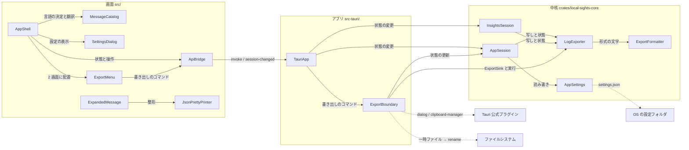

# Components — アプリ内の言語切替・書き出し・JSON の整形（261022-small-features）

上流の成果物：`inception/requirements-analysis/requirements.md`（FR1〜FR5、NFR1〜NFR6、AS1〜AS6、OQ1〜OQ4）、コード知識ベース `codekb/local-sights/architecture.md`・`component-inventory.md`。質問票の回答は `domain-design-questions.md` の Q1〜Q4。設計判断の記録は `decisions.md`（ADR-001〜ADR-006）。

ここで決めるのは「書くコードの部品」とその責任・依存・データの持ち主だけである。AWS SDK・Tauri（プラグインを含む）・React・Cloudscape・ファイルシステム・クリップボードは外部依存として扱う（project.md Corrections）。型の細部、CSV と Markdown の細かな形（OQ2）、既定のファイル名の形（OQ3）、JSON とみなす条件の細部（OQ1）は機能設計で決める。

**この一覧の範囲**：既存アプリの拡張のため、載せるのは今回新しく作る部品と、今回変える部品だけである（前の作業と同じ扱い）。ここに載せていない部品（LogView、EventTimeline、FilterEngine、FetchCoordinator、QueryStore、QueryEvaluator、TopBar、LogTable、LogAnalyticsPage など）は `codekb/local-sights/component-inventory.md` のまま変えない。`depends_on` も載せた部品どうしのものだけを書き、載せていない部品への今の依存はそのまま残る（例：AppSession は今と同じく LogView の行を読み、InsightsSession は今と同じく QueryEvaluator の結果を持つ）。

**全部品に共通の決まり**：AWS を新しく呼ばない（書き出しは手元の行だけを使う）。判断は中核ライブラリに置き、Tauri は配線と OS の境界、画面は表示と操作だけにする（codekb architecture「Key Design Decisions」、team.md Code Style）。純粋なロジック（CSV・Markdown の組み立て、ファイル名の作り、JSON の検出と整形、言語の決め方）はテストを先に書く（team.md Testing Posture）。秘密の認証情報を設定ファイル・ログ・画面に書かない（project.md Forbidden）。

## 部品カタログ（機械可読）

```yaml
components:
- name: AppSettings
  summary: 設定ファイル settings.json の読み書き（変更：今の CacheSettings を広げ、言語の設定を足す）
  behaviour: >
    今の `cache/settings.rs`（`formatVersion`、`cacheEnabled`）に `language` を足す。値は「OS に合わせる」「日本語」「English」の 3 つ。項目がない・知らない値・ファイルがない・読めない・形式が違うときは、キャッシュは今と同じく無効、言語は「OS に合わせる」として扱う（FR1.3、FR1.4、レビュー R-06）。書き込みは今と同じ（一時ファイル → rename）。前の版のファイル（`cacheEnabled` だけ）はそのまま読める。純粋な読み書きの関数で、OS に触れるのはパスを渡された入出力だけ。
  responsibilities:
  - 設定ファイルの読み（欠けと不正の既定値）
  - 設定ファイルの書き（キャッシュと言語）
  depends_on: []
  dependents:
  - component: AppSession
    interaction: 設定の読み込みと保存の呼び出し
  external_dependencies:
  - name: OS の設定フォルダ
    kind: other
    purpose: settings.json の置き場所
  entities:
  - name: AppSettingsFile
    identifier: path（アプリの設定フォルダの settings.json）
    attributes: [formatVersion, cacheEnabled, language]
- name: ExportFormatter
  summary: CSV と Markdown の組み立て（新規、純粋）
  behaviour: >
    列名の並びと行（セルの文字の並び）を受け取り、CSV（RFC 4180：コンマ区切り、CRLF、コンマ・二重引用符・改行を含むセルは二重引用符で括り中の引用符は 2 つ重ねる）か Markdown（GitHub 流の表：見出し行・区切り行・値の行、`|` は `\|` に逃がし、セルの中の改行は表を壊さない形に置き換える。置き換え方は機能設計 OQ2）の文字を作る（FR4.2、FR4.3）。セルの文字は括りと逃がし以外に加工しない（FR4.1.4）。欠けた値は空のセル（レビュー R-04）。1 行ずつ書き出せる形（イテレータから writer へ）にして、100 万行でも全体を一度に 2 重に持たない。BOM の有無は呼び出し側（LogExporter）が決める。テストを先に書く。
  responsibilities:
  - CSV の見出しと行の組み立てと逃がし
  - Markdown の表の組み立てと逃がし
  depends_on: []
  dependents:
  - component: LogExporter
    interaction: 写しの行を形式の文字にする
  external_dependencies: []
  entities: []
- name: LogExporter
  summary: 書き出し 1 回の仕事（新規、中核）
  behaviour: >
    書き出しの要求（画面の種類、形式、出し方）を受け取り、まず表示中の行の写し（ExportSnapshot）を取り、そのあと一覧が変わっても写しだけから出力を作る（FR2.1、FR3.1、レビュー R-01、ADR-004）。ログの画面の写しは AppSession が LogView の表示中の行から作る 3 列（時刻の文字・ストリーム・メッセージ全文、FR2.2、FR2.3）、クエリの画面の写しは InsightsSession が結果から作る表の列（`@message` は全文、FR3.2、FR3.3）。写しを ExportFormatter で文字にし、ファイル保存の CSV だけ先頭に BOM を付ける（FR4.2.3）。既定のファイル名（ロググループ名と日時を含み、`/` など macOS と Windows のどちらでもファイル名に使えない文字を安全な文字に置き換える。形は機能設計 OQ3、レビュー R-03）を純粋な関数で作る。行数の上限は置かない（FR2.4、FR3.4）。出力は ExportSink（ファイルかクリップボード）に渡し、結果（行数、パス、失敗の理由）を返す。進み具合と二重実行の防止の判断（Idle / Running / Done / Failed）は ExportJob の状態として持ち、AppSession が画面に写す（FR4.6）。
  responsibilities:
  - 表示中の行の写し（ExportSnapshot）の確定
  - 形式の文字の作成（ExportFormatter を使う）
  - 既定のファイル名の作成と安全化
  - ExportSink への引き渡しと結果の集約
  - ExportJob の状態
  depends_on:
  - component: ExportFormatter
    interaction: 写しの行を形式の文字にする
    style: sync
  dependents:
  - component: AppSession
    interaction: ログの画面の書き出しの開始と状態の受け取り
  - component: InsightsSession
    interaction: クエリの画面の書き出しの開始と状態の受け取り
  - component: ExportBoundary
    interaction: ExportSink の実装の差し込みと blocking スレッドでの実行
  external_dependencies: []
  entities:
  - name: ExportJob
    identifier: exportNumber（アプリの中で増える番号）
    attributes: [exportNumber, screen, format, target, status, rowCount, outputPath, failureReason]
  - name: ExportSnapshot
    identifier: exportNumber
    attributes: [columns, rows, logGroupName, takenAt]
    references:
    - entity: ExportJob
      owned_by: LogExporter
      relationship: 1 つの ExportJob は 1 つの ExportSnapshot を持つ
- name: ExportBoundary
  summary: ファイル保存とクリップボードの OS の境界（新規、アプリ）
  behaviour: >
    ExportSink の実装。ファイル：Tauri の公式プラグイン（dialog）で保存先を聞き（取り消しなら何も書かず知らせも出さない、FR4.4.2）、一時ファイルに書いて rename し（書けないときは一時ファイルを消して理由を返す、FR4.4.3）、保存先のパスを返す（FR4.4.4）。クリップボード：公式プラグイン（clipboard-manager）に文字を渡し、失敗は理由を返す（FR4.5）。LogExporter の仕事は blocking スレッドで走らせ、AppSession の ExportJob の状態を `session-changed` で画面に押す（今の TauriSink と同じ流儀）。両 OS の差はプラグインが吸収し、ここには `cfg` の分岐を置かない（NFR3、ADR-002）。
  responsibilities:
  - 保存ダイアログとファイルの書き込み（一時ファイル → rename）
  - クリップボードへの書き込み
  - 書き出しの仕事の起動（blocking）と状態の通知
  depends_on:
  - component: LogExporter
    interaction: ExportSink の実装の差し込みと blocking スレッドでの実行
    style: sync
  - component: AppSession
    interaction: 書き出しの状態の更新と SessionView の送出
    style: sync
  dependents:
  - component: TauriApp
    interaction: 書き出しのコマンドからの呼び出し
  external_dependencies:
  - name: tauri-plugin-dialog
    kind: third-party-api
    purpose: OS の保存ダイアログ
  - name: tauri-plugin-clipboard-manager
    kind: third-party-api
    purpose: クリップボードへの書き込み
  - name: ファイルシステム
    kind: other
    purpose: 書き出したファイルの置き場所
  entities: []
- name: AppSession
  summary: ログの画面の状態機械（変更：言語の設定、書き出しの写しと状態を足す）
  behaviour: >
    設定の状態に言語を足し、`SessionView` の設定に載せる（FR1.2、FR1.3）。設定の保存は AppSettings に委ね、失敗時は今の `settings.notice.SaveFailed` を使い言語は変えない（FR1.6）。言語を変えても取得済みのログ・開いた行・入力・接続は変えない（FR1.5）。ログの画面の書き出しでは、表示中の行（絞り込み後、FR2.1）から 3 列の写しを作って LogExporter に渡し、ExportJob の状態と知らせ（行数・保存先・失敗の理由）を `SessionView` に載せる（FR4.4〜FR4.6）。書き出しの操作を無効にする条件（表示中の行が 0、取得中、絞り込みの走査中、書き出し中）を判断して `SessionView` に出す（FR2.5、FR2.6、FR4.6.1）。書き出し中に取得や絞り込みを始めることは止めない（写しがあるため結果は変わらない、ADR-004）。
  responsibilities:
  - 設定（キャッシュ・言語）の状態と保存の流れ
  - ログの画面の書き出しの写しの作成と状態の表示
  - 書き出しの操作の可否の判断
  depends_on:
  - component: AppSettings
    interaction: 設定の読み込みと保存の呼び出し
    style: sync
  - component: LogExporter
    interaction: ログの画面の書き出しの開始と状態の受け取り
    style: sync
  dependents:
  - component: ExportBoundary
    interaction: 書き出しの状態の更新と SessionView の送出
  - component: TauriApp
    interaction: コマンドからの状態の変更
  external_dependencies: []
  entities:
  - name: LanguageSetting
    identifier: settings.language（1 つだけ）
    attributes: [language]
- name: InsightsSession
  summary: クエリの画面の状態機械（変更：結果の写しと書き出しの可否を足す）
  behaviour: >
    実行が終わった結果から、表の列と行（`@message` は全文、FR3.2、FR3.3）の写しを作って LogExporter に渡す。欠けた値は空のセルとして渡す（レビュー R-04）。書き出しの操作を無効にする条件（結果が 0 行、実行中、結果がない、書き出し中）を判断して `InsightsView` に出す（FR3.5、FR4.6.1）。
  responsibilities:
  - クエリの画面の書き出しの写しの作成
  - 書き出しの操作の可否の判断
  depends_on:
  - component: LogExporter
    interaction: クエリの画面の書き出しの開始と状態の受け取り
    style: sync
  dependents:
  - component: TauriApp
    interaction: コマンドからの状態の変更
  external_dependencies: []
  entities: []
- name: TauriApp
  summary: Tauri のアプリ本体（変更：書き出しのコマンド、設定コマンドの拡張、プラグインの登録）
  behaviour: >
    書き出しを始めるコマンド（画面の種類・形式・出し方を受け取り、ExportBoundary に渡す）を足す。`save_settings` を言語も受け取る形に広げる。dialog と clipboard-manager のプラグインを登録し、`capabilities/default.json` に必要な権限を足す。コマンドの登録は今と同じく 3 か所（`generate_handler!`、`build.rs`、`capabilities`）でそろえ、既存のテストで守る。
  responsibilities:
  - 書き出しと設定のコマンドの配線
  - プラグインの登録と権限
  depends_on:
  - component: ExportBoundary
    interaction: 書き出しのコマンドからの呼び出し
    style: sync
  - component: AppSession
    interaction: コマンドからの状態の変更
    style: sync
  - component: InsightsSession
    interaction: コマンドからの状態の変更
    style: sync
  dependents:
  - component: ApiBridge
    interaction: invoke と session-changed
  external_dependencies:
  - name: Tauri 2
    kind: third-party-api
    purpose: コマンド・イベント・プラグインの枠組み
  entities: []
- name: ApiBridge
  summary: Tauri のコマンドとイベントの型と関数（変更：書き出しと言語の型を足す）
  behaviour: >
    書き出しのコマンドの関数と、`SessionView` に増える項目（設定の言語、書き出しの状態と知らせ、書き出しの可否）の型を足す。`save_settings` の引数に言語を足す。
  responsibilities:
  - 書き出しと設定のコマンドの関数と型
  depends_on:
  - component: TauriApp
    interaction: invoke と session-changed
    style: sync
  dependents:
  - component: AppShell
    interaction: 状態の受け取りとコマンドの呼び出し
  - component: ExportMenu
    interaction: 書き出しのコマンドの呼び出し
  external_dependencies: []
  entities: []
- name: MessageCatalog
  summary: 日英の対訳表と言語の決め方（変更：設定を加味した言語の決定と新しい文言）
  behaviour: >
    設定の言語（OS に合わせる／日本語／English）と OS（ブラウザ）の言語から表示の言語を決める純粋な関数を足す（FR1.1、FR1.3、FR1.4）。設定が読めるまでの最初の描画は今と同じく OS の言語で行う（レビュー R-06）。言語の選択肢、書き出しのメニューと知らせ、JSON の切替の文言を日英で足す。テストを先に書く。
  responsibilities:
  - 表示の言語の決定（設定 × OS）
  - 新しい文言の対訳
  depends_on: []
  dependents:
  - component: AppShell
    interaction: 表示の言語の決定と翻訳
  external_dependencies: []
  entities: []
- name: AppShell
  summary: 1 つの窓の組み立て（変更：言語を SessionView から決めて全体に配る）
  behaviour: >
    `main.tsx` で起動時に OS の言語で描き、`SessionView` の設定の言語が届いたら MessageCatalog で表示の言語を決め直し、`createTranslator`・Cloudscape の `I18nProvider` の文言・`document.documentElement.lang` をまとめて切り替える（FR1.2）。切り替えで画面の部品を作り直さず、取得済みのログ・開いた行・入力欄を保つ（FR1.5）。書き出しの知らせ（保存先・行数・失敗）を既存の知らせの仕組みで出す（FR4.4.4、FR4.5）。
  responsibilities:
  - 表示の言語の切り替えと配布
  - 書き出しの知らせの表示
  depends_on:
  - component: ApiBridge
    interaction: 状態の受け取りとコマンドの呼び出し
    style: sync
  - component: MessageCatalog
    interaction: 表示の言語の決定と翻訳
    style: sync
  - component: SettingsDialog
    interaction: 設定の表示と保存の受け取り
    style: sync
  - component: ExportMenu
    interaction: 2 つの画面への配置
    style: sync
  dependents: []
  external_dependencies:
  - name: React 19 / Cloudscape
    kind: third-party-api
    purpose: 画面の枠組みと標準部品
  entities: []
- name: SettingsDialog
  summary: 設定のダイアログ（変更：言語の選択を足す）
  behaviour: >
    キャッシュの設定の下に「言語」の Select（OS の設定に合わせる／日本語／English）を足し、［保存］でキャッシュの設定と一緒に渡す（FR1.1）。標準部品のみ。
  responsibilities:
  - 言語の選択の表示と保存への引き渡し
  depends_on: []
  dependents:
  - component: AppShell
    interaction: 設定の表示と保存の受け取り
  external_dependencies: []
  entities: []
- name: ExportMenu
  summary: ［エクスポート］のドロップダウン（新規、画面）
  behaviour: >
    1 つの `ButtonDropdown` に「CSV で保存」「Markdown で保存」「CSV をコピー」「Markdown をコピー」の 4 項目を並べる（Q4 A、FR4.1.2、FR4.1.3）。可否は `SessionView` / `InsightsView` の判断をそのまま映し、書き出し中は無効にして処理中を示す（FR4.6.1、FR4.6.2）。ログの画面の一覧の上とクエリの画面の結果の表の上の 2 か所で同じ部品を使う。キーボードで操作でき、読み上げの名前を持つ（NFR6）。
  responsibilities:
  - 書き出しの操作の表示と可否
  - 書き出しのコマンドの呼び出し
  depends_on:
  - component: ApiBridge
    interaction: 書き出しのコマンドの呼び出し
    style: sync
  dependents:
  - component: AppShell
    interaction: 2 つの画面への配置
  external_dependencies: []
  entities: []
- name: JsonPrettyPrinter
  summary: メッセージの中の JSON の検出と整形（新規、画面側の純粋な補助）
  behaviour: >
    メッセージの文字を走査し、JSON のオブジェクトか配列が始まる位置と、そこから読み切れる範囲を見つける（全体が JSON のときも、前に文字が付くときも、FR5.1）。読み切れない（閉じない・壊れた）ときは見つからなかったとして返す（FR5.3）。整形は `JSON.parse` で読み直さず、字句（文字列・数値・記号）をそのまま保ち、空白と改行と字下げだけを足す（FR5.4：`1.0`・桁の大きい整数・キーの順・逃がしがそのまま、レビュー R-05）。結果は「前の部分（そのまま）」「整形した JSON」「後ろの部分（そのまま）」の並びで返す。JSON とみなす条件の細部（末尾に文字が続くとき、2 つ以上並ぶとき）は機能設計 OQ1。テストを先に書く。
  responsibilities:
  - JSON の範囲の検出
  - 字句を保った整形
  depends_on: []
  dependents:
  - component: ExpandedMessage
    interaction: 開いた行の表示の整形
  external_dependencies: []
  entities: []
- name: ExpandedMessage
  summary: 開いた行のメッセージ全文（変更：整形の表示と切替を足す）
  behaviour: >
    JsonPrettyPrinter で JSON が見つかれば、整形した文字を初期値として出し、「整形／元のまま」の切替を置く（FR5.5）。切替は行ごとの画面の状態で、行を閉じて開き直すと初期値に戻る。見つからなければ今までどおりの表示で切替を出さない（FR5.6）。文字ノードだけで描く、20 行までの高さと内側のスクロール、Tab/Escape、読み上げの名前、選択とコピーの振る舞いは変えない（FR5.7、FR5.8）。
  responsibilities:
  - 整形した表示と元のままの表示の切替
  - 今の全文表示の振る舞いの維持
  depends_on:
  - component: JsonPrettyPrinter
    interaction: 開いた行の表示の整形
    style: sync
  dependents: []
  external_dependencies: []
  entities: []
```

## Component Diagram



<!-- Text fallback: 画面では AppShell が ApiBridge・MessageCatalog・SettingsDialog・ExportMenu を使い、ExportMenu は ApiBridge を通じて書き出しのコマンドを呼ぶ。ExpandedMessage は JsonPrettyPrinter で整形する。アプリでは TauriApp が ExportBoundary を呼び、ExportBoundary は中核の LogExporter を blocking スレッドで走らせ、AppSession の状態を更新する。中核では AppSession が AppSettings を読み書きし、AppSession と InsightsSession が LogExporter に写しを渡し、LogExporter が ExportFormatter で文字を作る。外部依存は Tauri の公式プラグイン、ファイルシステム、OS の設定フォルダ。 -->

## Component Summary

| Component | Purpose | Depends On | Dependents | Entities Owned |
|---|---|---|---|---|
| AppSettings | settings.json の読み書き（言語を足す） | — | AppSession | AppSettingsFile |
| ExportFormatter | CSV・Markdown の組み立て（純粋） | — | LogExporter | — |
| LogExporter | 書き出し 1 回の仕事（写し・文字・ファイル名・状態） | ExportFormatter | AppSession、InsightsSession、ExportBoundary | ExportJob、ExportSnapshot |
| ExportBoundary | 保存ダイアログ・ファイル・クリップボードの境界 | LogExporter、AppSession | TauriApp | — |
| AppSession | ログの画面の状態機械（言語・書き出し） | AppSettings、LogExporter | ExportBoundary、TauriApp | LanguageSetting |
| InsightsSession | クエリの画面の状態機械（書き出し） | LogExporter | TauriApp | — |
| TauriApp | コマンドの配線とプラグインの登録 | ExportBoundary、AppSession、InsightsSession | ApiBridge | — |
| ApiBridge | コマンドとイベントの型と関数 | TauriApp | AppShell、ExportMenu | — |
| MessageCatalog | 言語の決定と対訳 | — | AppShell | — |
| AppShell | 窓の組み立て（言語の切り替え、知らせ） | ApiBridge、MessageCatalog、SettingsDialog、ExportMenu | — | — |
| SettingsDialog | 設定ダイアログ（言語の選択） | — | AppShell | — |
| ExportMenu | ［エクスポート］のドロップダウン | ApiBridge | AppShell | — |
| JsonPrettyPrinter | JSON の検出と字句を保った整形（純粋） | — | ExpandedMessage | — |
| ExpandedMessage | 開いた行の全文（整形と切替） | JsonPrettyPrinter | — | — |

## Entity Ownership

| Entity | Owning Component | Identifier | Attributes | References |
|---|---|---|---|---|
| AppSettingsFile | AppSettings | path | formatVersion、cacheEnabled、language | — |
| ExportJob | LogExporter | exportNumber | exportNumber、screen、format、target、status、rowCount、outputPath、failureReason | — |
| ExportSnapshot | LogExporter | exportNumber | columns、rows、logGroupName、takenAt | ExportJob（1 対 1） |
| LanguageSetting | AppSession | settings.language | language | — |

## External Dependencies

| Component | Dependency | Kind | Purpose |
|---|---|---|---|
| AppSettings | OS の設定フォルダ | other | settings.json の置き場所 |
| ExportBoundary | tauri-plugin-dialog | third-party-api | OS の保存ダイアログ |
| ExportBoundary | tauri-plugin-clipboard-manager | third-party-api | クリップボードへの書き込み |
| ExportBoundary | ファイルシステム | other | 書き出したファイル |
| TauriApp | Tauri 2 | third-party-api | コマンド・イベント・プラグイン |
| AppShell | React 19 / Cloudscape | third-party-api | 画面の枠組みと標準部品 |

## Rationale

| Component | なぜ別の部品か |
|---|---|
| AppSettings | 今の CacheSettings の責任（設定ファイルの読み書き）に言語が加わるだけで、新しい部品にはしない。名前を設定全体に広げる（変える部品） |
| ExportFormatter | 形式の決まり（逃がし・区切り）は純粋で変わりにくく、テスト先行で守る。写しの取り方や OS とは別の変化率 |
| LogExporter | 「写しを確定してから出力する」という書き出しの流れと状態は、2 つの画面で同じ。画面ごとの状態機械に埋めると重複する |
| ExportBoundary | ダイアログ・ファイル・クリップボードは OS に触れる処理で、中核に置けない。SsoCliRunner・BrowserOpener と同じ層 |
| AppSession / InsightsSession | 既存の状態機械。写しの中身（どの列、どの行）は画面ごとの知識なのでここに置く |
| MessageCatalog | 言語の決定は対訳表のそばに置く純粋な関数。設定と OS の両方を見る唯一の場所 |
| ExportMenu | 2 つの画面で同じ 4 項目を出すため、1 つの部品にして重複を避ける |
| JsonPrettyPrinter | 字句を保つ整形は独立した純粋なロジックで、表示部品から切り離してテストする |

### 部品の境界の選択肢と決めたこと

- **書き出しの置き場所**（Q1）：A. 中核で組み立て、Tauri が書く（採用）／B. 画面側で全部／C. コピーだけ画面側。行は中核にあり、100 万行を IPC で運ばない A を選んだ。詳細は ADR-001。
- **OS の境界の実装**（Q2）：A. 公式プラグイン（採用）／B. `rfd` と `arboard`／C. ダイアログだけプラグイン。両 OS の差を吸収し、権限を `capabilities` で見える形にする A を選んだ。詳細は ADR-002。
- **JSON の整形の置き場所**（Q3）：A. 画面側の純粋な TypeScript（採用）／B. 中核でコマンド／C. `DisplayRow` に載せる。表示だけの機能で IPC を増やさない A を選んだ。詳細は ADR-003。
- **書き出しの写し**：操作した時点の写しから出力し、処理中もほかの操作を止めない（ADR-004）。

## Assumptions & Open Questions

- [assumption] Cloudscape の日英の文言の束（`cloudscapeMessages`）は両言語分がすでにあり、`I18nProvider` の `locale` と `messages` を差し替えるだけで部品の文言が切り替わる（要件 AS5）。
- [assumption] クリップボードへ 100 万行の文字を渡しても、プラグインは失敗を返すか成功するかのどちらかで、アプリを落とさない。失敗は FR4.5.2 の知らせで扱う。
- OQ1〜OQ3（JSON とみなす条件の細部、Markdown の改行の置き換え、既定のファイル名の形）は要件のとおり機能設計で決める。
