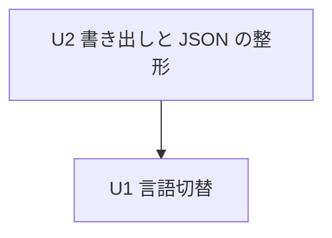

# Unit of Work Dependency — アプリ内の言語切替・書き出し・JSON の整形（261022-small-features）

上流：`unit-of-work.md`、`inception/domain-design/components.md`（部品の依存）・`decisions.md`、`inception/requirements-analysis/requirements.md`。

この文書は依存の形だけを書く。どれから作るかの経済的な順番は作る段階の計画で決める。

## 依存の一覧（機械可読）

```yaml
units:
  - name: u1-language-switch
    kind: service
    depends_on: []
  - name: u2-export-and-json
    kind: service
    depends_on: [u1-language-switch]
```



<!-- Text fallback: U2 は U1 に依存する（矢印は「依存する」の向き）。U1 は何にも依存しない。 -->

文字による代替：U2 は U1 に依存する。U1 は何にも依存しない。

## 依存の理由

| 依存 | 理由 |
|---|---|
| U2 → U1 | U2 は U1 が広げる `save_settings` の引数と `SessionView` の設定の形（AppSession の設定の状態）を前提にして、ExportJob の状態と知らせを同じ `SessionView` に載せる。また、U1 が先に入ると U2 の英語の画面の確認を起動し直さずに行える（Q2 A）。AppSession・TauriApp・ApiBridge・MessageCatalog・AppShell を両方の作業単位が触るため、同時に進めると衝突する |

## 最初の一本（薄い一本）

U1 言語切替が最初の一本。設定ダイアログ（画面）→ `save_settings`（Tauri）→ AppSession → AppSettings（設定ファイル）→ `SessionView` → AppShell（切り替え）の経路を、後の作業単位なしに通して動かせる。確かめ方は `unit-of-work.md` の U1 のとおり。

## 作業単位の間のつなぎ目

| つなぎ目 | 作る作業単位 | 使う作業単位 | 中身 |
|---|---|---|---|
| 設定の状態と `save_settings`（キャッシュ＋言語） | U1 | U2（ExportJob の状態を同じ `SessionView` に足す） | AppSession の設定の状態、`SessionView.settings`、コマンドの引数 |
| MessageCatalog の対訳表 | U1（言語の決定と言語の選択肢の文言） | U2（書き出しと JSON の切替の文言を足す） | `messages` の表への追加だけ。言語の決定の関数は変えない |
| コマンドの登録の 3 か所一致 | U1（`save_settings` の変更） | U2（書き出しのコマンドの追加、プラグインの権限） | `generate_handler!`、`build.rs`、`capabilities/default.json` と既存のテスト |

## 並べて進められる組み合わせ

- ない。U2 は U1 に依存し、作業単位は 2 つだけである。
