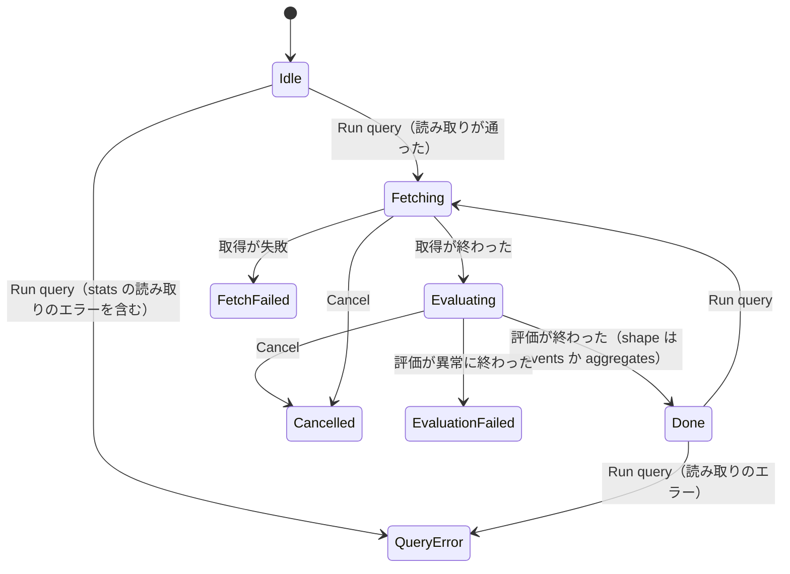
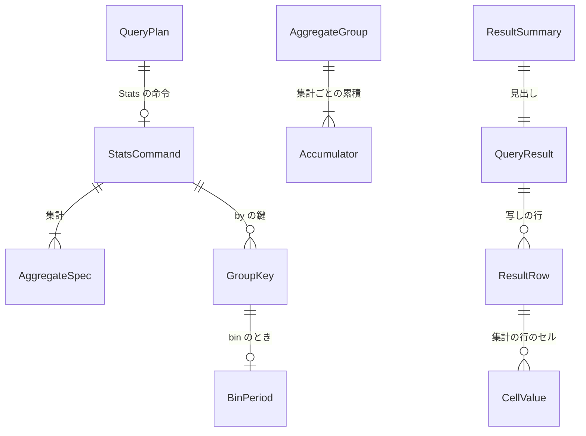

# Functional Spec — U1 薄い一本（u1-stats-skeleton）

上流：`inception/units-generation/unit-of-work.md`（U1）・`unit-of-work-story-map.md`・`unit-of-work-dependency.md`（形つきの QueryResult のつなぎ目）、`inception/requirements-analysis/requirements.md`、`inception/domain-design/components.md`・`decisions.md`、質問票 `functional-design-questions.md`（Q1〜Q6）。データの形は `entities.md`、決まりは `rules.md` が正本で、この文書は流れ（手順）と状態の移り変わりの正本である。

## 1. U1 で作るもの

Log Analytics の画面で `stats count(*) by bin(5m)` のような集計のクエリを実行すると、今までどおり足りない分を取得してから手元で集計し、集計の行（鍵の列と集計値の列）を結果の表に出す。行を開くと鍵と集計値が見え、CSV / Markdown に書き出せる。`stats` を含まないクエリの結果は前と同じ（BR5.1）。

| 部品 | U1 での中身 |
|---|---|
| QueryPlan | `CommandKind::Stats`（StatsCommand）、結果の形と列の名前の導出（BR3.1・BR3.3） |
| QueryParser | `stats`・`by`・`as`・`bin()` と 6 つの書き方の関数、書き間違いのエラー（BR1.1〜BR1.7）。振り分けは今の表に足す暫定のもの |
| StatsAggregator（新規） | グループ化・累積・bin・0 件の 1 行・並び・文字の丸め（BR2.1〜BR2.9） |
| QueryEvaluator | stats の段を足し、形つきの QueryResult を作る（BR3.1〜BR3.4） |
| QueryStore・QueryRunner・TauriSink | 型の変更に追従するだけ（copy_rows がイベントの写しを ResultRow::Event で返す、on_evaluated に形つきの結果）。流れは変えない（BR3.1） |
| InsightsSession | 形に従う見出し・行・詳細・書き出しの元、時刻のセルの整形（BR4.1〜BR4.4） |
| ExportJob | `ExportSnapshotSource::LogAnalytics` を列の名前と形つきの行に（BR4.4）。ExportFormatter は変えない |
| TauriApp・ApiBridge | 今のコマンドの値の形を広げる（3 章） |
| QueryResultTable・LogAnalyticsPage・MessageCatalog | 2 つの形の表示、0 行、文言（BR4.5・BR4.6） |
| CompatCheck | events の結果の型を合わせるだけ（`stats` の比較は U4） |

## 2. 流れ（手順）

### UC1 集計のクエリを実行する（成功）

1. 利用者が［Run query］か Cmd/Ctrl+Enter を押す（押せる条件は今のまま）。
2. QueryParser がクエリを読む。`stats` に達したら BR1.1〜BR1.5 で集計と鍵を読み、BR1.6・BR1.7 を確かめる。問題があれば UC2 へ。
3. 計画から結果の形（aggregates）と列の名前（鍵 then 集計、BR3.3）が決まる。
4. 取得は今の流れのまま（足りない分だけ、キャッシュ、ストリームの並行、BR5.2）。
5. 取得が終わったら評価する。QueryEvaluator が stats の前の命令を今の段で適用し、stats の段で残った位置のイベントを 10,000 行ずつ StatsAggregator に渡す（BR2.9、BR3.2）。塊ごとに進み具合を知らせ、続けるか聞く。
6. StatsAggregator はイベントごとに鍵の値の組を作り（BR2.1、BR2.5）、グループの累積を進める（BR2.2〜BR2.4）。
7. すべて渡し終えたら、StatsAggregator が行を作る：by なしで 0 グループなら空の 1 行（BR2.6）、グループを鍵の昇順に並べ（BR2.7）、累積を型つきのセルにする（BR2.8 の数値の丸めはセルの値を決めるときに適用）。
8. QueryEvaluator が QueryResult（shape = aggregates、columns、行 = 集計の行の写し、matchedCount = 行の数）を作り、今の on_evaluated で渡す（BR3.4）。
9. InsightsSession が結果を持ち、段階を Done にする。見出し（ResultSummary）に shape と columns が載る（BR4.1）。
10. 画面は見えている行を get_query_rows で読み、values をそのままセルに出す（BR4.5）。時刻のセルの文字は InsightsSession が画面のタイムゾーンで作る（BR4.2）。

```text
// StatsAggregator の入口（U1 で固定し、U2 は関数を足すだけ）
new(stats: StatsCommand) -> Aggregator
add(&mut self, event: 1 件のイベントと項目の読み手)   // 塊の中で 1 件ずつ
finish(self) -> (columns: 列の名前の並び, rows: 型つきのセルの行の並び)
```

### UC2 読み取りのエラー

1. QueryParser が BR1.2〜BR1.7 の問題を返す（Unsupported か Syntax と、行・列）。
2. 今の読み取りのエラーの流れのまま：段階を QueryError にし、AWS は呼ばず、前の結果は残し、クエリの文は消さない。クエリ欄の直下に文言と場所を出し、カーソルを動かす。

### UC3 0 件の集計

1. 取得が 0 件、または filter で全部落ちた。
2. by なし：1 行（count は 0、sum・avg・min・max は空のセル、BR2.6）。見出しは「1 行」。
3. by あり：0 行。表は「結果は 0 行」の表示で、失敗とは区別する（BR4.5、FR3.2）。

### UC4 行を開く

1. 利用者が集計の行を開く。
2. get_query_row_detail（runId, index）が、列の順の（名前, 文字）を返す（BR4.3）。@message の整形はしない。
3. イベントの行（events）は今のとおり。

### UC5 書き出す

1. 利用者が［Export］で CSV / Markdown を選ぶ（可否・ファイル名・通知は今のまま）。
2. InsightsSession の export_source が、列の名前・形つきの行の写し・zone を渡す（BR4.4）。
3. 書き出しの文字は表と同じ関数で作る（BR2.8、BR4.2）。ExportFormatter は変えない。

### UC6 タイムゾーンを切り替える

1. 利用者が UTC とローカルを切り替える。
2. 表は行を読み直し、bin の鍵と @timestamp の min・max のセルの文字だけが変わる。行の数と集計値は変わらない（BR4.2、FR2.3）。

### UC7 形の違う結果に続けて実行する

1. 前の結果がイベントの形で、次の実行が集計（または逆）。
2. U1 では今の決まりのまま：実行中は前の結果を「前回の結果」の印つきで残し、最終結果が届いたら見出し・行・詳細・書き出しの列をまとめて新しい形に替える（受け取った見出しの shape に従うだけ、ADR-006）。途中結果での差し替えは U3。

## 3. コマンドとイベント（TauriApp・ApiBridge）

コマンドとイベントの名前・引き数は変えない。値の形だけを広げる（BR4.1）。新しいコマンドはないため、capabilities と permissions は変えない。

| 名前 | 種類 | U1 での変更 |
|---|---|---|
| run_query・cancel_query | コマンド | 変えない |
| get_query_rows | コマンド | QueryRow の event・displayTime・logGroupName を events のときだけ持つ形に（aggregates では values だけ）。画面の型は任意の項目にする |
| get_query_row_detail | コマンド | 形は変えず、aggregates では列の（名前, 文字）を返す |
| start_export | コマンド | 変えない（中の ExportSnapshotSource が形つき） |
| session-changed | イベント | SessionView の ResultSummary に shape を足す |

## 4. 状態の移り変わり

クエリの画面の段階（AnalyticsPhase）は今のまま変えない（Idle → Fetching → Evaluating → Done、または QueryError / FetchFailed / Cancelled / EvaluationFailed）。U1 で増えるのは、Done の結果が形を持つことだけである。中断（Cancelled）の扱いは今のまま（評価しない）で、印つきの最終結果に変えるのは U3（FR5.1）。



<!-- Text fallback: 段階の移り変わりは今のまま。Run query で読み取りのエラーなら QueryError、通れば Fetching。Fetching は Evaluating・Cancelled・FetchFailed へ、Evaluating は Done・Cancelled・EvaluationFailed へ。Done の結果は形（events か aggregates）を持つ。Done や各終わりの段階から Run query でまた始まる。 -->

## 5. エンティティの関係（entities.md から作った見取り図）



<!-- Text fallback: QueryPlan は 0 か 1 つの StatsCommand を持ち、StatsCommand は 1 つ以上の AggregateSpec と 0 個以上の GroupKey を持つ。GroupKey は bin のとき BinPeriod を持つ。AggregateGroup は集計ごとの Accumulator を持つ（評価の途中だけ）。QueryResult は写しの ResultRow を持ち、集計の行は CellValue の列を持つ。ResultSummary は QueryResult の見出し。 -->

## 6. 決まりの見取り図（rules.md から作った要約）

- **読む**（BR1.1〜BR1.7）：`stats 集計, ... by 鍵, ...`。関数は 6 つの書き方、引き数は `*`・項目・toMillis(@timestamp)、鍵は項目・bin(期間)、期間は s・m・h・d。stats は最後の命令で 1 つ。書き間違いは場所つきのエラー。
- **集計する**（BR2.1〜BR2.9）：鍵の組でグループ化（鍵なしは 1 グループ）、count は数、sum・avg は数に読める値だけ、min・max は sort と同じ順、bin はエポックの倍数で空のビンは出ない、by なしの 0 件は 1 行、並びは鍵の昇順、小数は 4 桁、塊ごとに累積。
- **結果**（BR3.1〜BR3.4）：形つきの QueryResult、行は写し、列は鍵 then 集計、件数は行の数。
- **見せる・書き出す**（BR4.1〜BR4.6）：見出しに形、時刻のセルはタイムゾーンで整形、詳細は鍵と集計値、書き出しは表と同じ文字、同じ表に 2 つの形、文言の対訳。
- **変えないもの**（BR5.1・BR5.2）：stats のないクエリの結果と、AWS の呼び出し。

## 7. 確かめ方（U1）

team.md の Walking Skeleton の 3 つに合わせる。

1. `cargo test`（中核・アプリ）と Vitest が、CI の各 OS のランナーで通る。純粋なロジック（読み取りの stats、StatsAggregator、文字の丸め、bin）はテストを先に書く。既存のテストは期待値を変えずに通る（BR5.1）。カバレッジは 80% を下回らない。
2. 手元の確認用プログラム（今の FetchCheck を最小限広げる）で、実際の AWS から取得したログに `stats count(*) by bin(5m)` を当てて結果を出す。取得済み 100 万件に対する `stats` の最終結果までの時間を測って記録する（NFR1 の材料）。
3. GUI で集計のクエリを実行し、集計の行が表に出て、開けて、CSV / Markdown に書き出せること、タイムゾーンの切り替えで時刻の文字だけが変わることを目で確かめる。macOS と Windows の両方で行い、`filter`・`fields`・`sort`・`limit` だけのクエリが前と同じ結果になることも確かめる。

## 8. 残した問い

| 問い | 決める段 |
|---|---|
| コンソールの細部（鍵のないイベント、数値でない値、0 件の 1 行、小数の桁、既定の並び、関数名の大文字・小文字）がコンソールと同じか | U4 の確認用プログラムで比べ、違えば U2 か U4 で直す |
| `stats` の前に `sort`・`limit` を書いたときのコンソールの扱い（U1 はそのまま適用） | U2 の機能設計 |
| `stats` を含むクエリの件数の上限と打ち切り、`stats` のあとの `sort`・`limit` | U2 |
| 途中結果での形の切り替え、中断後の印つきの結果 | U3 |
