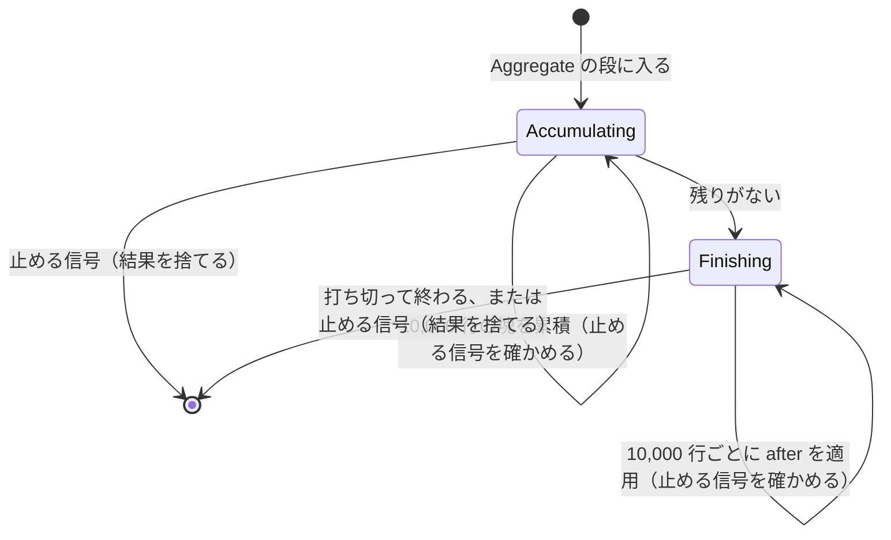
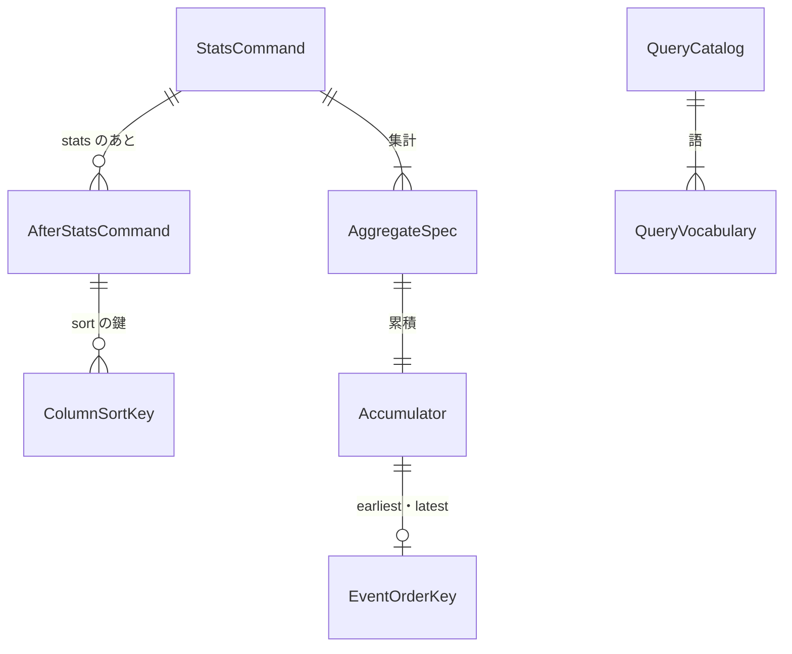

# Functional Spec — U2 `stats` をそろえる（u2-stats-complete）

上流：`inception/units-generation/unit-of-work.md`（U2、U3 との分担の表）・`unit-of-work-story-map.md`、`inception/requirements-analysis/requirements.md`、`inception/domain-design/components.md`・`decisions.md`、U1 の機能設計（`construction/u1-stats-skeleton/functional-design/`）、質問票 `functional-design-questions.md`（Q1〜Q5）。データの形は `entities.md`、決まりは `rules.md` が正本で、この文書は流れと状態の移り変わりの正本である。

## 1. U2 で作るもの

U1 の薄い一本に、残りの集計の関数、`stats` のあとの `filter`・`sort`・`limit`、件数の打ち切り、命令と関数の一覧の一元化（QueryCatalog）と、それに合わせた補完・色分け・エラー文言・README を足す。

| 部品 | U2 での中身 |
|---|---|
| QueryCatalog（新規） | 語の一覧（BR4.1） |
| QueryParser | 12 の関数、pct の 2 つの引き数、stats のあとの命令と列の名前の参照、一覧からの振り分け（BR1.1〜BR1.5） |
| QueryPlan | StatsCommand に stats のあとの命令（after）を足す |
| StatsAggregator | 7 つの関数の累積（BR2.1〜BR2.5） |
| QueryEvaluator | Aggregate の段の仕上げに、stats のあとの命令と打ち切りを足す（BR3.1・BR3.2） |
| InsightsSession | 補完の候補を一覧から（BR4.3）、打ち切りの状態 |
| TauriApp・ApiBridge | get_query_catalog のコマンド（BR4.2） |
| AnalyticsHelpers・QueryEditor | 色分けの規則を一覧から（BR4.2） |
| QueryResultTable | aggregates の打ち切りの注記（BR3.2） |
| LogAnalyticsPage・MessageCatalog | 「使える命令」の文を一覧から、新しいエラーの文言（BR4.2） |
| README | 対応表の更新と一致のテスト（BR4.4） |

## 2. 流れ（手順）

### UC1 stats のあとに filter・sort・limit を書いて実行する

1. 利用者が `stats count(*) as n by level | filter n > 10 | sort n desc | limit 5` を実行する。
2. QueryParser が stats を読み（U1）、続く命令を StatsCommand.after に書いた順に入れる。項目の参照は結果の列の名前として読み、ない名前ならエラー（BR1.4）。`fields` か 2 つ目の `stats` ならエラー（BR1.5）。
3. 取得と Aggregate の段の累積は U1 のまま。
4. 仕上げの 1 段で、StatsAggregator が鍵の昇順の行を作り（U1 の BR2.7）、QueryEvaluator が after を書いた順に適用し（BR3.1）、打ち切る（BR3.2）。
5. 結果は U1 のとおり QueryResult（aggregates）として渡り、表の注記に打ち切りが出る。

```text
// 仕上げ（10,000 行ごとに止める信号を確かめる。BR3.1）
rows = aggregator.finish()            // 鍵の昇順、型つきのセル
for cmd in stats.after: rows = apply(cmd, rows)   // filter / sort / limit
(rows, truncatedAt) = cut(rows, limit or 10,000)
```

### UC2 残りの関数を使う

1. `stats pct(latency, 95) as p95, stddev(latency), count_distinct(user), earliest(@message), latest(level), sortsFirst(user) by bin(1h)` を実行する。
2. QueryParser が BR1.1・BR1.2 で読む。pct の百分位が範囲外ならエラー。
3. StatsAggregator がイベントごとに累積を進め（BR2.1・BR2.3〜BR2.5）、finish で pct を並べて選ぶ（BR2.2）。

### UC3 画面を開いて一覧を受け取る

1. Log Analytics の画面が初めて出たとき、ApiBridge が get_query_catalog を呼ぶ（BR4.2）。
2. AnalyticsHelpers が色分けの規則を作り、QueryEditor に渡す。届くまでは色分けなし。
3. 読み取りのエラーで「使える命令」の文を出すとき、LogAnalyticsPage が一覧の supported の命令を MessageCatalog の文に差し込む。

### UC4 補完する

1. 利用者がクエリ欄で補完を出す。
2. InsightsSession の補完の候補に、一覧の命令・キーワード・関数・決まった項目と、JSON の項目の名前が入る（BR4.3）。

## 3. コマンドとイベント

| 名前 | 種類 | U2 での変更 |
|---|---|---|
| get_query_catalog | コマンド（新規） | QueryCatalog の一覧（語・種類・対応の有無・reserved）を返す。固定の定数で、AppState の鍵を取らない。capabilities と permissions に足し、権限の一致のテストの名前を明示する一覧にも足す |
| get_query_rows・get_query_row_detail | コマンド | 変えない |
| session-changed | イベント | 変えない（ResultSummary の truncatedAt は今もある） |

## 4. 状態の移り変わり

クエリの画面の段階は U1 のまま変えない。Aggregate の段の仕上げで行う処理が増えるだけで、段階の数と移り変わりは同じ。



<!-- Text fallback: Aggregate の段は、塊を累積する Accumulating を繰り返し、止める信号があれば結果を捨てて終わる。残りがなくなったら Finishing に移り、行を作って stats のあとの命令を 10,000 行ごとに適用し、打ち切って終わる。Finishing の途中でも止める信号があれば結果を捨てる。 -->

## 5. エンティティの関係（entities.md から作った見取り図）



<!-- Text fallback: StatsCommand は集計の指定と stats のあとの命令を持つ。sort の命令は列の鍵を持つ。集計の指定ごとに累積があり、earliest・latest の累積は選んだイベントの並びの鍵を持つ。QueryCatalog は語の一覧を持つ。 -->

## 6. 決まりの見取り図（rules.md から作った要約）

- **読む**（BR1.1〜BR1.5）：12 の関数、pct の百分位、stats のあとの filter・sort・limit（列の名前で参照）、fields と 2 つ目の stats は Unsupported。
- **集計する**（BR2.1〜BR2.6）：count_distinct は正確に、pct は最も近い順位、stddev は標本（Welford）、sortsFirst・sortsLast は sort の順、earliest・latest は時刻と並びの鍵、上限なしでメモリを測る。
- **仕上げる**（BR3.1・BR3.2）：stats のあとの命令を書いた順に、既定 10,000 行で打ち切り。
- **一覧**（BR4.1〜BR4.4）：QueryCatalog、画面の色分けと文言、補完、README の一致のテスト。
- **変えないもの**（BR5.1）。

## 7. 確かめ方（U2）

1. `cargo test` と Vitest が各 OS のランナーで通る。関数ごとの累積・pct の順位・stddev・stats のあとの命令・打ち切りはテストを先に書く。README と QueryCatalog の一致のテスト、権限の一覧の一致のテスト。カバレッジは 80% を下回らない。
2. 手元で各関数のクエリと `stats count(*) as n by level | filter n > 10 | sort n desc | limit 5` を実行して目で確かめる（macOS と Windows）。
3. 速さ：関数すべてを含む `stats` と、重いクエリ（`count_distinct(@message), pct(latency, 99) by @logStream`）の最終結果までの時間とメモリを、U1 と同じ 100 万件の条件で測り、U1 の `stats count(*) by bin(5m)` の 3 倍以内であることを確かめる（BR2.6）。

## 8. 残した問い

| 問い | 決める段 |
|---|---|
| 関数の計算の細部（pct の順位、stddev の分母、count_distinct の近似、sortsFirst と min の違い、earliest の同じ時刻）、関数名の大文字・小文字、stats のあとの filter の比べ方、stats を含むクエリの既定の 10,000 行の打ち切り（FR1.7）がコンソールと同じか | U4 で比べ、違えば直す |
| 2 つ目の stats | 次の版以降（Q3 A） |
