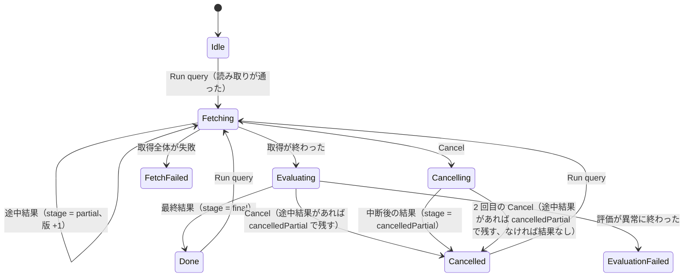
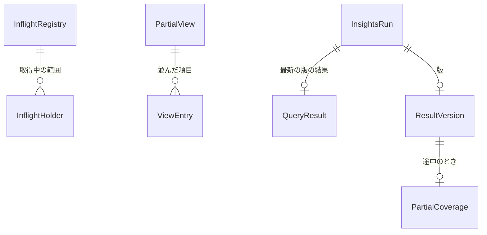

# Functional Spec — U3 途中結果と中断後の結果（u3-partial-results）

上流：`inception/units-generation/unit-of-work.md`（U3）・`unit-of-work-story-map.md`・`unit-of-work-dependency.md`、`inception/requirements-analysis/requirements.md`、`inception/domain-design/components.md`・`decisions.md`、U1・U2 の機能設計、質問票 `functional-design-questions.md`（Q1〜Q4）。データの形は `entities.md`、決まりは `rules.md` が正本で、この文書は流れと状態の移り変わりの正本である。

## 1. U3 で作るもの

クエリの実行中、取得が進むにつれて途中結果が表に出て差し替わり、取得が終わると最終結果になる。［Cancel］を押すと、止めた時点までの分で評価した結果が中断の印つきで残る。要件の FR4.2 は rules.md の「要件の読み替え」のとおり読む。

| 部品 | U3 での中身 |
|---|---|
| QueryRunner | InflightRegistry、途中の評価の間隔と別タスク、取得の終わり・中断の順番、中断後の評価（BR1.1・BR1.2・BR1.4・BR2.1・BR3.1〜BR3.3） |
| QueryStore | build_partial_view と viewVersion（BR1.3・BR1.4） |
| InsightsSession | 版・stage・coverage、前回の結果、Cancelling、rowKey（BR2.4〜BR2.6・BR3.1〜BR3.3・BR4.1・BR4.2） |
| TauriSink・TauriApp・ApiBridge | on_partial_result、版つきの読み出し、find_query_row（BR2.3・BR4.1） |
| QueryResultTable・LogAnalyticsPage・MessageCatalog | 途中・中断の印、読み上げ、行の見分けで保つ、中断の表示と通知（BR2.6〜BR2.9・BR3.4・BR3.5） |

## 2. 流れ（手順）

### UC1 取得に時間がかかるクエリを実行する（途中結果から最終結果へ）

1. 利用者が実行する。InsightsSession が新しい runId を作り、前回の結果を「前回の結果」の印つきで残す（BR2.5）。
2. QueryRunner が足りない範囲を今のとおり取得する。範囲ごとの holder を InflightRegistry に登録する（BR1.2）。
3. 最初のページが届いたら、途中の評価を別のタスクで始める（BR1.1）。
4. QueryStore が途中の view を作る（確定済みの分 ＋ 取得中の分の写し、viewVersion を進める、BR1.3・BR1.4）。
5. 評価器が今のとおり評価する（stats も、U2 の stats のあとの命令と打ち切りも同じ）。最後まで進んだら on_partial_result で知らせる（BR2.1）。
6. InsightsSession が版を 1 つ進めて結果を差し替え、stage = partial と coverage（ロググループの番号、含めた件数）を持つ。最初の版なら前回の結果の印を外す（BR2.4・BR2.5）。
7. TauriSink が session-changed を送る。画面は見出しの (runId, version) が変わったら、見えている行を (runId, version) で読み直す。開いた行と先頭の行を rowKey で保つ（BR2.3・BR2.8）。見出しの横に途中の印（BR2.6）。読み上げは最初の途中結果のときだけ（BR2.7）。
8. 前の途中の評価が終わってから 1 秒たち、取得済みが増えていれば 3 に戻る（BR1.1）。
9. 取得がすべて終わったら、動いている途中の評価を止めて終わるのを待ち（BR1.4）、今のとおり最終の view（確定済みの分だけ）で評価する。
10. 最終結果を stage = final で知らせる。版を進め、途中の印を消し、読み上げで最終結果になったことを知らせる。［Export］が押せるようになる（BR2.9）。

```text
// QueryRunner の途中の評価（取得とは別のタスク）
loop while fetching:
  wait until (first page arrived and no evaluation running and
              now - last_finished >= 1s and fetched_count > last_included)
  view = store.build_partial_view(registry)        // (epoch, viewVersion)
  result = evaluate(view, stop_signal)             // 止めたら None
  if result: sink.on_partial_result(run_id, result, coverage)
```

### UC2 取得済みで AWS を呼ばないとき

1. 足りない範囲がない（FR4.9）。
2. 途中の評価をせず、今のとおり最終の評価だけをして最終結果を出す（BR1.1）。前回の結果はこの最終結果で差し替わる（BR2.5）。

### UC3 取得中に［Cancel］を押す

1. 段階を Cancelling にし、取得に止める合図を出し、動いている途中の評価を止める（BR3.1・BR1.4）。
2. 取得が止まったら、途中の view を作る（取得中の分も含める。確定はしない）。
3. 評価する。この評価は最初の合図では止めない。
4. 評価が終わったら stage = cancelledPartial の最終結果にして版を進め、段階を Cancelled にする。印「一部のログだけの結果（中断）」と、失敗したストリームがあればその一覧（BR3.4）。中断の表示は「一部のログだけの結果を出しました」。
5. 取得し終えた範囲は取得済みとして残り、途中までの範囲は残らない（BR3.6）。［Export］で書き出せる（BR3.5）。

### UC4 中断後の評価の最中に、もう一度［Cancel］を押す

1. 中断後の評価に止める信号を出す（BR3.2）。
2. そのとき表に途中結果があれば、その結果を cancelledPartial にして残す（版は進めない）。なければ結果なしで「止めた」と示す。
3. 段階を Cancelled にする。

### UC5 取得が終わって最終の評価中に［Cancel］を押す

1. 最終の評価を今のとおり止める（BR3.3）。
2. 表に途中結果があれば cancelledPartial にして残し、なければ今の「止めた」。

## 3. コマンドとイベント

| 名前 | 種類 | U3 での変更 |
|---|---|---|
| get_query_rows | コマンド | 引き数に version を足す。版が違えば空の答え。QueryRow に rowKey を足す |
| get_query_row_detail | コマンド | 引き数に version を足す |
| find_query_row | コマンド（新規） | (runId, version, rowKey) から行の位置を返す（なければ none）。capabilities・permissions・権限の一致のテストの名前の一覧に足す |
| cancel_query | コマンド | Fetching なら中断後の評価へ、Cancelling なら 2 回目の中断（BR3.1・BR3.2） |
| session-changed | イベント | ResultSummary に version・stage・coverage を足す。段階に Cancelling |
| start_export | コマンド | 変えない（完了の通知の文だけ BR3.5） |

## 4. 状態の移り変わり（InsightsRun.phase と結果の stage）



<!-- Text fallback: Idle から Run query で Fetching。Fetching の間は途中結果が出るたびに版が進む。取得が終わると Evaluating に移り、最終結果で Done。Fetching で Cancel すると Cancelling に移り、中断後の結果か 2 回目の Cancel で Cancelled。Evaluating で Cancel すると Cancelled。Done・Cancelled からまた Run query。読み取りのエラーと取得の失敗、評価の失敗は今のまま。 -->

## 5. エンティティの関係（entities.md から作った見取り図）



<!-- Text fallback: InflightRegistry は取得中の範囲の保持を持つ。PartialView は確定済みと取得中の写しの項目を並べて持つ。InsightsRun は最新の版の結果と版を持ち、版は途中のとき含めた範囲を持つ。 -->

## 6. 決まりの見取り図（rules.md から作った要約）

- **途中の評価**（BR1.1〜BR1.4）：最初のページのあとすぐ、以後は前の評価から最低 1 秒。取得中の保持を登録して写し、viewVersion で見分ける。取得の終わり・中断では途中の評価を止めてから次へ。
- **途中結果の出し方**（BR2.1〜BR2.9）：同じ評価器、版の進みだけを知らせる、古い版を捨てる、最初の版で前回の結果を差し替え、途中の印、読み上げは状態の変化だけ、行の見分けで保つ、書き出しは終わってから。
- **中断**（BR3.1〜BR3.6）：取得中の［Cancel］は 1 回評価して中断の結果、2 回目で止めて途中結果を残す、最終の評価中は止めて途中結果を残す、印と失敗の両方、書き出しの通知。
- **読み出し**（BR4.1・BR4.2）：版・stage・coverage、rowKey、find_query_row。
- **変えないもの**（BR5.1）。

## 7. 確かめ方（U3）

1. `cargo test` と Vitest が各 OS のランナーで通る。途中の view（確定済みと取得中の分の合わせ方、並び、2 回数えない・落とさない FR4.8）、viewVersion の照合、版の受け取りと捨て方、中断の 3 つの場合（取得中・中断後の評価中・最終の評価中）はテストを先に書く。行の見分けで開いた行が保たれることを Vitest で確かめる。カバレッジは 80% を下回らない。
2. 手元で実際の AWS に対して、取得に時間のかかる期間のクエリ（`filter`・`fields` だけ、`sort`・`limit`、`stats` を最後の命令にしたもの、U2 のあとは `stats ... | sort ...`）を実行し、行が増えて差し替わること、最終結果になること、［Cancel］で印つきの結果が残ることを目で確かめる（macOS と Windows）。ログ管理の画面が今と同じに動くことも確かめる。
3. 速さ：途中結果ありで 100 万件を取得するとき、取得の終わりまでの時間が途中結果なしの今と比べて 10% 以上遅くならないこと、最初のページから最初の途中結果までの時間を測って記録する（NFR1。数値は作る段階で決め、決めたら下げない）。

## 8. 残した問い

| 問い | 決める段 |
|---|---|
| 途中の評価の間隔（1 秒）と、取得の速さを下げない合否の数値 | 作る段階で測って決める（OQ3） |
| 取得中の保持の写しが大きいとき（1 つの範囲に数十万件）の鍵を取る時間 | 作る段階で測り、長ければ写しを塊に分ける |
