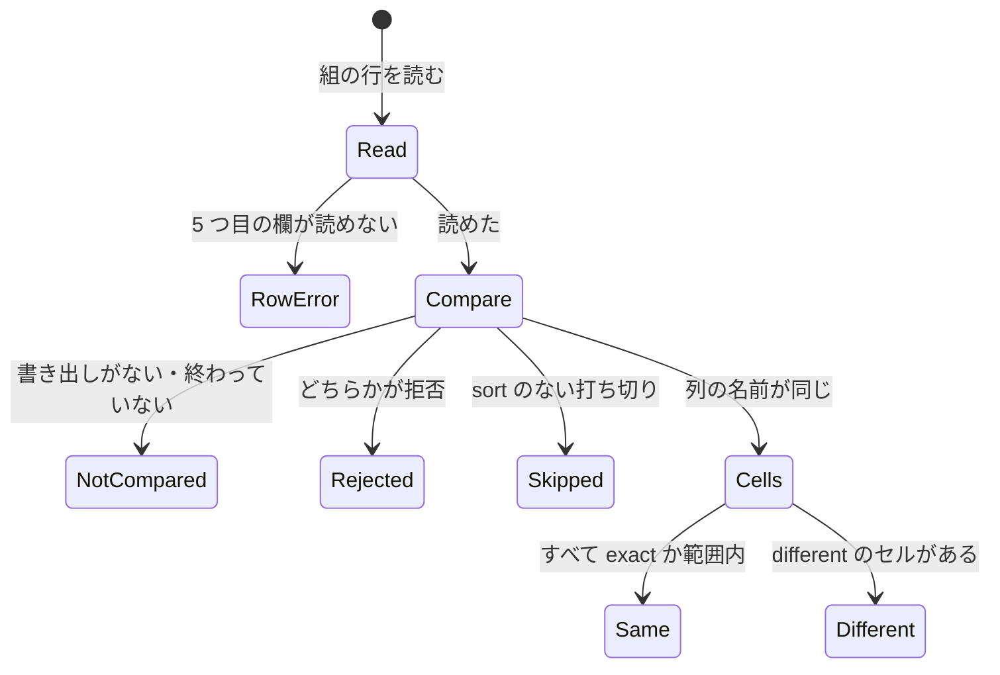
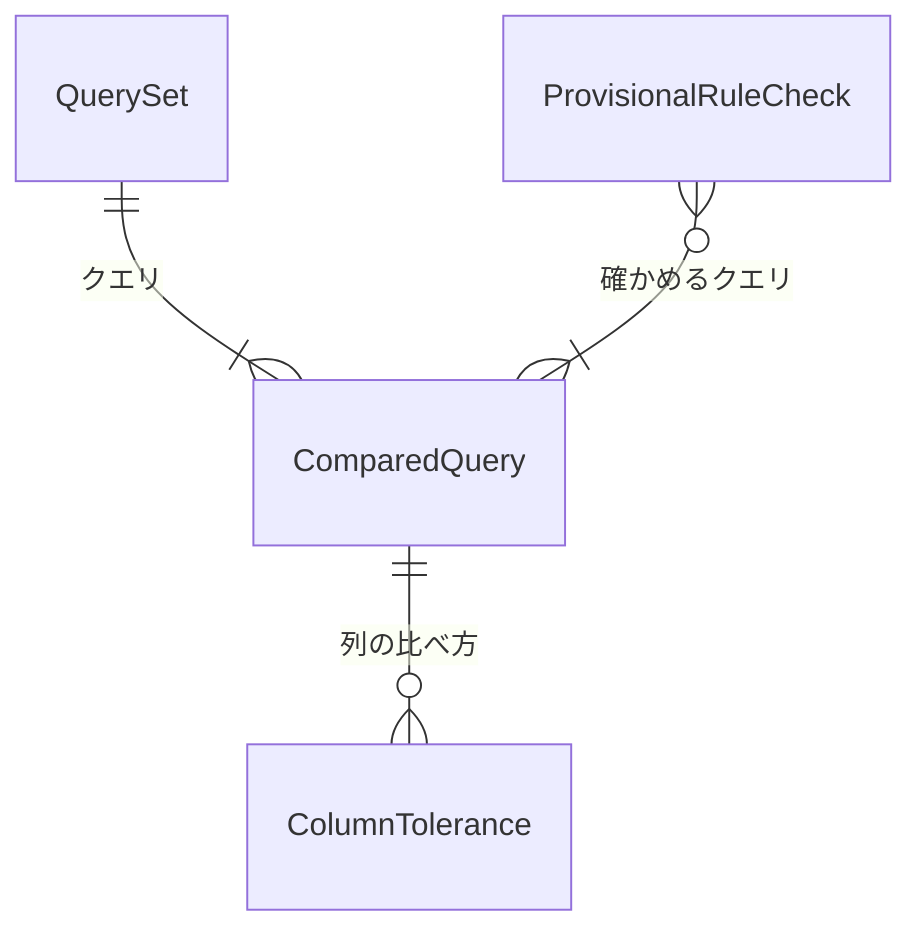

# Functional Spec — U4 互換の確かめ（u4-compat-stats）

上流：`inception/units-generation/unit-of-work.md`（U4）・`unit-of-work-story-map.md`、`inception/requirements-analysis/requirements.md`、U1・U2 の機能設計、質問票 `functional-design-questions.md`（Q1〜Q4）。データの形は `entities.md`、決まりは `rules.md` が正本で、この文書は流れの正本である。

## 1. U4 で作るもの

手元の確認用プログラム（`compat_check`）に、集計の結果を比べる仕組みを足し、比べるクエリの組に集計のクエリを足す。比べた結果で U1・U2 の仮の決まりがコンソールと違えば、U4 の中で直す。

| 部品 | U4 での中身 |
|---|---|
| CompatCheck（`examples/compat_check.rs`、`examples/compat/`） | compat_check.rs（集計の AppRows、並べ替えの項目、打ち切り、期間の端、BR2.7）、queries（splitn(5) と 5 つ目の欄、keyorder）、format（集計の行の Row）、compare（緩めのない列で対にする、セルの緩め、keyorder、BR2.6・BR2.8）、report（範囲内の違い、仮の決まりのまとめ）（BR1.3・BR2.1〜BR2.8） |
| `compat_queries.txt` | 集計のクエリ s01〜（BR1.1） |
| `compat_queries_numeric.txt`（新規） | 数の集計のクエリ n01〜（BR1.2） |
| `scripts/compat/insights-export.sh` | 変えない（QUERIES= で組のファイルを選べる今のまま） |
| 中核（StatsAggregator など） | 比べて違いが分かった仮の決まりだけを直す（BR3.1） |

## 2. 流れ（手順）

### UC1 開発者が手元で比べる

1. 開発者が本人の認証情報で `insights-export.sh` を実行し、組のクエリをコンソールの Logs Insights で実行して書き出す（今のまま。書き出しはリポジトリの外）。
2. 開発者が `compat_check` を実行する。組を読み（5 つ目の欄を含む、BR1.3）、同じロググループと期間をアプリの中核で取得して評価する（今のまま）。
3. クエリごとに、アプリの結果の形で Row を作り（BR2.1・BR2.7）、今の 7 段で比べる。緩めのある列があれば緩めのない列で行を対にしてから、緩めのある列を比べる（BR2.6・BR2.2・BR2.3）。sort のない打ち切りは比べない（BR2.4）。keyorder なら鍵の並びも比べる（BR2.8）。
4. 報告を出す：クエリごとの結果、範囲内の違い、仮の決まりごとのまとめ（BR1.4・BR2.5）。終了コードは違いがあれば 1。
5. 仮の決まりに違いがあれば、BR3.1 のとおり直すか諮る。直したら 1 からやり直して、違いが消えたことを確かめる。

### UC2 数の集計を比べる

1. 開発者が `compat_queries_numeric.txt` の項目の名前を、自分の数の JSON の項目を持つロググループに合わせて書き換える（BR1.2）。
2. UC1 と同じく、`QUERIES=` と `--queries` でこの組を選んで比べる。

## 3. 状態の移り変わり

確認用プログラムは 1 回の実行で終わる道具で、持ち続ける状態はない。1 つのクエリの比べ方の流れは次のとおり。

<!-- Text fallback: 組の行を読み、読めなければ行のエラー。読めたら比べる。書き出しがなければ比べない、拒否があればその種類、sort のない打ち切りは飛ばす。列の名前が同じならセルを比べ、すべて一致か範囲内なら同じ、範囲を超えるセルがあれば違い。 -->

## 4. エンティティの関係（entities.md から作った見取り図）

<!-- Text fallback: 組はクエリを持ち、クエリは列ごとの比べ方を持てる。仮の決まりの確かめは、それを確かめるクエリを指す。 -->

## 5. 決まりの見取り図（rules.md から作った要約）

- **組**（BR1.1〜BR1.4）：CloudTrail の組に集計のクエリ、数の集計用の新しい組、5 つ目の欄で列の比べ方、仮の決まりとの対応。
- **比べ方**（BR2.1〜BR2.5）：形で分けて今の 7 段、小数は 1e-6 か 0.0001、count_distinct は 2%、sort のない打ち切りは比べない、範囲内の違いを分けて報告。
- **違いへの対応**（BR3.1・BR3.2）：U4 の中で直す、大きいものは諮る、食い違う拡張は入れない。

## 6. 確かめ方（U4）

1. `cargo test`（examples のテストを含む）が各 OS のランナーで通る。比べる処理（5 つ目の欄の読み方、集計の Row、小数と近似の範囲、範囲内の違いの報告）は見本のデータで、テストを先に書く。AWS には接続しない。
2. 開発者の手元で、CloudTrail のロググループに対して集計の組を比べ、結果を作る段階の記録に残す。数の組は、数の項目を持つロググループがあれば比べ、なければ `avg(toMillis(@timestamp))` の 1 本だけを比べて記録する。
3. 仮の決まりの違いを直したら、U1・U2 のテストも通ることを確かめる。

## 7. 残した問い

| 問い | 決める段 |
|---|---|
| 比べて分かった違いのうち、どれを直し、どれを諮るか | U4 の作る段階（BR3.1） |
| 数の JSON の項目を持つロググループが手元にないときの数の集計の確かめ | U4 の作る段階（`toMillis` の 1 本で代える） |
