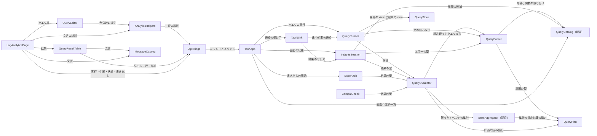

# Components — `stats` による集計と、クエリ実行中の途中結果の表示（261025-insights-stats）

上流の成果物：`inception/requirements-analysis/requirements.md`（FR1〜FR7、NFR1〜NFR12、C1〜C5、A1〜A8、OQ1〜OQ5）とそのレビュー `reviews/review-01.md`（R-01〜R-08）、コード知識ベース `codekb/local-sights/`（architecture・component-inventory・code-quality-assessment）、前の作業 261017-insights-query の部品の一覧（`inception/domain-design/components.md`）。質問票の回答は `domain-design-questions.md` の Q1〜Q7。設計判断の記録は `decisions.md`（ADR-001〜ADR-006）。

ここで決めるのは「書くコードの部品」とその責任・依存・データの持ち主だけである。AWS SDK・Tauri・React・Cloudscape・Ace・ファイルシステムは外部依存として扱う（project.md Corrections）。集計の関数の確定した一覧と各関数の引き数・結果の型（OQ1）、コンソールの細部の振る舞い（OQ2）、途中結果の更新の間隔の数値と速さの合否（OQ3）、互換を確かめるクエリの具体例（OQ4）は機能設計と作る段階で決める。

**この一覧の範囲**：既存アプリの拡張のため、載せるのは今回新しく作る部品（QueryCatalog・StatsAggregator）と、今回変える部品だけである。ここに載せていない部品（FetchCoordinator、EventFetcher、LogCache、CachePlan、EventTimeline、LogView、FilterEngine、EventFieldReader、NaturalSort、DateTextResolver、AppSession、ExportFormatter、ExportBoundary、LogGroupMultiselect、ログ管理の画面の部品など）は `codekb/local-sights/component-inventory.md` のまま変えない。`depends_on` も載せた部品どうしのものだけを書き、載せていない部品への今の依存はそのまま残る（例：QueryRunner は今と同じく FetchCoordinator・LogCache・EventFieldReader を使い、QueryEvaluator は EventFieldReader・NaturalSort を使う）。

**全部品に共通の決まり**：呼べる AWS API は DescribeLogGroups / DescribeLogStreams / GetLogEvents だけで、集計もすべて手元で評価し、Logs Insights の API は呼ばない（C1、FR1.8）。エラー・画面・ログに秘密の認証情報とアクセスキー ID を出さない。自動テストと CI は実際の AWS に接続しない（C2）。クエリの文や結果を外部に送らない（NFR12）。判断は中核ライブラリに置き、Tauri は配線、画面は表示だけにする（C3）。テスト以外で `unwrap()` / `expect()` を使わない（team.md Code Style）。ログ管理の画面と、前の作業のクエリの振る舞いは変えない（C5。中断の扱いだけ FR5.1 で改める、ADR-006）。

## 部品カタログ（機械可読）

```yaml
components:
- name: QueryCatalog
  summary: 対応する命令・関数・キーワードの一覧（新規）
  behaviour: クエリの言葉の一覧を 1 か所に持つ純粋なデータの部品（Q6、FR6.2、ADR-005）。命令（対応：fields・filter・sort・limit・stats。非対応：parse・dedup・display・pattern・diff・unmask・unnest・lookup・filterindex・source）、集計の関数（FR1.2 の一覧。確定は機能設計の OQ1）、集計以外の関数（toMillis と bin）、キーワード（by・as・asc・desc・and・or・not・like・in など）を、種類と対応の有無つきで列挙する。QueryParser はこの一覧で命令と関数の振り分けを行い、InsightsSession は補完の候補をこの一覧から作り、TauriApp はこの一覧をそのまま画面に渡す。README の対応表は、この一覧と一致することをテストで確かめる（FR6.1）。実行時に変わらないため状態を持たない。
  responsibilities:
  - 命令・関数・キーワードの一覧とその対応の有無
  - 画面とテストに渡せる形での提供
  depends_on: []
  dependents:
  - component: QueryParser
    interaction: 命令と関数の振り分け
  - component: InsightsSession
    interaction: 補完の候補
  - component: TauriApp
    interaction: 画面へ渡す一覧
  external_dependencies: []
  entities:
  - name: QueryVocabulary
    identifier: name（語そのもの）
    attributes:
    - name
    - kind
    - supported
- name: QueryParser
  summary: クエリの文の読み取り（変更：stats・by・as・bin() を読む）
  behaviour: 今の fields・filter・sort・limit の読みに、`stats <集計>, ... [by <鍵>, ...]` の読みを足す（FR1.1）。集計は「関数名・引き数・as で付けた名前」、鍵は「決まった項目・JSON の項目・bin(<間隔>)・as で名前を付けた式」とし、書けるものの一覧は QueryCatalog から引く（FR1.3、R-05：引き数と鍵に書けるものは機能設計で列挙し、それ以外は Unsupported の問題にする）。命令の順番の決まり（stats のあとの sort・limit は許す、stats のあとの fields・filter と stats を 2 回書くの扱いはコンソールと同じ。OQ2）は読み取りの段で確かめ、最初の問題を場所つきで返す（FR1.4、FR6.3：by のあとに何もない、閉じていない括弧、引き数の数の違い）。読み取ったものは QueryPlan に Stats の命令として置く。テストを先に書く。
  responsibilities:
  - 文の読み取りと問題の場所
  - stats・by・bin() の読み取り
  depends_on:
  - component: QueryCatalog
    interaction: 命令と関数の振り分け
    style: sync
  - component: QueryPlan
    interaction: 読み取った計画の型
    style: sync
  dependents:
  - component: QueryEvaluator
    interaction: 読み取ったクエリの形
  - component: QueryRunner
    interaction: 文の読み取り
  - component: InsightsSession
    interaction: エラーの場所と種類の型
  external_dependencies: []
  entities:
  - name: QueryProblem
    identifier: position（行, 列）
    attributes:
    - line
    - column
    - kind
    - word
- name: QueryPlan
  summary: クエリの計画の型（変更：Stats の命令と結果の列の名前）
  behaviour: CommandKind に Stats を足す。Stats は集計の指定の列（関数・引き数・列の名前）と by の鍵の列（項目か bin(<間隔>)、名前）を持つ。計画から「結果の列の名前の一覧」と「結果の形（イベントの行か集計の行か）」を求める純粋な関数を持ち、QueryEvaluator と InsightsSession はこれで列と形を決める（FR3.1：鍵の列と集計値の列をクエリに書いた順で、as の名前はその名前で）。今の fields・filter・sort・limit の型は変えない。
  responsibilities:
  - 計画の型（Stats を含む）
  - 結果の列の名前と形の導出
  depends_on: []
  dependents:
  - component: QueryParser
    interaction: 読み取った計画の型
  - component: QueryEvaluator
    interaction: 計画の読み出し
  - component: StatsAggregator
    interaction: 集計の指定と鍵の指定
  external_dependencies: []
  entities:
  - name: QueryPlan
    identifier: queryText（読み取った文そのもの）
    attributes:
    - queryText
    - commands
    - fields
    - condition
    - sortKeys
    - limit
    - aggregates
    - groupKeys
- name: StatsAggregator
  summary: stats の集計（新規）
  behaviour: filter で残ったイベントを受け取り、by の鍵の値の組ごとにグループを作り、集計の指定ごとの累積（count(*)・count(項目)・count_distinct・sum・avg・min・max・pct・stddev・earliest・latest・sortsFirst・sortsLast など。確定は OQ1）を進め、最後にグループごとの集計の行（鍵の値と集計値のセルの列）を返す純粋な部品（Q2、ADR-002）。bin(<間隔>) の区切りの計算（UTC のエポック基準、A8。間隔の書き方と揃え方は OQ2）と、イベントのない区切りの行を出さない決まり（FR2.2）もここに置く。鍵の項目を持たないイベント、集計する項目を持たないイベント、数値でない値の扱い（FR1.6）と、イベントが 0 件のときの by なしの stats の行数（R-04）は、コンソールと同じにするための決まりを機能設計で確かめてここに実装する。集計値の型と表示の文字（小数の桁、丸め。A7）はここで 1 回だけ決め、表と書き出しは同じ文字を使う。イベントを塊ごとに受け取れる形にし、QueryEvaluator が 10,000 行ずつ進める今の流れに乗る（NFR2）。実際の AWS もファイルも触らず、テストを先に書く（NFR7）。
  responsibilities:
  - by の鍵によるグループ化
  - 集計の関数ごとの累積と集計値
  - bin() の区切りの計算
  - 集計値の表示の文字
  depends_on:
  - component: QueryPlan
    interaction: 集計の指定と鍵の指定
    style: sync
  dependents:
  - component: QueryEvaluator
    interaction: 残ったイベントの集計
  external_dependencies: []
  entities:
  - name: AggregateGroup
    identifier: groupKey（by の鍵の値の組）
    attributes:
    - keyValues
    - accumulators
- name: QueryEvaluator
  summary: クエリの評価（変更：集計の行を含む 2 つの形の結果を作る）
  behaviour: 今の流れ（Ordering → 命令を書いた順に Command → Columns → Done、filter と JSON 項目の sort は 10,000 行ずつ）はイベントの行の結果のために変えない。計画に Stats があるときは、filter で残ったイベントを StatsAggregator に塊ごとに渡し、できた集計の行に対して stats のあとの sort・limit を行う（FR1.4、Q2）。結果の件数の上限（limit を書かないとき）はコンソールと同じにし、打ち切ったことを示す（FR1.7、OQ2）。結果は 1 つの QueryResult にまとめ、形（イベントの行か集計の行か）・列の名前の一覧・行の列挙型（イベントの行＝保持の位置とロググループ名、集計の行＝セルの値の列）を持つ（Q1、ADR-001、A2）。評価の入力は QueryStore の view（最終結果は確定済みの分、途中結果は途中の view）で、どちらも同じ評価の道を通る（A5、Q3）。
  responsibilities:
  - filter・fields・sort・limit の評価
  - stats を含む計画の評価と集計の行への sort・limit
  - 2 つの形の QueryResult の組み立て
  depends_on:
  - component: QueryParser
    interaction: 読み取ったクエリの形
    style: sync
  - component: QueryPlan
    interaction: 計画の読み出し
    style: sync
  - component: StatsAggregator
    interaction: 残ったイベントの集計
    style: sync
  dependents:
  - component: QueryRunner
    interaction: 評価
  - component: InsightsSession
    interaction: 結果の型
  - component: ExportJob
    interaction: 書き出しの元になる結果の型
  - component: CompatCheck
    interaction: 比べる結果の型
  external_dependencies: []
  entities:
  - name: QueryResult
    identifier: runId
    attributes:
    - runId
    - shape
    - columns
    - rows
    - matchedCount
    - evaluatedCount
    - truncated
    references:
    - entity: QueryPlan
      owner: QueryParser
      note: 1 つの結果は 1 つの読み取ったクエリから作られる
    - entity: GroupHoldings
      owner: QueryStore
      note: イベントの行は QueryStore が持つイベントを位置で指す。集計の行は何も指さない
- name: QueryStore
  summary: クエリの画面の取得済みのログ（変更：途中の view を作る入口を足す）
  behaviour: 今の持ち方（HoldingKey ごとの committed / staging、StreamSequences、epoch、begin_run、discard_all、missing_ranges、add_cached、settle_range、build_view、evaluate_step、copy_rows）と確定の決まりは変えない。足すのは「確定済みの分と、取得中の範囲ごとの保持の写しを合わせた、途中の view を作る」入口だけである（Q3、ADR-003）。途中の view は世代（epoch）を固定した時刻順の一覧で、評価器には最終の view と同じ形に見える。写しの中のイベントは確定していないため、取得済みの範囲の記録には加えず、最終結果は今までどおり確定済みの分だけから作る（FR4.8、FR5.3）。範囲の途中までの取得は確定しない（FR5.3）。
  responsibilities:
  - ロググループごとのイベントと取得済みの範囲
  - 最終結果のための view
  - 途中結果のための途中の view
  depends_on: []
  dependents:
  - component: QueryRunner
    interaction: 最終の view と途中の view
  external_dependencies: []
  entities:
  - name: GroupHoldings
    identifier: holdingKey（プロファイル, リージョン, ロググループ名）
    attributes:
    - profile
    - region
    - logGroupName
    - coveredRanges
    - version
- name: QueryRunner
  summary: クエリの実行の流れ（変更：途中結果の評価と版、中断後の結果）
  behaviour: 今の流れ（begin_run → fetch_missing → on_fetch_ended → build_view → evaluate_held → copy_rows → on_evaluated）に、取得中の途中結果の評価を足す（FR4.1）。取得が進んでいる間、一定の間隔ごと（250 ms を起点に、数値は OQ3）に、範囲ごとの保持の写しを QueryStore に渡して途中の view を作り、同じ評価器で全体を評価し直して QueryResult を作り、版の番号を 1 つ進めて QuerySink に「途中結果ができた」と知らせる（Q3、Q4、A4、ADR-003・ADR-004）。評価は blocking スレッドで塊ごとに進め、取得を待たせない（NFR1・NFR2）。前の途中結果の評価が終わっていなければ次は始めない。期間がすべて取得済みで AWS を呼ばないときは途中結果を経ずに最終結果を出す（FR4.9）。最終結果は今までどおり確定済みの分だけから作り、最後の版として知らせる（FR4.6）。［Cancel］では、止めた時点の確定済みの分と保持の写しで 1 回評価し、「一部のログだけの結果（中断）」の印つきの最終結果として知らせる（FR5.1、ADR-006。途中まで取得した範囲は確定しない、FR5.3）。ストリームの失敗と中断が両方あるときは両方を知らせる（FR5.4）。QuerySink の契約に途中結果の通知（runId・版・結果）を足し、今の通知は変えない。
  responsibilities:
  - 読み取り・取得・評価の順番と止め方
  - 途中結果の評価の間隔と版
  - 中断後の最終結果
  depends_on:
  - component: QueryParser
    interaction: 文の読み取り
    style: sync
  - component: QueryEvaluator
    interaction: 評価
    style: sync
  - component: QueryStore
    interaction: 最終の view と途中の view
    style: sync
  dependents:
  - component: TauriApp
    interaction: クエリの実行
  - component: TauriSink
    interaction: 途中結果と最終結果の通知の受け手
  external_dependencies: []
  entities: []
- name: InsightsSession
  summary: クエリの画面の状態機械（変更：版つきの結果と途中・中断の印、補完の候補）
  behaviour: 結果の持ち方を「最終結果だけ」から「最新の版の結果（途中か最終か）」に変える。begin で前回の結果を「前回の結果」の印つきで持ち越し、最初の途中結果が届いた時点で差し替える（FR4.7、A3、Q7、ADR-006：形が違っても、画面は受け取った結果の形に従うだけなので、見出し・行の詳細・件数・書き出しの列は同時に切り替わる）。古い版や別の runId の結果が後から届いても捨てる（A4、R-07）。結果のそばに示す状態（途中であること、ロググループ・範囲のうちどこまで終わったか、最終になったこと、中断で一部のログだけであること、失敗したストリーム）を状態として持つ（FR4.5、FR4.6、FR5.1、FR5.4）。行と詳細の表示（display_rows / display_row_detail）は結果の形で分かれ、集計の行の詳細は鍵と集計値だけを出す（FR3.3）。補完の候補（命令・関数・by）は QueryCatalog から作る（FR6.2）。書き出しは実行中は不可、最終結果（中断後を含む）で可とする（FR4.10、FR5.2）。
  responsibilities:
  - クエリの画面の状態と相
  - 最新の版の結果と印
  - 行と詳細の表示の形
  - 補完の候補
  depends_on:
  - component: QueryParser
    interaction: エラーの場所と種類の型
    style: sync
  - component: QueryEvaluator
    interaction: 結果の型
    style: sync
  - component: QueryCatalog
    interaction: 補完の候補
    style: sync
  dependents:
  - component: TauriApp
    interaction: クエリの画面の状態
  - component: TauriSink
    interaction: 進み具合と結果の写し先
  external_dependencies: []
  entities:
  - name: InsightsRun
    identifier: runId
    attributes:
    - runId
    - phase
    - selectedLogGroups
    - timeRangeInput
    - queryText
    - problem
    - resultVersion
    - resultStage
    - coverage
    - cancelledPartial
    - failedStreams
    references:
    - entity: QueryResult
      owner: QueryEvaluator
      note: 1 回の実行に、最新の版の結果が 1 つ
    - entity: QueryProblem
      owner: QueryParser
      note: エラーのときに 1 つの問題を指す
- name: ExportJob
  summary: 書き出しの仕事とその型（変更：集計の行の結果も書き出す）
  behaviour: ExportSnapshotSource の LogAnalytics を、列の名前の一覧と形つきの行（QueryResult の形）を受け取る形に変える（FR3.4、Q1）。集計の行は表と同じ文字のセルをそのまま書き、イベントの行は今と同じ（@message は全文）。中断の印は表のそばだけに出し、ファイルには含めない（FR5.2、R-08 の理由は機能設計で書く）。可否の決まり（実行中は Running、結果がなければ NoResult）は変えず、中断後の最終結果は書き出せる（FR4.10、FR5.2）。ExportFormatter は変えない。
  responsibilities:
  - 書き出しの可否と仕事の進み
  - 2 つの形の結果からの書き出しの元の組み立て
  depends_on:
  - component: QueryEvaluator
    interaction: 書き出しの元になる結果の型
    style: sync
  dependents:
  - component: TauriApp
    interaction: 書き出しの開始
  external_dependencies: []
  entities: []
- name: CompatCheck
  summary: コンソールとの互換の確かめの例（変更：stats の結果を比べる）
  behaviour: 手元の確認用プログラムに、集計の行の結果の比べ方を足す（FR7.1）。集計の行の集まり（鍵と集計値）が一致することを比べ、sort を書いたクエリだけ並び順も比べる。比べる文字は StatsAggregator が決めた表示の文字と同じにする（A7）。クエリの組は OQ4 で決める（FR7.2・FR7.3）。実行は開発者の手元だけで、本人の認証情報を使い、コンソールから書き出した結果はリポジトリに置かない（NFR4）。
  responsibilities:
  - 2 つの形の結果の比較
  depends_on:
  - component: QueryEvaluator
    interaction: 比べる結果の型
    style: sync
  dependents: []
  external_dependencies: []
  entities: []
- name: TauriApp
  summary: Tauri のアプリ本体（変更：一覧と版つきの結果のコマンド、結果の更新のイベント）
  behaviour: 今のコマンドとイベントは変えない。足すのは、QueryCatalog をそのまま返すコマンド、結果の見出し（runId・版・形・列の名前・件数・印）を返すコマンド、版と形に従って行を返すコマンド（今の get_query_rows / get_query_row_detail を形つきに広げる）、そして「結果の版が進んだ」ことだけを知らせるイベント（Q4、ADR-004。結果そのものはイベントに載せない）である。クエリの実行の起動と回復は今のまま。書き出しの開始は ExportJob の新しい形に合わせる。
  responsibilities:
  - コマンドとイベントの配線
  - 版つきの結果の読み出し
  depends_on:
  - component: QueryRunner
    interaction: クエリの実行
    style: async
  - component: InsightsSession
    interaction: クエリの画面の状態
    style: sync
  - component: QueryCatalog
    interaction: 画面へ渡す一覧
    style: sync
  - component: ExportJob
    interaction: 書き出しの開始
    style: async
  - component: TauriSink
    interaction: 中核の通知の受け手の実装
    style: sync
  dependents:
  - component: ApiBridge
    interaction: コマンドとイベント
  external_dependencies:
  - name: Tauri
    kind: other
    purpose: コマンドとイベント
  entities: []
- name: TauriSink
  summary: 中核の通知の受け手（変更：途中結果の通知を版の進みとして画面へ）
  behaviour: TauriQuerySink に、QuerySink の途中結果の通知を受けて InsightsSession の結果を差し替え、「結果の版が進んだ」イベントを出す処理を足す（Q4）。画面に押し出す間隔は今の 250 ms の進み具合の押し出しにならって絞り（数値は OQ3）、最終結果と中断後の結果は間隔に関わらずすぐ出す。今の進み具合・最終結果・失敗の通知は変えない。
  responsibilities:
  - 中核の通知を AppSession と InsightsSession に写す
  - 結果の版の進みのイベント
  depends_on:
  - component: InsightsSession
    interaction: 進み具合と結果の写し先
    style: sync
  - component: QueryRunner
    interaction: 途中結果と最終結果の通知の受け手
    style: async
  dependents:
  - component: TauriApp
    interaction: 中核の通知の受け手の実装
  external_dependencies:
  - name: Tauri
    kind: other
    purpose: イベントの送出
  entities: []
- name: ApiBridge
  summary: 画面側のコマンドとイベントの窓口（変更：一覧・版つきの結果・更新イベント）
  behaviour: 一覧を取るコマンド、結果の見出しを取るコマンド、形つきの行と詳細を取るコマンド、結果の版が進んだイベントの購読を足す。SessionView に結果の版・形・列の名前・印（途中・最終・中断・前回）を足す。古い版・別の runId の答えを捨てる判断は画面の部品に渡す値（runId・版）で行えるようにする。
  responsibilities:
  - コマンドの関数とイベントの購読
  - SessionView の型と合成
  depends_on:
  - component: TauriApp
    interaction: コマンドとイベント
    style: async
  dependents:
  - component: QueryResultTable
    interaction: 見出し・行・詳細の読み出し
  - component: LogAnalyticsPage
    interaction: 実行・中断・状態・書き出し
  - component: AnalyticsHelpers
    interaction: 一覧の取得
  external_dependencies: []
  entities: []
- name: AnalyticsHelpers
  summary: クエリ欄の色分けと補完の助け（変更：一覧を QueryCatalog から作る）
  behaviour: 今の固定の命令・関数の一覧（QUERY_HIGHLIGHT_RULES の語）を、ApiBridge で取った QueryCatalog から作る形に変える（FR6.2、Q6）。一覧が取れる前は色分けなしで動く。firstLine などの今の助けは変えない。
  responsibilities:
  - 色分けの規則の生成
  - 一覧の保持
  depends_on:
  - component: ApiBridge
    interaction: 一覧の取得
    style: async
  dependents:
  - component: QueryEditor
    interaction: 色分けの規則
  - component: LogAnalyticsPage
    interaction: 使える命令の文言の材料
  external_dependencies: []
  entities: []
- name: QueryEditor
  summary: クエリ欄（変更：色分けの規則を一覧から受ける）
  behaviour: 色分けの規則を AnalyticsHelpers から受け取る。補完の候補は今までどおり中核（InsightsSession）から来るため、stats・by・集計の関数が候補に入るのは中核の変更で足りる。問題の下線と Cmd/Ctrl+Enter は変えない。
  responsibilities:
  - クエリの入力と色分け
  depends_on:
  - component: AnalyticsHelpers
    interaction: 色分けの規則
    style: sync
  dependents:
  - component: LogAnalyticsPage
    interaction: クエリ欄
  external_dependencies:
  - name: Cloudscape CodeEditor と Ace
    kind: other
    purpose: コードの欄
  entities: []
- name: QueryResultTable
  summary: 結果の表（変更：2 つの形の行、途中結果の差し替え、印）
  behaviour: 結果の見出しの形に従って、イベントの行（今と同じ。@message は 1 行目だけ）と集計の行（鍵の列と集計値の列のセルをそのまま）を同じ表に出す（FR3.1、FR3.6、Q1・Q7）。行を開いたときの詳細も形で分け、集計の行は鍵と集計値だけ（FR3.3）。列が多いときは横にスクロールできる（FR3.5）。結果の版が進んだら見出しと行を取り直して差し替え、スクロール位置・開いた行・選択をできるだけ保つ（FR4.4）。古い版・別の runId の答えは捨てる（A4）。表のそばに、途中であることとどこまで終わったか、最終になったこと、中断で一部のログだけであること、前回の結果であることを文字で示し、色だけに頼らない（FR4.5、FR4.6、FR5.1、FR4.7、NFR10）。読み上げには状態の変化だけを知らせ、版が進むたびに知らせ続けない（R-06）。0 行は失敗と区別して示す（FR3.2）。文言は MessageCatalog から引く（NFR9）。Cloudscape の部品だけで作る（NFR11）。
  responsibilities:
  - 2 つの形の行と詳細の表示
  - 版に従った差し替えと操作の保持
  - 途中・最終・中断・前回の印
  depends_on:
  - component: ApiBridge
    interaction: 見出し・行・詳細の読み出し
    style: async
  - component: MessageCatalog
    interaction: 文言
    style: sync
  dependents:
  - component: LogAnalyticsPage
    interaction: 結果
  external_dependencies:
  - name: Cloudscape Table
    kind: other
    purpose: 表の部品
  entities: []
- name: LogAnalyticsPage
  summary: Log Analytics の画面全体（変更：途中結果の表示、中断後の結果、書き出しの可否）
  behaviour: 結果の領域は、結果の見出しがあるときに QueryResultTable を描く（途中結果でも描く。FR4.1）。実行を始めたら前回の結果を「前回の結果」の印つきで残し、最初の途中結果の版が届いたら差し替える（FR4.7、Q7）。進み具合（RunProgress）は今のまま結果の容器の外に出す。［Export］は実行中は無効にし、最終結果（中断後を含む）で有効にする（FR4.10、FR5.2）。中断で結果が出るようになったため、中断の表示を「止めた」だけから「一部のログだけの結果（中断）」の印へ変える（FR5.1）。「使える命令」のエラー文言は、QueryCatalog の一覧を MessageCatalog の文に差し込んで作る（FR6.2）。途中結果の表示中も画面の切り替え・スクロール・行の開閉ができる（FR4.10）。
  responsibilities:
  - 画面全体の組み立てと実行・中断
  - 結果の領域の出し方と前回の結果の扱い
  - 書き出しの可否の表示
  depends_on:
  - component: ApiBridge
    interaction: 実行・中断・状態・書き出し
    style: async
  - component: QueryEditor
    interaction: クエリ欄
    style: sync
  - component: QueryResultTable
    interaction: 結果
    style: sync
  - component: AnalyticsHelpers
    interaction: 使える命令の文言の材料
    style: sync
  - component: MessageCatalog
    interaction: 文言
    style: sync
  dependents: []
  external_dependencies:
  - name: Cloudscape
    kind: other
    purpose: 画面の部品
  entities: []
- name: MessageCatalog
  summary: 日英の対訳表（変更：新しい文言を足す）
  behaviour: 途中であることとどこまで終わったか、最終になったこと、中断で一部のログだけの結果であること、集計の 0 行、stats の書き間違いのエラー、使える命令の文（一覧を差し込む形）を英語と日本語で足す（NFR9）。固定の命令の一覧を文言に埋め込んでいた supportedList は、一覧を差し込む形に変える（FR6.2）。
  responsibilities:
  - 文言の対訳と差し込み
  depends_on: []
  dependents:
  - component: QueryResultTable
    interaction: 文言
  - component: LogAnalyticsPage
    interaction: 文言
  external_dependencies: []
  entities: []
```

## Component Diagram



<!-- Text fallback: 画面の LogAnalyticsPage は QueryEditor・QueryResultTable・AnalyticsHelpers・MessageCatalog と ApiBridge を使う。ApiBridge は TauriApp のコマンドとイベントを呼ぶ。TauriApp は QueryRunner・InsightsSession・QueryCatalog・ExportJob・TauriSink を使う。TauriSink は QueryRunner からの途中結果と最終結果の通知を InsightsSession に写し、結果の版が進んだイベントを出す。QueryRunner は QueryParser・QueryEvaluator・QueryStore を使う（FetchCoordinator・LogCache への依存は今のまま）。QueryEvaluator は QueryParser・QueryPlan・StatsAggregator を使う。QueryParser と InsightsSession と TauriApp は QueryCatalog を使う。ExportJob と CompatCheck は QueryEvaluator の結果の型を使う。 -->

文章での説明：利用者が実行すると、TauriApp が QueryRunner に任せる。QueryRunner は QueryParser で文を読み（stats・by・bin() を含む。語の一覧は QueryCatalog）、今までどおり足りない範囲を取得しながら、一定の間隔ごとに QueryStore に途中の view を作らせ、QueryEvaluator で全体を評価し直す。QueryEvaluator は計画に stats があれば filter で残ったイベントを StatsAggregator に渡し、集計の行に sort・limit をかけ、形つきの QueryResult を作る。QueryRunner は版を進めて TauriSink に知らせ、TauriSink は InsightsSession の結果を差し替えて「版が進んだ」イベントを出す。画面の QueryResultTable はそれを受けて ApiBridge で見出しと行を取り直し、形に従って表を差し替える。取得が終わると最終結果が最後の版として同じ道で届き、［Cancel］のときは止めた時点の分で評価した結果が中断の印つきで届く。

## Component Summary

| Component | Purpose | Depends On | Dependents | Entities Owned |
|---|---|---|---|---|
| QueryCatalog | 命令・関数・キーワードの一覧（新規） | — | QueryParser, InsightsSession, TauriApp | QueryVocabulary |
| QueryParser | 文の読み取り（変更：stats・by・bin()） | QueryCatalog, QueryPlan | QueryEvaluator, QueryRunner, InsightsSession | QueryProblem |
| QueryPlan | 計画の型（変更：Stats と列の名前・形） | — | QueryParser, QueryEvaluator, StatsAggregator | QueryPlan |
| StatsAggregator | stats の集計（新規） | QueryPlan | QueryEvaluator | AggregateGroup |
| QueryEvaluator | 評価（変更：2 つの形の結果） | QueryParser, QueryPlan, StatsAggregator | QueryRunner, InsightsSession, ExportJob, CompatCheck | QueryResult |
| QueryStore | 取得済みのログ（変更：途中の view） | — | QueryRunner | GroupHoldings |
| QueryRunner | 実行の流れ（変更：途中結果・版・中断後の結果） | QueryParser, QueryEvaluator, QueryStore | TauriApp, TauriSink | — |
| InsightsSession | 画面の状態（変更：版つきの結果と印、補完） | QueryParser, QueryEvaluator, QueryCatalog | TauriApp, TauriSink | InsightsRun |
| ExportJob | 書き出し（変更：集計の行も） | QueryEvaluator | TauriApp | — |
| CompatCheck | 互換の確かめ（変更：stats の比較） | QueryEvaluator | — | — |
| TauriApp | アプリ本体（変更：一覧・版つきの結果・更新イベント） | QueryRunner, InsightsSession, QueryCatalog, ExportJob, TauriSink | ApiBridge | — |
| TauriSink | 通知の受け手（変更：途中結果 → 版の進み） | InsightsSession, QueryRunner | TauriApp | — |
| ApiBridge | 画面の窓口（変更） | TauriApp | QueryResultTable, LogAnalyticsPage, AnalyticsHelpers | — |
| AnalyticsHelpers | 色分けと補完の助け（変更：一覧から作る） | ApiBridge | QueryEditor, LogAnalyticsPage | — |
| QueryEditor | クエリ欄（変更：規則を受ける） | AnalyticsHelpers | LogAnalyticsPage | — |
| QueryResultTable | 結果の表（変更：2 つの形・差し替え・印） | ApiBridge, MessageCatalog | LogAnalyticsPage | — |
| LogAnalyticsPage | 画面全体（変更：途中結果・中断・書き出しの可否） | ApiBridge, QueryEditor, QueryResultTable, AnalyticsHelpers, MessageCatalog | — | — |
| MessageCatalog | 対訳表（変更：新しい文言） | — | QueryResultTable, LogAnalyticsPage | — |

## Entity Ownership

| Entity | Owning Component | Identifier | Attributes | References |
|---|---|---|---|---|
| QueryVocabulary | QueryCatalog | name（語そのもの） | name, kind, supported | — |
| QueryProblem | QueryParser | position（行, 列） | line, column, kind, word | — |
| QueryPlan | QueryPlan | queryText（読み取った文そのもの） | queryText, commands, fields, condition, sortKeys, limit, aggregates, groupKeys | — |
| AggregateGroup | StatsAggregator | groupKey（by の鍵の値の組） | keyValues, accumulators | — |
| QueryResult | QueryEvaluator | runId | runId, shape, columns, rows, matchedCount, evaluatedCount, truncated | QueryPlan（QueryPlan）：1 つの結果は 1 つの計画から; GroupHoldings（QueryStore）：イベントの行だけが保持のイベントを位置で指す |
| GroupHoldings | QueryStore | holdingKey（プロファイル, リージョン, ロググループ名） | profile, region, logGroupName, coveredRanges, version | — |
| InsightsRun | InsightsSession | runId | runId, phase, selectedLogGroups, timeRangeInput, queryText, problem, resultVersion, resultStage, coverage, cancelledPartial, failedStreams | QueryResult（QueryEvaluator）：最新の版の結果が 1 つ; QueryProblem（QueryParser）：エラーのときに 1 つ |

QueryPlan の型は前の作業では QueryParser の持ち物として書いたが、コード知識ベースでは別の部品（`query/plan.rs`）になっているため、ここでは QueryPlan の部品を持ち主とする。集計の行のセルの値（型と表示の文字）は QueryResult の rows の中身であり、別の実体にはしない。途中結果の版は InsightsRun の属性（resultVersion）で、QueryResult 自身は版を持たない（同じ runId の結果が版ごとに差し替わる）。

## External Dependencies

| Component | Dependency | Kind | Purpose |
|---|---|---|---|
| TauriApp | Tauri | other | コマンドとイベント |
| TauriSink | Tauri | other | イベントの送出 |
| QueryEditor | Cloudscape CodeEditor と Ace | other | コードの欄 |
| QueryResultTable | Cloudscape Table | other | 表の部品 |
| LogAnalyticsPage | Cloudscape | other | 画面の部品 |

AWS SDK への依存は今の FetchCoordinator・AwsCloudWatchLogsGateway のままで、今回の部品は新しく AWS に触れない（C1）。

## Rationale

| Component | なぜ別の部品か |
|---|---|
| QueryCatalog | 命令と関数の一覧は、パーサ・補完・色分け・エラー文言・README の 5 か所で同じでなければならず、変わる理由（対応する言葉が増える）が 1 つ（Q6、FR6.2、ADR-005）。状態を持たない純粋なデータなので、中核に置けばテストで README との一致も確かめられる |
| StatsAggregator | 集計は 13 種類以上の関数の累積・bin() の区切り・グループ化という大きな純粋なロジックで、評価の流れ（filter・sort・limit）とは変わる理由が違う。別にすることでテストを先に書き、関数ごとに閉じて確かめられる（Q2、ADR-002、NFR7） |
| QueryEvaluator に 2 つの形を持たせる | 結果を受け取る場所（画面・書き出し・確認用プログラム）を 1 つのままにし、形が切り替わる時点を 1 か所（結果そのもの）で決めるため（Q1、ADR-001、R-02） |
| QueryStore に途中の view を足す | 確定の仕組み（FR4.8 の二重計上の防止）を変えずに途中結果を作るため。取得中のイベントを確定する作り直し（Q3 B）や増分評価の 2 本目の道（Q3 C）を避ける（Q3、ADR-003） |
| QueryRunner に途中の評価と版を置く | 取得と評価の順番と間隔は流れの責任で、純粋な部品（評価・集計）には持たせない。版の番号もここで進め、古い結果を捨てる判断を画面と InsightsSession にそろえる（A4） |
| TauriSink が版の進みだけを知らせる | 大きな結果をイベントに載せず、ログ管理の画面の fetch-progress → get_rows と同じ形にする（Q4、ADR-004） |
| 画面の部品（QueryResultTable・LogAnalyticsPage・QueryEditor・AnalyticsHelpers・MessageCatalog） | 表示だけを持ち、形・版・印の判断は中核から受け取った値に従う（C3） |
| 変える部品（QueryParser・QueryPlan・InsightsSession・ExportJob・CompatCheck・TauriApp・ApiBridge） | stats と途中結果に合わせて責任を広げる。ログ管理の画面に関わる部分は触らない（C5） |

### 選んだ分け方と、選ばなかった分け方

- **結果の形**（ADR-001）：1 つの QueryResult に形・列の名前・行の列挙型を持たせる。選ばなかったもの：別の型 StatsResult と別の表の部品（受け取る場所が 2 つになり、形の切り替えと書き出しの分岐が画面側に散る）、イベントの行もセルに統一（今の行の詳細の全文表示と 1 行 = 1 イベントのテストを作り直す）。
- **集計の部品**（ADR-002）：StatsAggregator を切り出す。選ばなかったもの：QueryEvaluator を広げる（1 つの部品が大きくなり、関数ごとのテストが評価の流れと混ざる）。
- **途中結果の作り方**（ADR-003）：確定済みの分と保持の写しで途中の view を作り、同じ評価器で全体を評価し直す。途中も最終結果と同じ並びに保つ（Q5 A。R-01 の解決：行が途中に挿入され既存の行が動くことを許す。FR4.2 の「末尾に足す・動かない」は機能設計で改める）。選ばなかったもの：段階的な確定、増分評価。
- **途中結果の届け方**（ADR-004）：版の進みだけをイベントで知らせ、画面が command で取りに行く。選ばなかったもの：結果をイベントに載せる。
- **一覧の一元化**（ADR-005）：QueryCatalog。選ばなかったもの：複数の場所に持ち一致をテストするだけ。
- **形の切替の時点と中断の扱い**（ADR-006）：前回の結果は前回の形のまま残し、最初の途中結果で切り替える。中断は止めた時点の分で評価した結果を印つきの最終結果とし、C5 の例外とする。選ばなかったもの：形が違うときだけ空にする、実行の開始で常に消す。

## Open Questions

| 問い | 決める段 |
|---|---|
| 集計の関数の確定した一覧と、各関数の引き数・結果の型・表示の文字（OQ1）。StatsAggregator と QueryCatalog の中身 | 機能設計（AWS の資料で確かめる） |
| stats の引き数と by の鍵に書ける式の一覧（R-05）、イベントが 0 件のときの by なしの stats の行数（R-04）、stats のあとの fields・filter と stats を 2 回書くの扱い、結果の件数の上限、bin() の間隔と揃え方（OQ2） | 機能設計（AWS の資料で確かめ、確かめられないものは確認用プログラムで比べる） |
| 途中結果の評価の間隔の数値と、前の評価が終わらないときの間引き（OQ3）。NFR1 の合否の数値 | 機能設計（方針）・作る段階（数値） |
| 途中の view のための保持の写しの取り方（鍵を長く持たない形。NFR2）と、途中の view にキャッシュから読んだ分をどう含めるか | 機能設計 |
| FR4.2 の文言（「末尾に足す・動かない」→「最終結果と同じ並びに保ち、行が途中に入ることがある」）の改め方と受け入れ基準の直し（R-01） | 機能設計 |
| 中断の印をファイルに含めない理由（R-08）と、途中結果の読み上げの扱い（R-06） | 機能設計 |
| 互換を確かめる集計のクエリの組（OQ4） | 機能設計 |
