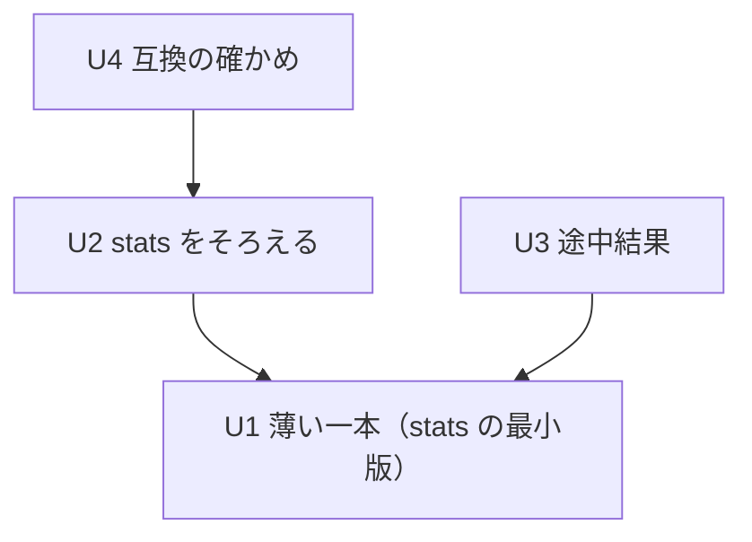

# Unit of Work Dependency — `stats` による集計と途中結果の表示（261025-insights-stats）

上流：`unit-of-work.md`、`inception/domain-design/components.md`（部品の依存）・`decisions.md`、`inception/requirements-analysis/requirements.md`。

この文書は依存の形だけを書く。どれから作るかは作る段階の計画で決める。

## 依存の一覧（機械可読）

```yaml
units:
  - name: u1-stats-skeleton
    kind: service
    depends_on: []
  - name: u2-stats-complete
    kind: library
    depends_on: [u1-stats-skeleton]
  - name: u3-partial-results
    kind: service
    depends_on: [u1-stats-skeleton]
  - name: u4-compat-stats
    kind: library
    depends_on: [u2-stats-complete]
```



文字による代替：U2 と U3 は U1 に依存する。U4 は U2 に依存する（矢印は「依存する」の向き）。U2 と U3 の間、U3 と U4 の間に依存はない。

## 依存の理由

| 依存 | 理由 |
|---|---|
| U2 → U1 | U2 は U1 が作る `CommandKind::Stats`・StatsAggregator・形つきの QueryResult・結果の表の形の分岐に、残りの関数と `sort`/`limit` の後置と一覧の一元化を足す |
| U3 → U1 | U3 は U1 が決めた形つきの QueryResult と結果の見出し・行のコマンドの上に、版と途中・最終・中断の印を足す（結果の型は U1 で固定し、U3 は差し替えの仕組みだけを足す） |
| U4 → U2 | U4 が比べるクエリには関数すべてと `stats` のあとの `sort`/`limit` が要る（FR7.2） |

## 作業単位の間のつなぎ目

| つなぎ目 | 作る作業単位 | 使う作業単位 | 中身 |
|---|---|---|---|
| 形つきの QueryResult（形・列の名前・行の列挙型。行はすべて写し） | U1（形は U1 で固定） | U2（集計の行の列と型を増やす）、U3（同じ runId の結果を版ごとに差し替える）、U4（集計の行を比べる） | ADR-001。U2・U3・U4 は形の内側の変更にとどめ、形そのものを変えない |
| 計画の型（`CommandKind::Stats`、集計の指定、`by` の鍵） | U1 | U2（関数と `sort`/`limit` の後置を足す）、U4 | ADR-002 |
| StatsAggregator の入口（塊ごとにイベントを受け取り、集計の行を返す） | U1 | U2（関数を足す）、U4（同じ整形で比べる） | ADR-002。関数ごとの累積は内側 |
| 結果の見出しと行のコマンド（形・列・件数） | U1 | U3（版を添え、版が進んだイベントを足す） | ADR-004 |
| QueryStore の view（最終の view） | 今のコード | U3（途中の view を足す） | ADR-003。確定の仕組みは変えない |
| QuerySink の契約 | 今のコード | U3（途中結果の通知を足す） | ADR-004。今の通知は変えない |
| 命令・関数の一覧（QueryCatalog） | U2 | U2 の中で QueryParser・InsightsSession・画面・README がそろう | ADR-005。U1 は今の `OTHER_COMMANDS`/`function()` に 5 つの関数を足すだけで、一元化は U2 |
| 書き出しの元（`ExportSnapshotSource::LogAnalytics`、形つき） | U1 | U3（中断後の結果も書き出せる） | FR3.4、FR5.2 |

## 並べて進められる組み合わせ

- U1 のあと、U2 と U3 は並べて進められる（Q3 A）。重なる部品は QueryEvaluator・InsightsSession・TauriApp・ApiBridge・QueryResultTable・LogAnalyticsPage・MessageCatalog だが、U2 が触るのは「列・関数・一覧」、U3 が触るのは「版・途中の view・印」で、どちらも U1 で固定した結果の形とコマンドの内側の変更にとどまる。
- U4 は U2 のあとで、U3 とは並べて進められる（U4 は最終結果だけを比べ、途中結果に依存しない）。
